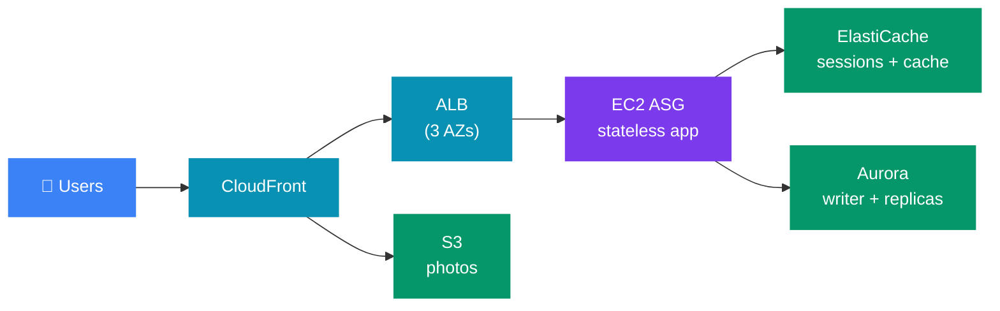
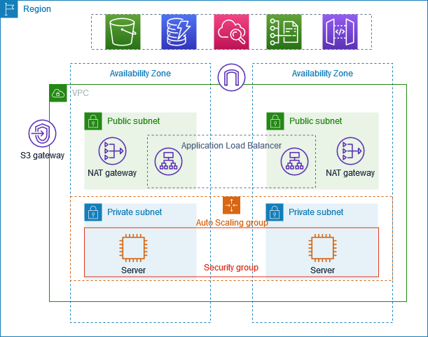
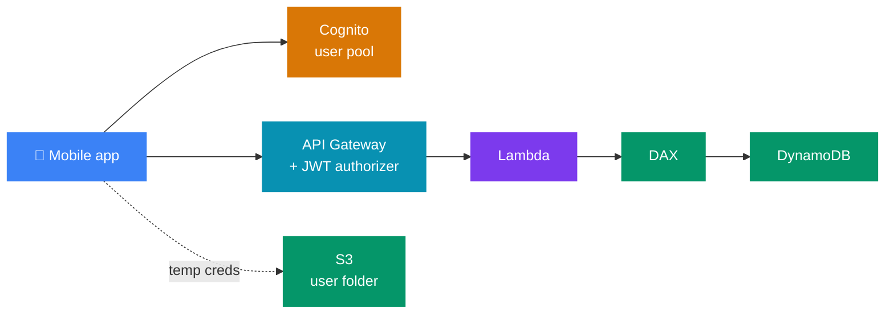
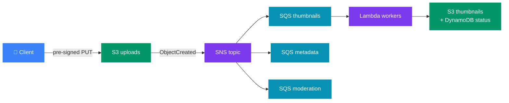
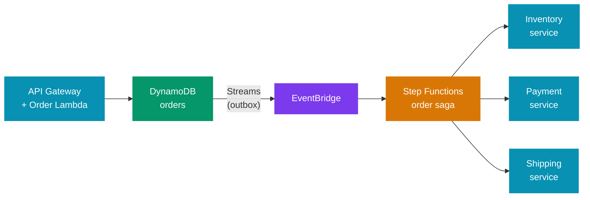
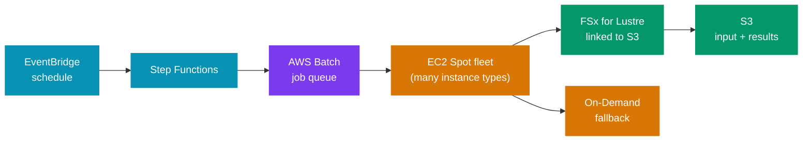
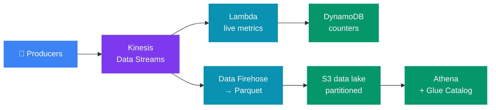
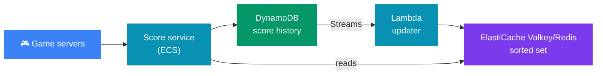
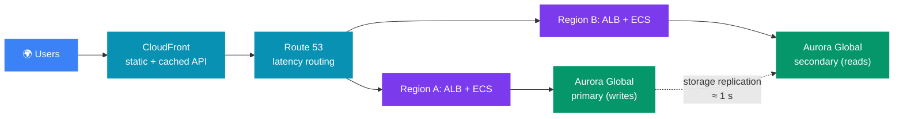

# 🏛️ AWS Reference Architectures — Interview Walk-Throughs

> 🧭 **AWS for system design** &nbsp;·&nbsp; 🔥🔥 Very High Priority &nbsp;·&nbsp; 💬 **11 Questions**

> _"Naming eight AWS services is not a design. A design says what each box does, where it breaks first, and what you would change when traffic grows ten times."_

---

🏛️ This file has **eight end-to-end AWS architectures**. Each one follows the order you would use in a system-design round: requirements → diagram → request flow → why each component → bottlenecks → failure modes → trade-offs and the 10x plan.

🔗 Each service is explained in depth in its own file. This file only shows **how they fit together**. Service files: [compute](./05_compute_and_scaling.md) · [storage](./09_storage.md) · [databases](./02_databases.md) · [caching and edge](./04_caching_and_edge.md) · [messaging](./03_messaging_and_streaming.md) · [networking](./07_networking.md) · [security](./08_security.md) · [observability](./10_observability.md) · [reliability and DR](./06_reliability_and_dr.md).

🔗 Generic designs (URL shortener, news feed, chat, payments) are in [`../../system-design/01_insider_guide_Alex_Xu/`](../../system-design/01_insider_guide_Alex_Xu/). This file stays AWS-specific.

---

📊 **Question Count**

| # | Section | Questions |
|---|---|---|
| 2 | [A1 — Stateful Web App: From One EC2 to Multi-AZ](#2-a1--stateful-web-app-from-one-ec2-to-multi-az) | 1 |
| 3 | [A2 — Serverless REST API](#3-a2--serverless-rest-api) | 2 |
| 4 | [A3 — Upload Fan-Out Pipeline (Thumbnails)](#4-a3--upload-fan-out-pipeline-thumbnails) | 2 |
| 5 | [A4 — Event-Driven Order Processing with a Saga](#5-a4--event-driven-order-processing-with-a-saga) | 1 |
| 6 | [A5 — Batch / HPC on Spot](#6-a5--batch--hpc-on-spot) | 1 |
| 7 | [A6 — High-Throughput Ingestion to a Data Lake](#7-a6--high-throughput-ingestion-to-a-data-lake) | 2 |
| 8 | [A7 — Real-Time Leaderboard and Session Store](#8-a7--real-time-leaderboard-and-session-store) | 1 |
| 9 | [A8 — Global, Low-Latency, Read-Heavy App](#9-a8--global-low-latency-read-heavy-app) | 1 |
| | **Total** | **11** |

> 🔥🔥 Very High — asked in almost every Tier-1 loop &nbsp;·&nbsp; 🔥 High — very frequent in Tier-1 interviews &nbsp;·&nbsp; ⚡ Medium — commonly asked &nbsp;·&nbsp; 💤 Low — good to know, rarely asked

---

## 📑 Table of Contents

1. [How to Walk Through Any Architecture](#1-how-to-walk-through-any-architecture)
2. [A1 — Stateful Web App: From One EC2 to Multi-AZ](#2-a1--stateful-web-app-from-one-ec2-to-multi-az)
3. [A2 — Serverless REST API](#3-a2--serverless-rest-api)
4. [A3 — Upload Fan-Out Pipeline (Thumbnails)](#4-a3--upload-fan-out-pipeline-thumbnails)
5. [A4 — Event-Driven Order Processing with a Saga](#5-a4--event-driven-order-processing-with-a-saga)
6. [A5 — Batch / HPC on Spot](#6-a5--batch--hpc-on-spot)
7. [A6 — High-Throughput Ingestion to a Data Lake](#7-a6--high-throughput-ingestion-to-a-data-lake)
8. [A7 — Real-Time Leaderboard and Session Store](#8-a7--real-time-leaderboard-and-session-store)
9. [A8 — Global, Low-Latency, Read-Heavy App](#9-a8--global-low-latency-read-heavy-app)
10. [Choosing Between Them](#10-choosing-between-them)

---

## 1. How to Walk Through Any Architecture

🧭 Use the same order every time. It keeps you calm and shows the interviewer a method.

1. 📏 **Requirements with numbers.** Read/write ratio, peak QPS (Queries Per Second), data size, latency target, RPO (Recovery Point Objective: how much recent data you can lose), RTO (Recovery Time Objective: how long the system can be down).
2. 🗺️ **Diagram.** At most 8 boxes. Name the AWS service on each box.
3. ➡️ **One request, end to end.** Follow a single write and a single read through the boxes.
4. ❓ **Why each box.** One line each, plus the option you rejected.
5. 📈 **What breaks first.** The first bottleneck as load grows, and the fix.
6. ⚠️ **Failure modes.** For each box: what happens when it fails, and who notices.
7. ⚖️ **Trade-offs and 10x.** What you gave up, and what you would change at 10x load.

> 💡 **Tip:** say the numbers that **drive** a choice. Example: "DynamoDB partitions cap at 1,000 WCU (Write Capacity Units), so my hot key needs write sharding." Do not recite numbers that change nothing.

---

## 2. A1 — Stateful Web App: From One EC2 to Multi-AZ

📈 This is the classic "WhatIsTheTime → MyClothes → MyWordPress" progression, told as one story.

🧩 **The prompt** is usually: _"Start small, then scale it."_

### Requirements

- 🛒 An e-commerce site with a shopping cart and user accounts. Users upload product photos.
- 📏 100 users today → 1 million users. Read-heavy (≈ 10:1).
- 🛡️ No lost carts when a server dies. Survive one AZ (Availability Zone) failure. RTO (Recovery Time Objective: how long the system can be down) is minutes. RPO (Recovery Point Objective: how much data you can lose) is ≈ 0 inside the Region.

### The evolution, step by step

| Stage | Change | ✅ Problem it solves | ⚠️ New problem it creates |
|---|---|---|---|
| 1 | One EC2 (Elastic Compute Cloud) + Elastic IP | It works | Single point of failure; vertical scaling needs downtime |
| 2 | Bigger instance | More capacity | Still one box; a hard upper limit |
| 3 | Several EC2s, DNS A records to each | More capacity | DNS TTL (Time To Live): users keep hitting a dead IP after an instance dies |
| 4 | **ALB** (Application Load Balancer) in front, instances in private subnets | Health checks remove bad instances; one DNS name | Cart lives in instance memory — lost when the user hits another instance |
| 5 | **ASG** (Auto Scaling Group) across **3 AZs** | Self-healing, scales with load, survives an AZ | Still stateful |
| 6 | Session in **ElastiCache**, not in memory | Any instance can serve any user; instances become disposable | Need a durable store for accounts and orders |
| 7 | **RDS (Relational Database Service) / Aurora Multi-AZ** + read replicas | Durable data; reads scale out | Photos on local EBS (Elastic Block Store) disks are not shared between instances |
| 8 | Photos in **S3**, served by **CloudFront** | Shared, durable, cheap, cached at the edge | — |

### Final diagram

> 🖼️ *Where each box lives in the network: the ALB and NAT gateways sit in public subnets, and the app servers of the Auto Scaling group sit in private subnets. The picture shows two AZs; this design uses three.* Source: [Example: VPC with servers in private subnets and NAT](https://docs.aws.amazon.com/vpc/latest/userguide/vpc-example-private-subnets-nat.html) · License: CC BY-SA 4.0

### Request flow — "add to cart"

1. 🌐 Route 53 alias → CloudFront → ALB (dynamic paths are not cached).
2. 🔀 ALB picks a healthy instance in any AZ (cross-zone load balancing is on by default for ALB).
3. 🗃️ The app reads the session ID from the cookie and loads the cart from ElastiCache.
4. 💾 It writes the updated cart back to ElastiCache with a TTL. On checkout, it writes the order to the Aurora writer in a transaction.
5. ⚡ Product pages read from ElastiCache first (lazy loading / cache-aside). On a miss they read an Aurora replica and fill the cache.

### Why each component

| Component | ✅ Why | ❌ Rejected option |
|---|---|---|
| 🌐 ALB | L7 routing, health checks, TLS termination, one stable endpoint | DNS round-robin — no health checks, TTL delays |
| 📈 ASG over 3 AZs | Self-healing + static stability (each AZ sized at 50% of peak) | 2 AZs — need 200% capacity to survive one AZ |
| 🗃️ ElastiCache sessions | Stateless app tier; fast | **ALB sticky sessions** — a dead instance still loses carts, and load becomes uneven. **Cookie-only state** — 4 KB limit, must be signed, sent on every request |
| 🗃️ Aurora | Multi-AZ storage (6 copies in 3 AZs), up to 15 replicas, fast failover | Self-managed MySQL on EC2 |
| 🪣 S3 + CloudFront for photos | Shared by all instances, 11 nines durability, edge cache | **EBS** — attached to one instance in one AZ. **EFS** (Elastic File System) — works (shared, Multi-AZ) but costs more per GB and is slower for serving images than CloudFront |

### Bottlenecks and how it scales

| 📈 As load grows | First bottleneck | Fix |
|---|---|---|
| More page views | Aurora reader CPU | Cache-aside in ElastiCache; add readers; CloudFront for semi-static pages |
| More logged-in users | ElastiCache memory | Cluster mode (shards); set TTLs |
| More checkouts | **Aurora single writer** | Bigger writer first; then split by domain (orders vs catalog); later shard or move hot tables to DynamoDB |
| Traffic spikes (sale) | ASG scale-out is slow (minutes) | Scheduled/predictive scaling before the sale; warm pools; keep 150% base capacity |

### Failure modes

| ⚠️ Failure | Effect | Fix |
|---|---|---|
| One instance dies | ALB health check removes it in ≈ 30 s; ASG replaces it | Stateless app, so no data lost |
| One AZ fails | Lose one third of instances, maybe the Aurora writer | Static stability (150%); Aurora fails over to a replica in another AZ (≈ 30 s or less) |
| ElastiCache node fails | Carts in that shard lost if no replica | Multi-AZ replica with auto failover; or keep carts in DynamoDB if they must survive |
| Cache cold after restart | All reads hit Aurora → overload | Warm the cache; request coalescing; rate-limit misses |
| Bad deploy | All instances broken | Rolling or blue/green deploy with automatic rollback on alarms |

### Trade-offs and the 10x plan

- ⚖️ **Trade-off:** ElastiCache adds a stateful tier you must size and monitor, but it makes the app tier disposable.
- 📈 **At 10x:**
  - Move to containers (ECS/EKS: Elastic Container Service / Elastic Kubernetes Service) for faster scaling.
  - Put the cart in DynamoDB (durable, scales writes).
  - Split the monolith by domain.
  - Aurora writer becomes the main risk — consider Aurora Limitless or sharding the orders table by customer.

> 🎤 **In the interview:** "I first make the app tier stateless: sessions go to ElastiCache and files to S3. Then any instance can serve any user, and an ASG across three AZs can replace instances freely. After that, the single Aurora writer is my bottleneck, and I plan around it."

🔗 Related: [`../../system-design/01_insider_guide_Alex_Xu/vol_1/ch01_scale_from_zero.md`](../../system-design/01_insider_guide_Alex_Xu/vol_1/ch01_scale_from_zero.md).

### Interview questions

1. **🔥🔥 Your web app on an ASG loses shopping carts whenever an instance is replaced. Sticky sessions are on. What is wrong, and what do you change?**

<!-- -->

Answer

⚠️ **What is wrong:** sticky sessions only send a user back to the same instance. When that instance dies, the cart dies with it. Stickiness also makes load uneven.

🧭 **What I change:**

- 🗃️ I would move session state out of the instance into ElastiCache, with a TTL and a Multi-AZ replica.
- 💾 If carts must survive everything, I would use DynamoDB.

✅ Then the app tier is stateless, and the ASG can replace instances freely.

---

---

## 3. A2 — Serverless REST API

📱 The "MyTodoList" mobile backend.

🧩 **The prompt:** _"Build a REST API for a mobile app with no servers to manage."_

### Requirements

- 📱 HTTPS REST API for a mobile app. Users sign in. Each user can also store files.
- 📈 Spiky traffic: near zero at night, 5,000 rps at peak. Read-heavy.
- ⚡ p99 latency < 200 ms for reads. Pay per use.

### Diagram

### Request flow — "list my todos"

1. 🔐 The app signs in to **Cognito user pool** and gets a JWT (JSON Web Token).
2. 🚪 It calls `GET /todos` on **API Gateway** with the JWT. The **Cognito authorizer** checks the token — Lambda is not invoked for a bad token.
3. 📏 API Gateway checks throttling (account and usage-plan limits), then the response cache.
4. ⚙️ On a cache miss, it invokes **Lambda**. Lambda runs `Query` on DynamoDB with `PK = USER#<id>` through **DAX** (DynamoDB Accelerator).
5. 🪣 For files, the app exchanges the JWT at a **Cognito identity pool** for temporary AWS credentials. An IAM (Identity and Access Management) policy limits them to the user's own S3 prefix. Upload goes straight to S3, not through Lambda.

### Why each component

| Component | ✅ Why | ❌ Rejected option |
|---|---|---|
| 🚪 API Gateway (REST API) | Auth, throttling, usage plans, caching, WAF (Web Application Firewall), request validation | **HTTP API** — cheaper and faster, but no response cache, no usage plans/API keys. Pick it if you do not need those. |
| 🔐 Cognito | Managed sign-up/sign-in, JWTs, federation | Own auth service — more code, more risk |
| ⚙️ Lambda | Scales to zero, pay per request | ECS Fargate — better for steady high traffic or long-lived connections |
| 🗃️ DynamoDB | Single-digit ms at any scale, on-demand capacity | RDS — connection limits with Lambda (needs RDS Proxy), harder to scale writes |
| ⚡ DAX | Microsecond reads for hot items; cuts RCU (Read Capacity Unit) cost | ElastiCache — more code (cache-aside logic in the app) |
| 🪣 Direct S3 upload with temp creds | Large files do not pass through API Gateway (10 MB limit) or Lambda (6 MB sync payload) | Upload through the API |

### Key limits that drive the design

| 📏 Limit | Value | Design effect |
|---|---|---|
| API Gateway throttle | 10,000 rps steady, 5,000 burst, per account per Region (soft) | Request an increase before launch; set per-client usage plans |
| API Gateway integration timeout | 29 s default (raisable for Regional/private REST APIs) | Long work must be async (return 202, process via SQS (Simple Queue Service)) |
| API Gateway payload | 10 MB | Files go direct to S3 |
| Lambda concurrency | 1,000 per Region default; each function scales by 1,000 every 10 s | One function can starve others → set **reserved concurrency** |
| Lambda sync payload | 6 MB request/response | Same as above |
| DynamoDB item | 400 KB | Large blobs go to S3, store the key |
| DynamoDB partition | 3,000 RCU / 1,000 WCU | Choose a high-cardinality partition key |

### Bottlenecks and how it scales

- 📏 **Concurrency = RPS (Requests Per Second) × duration.** 5,000 rps × 100 ms = 500 concurrent Lambdas. If DynamoDB slows to 1 s, the same traffic needs 5,000 — over the default quota. So latency of the dependency drives Lambda concurrency.
- ⚡ **Cold starts** hurt Java the most (often 1–3 s without help). Use **SnapStart** for Java, or provisioned concurrency for the hot path.
- ⚠️ **Hot partition** in DynamoDB: one very active user or a "global counter" item. Fix with write sharding (`PK = COUNTER#<n>`) or by aggregating in a stream.
- 💡 **Reads:** API Gateway cache (regional) for responses that are the same for everyone; DAX for per-user hot items.

### Failure modes

| ⚠️ Failure | Effect | Fix |
|---|---|---|
| Lambda throttled (concurrency limit) | 429/502 to clients | Reserved concurrency per function; quota increase; client backoff with jitter |
| DynamoDB throttles a hot key | Higher latency, errors | Better key design; on-demand mode (absorbs up to 2× the previous peak at once) |
| Cognito outage | No new sign-ins; existing JWTs still validate until expiry | Reasonable token lifetime; this is a regional dependency |
| Retry storm from the mobile app | Load multiplies | SDK backoff with jitter; idempotency key header on writes |
| Region outage | API down | DynamoDB Global Tables + API in a second Region + Route 53 latency routing with health checks |

### Trade-offs and the 10x plan

- ⚖️ **Trade-off:** no servers and pay-per-use, but cold starts, per-request cost at high steady traffic, and many service quotas to manage.
- 📈 **At 10x (50,000 rps steady):**
  - Lambda cost may pass container cost — consider moving the hot endpoints to ECS Fargate behind an ALB.
  - Put CloudFront in front for edge caching and TLS.
  - Ask for quota increases early.

> 🎤 **In the interview:** "API Gateway checks the Cognito token and throttles each client, so bad or abusive traffic never reaches Lambda. Lambda concurrency equals RPS times duration. So I keep DynamoDB fast with DAX. I also set reserved concurrency, so one function cannot starve the others."

### Interview questions

2. **🔥🔥 A Lambda behind API Gateway calls an RDS PostgreSQL database. At peak, the database runs out of connections. Why, and what are your options?**

<!-- -->

Answer

⚠️ **Why:** each concurrent Lambda environment opens its own connection, so 1,000 concurrent executions can mean 1,000 connections.

🧭 **Options:**

- 🗃️ Put **RDS Proxy** in front to pool and share connections.
- 📏 Cap the function with reserved concurrency.
- ⚡ Reduce concurrency by making each call faster.
- 🔀 Move the access pattern to DynamoDB, which has no connection limit.

✅ I would start with RDS Proxy and a concurrency cap.

---

3. **⚡ What is Amazon API Gateway, and when would you use it?**

<!-- -->

Answer

🚪 API Gateway is a managed front door for your APIs. It creates, publishes and secures **REST**, **HTTP** and **WebSocket** APIs. It handles the cross-cutting work — auth, throttling, TLS — so each backend service only does its own domain logic.

> 💡 **Key idea:** think of it as nginx + rate limiter + auth middleware + TLS termination, managed by AWS.

**Main features:**

- 🔐 **Auth** — Cognito / JWT authorizers, Lambda authorizers, IAM auth. API keys are REST API only.
- 📏 **Throttling** — per-stage and per-route limits. Per-client quotas through **usage plans** are REST API only.
- 🔄 **Transformation** — mapping templates and request validation (REST API only).
- 🐤 **Canary deployments** — send a percentage of traffic to a new deployment (REST API only).
- 🔭 **Monitoring** — CloudWatch metrics and access logs.

| Type | Protocol | Best for |
|---|---|---|
| 🚪 **REST API** | HTTPS | Full feature set: usage plans, WAF, caching, private endpoints |
| ⚡ **HTTP API** | HTTPS | Low cost, low latency. AWS quotes **up to 71% lower cost** and **up to 60% lower latency** than REST API |
| 🔌 **WebSocket API** | WebSocket | Real time: chat, notifications, live dashboards |

> ⚠️ **Trap:** do not swap the two numbers: **71% is cost**, **60% is latency**.

🧭 **Decision rule:** default to **HTTP API**. Pick REST API only when you need a feature it lacks — usage plans and WAF are the two that force this most often. A2 picks REST API for exactly those reasons (see [Why each component](#why-each-component-1)).

📏 **Limits that shape the design** (full list in [Key limits](#key-limits-that-drive-the-design)):

- ⏱️ **Integration timeout:** 29 s default for REST APIs. Since June 2024 you can raise it, but only for Regional and private REST APIs, and it may lower your account throttle quota. For HTTP APIs, **30 s** is a hard limit. So long work returns `202 Accepted` with a job ID and runs async (SQS + worker).
- 📦 **Payload: 10 MB**, not raisable. Big files go straight to S3 with a pre-signed URL.

🌐 **Private backends:** API Gateway reaches an internal ALB or NLB (Network Load Balancer) through a **VPC (Virtual Private Cloud) link**.

- REST APIs could link only to an **NLB** for years.
- Since Nov 2025 they can link **directly to an ALB** (VPC link V2).
- HTTP APIs could always do that.

---

---

## 4. A3 — Upload Fan-Out Pipeline (Thumbnails)

🧩 **The prompt:** _"Users upload photos. Make thumbnails, extract metadata, and scan for bad content."_

### Requirements

- 📏 1 million uploads a day (≈ 12/s average, 200/s peak). Files up to 50 MB.
- ⚡ Thumbnails ready within a few seconds. Each processing step must be independent — a slow moderation step must not delay thumbnails.
- 🔁 No upload is lost; every step can be retried.

### Diagram

_Q2 and Q3 have their own workers too; they are left out to keep the diagram small._

### Request flow

1. 🔒 The client asks the API for an upload URL. The API returns an **S3 pre-signed PUT URL** (short expiry, fixed key like `uploads/<userId>/<uuid>.jpg`).
2. 🪣 The client uploads straight to S3 (multipart for large files).
3. 📨 S3 sends an `ObjectCreated` event to an **SNS (Simple Notification Service) topic**.
4. 📨 SNS **fans out** the event to three **SQS queues**, one per step.
5. ⚙️ Each queue has its own **Lambda** consumer (event source mapping). The thumbnail worker reads the original, writes resized images to the output bucket, and updates status in DynamoDB.
6. 🔔 The client polls a status endpoint, or gets a push notification when all steps finish.

### Why each component

| Component | ✅ Why | ❌ Rejected option |
|---|---|---|
| 🔒 Pre-signed URL | Big files skip your API; S3 handles the bandwidth | Upload via API Gateway — 10 MB limit, pays for Lambda time |
| 📨 SNS → SQS fan-out | One event, many independent consumers; each queue buffers and retries on its own | **S3 → Lambda directly** — no buffer, and only one consumer per event type/prefix. **App writes to 3 queues** — if it crashes midway, some queues miss the event. |
| 📨 SQS per step | Each step scales, fails and retries alone; DLQ (Dead-Letter Queue) per step | One shared queue — a slow step blocks others |
| ⚙️ Lambda workers | Scale with queue depth; no servers | ECS workers — better for long jobs (> 15 min) or heavy native libraries |
| 🪣 Separate output bucket | An event on the output bucket cannot trigger the pipeline again (no infinite loop) | Same bucket with prefix filters — works, but easy to get wrong |

🧭 **EventBridge instead of SNS?**

- ✅ S3 can send events to **EventBridge**. Use it when you need rich filtering (by size, key pattern, metadata), many target types, or **archive and replay**.
- ⚖️ SNS is simpler and has higher throughput for plain fan-out.

### Key numbers and settings

| Setting | 📏 Value | Why |
|---|---|---|
| S3 request rate | 3,500 writes and 5,500 reads per second **per prefix** | Spread keys over prefixes at very high rates |
| SQS visibility timeout | ≥ **6 ×** the Lambda timeout (AWS guidance) | Stops a second worker from picking up a message still being processed |
| SQS `maxReceiveCount` → DLQ | e.g. 5 | A poison image does not loop forever |
| SQS retention | 4 days default, up to 14 days | Time to fix a broken worker before messages expire |
| Message size | SQS: 1 MiB (raised from 256 KiB in Aug 2025). SNS: 256 KiB by default. Since Sep 2026 a topic can opt in to 1 MiB if it has ≤ 100 subscriptions, all SQS, Lambda or Firehose. So the fan-out message is 256 KiB by default, 1 MiB with opt-in | Images are up to 50 MB, so send the S3 key, not the image (claim check) |
| Lambda timeout | Max 15 min | Video transcoding needs ECS/Batch or MediaConvert |

### Bottlenecks and how it scales

- ⚙️ **Lambda concurrency per queue:** set **maximum concurrency** on each event source mapping. Then a burst of uploads cannot use all account concurrency and starve the API.
- 📨 **Downstream limits:** moderation may call a third-party API with a rate limit. The SQS queue absorbs the burst. The consumer's max concurrency matches the partner's limit.
- 📦 **Large files:** memory and `/tmp` space (up to 10 GB each) in Lambda. Past that, move to ECS.

### Failure modes

| ⚠️ Failure | Effect | Fix |
|---|---|---|
| Duplicate events (S3 and SQS are at-least-once) | Thumbnail made twice | Idempotent worker: output key is derived from input key; write is a safe overwrite |
| Corrupt image | Worker fails every time | DLQ after N tries; alarm on DLQ depth; redrive after the fix |
| S3 event is late (rarely, a minute or more) | Thumbnail is late | Acceptable here; for strict needs, also enqueue from the API after upload |
| Worker bug deployed | All messages fail and go to DLQ | Alarm on DLQ; fix and **redrive** — no data lost |
| Event for an object that was deleted | Worker gets 404 | Treat as success and skip |

### Trade-offs and the 10x plan

- ⚖️ **Trade-off:** eventual completion — the user sees "processing" for a few seconds. In return, each step is isolated and retried on its own.
- 📈 **At 10x (2,000 uploads/s peak):**
  - S3 prefixes by hash.
  - SQS scales without change.
  - Set Lambda concurrency caps per queue.
  - Consider S3 → EventBridge → SQS for filtering.
  - Move heavy steps to Fargate or AWS Batch.

> 🎤 **In the interview:** "The client uploads to S3 with a pre-signed URL. S3 emits one event to SNS, and SNS fans it out to a queue per step. Each step scales, fails and retries on its own, with its own DLQ. Workers are idempotent because S3 and SQS can deliver twice."

### Interview questions

4. **🔥 In the thumbnail pipeline, why SNS → SQS instead of S3 → Lambda directly?**

<!-- -->

Answer

- ❌ **S3 → Lambda** gives one consumer per event type and prefix, and no buffer.
- ✅ **SNS → SQS:** one event fans out to several independent queues — thumbnails, metadata, moderation. Each queue buffers bursts, retries on its own, and has its own DLQ. So a slow or broken step does not affect the others.
- 💡 The publisher sends one message, so it cannot half-succeed like an app writing to three queues.

---

5. **🔥🔥 Your SQS-triggered Lambda processes some messages twice. Why, and how do you fix it?**

<!-- -->

Answer

⚠️ **Why:** SQS standard is at-least-once. Also, the visibility timeout may be shorter than the processing time. Then the message becomes visible again, and a second worker picks it up.

🧭 **Fixes:**

- ⏱️ Set the visibility timeout to at least 6× the function timeout.
- 🔁 Return partial batch failures, so only the failed messages retry.
- 🔑 Make the worker idempotent — use a deterministic output key or a conditional write on a message ID.

---

---

## 5. A4 — Event-Driven Order Processing with a Saga

🧩 **The prompt:** _"Place an order: reserve stock, charge payment, arrange shipping. Services are separate. No distributed transaction."_

### Requirements

- 🧩 Order, Inventory, Payment and Shipping are separate services with separate databases.
- ↩️ If payment fails, release the stock. If shipping fails, refund the payment.
- 💰 Never charge twice.
- 📏 500 orders/s peak. The user gets an answer in under 1 s ("order accepted"), and the final state within seconds.

### Diagram

### Request flow

1. 🔑 `POST /orders` with an **idempotency key**. The Order Lambda writes the order with status `PENDING`. It uses a conditional put (`attribute_not_exists`), so a retried request does not create a second order. It returns **202 Accepted**.
2. 📨 **DynamoDB Streams** picks up the new item. **EventBridge Pipes** turns it into an `OrderPlaced` event on an EventBridge bus. This is the **transactional outbox**. The event comes from the same write as the order. So you can never save the order and lose the event.
3. ⚙️ An EventBridge rule starts a **Step Functions Standard** workflow — the **saga orchestrator**.
4. ➡️ The saga calls `ReserveStock` → `ChargePayment` → `CreateShipment`. Each step passes the order ID as an idempotency key.
5. ↩️ If a step fails after retries, the `Catch` runs **compensations** in reverse: `RefundPayment` → `ReleaseStock`, then sets the order to `FAILED`.
6. ✅ On success, the saga sets `CONFIRMED` and emits `OrderConfirmed`. Email, analytics and loyalty services subscribe to it on EventBridge — the saga does not need to know them.

### Why each component

| Component | ✅ Why | ❌ Rejected option |
|---|---|---|
| 🧭 Step Functions (orchestration) | Saga state, retries with backoff, compensations and history are visible in one place | **Choreography only** (each service reacts to events) — fine for 2–3 steps. With more steps, the flow is hidden across services and hard to debug |
| ⚙️ **Standard** workflow | Up to 1 year, **exactly-once** step execution, full history; good for business processes | **Express** — up to 5 min, at-least-once, cheaper for high-volume short flows |
| 📨 EventBridge | Content-based routing, many targets, archive + replay, schema registry | SNS — simpler fan-out, no replay, weaker filtering |
| 🗃️ DynamoDB Streams → Pipes (outbox) | Order write and event cannot get out of sync | Lambda writes DB **and** publishes — a crash between the two loses the event |
| 🔑 Idempotency keys everywhere | Every step can be retried safely | Hoping retries never happen |

### Key numbers

| Item | 📏 Value |
|---|---|
| Step Functions Standard max duration | 1 year |
| Step Functions Express max duration | 5 minutes |
| Execution history limit (Standard) | 25,000 events — use child workflows for long loops |
| EventBridge target retries | Up to 24 hours and 185 attempts by default, then the target's DLQ |
| EventBridge max event size | 1 MB (raised from 256 KiB in Jan 2026) — put larger data in S3 or DynamoDB and send the key |
| DynamoDB Streams retention | 24 hours |

### Bottlenecks and how it scales

- 📏 **Step Functions Standard** has per-account rate limits on starting executions and on state transitions. At very high volume, use **Express** for short sub-flows, or batch.
- 📨 **Payment provider rate limit:** put an SQS queue in front of the payment worker. Use the **callback pattern** (`.waitForTaskToken`), so the saga waits without polling.
- ⚠️ **Hot item in inventory** (a flash sale on one product): conditional decrements on one DynamoDB item hit the 1,000 WCU partition limit. Split the stock into N buckets, or pre-allocate tokens.

### Failure modes

| ⚠️ Failure | Effect | Fix |
|---|---|---|
| Payment times out — unknown if charged | Danger of double charge or lost money | Idempotency key at the provider; on timeout, **query** the payment status before retrying or refunding |
| A compensation fails | Stock stays reserved, or money not refunded | Retry compensations with backoff; alert a human after N tries; compensations must be idempotent |
| Duplicate `OrderPlaced` event (at-least-once) | Two sagas for one order | Start the execution with **name = order ID** — Step Functions rejects a duplicate name for Standard workflows |
| Consumer down | Events pile up | EventBridge retries for 24 h, then DLQ; archive allows replay |
| User reads order right after placing it | Sees `PENDING` | Expected; show progress in the UI |

### Trade-offs and the 10x plan

- ⚖️ **Trade-off:** eventual consistency. The user gets "accepted", not "confirmed", and the system must handle compensations. In return, no distributed lock and no 2PC across services.
- 📈 **At 10x (5,000 orders/s):**
  - Use Express workflows for the fast path (reserve + charge) and Standard only for long steps (shipping).
  - Partition stock buckets.
  - Move the payment queue to FIFO (First In, First Out) per customer if order matters.

> 🎤 **In the interview:** "The order write and the event come from one DynamoDB write through Streams — that is my outbox. A Step Functions Standard workflow runs the saga, and each step has a compensation in its Catch. Every call carries the order ID as the idempotency key, so retries are always safe."

🔗 Related: [`../../system-design/01_insider_guide_Alex_Xu/vol_2/ch11_payment_system.md`](../../system-design/01_insider_guide_Alex_Xu/vol_2/ch11_payment_system.md).

### Interview questions

6. **🔥🔥 Design order placement across Inventory, Payment and Shipping without 2PC.**

<!-- -->

Answer

🧭 I use a saga.

- 🗃️ The Order Lambda writes the order to DynamoDB with an idempotency key.
- 📨 Streams + EventBridge Pipes publish `OrderPlaced`. This is the outbox, so the write and the event cannot get out of sync.
- ⚙️ A Step Functions Standard workflow reserves stock, charges payment, creates shipment.
- ↩️ Each step has a compensation in a Catch: refund, then release stock.
- 🔑 The execution name is the order ID, so a duplicate event cannot start a second saga.
- ✅ The user gets 202 and sees status updates.

---

---

## 6. A5 — Batch / HPC on Spot

🧩 **The prompt:** _"Run a nightly risk calculation over 50 TB of data as cheaply as possible, finished by 6 AM."_

### Requirements

- 📏 50 TB input in S3. About 100,000 independent tasks, each 2–10 minutes.
- ⏱️ Must finish in a 6-hour window.
- 💰 Lowest possible cost.
- ⚠️ Some jobs are **tightly coupled** (nodes talk to each other) — most are not.

### Diagram

### Request flow

1. ⏱️ An **EventBridge schedule** starts a Step Functions workflow at 11 PM.
2. ⚙️ The workflow submits an **AWS Batch array job**. One parent has up to 10,000 child jobs, so use several arrays for 100,000 tasks.
3. 💰 Batch places jobs on a **Spot** compute environment with many instance types and the price-capacity-optimized allocation strategy. A second, **On-Demand** compute environment in the same job queue takes over if Spot capacity is short.
4. 🗃️ Workers read input through **FSx for Lustre**, which lazy-loads files from S3 and serves them at very high throughput. Results go back to S3.
5. 🔁 Each task writes a **checkpoint**. On a Spot interruption, Batch retries the task, and it resumes from the checkpoint.
6. ✅ When all tasks finish, the workflow runs the aggregation step and notifies the team.

### Why each component

| Component | ✅ Why | ❌ Rejected option |
|---|---|---|
| ⚙️ AWS Batch | Managed queue, scheduling, retries, array jobs; you pay only for EC2 | Self-managed scheduler on EC2 |
| 💰 Spot instances | Up to **90%** cheaper than On-Demand | All On-Demand — safe but 3–10× the cost |
| 📈 Many instance types | Bigger Spot pool → fewer interruptions | One instance type — capacity runs out |
| 🗃️ FSx for Lustre | Shared POSIX file system, hundreds of GB/s, millions of IOPS (Input/Output Operations Per Second), linked to S3 | Every worker downloads from S3 — fine for small inputs, slow and repetitive for shared data; **EFS** — lower throughput for HPC (High-Performance Computing) |
| 🧭 Step Functions | Orchestrates stages, handles the "all done" barrier | Cron on an EC2 box |

⚠️ **Tightly coupled jobs** (MPI (Message Passing Interface), nodes exchange data every step) need two things:

- 🧱 **First,** a **cluster placement group** (same rack area, lowest latency).
- ⚡ **Second,** **EFA** (Elastic Fabric Adapter, OS-bypass networking for MPI on Linux).

> ❌ **Bad fit for Spot:** these jobs are poor fits for Spot — one interruption stops the whole job. Run them On-Demand, or with frequent checkpoints.

💡 **AWS ParallelCluster** builds this kind of cluster for you.

### Bottlenecks and how it scales

- 📈 **Spot capacity** in one AZ/instance type → spread over all AZs and 10+ instance types.
- 🗃️ **Storage throughput** → FSx for Lustre throughput grows with its size. Or partition the S3 input, so each worker reads its own slice.
- 📏 **Service quotas:** vCPU quotas for Spot and On-Demand. Raise them before the first big run.

### Failure modes

| ⚠️ Failure | Effect | Fix |
|---|---|---|
| Spot interruption (2-minute notice) | Task killed | Checkpoint to S3/FSx; Batch retry strategy (`attempts` > 1); handle the rebalance signal early |
| Spot capacity unavailable | Jobs wait in `RUNNABLE` | On-Demand compute environment as the second choice in the job queue |
| One bad input file | Task fails every time | Limit retries; write failed IDs to a list; do not fail the whole run |
| Run will miss 6 AM | Late report | Alarm on progress rate at 3 AM; automatically add On-Demand capacity |

### Trade-offs and the 10x plan

- ⚖️ **Trade-off:** much cheaper, but the run time is less predictable, and you must write checkpoint and retry logic.
- 📈 **At 10x (500 TB):**
  - Split by date or region and run in parallel.
  - Parquet and partitioned input so tasks read less.
  - Consider EMR (Elastic MapReduce)/Spark (also on Spot) if the work is really a big data job, not independent tasks.

> 🎤 **In the interview:** "The tasks are independent. So I run them as AWS Batch array jobs on Spot, across many instance types. On-Demand is the fallback in the same queue. Every task checkpoints, so an interruption only costs a few minutes of work."

### Interview questions

7. **⚡ A nightly batch on Spot sometimes misses its deadline. What do you change?**

<!-- -->

Answer

- 📈 Spread across many instance types and all AZs, using price-capacity-optimized allocation, so Spot capacity is easier to get.
- 🛡️ Add an On-Demand compute environment as the second choice in the Batch job queue.
- 🔁 Make tasks checkpoint so interruptions lose little work.
- 🔭 Add an alarm on progress mid-way that adds On-Demand capacity if the run is behind.
- 📏 And raise vCPU quotas ahead of time.

---

---

## 7. A6 — High-Throughput Ingestion to a Data Lake

🧩 **The prompt:** _"Collect clickstream events from apps and websites. Show some live metrics, and let analysts query months of history."_

### Requirements

- 📏 100,000 events/s at peak, ≈ 1 KB each → ≈ 100 MB/s.
- ⚡ Live dashboards within seconds. Ad-hoc SQL on 12 months of data.
- 🧭 Ordering only matters per user session. Losing a few events is not acceptable.

### Diagram

### Request flow

1. 📨 Producers send batches to **Kinesis Data Streams** with `PutRecords`. The **partition key** is the session ID, so one session's events stay in order on one shard. (Browsers send through API Gateway or a small ingest service; they must not hold AWS keys.)
2. ⚙️ **Lambda** reads each shard in batches and updates per-minute counters in DynamoDB for the live dashboard.
3. 🪣 **Data Firehose** reads the same stream and buffers it. It converts JSON to **Parquet** using a Glue table schema. It writes to S3 with **dynamic partitioning**, like `dt=2026-10-31/hour=14/`.
4. 📊 Analysts query with **Athena**. The Glue Data Catalog holds the schema and partitions.

### Why each component

| Component | ✅ Why | ❌ Rejected option |
|---|---|---|
| 📨 Kinesis Data Streams | Ordered per shard, replay (retention), many consumers on one stream | **SQS** — no replay, no multiple independent readers of the same data. **MSK (Managed Streaming for Apache Kafka)** — choose it if the team already runs Kafka or needs Kafka tools; more to operate |
| ⚙️ Lambda consumer | Simple real-time processing, scales per shard | Managed Apache Flink — choose it for windowed joins and complex stateful streaming |
| 📨 Data Firehose | Fully managed delivery to S3 with buffering, compression and format conversion | Own consumer writing many small files |
| 🪣 Parquet + partitions | Athena bills per TB **scanned**; columnar + partitions often cut scanned data by 90% or more | Raw JSON — slow and costly to query |
| 📊 Athena | Serverless SQL on S3; no cluster | Redshift — choose it for heavy, frequent BI (Business Intelligence) queries and joins |

### Key numbers

| Item | 📏 Value | Design effect |
|---|---|---|
| Shard write limit | **1 MB/s or 1,000 records/s** | 100 MB/s needs **≥ 100 shards** (plus headroom) — or use **on-demand mode** |
| Shard read limit (shared) | 2 MB/s across all standard consumers | Two consumers share it; use **enhanced fan-out** (2 MB/s per consumer per shard) for more readers |
| Max record size | 1 MB | Large payloads go to S3 |
| Retention | 24 h default, up to 365 days | Long enough to replay after a consumer bug |
| Firehose buffer | 1–128 MB or 0–900 s | Bigger buffers → fewer, larger S3 files (Athena likes files of ≈ 128 MB+) |
| Lambda per shard | Batch size, **parallelization factor up to 10** | More throughput per shard while keeping per-key order |

### Bottlenecks and how it scales

- ⚠️ **Hot shard:** one partition key with huge traffic (a bot, a viral page). Add a random suffix to spread it, or aggregate at the producer (KPL (Kinesis Producer Library) aggregation).
- 🪣 **Small files in S3:** many tiny files make Athena slow. Increase the Firehose buffer, or run a compaction job.
- 🔍 **Consumer lag** (`IteratorAge` metric rising): add shards, raise Lambda parallelization factor, or use enhanced fan-out.

### Failure modes

| ⚠️ Failure | Effect | Fix |
|---|---|---|
| Poison record in Lambda | **The shard stops** — Lambda retries the same batch until the record expires | `BisectBatchOnFunctionError`, `MaximumRetryAttempts`, on-failure destination (SQS/S3) |
| Throttling on put (`ProvisionedThroughputExceeded`) | Producer errors | Producer retries with backoff and jitter; more shards; on-demand mode |
| Firehose cannot write | Data waits in Firehose up to 24 h, then goes to an error prefix | Alarm on delivery errors; S3 error output |
| Duplicate records (producer retries) | Double counts | Event ID in each record; dedupe in the query or in the counter update |
| Schema change from producers | Parquet conversion fails | Schema registry; version field; route bad records to an error prefix |

### Trade-offs and the 10x plan

- ⚖️ **Trade-off:** Firehose is near-real-time (buffered), not instant; the live path goes through Lambda instead. Athena is cheap for occasional queries but slow for dashboards with many users.
- 📈 **At 10x (1 GB/s):**
  - 1,000+ shards or on-demand.
  - Enhanced fan-out.
  - Consider MSK if you need Kafka-level control.
  - Use Managed Flink for live aggregation.
  - Add Iceberg tables in S3 for updates and compaction.
  - Redshift or a serving store for dashboards.

> 🎤 **In the interview:** "Kinesis is my buffer and replay log. The partition key is the session ID, so order is kept where it matters. One consumer feeds live counters, and Firehose writes partitioned Parquet to S3 for Athena. I size shards from the 1 MB/s write limit."

🔗 Related: [`../../system-design/01_insider_guide_Alex_Xu/vol_2/ch06_ad_click_event_aggregation.md`](../../system-design/01_insider_guide_Alex_Xu/vol_2/ch06_ad_click_event_aggregation.md).

### Interview questions

8. **🔥 Your Kinesis → Lambda consumer has `IteratorAge` growing for one shard only. What is happening?**

<!-- -->

Answer

🔍 **There are two likely causes:**

- 📈 The shard may be hot: one partition key has much more traffic.
- ⚠️ Or Lambda keeps failing on a poison record, so it retries the same batch and blocks the shard.

🧭 **Fixes:**

- ☠️ **For a poison record:** turn on `BisectBatchOnFunctionError`, limit `MaximumRetryAttempts`, and send failures to an on-failure destination.
- 🔀 **For a hot key:** add a suffix to the partition key. Or raise the parallelization factor (up to 10 per shard); per-key order is kept.

---

9. **🔥 How do you size a Kinesis stream for 50,000 events/s of 2 KB each?**

<!-- -->

Answer

📏 That is 100 MB/s in. Each shard takes 1 MB/s or 1,000 records/s.

| Sized by | Shards I need |
|---|---|
| Bytes | 100 |
| Records | 50 |

- ✅ Bytes win, so 100 shards, plus about 30% headroom → 130 shards.
- 💡 If traffic is unpredictable, I use on-demand mode instead.
- 📖 For reads, two consumers share 2 MB/s per shard; with more consumers I use enhanced fan-out.

---

---

## 8. A7 — Real-Time Leaderboard and Session Store

🧩 **The prompt:** _"A game with 10 million players. Show the top 100 and each player's rank in real time."_

### Requirements

- 📏 10 million active players; 50,000 score updates/s at peak.
- ⚡ Read: top 100, and "my rank" plus the players around me. Latency < 10 ms.
- 💾 Scores must not be lost. The leaderboard resets every season.

### Diagram

### Request flow

1. 🎮 A match ends. The game server calls the score service with a match ID (idempotency key).
2. 🗃️ The service writes the score event to **DynamoDB** (source of truth). It uses a conditional put on the match ID, so a retry is not counted twice.
3. ⚙️ **DynamoDB Streams** triggers a Lambda that runs `ZINCRBY leaderboard:season42 <points>
   <playerId>` on the **sorted set**.
4. 🏆 Read "top 100": `ZREVRANGE leaderboard:season42 0 99 WITHSCORES`.
5. 📍 Read "my rank": `ZREVRANK` then `ZREVRANGE` for the players around that rank.

🗃️ **Session store** uses the same cluster with a different key space: `session:<id>` as a hash with a TTL. This is the same pattern as A1.

### Why each component

| Component | ✅ Why | ❌ Rejected option |
|---|---|---|
| 🏆 Sorted set | Insert/update and rank in **O(log N)**; range read in O(log N + M) | SQL `ORDER BY score LIMIT 100` + `COUNT(*) WHERE score > x` — too slow at 10 M rows and 50k updates/s |
| 🗃️ ElastiCache (Valkey/Redis OSS) | In-memory, sub-ms, Multi-AZ with auto failover | **Memcached** — no sorted sets, no replication |
| 🗃️ DynamoDB as source of truth | Durable; can **rebuild** the sorted set if the cache is lost | Cache only — lose the leaderboard on a failure |
| 📨 Streams → Lambda | Cache updates are decoupled and retried | Dual write from the service — cache and DB can diverge |

🧭 **MemoryDB instead?**

- 🗃️ MemoryDB is Redis/Valkey-compatible with a **durable Multi-AZ transaction log**.
- ✅ It can be the primary database for the leaderboard, removing DynamoDB from the path.
- ⚖️ Writes are a little slower (single-digit ms). Choose it if you want one store and can accept that.

### Bottlenecks and how it scales

- ⚠️ **One sorted set = one key = one shard.** In cluster mode, a key cannot be split. 10 M members fit in memory easily (≈ 1 GB). But 50k writes/s on one key all go to **one node's CPU**. Redis-compatible engines run commands mostly on one thread per node.
- 🧭 **Fixes:**
  - Batch updates in the Lambda (one pipeline per batch).
  - Shard by bracket/region (`leaderboard:season42:asia`).
  - Merge the top-K of each shard for the global top 100.
  - Serve reads from replicas.
- ⚡ **Top 100 read traffic:** cache the result for 1 s in the app or at the edge — everyone sees the same list.

### Failure modes

| ⚠️ Failure | Effect | Fix |
|---|---|---|
| Primary node fails | Short write outage until a replica is promoted | Multi-AZ with auto failover; Lambda retries from the stream |
| Whole cache lost | Leaderboard empty | Rebuild from DynamoDB (scan or an export to S3, then bulk load); MemoryDB avoids this |
| Duplicate stream events | Score added twice | Conditional put on match ID in DynamoDB **before** the stream; idempotent updater |
| Memory full | Evictions or write errors | `noeviction` for the leaderboard key; alarms on memory; expire old season keys |
| Ties | Unstable ordering | Encode a tie-breaker in the score (for example, score × 10¹⁰ − timestamp) |

### Trade-offs and the 10x plan

- ⚖️ **Trade-off:** two stores to keep in sync, in return for sub-ms reads and a durable source of truth.
- 📈 **At 10x (100 M players, 500k updates/s):**
  - Shard leaderboards by region or bracket.
  - Global top K computed from per-shard top K.
  - Approximate rank (percentile buckets) for players far from the top — nobody needs to know they are rank 48,213,007 exactly.

> 🎤 **In the interview:** "The sorted set gives rank in O(log N). DynamoDB is the source of truth, and Streams update the cache. So I can rebuild the leaderboard if the cache is lost. One sorted set lives on one node. At very high write rates I shard by region and merge the top-K lists."

🔗 Related: [`../../system-design/01_insider_guide_Alex_Xu/vol_2/ch10_real_time_gaming_leaderboard.md`](../../system-design/01_insider_guide_Alex_Xu/vol_2/ch10_real_time_gaming_leaderboard.md).

### Interview questions

10. **🔥 The leaderboard's Redis primary is at 100% CPU, but memory is only 20% used. Why, and how do you scale?**

<!-- -->

Answer

⚠️ **Why:** all updates hit one sorted set key, and one key lives on one shard. Redis-compatible engines run commands mostly on a single thread per node. So CPU on that one node is the limit. Adding shards does not help one key.

🧭 **My fixes:**

- 📦 Batch updates (pipelines).
- 📖 Serve reads from replicas.
- ⚡ Cache the top 100 for a second.
- 🔀 Shard the leaderboard by region or bracket, and merge the top-K lists.

---

---

## 9. A8 — Global, Low-Latency, Read-Heavy App

🧩 **The prompt:** _"Users in India, Europe and the US. Product pages must load fast everywhere, and the app must survive a Region outage."_

### Requirements

- 📏 Read:write ≈ 100:1. Reads p99 < 100 ms in every continent.
- ⏱️ Writes (orders, profile changes) can take 200–300 ms.
- 🛡️ Survive a full Region outage with RTO of minutes and RPO of seconds.

### Diagram

_A third Region is the same as Region B. Static assets in S3 replicate with CRR (Cross-Region Replication)._

### Request flow

1. ⚡ **Static assets and cacheable API responses** (product pages, catalog) are served from **CloudFront** edge locations. Most reads end here.
2. 🌐 Cache misses and dynamic calls go to the origin domain. **Route 53 latency-based routing** with health checks sends them to the nearest healthy Region.
3. 📖 **Reads** are served by that Region's Aurora replica (read local). Data is at most about one second old.
4. ✍️ **Writes** go to the Aurora **primary** Region. Either the secondary uses **write forwarding**, or write APIs call the primary Region's endpoint.
5. 🛒 **Session and cart data** must be writable everywhere. They live in **DynamoDB Global Tables** (write local; last-writer-wins is fine for a cart).

### Why each component

| Component | ✅ Why | ❌ Rejected option |
|---|---|---|
| 🌐 CloudFront | Cuts latency for most reads; absorbs spikes; shields origins; WAF at the edge | Serve all reads from the Regions |
| 🌐 Route 53 latency routing + health checks | Nearest healthy Region per user | **Global Accelerator** — 2 static anycast IPs, TCP/UDP, fast failover without DNS caching; better for non-HTTP or when clients cannot handle DNS changes |
| 🗃️ Aurora Global Database | Relational data, < 1 s lag, failover < 1 min | **DynamoDB Global Tables everywhere** — great if the data model is key-value and LWW (Last-Writer-Wins) is fine; not for relational orders |
| 🗃️ DynamoDB Global Tables for carts/sessions | Write local in every Region | Aurora write forwarding for every cart click — adds cross-Region latency to each click |
| 🪣 S3 CRR | Origin assets available in each Region | One bucket — a Region outage takes away the CloudFront origin (use an origin group for failover) |

### Bottlenecks and how it scales

- ⚠️ **Write latency** for far users: every write crosses to the primary. Fix with write partitioning (home Region per user), or move write-heavy entities to DynamoDB Global Tables.
- 💡 **Cache hit ratio** is the main lever on cost and latency. Normalise cache keys (strip tracking query strings), set sensible TTLs, and use versioned asset URLs instead of invalidations.
- 💰 **Cross-Region data transfer** costs grow with replication volume — replicate only what each Region needs.

### Failure modes

| ⚠️ Failure | Effect | Fix |
|---|---|---|
| Region B fails | Its users fail over to Region A by Route 53 health checks | Region A sized to carry the extra traffic (static stability), or warm-standby scale-up |
| **Primary Region A fails** | Writes stop; reads continue in B | Aurora managed failover promotes B (< 1 min, RPO ≈ lag); switch writes with Route 53 ARC (Application Recovery Controller) routing controls |
| Replication lag spike | Users read stale data after their own write | **Read-your-writes:** after a write, route that user's reads to the primary for a few seconds. Or read from DynamoDB with the version |
| Bad deploy to all Regions | Global outage | Deploy one Region at a time, with bake time and automatic rollback |
| CloudFront origin fails | Errors on cache miss | Origin groups (failover for GET/HEAD/OPTIONS); serve stale content on error |

### Trade-offs and the 10x plan

- ⚖️ **Trade-off:** about twice the infrastructure cost and much more operational work (two Regions, drift, failover drills). In return you get low global latency and Region-level resilience.
- 📈 **At 10x:**
  - More Regions (Aurora Global secondaries are read-only and capped in number, so check the limit).
  - More logic at the edge (CloudFront Functions for redirects/headers, Lambda@Edge for heavier work).
  - Cell-based design inside each Region.
  - Home-Region write partitioning.

> 🎤 **In the interview:** "Most reads end at CloudFront. Misses go to the nearest healthy Region by Route 53 latency routing and read a local Aurora replica. Writes go to one primary Region, so there are no conflicts. Carts live in DynamoDB Global Tables, where last-writer-wins is fine. A Region failure is a managed Aurora failover plus an ARC routing switch."

### Interview questions

11. **🔥🔥 Users in India see stale data right after updating their profile in your Aurora Global setup (primary in Virginia, secondary in Mumbai). Fix it without losing low read latency.**

<!-- -->

Answer

🔍 **Why:** the write goes to Virginia and replicates to Mumbai in about a second. But the next read hits Mumbai before the change arrives.

🧭 **Fix — I add read-your-writes:**

- ✍️ After a write, I route that user's reads to the primary for a few seconds.
- 🍪 A flag in the session or a short-lived cookie marks the user.
- 🔁 Another option: the client keeps the version it wrote and retries the read until the replica catches up.
- ✅ Other users keep reading locally.

💡 If profile writes are frequent, I move profiles to DynamoDB Global Tables with a home Region per user.

---

---

## 10. Choosing Between Them

| If the prompt says… | Start from | Key AWS pieces |
|---|---|---|
| 🌐 "Classic web app, scale it" | A1 | ALB, ASG over 3 AZs, ElastiCache, Aurora, S3 + CloudFront |
| 📱 "Spiky traffic, no servers, mobile backend" | A2 | API Gateway, Cognito, Lambda, DynamoDB (+ DAX) |
| 🪣 "Process every uploaded file in several ways" | A3 | Pre-signed URL, S3 events, SNS → SQS fan-out, Lambda, DLQs |
| 🔁 "Multi-step business flow across services" | A4 | DynamoDB Streams outbox, EventBridge, Step Functions saga |
| ⚙️ "Huge compute job, cheap, deadline" | A5 | AWS Batch, Spot + On-Demand fallback, FSx for Lustre |
| 📨 "Millions of events, live + historical analytics" | A6 | Kinesis, Lambda, Firehose → Parquet on S3, Athena |
| 🏆 "Rank / top-K / real-time counters" | A7 | ElastiCache sorted sets, DynamoDB as source of truth |
| 🌍 "Users worldwide, survive a Region" | A8 | CloudFront, Route 53 / Global Accelerator, Aurora Global, DynamoDB Global Tables |

⚖️ **Serverless or containers?** The rule is in [`./05_compute_and_scaling.md` §6](./05_compute_and_scaling.md#6-how-to-choose-compute). In short: Lambda for spiky, short work; containers for steady, high traffic.

🔗 See also [`../../system-design/03_case_studies/03_prime_video_monolith_vs_serverless.md`](../../system-design/03_case_studies/03_prime_video_monolith_vs_serverless.md) — a real case where moving **off** serverless cut cost by 90%.

---

## 📊 Section Coverage Tracker

> **R-1:** `✅ First read` &nbsp;·&nbsp; **R0–R6:** `🟢🟡🔴 Recall confidence` · `[ ] Pending` · `⏭️ Skipped`  
> **Priority:** `🔥🔥 VH` · `🔥 H` · `⚡ M` · `💤 L`

| § | Section | Priority | R-1 | R0 | R1 | R2 | R3 | R4 | R5 | R6 |
|---|---------|----------|-----|----|----|----|----|----|----|----|
| 1 | How to Walk Through Any Architecture | 🔥 | [ ] | [ ] | [ ] | [ ] | [ ] | [ ] | [ ] | [ ] |
| 2 | A1 — Stateful Web App: From One EC2 to Multi-AZ | 🔥🔥 | [ ] | [ ] | [ ] | [ ] | [ ] | [ ] | [ ] | [ ] |
| 3 | A2 — Serverless REST API | 🔥🔥 | [ ] | [ ] | [ ] | [ ] | [ ] | [ ] | [ ] | [ ] |
| 4 | A3 — Upload Fan-Out Pipeline (Thumbnails) | 🔥🔥 | [ ] | [ ] | [ ] | [ ] | [ ] | [ ] | [ ] | [ ] |
| 5 | A4 — Event-Driven Order Processing with a Saga | 🔥🔥 | [ ] | [ ] | [ ] | [ ] | [ ] | [ ] | [ ] | [ ] |
| 6 | A5 — Batch / HPC on Spot | ⚡ | [ ] | [ ] | [ ] | [ ] | [ ] | [ ] | [ ] | [ ] |
| 7 | A6 — High-Throughput Ingestion to a Data Lake | 🔥 | [ ] | [ ] | [ ] | [ ] | [ ] | [ ] | [ ] | [ ] |
| 8 | A7 — Real-Time Leaderboard and Session Store | 🔥 | [ ] | [ ] | [ ] | [ ] | [ ] | [ ] | [ ] | [ ] |
| 9 | A8 — Global, Low-Latency, Read-Heavy App | 🔥🔥 | [ ] | [ ] | [ ] | [ ] | [ ] | [ ] | [ ] | [ ] |
| 10 | Choosing Between Them | 🔥 | [ ] | [ ] | [ ] | [ ] | [ ] | [ ] | [ ] | [ ] |

### 🎯 Review Queue

_Questions missed in the last recall — drilled first next session, cleared when solid. Managed by `/recall`._

- _(empty)_
