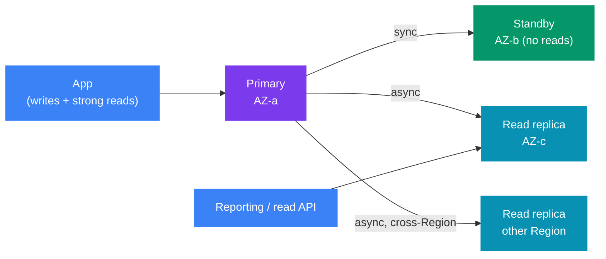
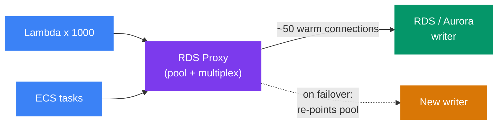
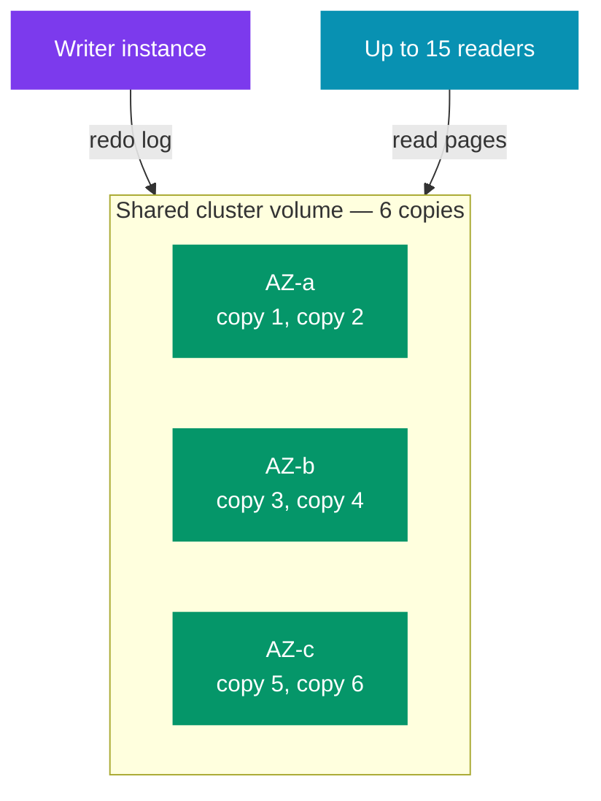
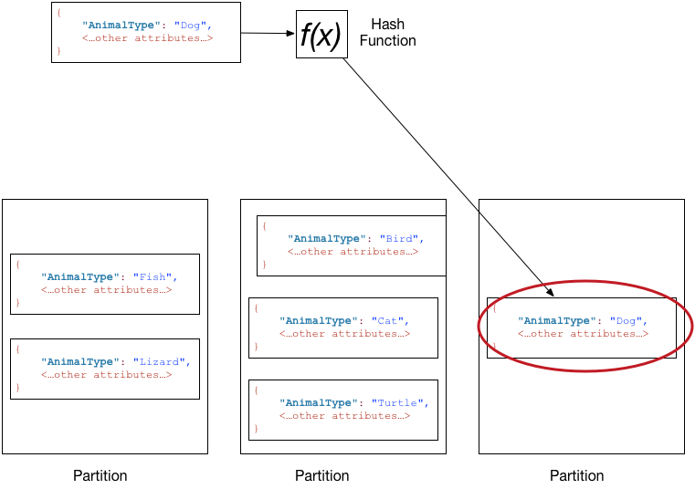
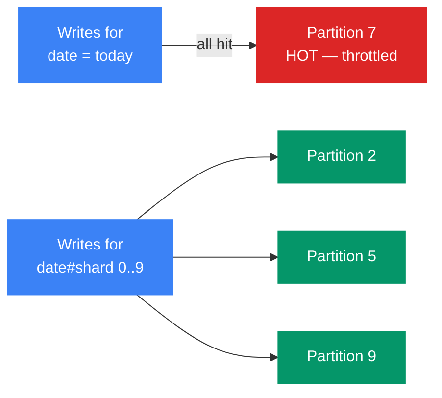

# 🗄️ AWS Databases for System Design — RDS, Aurora, DynamoDB

> 🧭 **AWS for system design** &nbsp;·&nbsp; 🔥🔥 Very High Priority &nbsp;·&nbsp; 💬 **11 Questions**

> _"Every design round has a box labelled 'DB'. A senior engineer names the engine, the
> access pattern it serves, and how it fails."_

This note covers the AWS databases that appear in almost every design round.
It is **AWS-specific**.

🔗 **The generic theory lives elsewhere:**
- 🔁 Replication, sharding, read/write split → [Alex Xu Vol 1 ch01 §3 and §8](../../system-design/01_insider_guide_Alex_Xu/vol_1/ch01_scale_from_zero.md)
- 🔑 Key-value store design, quorum, vector clocks → [Alex Xu Vol 1 ch06](../../system-design/01_insider_guide_Alex_Xu/vol_1/ch06_design_a_key_value_store.md)
- 🧮 Consistent hashing → [Alex Xu Vol 1 ch05](../../system-design/01_insider_guide_Alex_Xu/vol_1/ch05_design_consistent_hashing.md)
- ⚖️ CAP, PACELC, consistency models → [Distributed fundamentals](../../system-design/02_distributed_systems/01_distributed_fundamentals.md)

---

📊 **Question Count**

| # | Section | Questions |
|---|---|---|
| 1 | [RDS — Managed Relational Database](#1-rds--managed-relational-database) | 3 |
| 2 | [RDS Proxy — Connection Pooling as a Service](#2-rds-proxy--connection-pooling-as-a-service) | 1 |
| 3 | [Aurora — Relational on Distributed Storage](#3-aurora--relational-on-distributed-storage) | 1 |
| 4 | [DynamoDB — Data Model and Capacity](#4-dynamodb--data-model-and-capacity) | 2 |
| 5 | [DynamoDB — Correctness, Events and Global Scale](#5-dynamodb--correctness-events-and-global-scale) | 3 |
| 6 | [Which Database for Which Access Pattern](#6-which-database-for-which-access-pattern) | 1 |
| | **Total** | **11** |

> 🔥🔥 Very High — asked in almost every Tier-1 loop &nbsp;·&nbsp; 🔥 High — very frequent in Tier-1 interviews &nbsp;·&nbsp; ⚡ Medium — commonly asked &nbsp;·&nbsp; 💤 Low — good to know, rarely asked

---

## 📑 Table of Contents

1. [RDS — Managed Relational Database](#1-rds--managed-relational-database)
2. [RDS Proxy — Connection Pooling as a Service](#2-rds-proxy--connection-pooling-as-a-service)
3. [Aurora — Relational on Distributed Storage](#3-aurora--relational-on-distributed-storage)
4. [DynamoDB — Data Model and Capacity](#4-dynamodb--data-model-and-capacity)
5. [DynamoDB — Correctness, Events and Global Scale](#5-dynamodb--correctness-events-and-global-scale)
6. [Which Database for Which Access Pattern](#6-which-database-for-which-access-pattern)
7. [Numbers Cheat Sheet](#7-numbers-cheat-sheet)

---

## 1. RDS — Managed Relational Database

### 1.1 What problem it solves

🧩 **Problem:** RDS (Relational Database Service) runs MySQL, PostgreSQL, MariaDB, Oracle, SQL Server and Db2 for you.

| 🤝 Who owns what | |
|---|---|
| ☁️ **AWS handles** | Patching, backups, failover and storage growth |
| 🧑‍💻 **You still own** | The schema, the queries, the indexes and the instance size |

✅ **Use it when:**
- 🔗 The data is relational and you need joins, foreign keys and ACID transactions.
- 📏 The write load fits on **one** primary instance.
- 🧑‍💻 The team already knows SQL and the ORM (JPA/Hibernate).

❌ **Do NOT use it when:**
- 📈 Writes must scale past one machine → shard by hand, or use DynamoDB / Aurora DSQL (Distributed SQL).
- ⚡ You need single-digit-ms reads at any scale with a known key → DynamoDB.
- 📊 The workload is analytics over billions of rows → Redshift.

### 1.2 Multi-AZ vs Read Replicas — the core distinction

> 💡 **Key idea:** These two features look similar. They solve **different** problems.

| | 🛡️ **Multi-AZ (instance)** | 🛡️ **Multi-AZ DB cluster** | 📈 **Read Replica** |
|---|---|---|---|
| Goal | High availability | HA + some read scale | Read scaling |
| Replication | **Synchronous** (block-level) | Semi-synchronous (1 of 2 standbys must ack) | **Asynchronous** |
| Can serve reads? | ❌ No — standby is idle | ✅ Yes — 2 readable standbys | ✅ Yes |
| Failover | Automatic, **60–120 s** typical | Automatic, **under ~35 s** typical | Manual **promote** |
| Data loss on failover | ✅ None (sync) | ✅ None for acked writes | ⚠️ Up to the replica lag |
| Scope | Same Region, other AZ | Same Region, 3 AZs | Same AZ, other AZ, or other Region |
| How many | 1 standby | 2 standbys | Up to **15** (MySQL, MariaDB, PostgreSQL); 5 for Oracle / SQL Server |
| Engines | All | MySQL, PostgreSQL only | All |

- 🛡️ **Multi-AZ** = an insurance copy. It protects you from an AZ (Availability Zone) or instance failure.
- 📈 **Read replica** = more read capacity. It does **not** protect you automatically.
- 💡 You can combine them. A read replica can itself be Multi-AZ.



### 1.3 How failover works

🔁 **The four steps:**
1. 🔍 RDS detects a failure: host down, AZ outage, storage failure, or a manual reboot with failover.
2. ⬆️ RDS promotes the standby to primary.
3. 🌐 RDS flips the **DNS CNAME** (Canonical Name record) of the endpoint to the new primary.
4. 🔌 Clients reconnect to the same endpoint name.

⚠️ **What this means for the application:**
- 💥 All open connections break. In-flight transactions roll back.
- 🔁 The client must **retry** and must **re-resolve DNS**.
- ☕ The JVM caches DNS. Set `networkaddress.cache.ttl` low (for example 5–30 s). Otherwise the app keeps hitting the old IP.
- ⚡ The 60–120 s window is mostly detection + DNS. RDS Proxy (§2) or the AWS JDBC Driver shortens it.

### 1.4 Replica lag — the main failure mode of read replicas

📏 **Definition:** Replica lag = how far the replica is behind the primary. CloudWatch metric: `ReplicaLag` (seconds).

⚠️ **Why lag grows:**
- 🐢 A long write transaction or a big batch on the primary.
- 📉 The replica is a smaller instance than the primary.
- 📊 A long-running report query on the replica blocks replay (PostgreSQL can cancel it instead).
- 🌍 Cross-Region network delay.

❌ **What breaks — read-your-own-writes:**
1. ✍️ User updates a profile → the write goes to the primary.
2. 👀 The next page load reads from a replica → it shows the old value.

✅ **Fixes, in order of preference:**
1. 🎯 Route reads that follow a write (same session, next few seconds) to the **primary**.
2. 📊 Route only lag-tolerant reads to replicas: reports, search pages, dashboards.
3. 🧭 Track the primary's position (MySQL GTID = Global Transaction Identifier, PostgreSQL LSN = Log Sequence Number) and wait until the replica catches up. This is complex; use it only if 1 and 2 are not enough.
4. 🔔 Alert when `ReplicaLag` stays above your SLO (Service Level Objective). Take the replica out of rotation.

### 1.5 Backups and recovery

| Feature | Detail |
|---|---|
| 💾 Automated backups | Retention 0–35 days. Daily snapshot + transaction logs. |
| ⏪ Point-in-time restore | Any second in the retention window, usually up to ~5 min ago. |
| 📸 Manual snapshots | Kept until you delete them. Use for long retention. |
| ⚠️ Restore result | Always a **new** instance with a **new** endpoint. The app config must change. |
| 📈 Storage auto scaling | Grows when free space < 10% for 5 min. You set a maximum. |

> ⚠️ **Trap:** A restore is not a failover. It takes minutes to hours, depending on size.

| Protects against | Use |
|---|---|
| 🗑️ **Bad data** (a wrong `DELETE`) | Backups |
| 💥 **Bad hardware** | Multi-AZ |

🎤 **How to say it in an interview:**
> "I'll start with RDS PostgreSQL in Multi-AZ for the transactional core. The data is relational
> and the write load fits one node. Multi-AZ gives automatic failover with no data loss. Read
> replicas are a separate decision, and I'll only send lag-tolerant reads to them."

### Interview questions

1. **🔥🔥 What is the difference between RDS Multi-AZ and read replicas? Can you use both together?**

<!-- -->
<details>
<summary>Answer</summary>

💡 They solve **different** problems. 🔗 The full comparison is in [§1.2](#12-multi-az-vs-read-replicas--the-core-distinction).

- 🛡️ **Multi-AZ = insurance.** A synchronous copy in another AZ. It fails over automatically, with no data loss. On a Multi-AZ **DB instance**, the standby serves no reads.
- 📈 **Read replica = extra read capacity.** An asynchronous copy that serves `SELECT` queries. It does not fail over by itself. You promote it by hand, and you can lose up to the replica lag.

> ⚠️ **Trap — "The standby can't serve reads" is true only for a Multi-AZ DB instance.** A **Multi-AZ DB cluster** (MySQL / PostgreSQL) has **2 readable standbys** and a reader endpoint. It fails over in under ~35 s. So there, Multi-AZ gives HA and some read scale at the same time.

✅ **Using both together** is the normal production setup:
- 🛡️ Multi-AZ on the primary for HA. Read replicas for lag-tolerant reads.
- 💡 A read replica can itself be Multi-AZ.
- 🌍 A **cross-Region** read replica is the standard path for Regional DR (Disaster Recovery). You promote it when the Region fails. Its replication lag becomes your **RPO** (Recovery Point Objective: how much recent data you can lose).

🎤 **How to say it:**
> "Multi-AZ is for availability, read replicas are for read scale. On a Multi-AZ instance the
> standby is passive. A Multi-AZ DB cluster gives two readable standbys and a faster failover.
> In production I use both, and a cross-Region replica for DR."

---

</details>

2. **🔥🔥 Your RDS PostgreSQL primary failed over at 2 AM and the app was down for 4 minutes, though RDS reports failover finished in 70 seconds. Why, and how do you fix it?**

<!-- -->
<details>
<summary>Answer</summary>

💡 **Key idea:** The extra time is on the **client side**, not in RDS.

🔍 **Why it took longer:**
- 🌐 RDS fails over by flipping the endpoint's **DNS CNAME** (see [§1.3](#13-how-failover-works)). The JVM and the connection pool still hold the old IP.
- ☕ The JVM DNS cache (`networkaddress.cache.ttl`) may keep the old address. With a security manager installed, older setups cached it **forever**.
- ⚠️ **The connection pool is usually the bigger problem.** HikariCP keeps open sockets to the old primary. A query on a dead socket can hang until the TCP timeout, often many minutes.
- ⏳ Socket timeouts may be missing, so threads hang on dead TCP connections.

✅ **Fixes:**
1. ☕ Set a short JVM DNS TTL (Time To Live) of 5–30 s, for example `-Dnetworkaddress.cache.ttl=30`. Do not depend on the JDK default for a database endpoint.
2. ⏱️ Set the JDBC driver's `connectTimeout` and `socketTimeout`, so a call on a dead socket fails fast.
3. 🔌 Keep HikariCP's `maxLifetime` below the database's idle timeout, and set `keepaliveTime`, so dead connections are found and replaced. Do not add `connectionTestQuery` with a JDBC4 driver. HikariCP already checks each connection with `Connection.isValid()`.
4. 🧭 Use **RDS Proxy** or the **AWS JDBC Driver** (failover plugin). Both track the topology and reconnect without waiting for DNS.
5. 🔁 Retry idempotent operations after a connection error.
6. ⚡ If 70 s is still too long, move to Aurora (replica failover usually under 30 s) or a Multi-AZ DB cluster (under ~35 s).

> 💡 **Tip — test it before production needs it.** Force a failover in staging with **reboot with failover**, and measure how long the app takes to recover.

---

</details>

3. **🔥🔥 You added three read replicas to offload reads. Users now complain that after they edit their profile, the old data sometimes shows. What is happening and what do you change?**

<!-- -->
<details>
<summary>Answer</summary>

🧩 **Cause:** This is **replica lag** breaking **read-your-own-writes**.
Replication to read replicas is asynchronous. The read after the write can hit a replica that has not applied it yet.

✅ **Fixes:**
- 🎯 Route reads that follow a write in the same session (for a few seconds) to the **primary**.
- 📊 Keep replicas for lag-tolerant reads only: search pages, reports.
- 🔭 Monitor `ReplicaLag`. Remove a replica from rotation if it stays behind.
- ⚡ On Aurora, lag is usually under 100 ms, so the window is smaller, but the rule is the same.

> ❌ **Multi-AZ would not help.** The standby does not serve reads.

---

</details>

---

## 2. RDS Proxy — Connection Pooling as a Service

### 2.1 The problem: connection storms

🧩 **Problem:** A relational database handles a limited number of connections.
Each connection costs memory on the DB. `max_connections` depends on instance memory.

⚠️ **How the storm happens** (with **Lambda** and with fast auto scaling):
1. λ Each Lambda execution environment opens its own connection.
2. 📈 A traffic spike creates 1,000 environments → 1,000 new connections in seconds.
3. 🔥 The DB spends its CPU on connection setup (TLS + auth), or hits `max_connections`.
4. ❌ New requests fail with "too many connections".

> ⚠️ **Trap:** A connection pool inside the app (HikariCP) does not help here. Each Lambda instance has its own tiny pool.

### 2.2 What RDS Proxy does



- 🔌 **Pools and shares** DB connections between many clients (multiplexing).
- 🛡️ **Keeps client connections open during failover.** It routes to the new writer itself, without waiting for DNS. AWS says it cuts failover time by up to 66% for RDS and Aurora.
- 🔐 **Enforces IAM (Identity and Access Management) authentication**, and reads DB credentials from Secrets Manager.
- 🔒 Runs inside your VPC (Virtual Private Cloud) only. It is not reachable from the internet.
- ☁️ Serverless and Multi-AZ. You do not size it.

### 2.3 Failure modes and limits

| Problem | What happens |
|---|---|
| ⚠️ **Connection pinning** | Session state (temp tables, `SET` variables, some prepared statements) pins a client to one DB connection. Pinned connections are not shared, so the pool stops helping. Watch `DatabaseConnectionsCurrentlySessionPinned`. |
| ⚡ Extra hop | Adds a few ms of latency per query. |
| ⏳ Long transactions | A connection stays busy for the whole transaction. Multiplexing only works between transactions. |
| ❌ It is not a rate limiter | If the DB is CPU-bound, the proxy just queues requests. Requests time out at the proxy instead. |

❌ **When NOT to use it:** a fixed fleet of long-running services with a well-sized HikariCP pool.
There the app pool already does the job.

🎤 **How to say it in an interview:**
> "Lambda plus a relational database is a connection-storm risk, so I put RDS Proxy in front.
> It multiplexes thousands of short-lived clients onto a small warm pool, and it hides failover
> from the functions. I'd watch session pinning, because pinned connections stop being shared."

### Interview questions

4. **🔥 A Lambda-based API on Aurora works in testing but fails with "too many connections" during a marketing spike. Explain and fix.**

<!-- -->
<details>
<summary>Answer</summary>

🧩 **Cause:** Each Lambda execution environment opens its **own** DB connection. A spike scales Lambda to hundreds or thousands of environments. Connections go past `max_connections`, and the DB spends CPU on TLS + auth.

✅ **Fix with RDS Proxy:**
- 🔌 It multiplexes many client connections onto a small warm pool.
- 🛡️ It keeps clients connected during failover.
- 🔐 It uses IAM auth and Secrets Manager.

💡 **Also:**
- 📏 Set **reserved concurrency** on the function, so Lambda cannot open more connections than the DB can take.
- ⚠️ Watch session **pinning** in the proxy (SET statements, temp tables). Pinned connections are not shared.
- 📈 If the DB is CPU-bound, the proxy will not save it. Add replicas, cache reads, or put a queue in front of writes.

---

</details>

---

## 3. Aurora — Relational on Distributed Storage

### 3.1 The idea: separate compute from storage

🧩 **The idea:** Aurora is MySQL- or PostgreSQL-compatible. The SQL engine is normal.
The **storage layer** is new: one shared, distributed volume for the whole cluster.

📏 **How the volume works:**
- 🗂️ The volume keeps **6 copies** of every data block, **2 in each of 3 AZs**.
- 🧱 The volume is split into **10 GB segments** (protection groups). Each segment is replicated and repaired on its own.
- ⚖️ **Write quorum = 4 of 6.** **Read quorum = 3 of 6.**
- ⚡ The writer sends only **redo log records** to storage, not full pages. Storage nodes build the pages.
- 📈 The volume grows automatically in 10 GB steps, up to **128 TiB** (newer engine versions allow more).



<p align="center"></p>

> 🖼️ *One writer and the readers all use the same storage volume across 3 AZs. Writes need 4 of 6 copies, and the volume backs up to S3 all the time.* Source: [Amazon Aurora DB clusters](https://docs.aws.amazon.com/AmazonRDS/latest/AuroraUserGuide/Aurora.Overview.html) · License: CC BY-SA 4.0

**Why 4/6 and 3/6:**

| Failure | Writes | Reads |
|---|---|---|
| 1 storage node down | ✅ 5 left ≥ 4 | ✅ |
| Whole AZ down (2 copies) | ✅ 4 left ≥ 4 | ✅ |
| AZ down + 1 more node (3 copies) | ❌ 3 < 4 | ✅ 3 ≥ 3 — data is safe, repair starts |

> 🛡️ **Result:** Aurora keeps **writing** through an AZ loss, and keeps the **data** through "AZ + 1".  
> ⚡ Repair of a 10 GB segment takes seconds over a fast network, so the window for a second failure is small.

### 3.2 Replicas, lag and failover

- 📈 Up to **15 Aurora Replicas** in the same Region.
- 🗂️ Replicas read the **same storage volume**. They do not replay a full copy of the data.
- ⚡ So replica lag is small: AWS says **usually well under 100 ms**.
- 🔁 Failover promotes a replica. It is **usually under 30 s**. You set the order with **failover tiers** (0–15).
- ⚠️ With **no** replica, Aurora must create a new writer. That takes several minutes. Always run at least one replica in production.

### 3.3 Endpoints

| Endpoint | Points to | Use |
|---|---|---|
| ✍️ **Cluster (writer)** | The current writer | All writes and read-your-own-write reads |
| 📖 **Reader** | All replicas, DNS round-robin | Read traffic |
| 🎛️ **Custom** | A subset of instances you choose | For example, big instances for analytics only |
| 🔍 **Instance** | One instance | Debugging only |

> ⚠️ **Trap:** The reader endpoint balances **connections**, not queries. A connection pool opened once keeps hitting the same replica.  
> New replicas from auto scaling get no traffic until clients open new connections.  
> 💡 **Fix:** Set a max lifetime on pooled connections.

### 3.4 Aurora Global Database

🧩 **What it is for:** multi-Region reads and disaster recovery.

- ✍️ One **primary Region** takes writes. Up to **10 secondary Regions** are read-only (the limit was 5 until 2025).
- 📈 Up to **16 replicas** in each secondary Region.
- ⚡ Replication runs at the **storage layer**. Typical lag is **under 1 second**.
- 🔁 **Write forwarding:** a secondary can accept a write and forward it to the primary. It saves app routing, but the write still pays the cross-Region round trip.

> 📏 **RTO** (Recovery Time Objective) = how long the system can be down before it is back.

| Operation | When | RPO | RTO |
|---|---|---|---|
| 🗓️ **Switchover** (managed, planned) | Region rotation, drills | 0 — waits for sync | Minutes |
| 🚨 **Failover** (unplanned) | Primary Region is down | = replication lag (usually < 1 s) | Usually < 1 min to promote |

> ⚠️ **Fails when:** after an unplanned failover the old primary may hold writes that never replicated.
> Aurora keeps a snapshot of that state, but you must reconcile it by hand.

### 3.5 Aurora Serverless v2

📏 **Numbers:**
- ⚙️ Capacity is measured in **ACUs** (Aurora Capacity Units). 1 ACU ≈ 2 GiB memory + matching CPU.
- 📈 Scales in **0.5 ACU** steps, in seconds, between your min and max (max 256 ACU).
- 💤 Newer versions can **scale to 0 ACU** and pause when idle. The first query after a pause waits for resume (seconds).
- 🧩 You can mix Serverless v2 and provisioned instances in one cluster.
- ⚠️ **Serverless v1 is end of life (31 Mar 2025).** Do not design with it.

✅ **Use it when:** load is spiky or unknown — dev/test, a new product, a multi-tenant SaaS with many small DBs.  
❌ **Do NOT use it when:** load is steady and high. 💰 A provisioned instance is cheaper per hour.

### 3.6 Aurora vs RDS — when is Aurora worth it?

| ✅ Pick **Aurora** when | ✅ Stay on **RDS** when |
|---|---|
| ⚡ You need failover under 30 s | 60–120 s failover is acceptable |
| 📈 You need more than a few read replicas with low lag | 0–2 replicas are enough |
| 🌍 You need multi-Region DR with RPO about 1 s | Single Region is enough |
| 🗂️ Storage is large or grows fast | 💰 Small DB, cost matters most |
| | 🧩 You need an engine Aurora does not support (Oracle, SQL Server) |

> ⚠️ **What Aurora does not fix:** it still has **one writer**. Write throughput is limited by one instance.  
> 🔗 For multi-writer SQL across Regions, AWS now offers **Aurora DSQL** (GA: General Availability in 2025, PostgreSQL-compatible, active-active, optimistic concurrency).

🎤 **How to say it in an interview:**
> "I'd choose Aurora PostgreSQL over plain RDS. Its storage keeps six copies across three AZs
> with a 4-of-6 write quorum, so losing an AZ does not stop writes. Failover to a replica is
> usually under 30 seconds. It still has one writer. If writes outgrow one instance, I'd shard or
> move that access pattern to DynamoDB."

### Interview questions

5. **🔥🔥 Why can Aurora lose an entire AZ and keep accepting writes, while losing data needs more than that?**

<!-- -->
<details>
<summary>Answer</summary>

🗂️ Aurora storage keeps **6 copies** of each 10 GB segment, **2 in each of 3 AZs**.

| Quorum | What happens |
|---|---|
| ✍️ Writes need **4 of 6** | Losing one AZ removes 2 copies. 4 are left, so writes continue. |
| 📖 Reads need **3 of 6** | Losing an AZ plus one more node leaves 3. Writes stop, but the data is still readable and safe. Aurora repairs the missing copies. |

- ⚡ Repair of a 10 GB segment takes seconds. So the time window for a second failure is very short.
- ⚙️ The compute layer is separate. If the **writer instance** was in the lost AZ, a replica in another AZ is promoted, usually in under 30 s.

---

</details>

---

## 4. DynamoDB — Data Model and Capacity

### 4.1 What problem it solves

🧩 **Problem:** DynamoDB is a managed **key-value and document** store.
⚡ It gives single-digit-ms latency at almost any scale, **if** you access data by key.

✅ **Use it when:**
- 🔑 You know the access patterns up front, and each one is "get by key" or "range by key".
- 📈 You need very high or very spiky write throughput.
- ☁️ You want no servers, no failover events, no connection pools (HTTP API).

❌ **Do NOT use it when:**
- 🗃️ You need ad-hoc queries, joins, or new filters every sprint → relational DB.
- 📊 You need aggregations (`SUM`, `GROUP BY`) over many items → Redshift / Athena.
- 🔎 You need full-text search → OpenSearch.
- ❓ The access patterns are still unknown.

### 4.2 Keys and partitions

| Term | Meaning |
|---|---|
| 🔑 **Partition key (PK)** | Hashed to choose the physical partition. Every request should name it. |
| 🔢 **Sort key (SK)** | Optional. Orders items inside one PK. Allows range queries (`begins_with`, `between`). |
| 🗂️ **Item collection** | All items with the same PK. |
| 📏 **Item size limit** | **400 KB**, including attribute names. Big blobs go to S3; store the S3 key in the item. |

📏 **Per-partition limits** — the most important numbers in DynamoDB:
- 📖 **3,000 RCU** (Read Capacity Units) per second.
- ✍️ **1,000 WCU** (Write Capacity Units) per second.
- 🗂️ About **10 GB** of data. Above that, DynamoDB splits the partition.

<p align="center"></p>

> 🖼️ *DynamoDB hashes the partition key value to pick the partition that stores the item.* Source: [Partitions and data distribution in DynamoDB](https://docs.aws.amazon.com/amazondynamodb/latest/developerguide/HowItWorks.Partitions.html) · License: CC BY-SA 4.0

📏 **Capacity units:**

| Unit | Covers |
|---|---|
| 1 **RCU** | 1 strongly consistent read/s of up to 4 KB, **or** 2 eventually consistent reads/s |
| 1 **WCU** | 1 write/s of up to 1 KB |
| Transactional read / write | 💰 2× the normal cost |

### 4.3 Partition key design and hot partitions

💡 **Key idea:** A table is fast only if traffic spreads over many partition key values.
A **hot partition** is one key value (or a few) that gets most of the traffic.

| | Examples |
|---|---|
| ❌ **Bad keys** | `status`, `date`, `country`, `tenant_id` when one tenant is 80% of traffic |
| ✅ **Good keys** | `user_id`, `order_id`, `device_id` — high cardinality, even access |



✅ **Fixes for a hot key:**
1. ✂️ **Write sharding.** Add a suffix: `2026-10-31#0` … `2026-10-31#9`. Writes spread over 10 keys. Reads must query all 10 and merge (scatter-gather).
2. ⚡ **Cache hot reads** with DAX (DynamoDB Accelerator) or ElastiCache.
3. 🔑 **Change the key.** Often a composite key (`tenant_id#user_id`) fixes it.
4. 📨 **Buffer writes.** Put a queue in front and write aggregated counts in batches.

### 4.4 Adaptive capacity and burst capacity

- 🔄 **Adaptive capacity** moves unused capacity to busy partitions. It is automatic and instant.
- ✂️ **Split for heat:** DynamoDB can split a partition that stays hot, so hot items land on separate partitions.
- 🔋 **Burst capacity:** DynamoDB saves up to **300 seconds** of unused partition capacity for short spikes.

> ⚠️ **Trap — the limit these features cannot remove:** **one partition key value** still lives on one partition.  
> A single item, or one PK's item collection, cannot go above 3,000 RCU / 1,000 WCU.  
> Splitting does not help a single hot key. Only key design or caching does.

### 4.5 On-demand vs provisioned

| | ⚡ **On-demand** | 🎛️ **Provisioned (+ auto scaling)** |
|---|---|---|
| You set | Nothing (optional max throughput) | RCU / WCU, plus a target usage % |
| 📈 Scaling | Instant up to **2× the previous peak**; above that within ~30 min | Auto scaling reacts in **minutes** (CloudWatch alarms) |
| ⚠️ Throttling risk | Traffic jumps far past 2× the old peak in seconds | Spikes faster than auto scaling |
| 💰 Cost | Higher per request | Cheaper at steady, predictable load |
| ✅ Best for | New tables, spiky or unknown load | Steady traffic you can forecast |

- ⚠️ You can switch modes, but not freely (limited switches per 24 h).
- 💡 For a known launch spike on either mode, **pre-warm** with *warm throughput* settings, so the table already has enough partitions.
- 🔁 Throttled requests return `ProvisionedThroughputExceededException` (or `ThrottlingException`). The SDK retries with backoff. Design the caller to handle it.

### 4.6 Query vs Scan

| | Reads | 💰 Cost | Verdict |
|---|---|---|---|
| **Query** | One PK, optional SK condition | Proportional to the items read | ✅ |
| **Scan** | The whole table | Proportional to table size | ❌ in a request path |

- 📏 Both return at most **1 MB per page**. Use `LastEvaluatedKey` to page.
- ⚠️ A **filter expression** runs *after* the read. You still pay for every item read.

### 4.7 LSI vs GSI

💡 Secondary indexes give you a second access pattern.

| | **LSI (Local Secondary Index)** | **GSI (Global Secondary Index)** |
|---|---|---|
| 🔑 Key | **Same PK**, different SK | Any PK, any SK |
| 🗓️ When created | **Only at table creation** | Any time |
| 📏 Max per table | 5 | 20 (default quota) |
| ⚖️ Consistency | Strong or eventual | **Eventual only** |
| ⚙️ Capacity | Shares the table's capacity | Has its **own** capacity |
| 📏 Size limit | **10 GB per PK value** (item collection) | None |
| ✅ Use | "Orders of user X, sorted by amount" | "Orders by status", "user by email" |

⚠️ **GSI failure modes:**
- 👀 **Stale reads.** A GSI is updated asynchronously. Write then read via the GSI may miss the new item. Lag is usually under a second, but you cannot ask for a strong read.
- 🧱 **Back-pressure.** If a GSI on a provisioned table runs out of write capacity, DynamoDB **throttles writes to the base table**. One under-provisioned index can stop all writes.
- 🔥 **Hot GSI key.** A GSI on `status` has 3–5 values. All writes to those values go to a few partitions. Same hot-key problem, now on the index.
- 🆔 **Uniqueness.** A GSI does not enforce unique values. For a unique email, write a second item `EMAIL#x` with a conditional put, in the same transaction.

🎤 **How to say it in an interview:**
> "I design the DynamoDB table from the access patterns. The partition key is user_id, which has
> high cardinality. The sort key lets me range-query by time. Each partition caps at 3,000 reads
> and 1,000 writes per second. So I check that no single key can pass that. If one can, I
> write-shard it or put a cache in front."

### Interview questions

6. **🔥🔥 Design the DynamoDB table for an order service. Access patterns: get order by id, list a customer's orders newest first, list all PENDING orders for an ops dashboard.**

<!-- -->
<details>
<summary>Answer</summary>

| Pattern | Key |
|---|---|
| 🔑 Get order by id | Table: `PK = CUSTOMER#<id>`, `SK = ORDER#<timestamp>#<orderId>`; plus a GSI on `orderId`, or put `orderId` in the client request with the customer id |
| 🕒 Customer's orders, newest first | `Query PK = CUSTOMER#<id>`, `ScanIndexForward = false`, `Limit = 20` |
| ⏳ PENDING orders | **Sparse GSI**: write attribute `pendingShard = PENDING#<0..9>` only while the order is pending; remove it when it moves on |

🧭 **Why these choices:**
- ✅ `customer_id` has high cardinality, so writes spread across partitions.
- ⚠️ A GSI on raw `status` would be a **hot key** (few values). The sparse, sharded GSI holds only pending orders and spreads them over 10 keys. The dashboard queries 10 keys and merges.
- ⚖️ The GSI is eventually consistent. That is fine for a dashboard.
- 🪣 Big order payloads (> 400 KB) go to S3, with the key in the item.

---

</details>

7. **🔥 One celebrity product gets 20,000 reads per second and DynamoDB throttles it, even though the table has plenty of total capacity. Why, and what do you do?**

<!-- -->
<details>
<summary>Answer</summary>

🧩 **Cause:** All reads for that product hit **one partition key**.
- 📏 One partition key value is limited to **3,000 RCU** (strong reads of 4 KB each; 6,000 eventually consistent reads).
- ⚠️ Total table capacity does not matter. Adaptive capacity and split-for-heat cannot split a **single** item.

✅ **Fixes:**
1. ⚡ **Cache it.** DAX (microseconds, DynamoDB API) or ElastiCache, or CloudFront if the response is public.
2. 💰 Use **eventually consistent** reads — they cost half.
3. ✂️ If the hot traffic is **writes** (a counter), **write-shard** the key (`product#0..N`) and sum on read. Or buffer counts in a queue / Redis and flush in batches.

---

</details>

---

## 5. DynamoDB — Correctness, Events and Global Scale

### 5.1 Conditional writes — optimistic locking and idempotency

🧩 **How it works:**
- ✅ A **condition expression** makes a write succeed only if a check on the current item passes.
- ❌ If the check fails, DynamoDB returns `ConditionalCheckFailedException` and writes nothing.
- 🔒 The check and the write are **atomic** for that one item.

**🆔 Pattern 1 — idempotency (insert once):**

```text
PutItem  Key = { pk: "IDEMP#<request-id>" }
         ConditionExpression = attribute_not_exists(pk)
```

- ✅ First call succeeds. A retry with the same request id fails the condition.
- 🔁 On failure, read the stored result and return it to the caller.
- ⏳ Add a TTL so idempotency records expire (for example after 24 h).

**🔢 Pattern 2 — optimistic locking (version check):**

```text
UpdateItem  Key = { pk: "ACCOUNT#42" }
            UpdateExpression    = SET balance = :new, version = :v_plus_1
            ConditionExpression = version = :v_read
```

1. 📖 Read the item and its `version`. Compute the new state. Write with "version still equals what I read".
2. 🔁 If another writer got there first, the condition fails. Re-read and retry.
3. 💡 Spring Data / the DynamoDB Enhanced Client support this with a `@DynamoDbVersionAttribute`.

**🛡️ Pattern 3 — guard an invariant:** `ConditionExpression = balance >= :amount` for a debit.

### 5.2 Transactions

- 📏 `TransactWriteItems` / `TransactGetItems`: ACID across up to **100 items** and **4 MB** total. Items can be in different tables of the same account and Region.
- 💰 Cost: **2×** the normal capacity (prepare + commit).
- ❌ Each action can carry its own condition. If any condition fails, nothing is written (`TransactionCanceledException`).
- 🆔 A `ClientRequestToken` makes the call idempotent for **10 minutes**.
- 🔁 Conflicts: two transactions on the same item → one is cancelled. Retry with backoff.

✅ **Use for:** "debit A and credit B", "create user + reserve unique email".  
❌ **Do NOT use for:** every write. It doubles the cost and raises conflict rates on hot items.

### 5.3 TTL

- 🕒 You name a Number attribute that holds an **epoch time in seconds**.
- 🗑️ After that time, DynamoDB deletes the item in the background, for free (no WCU).
- ⚠️ Deletion is **not exact**. It usually happens within a few days of expiry.
- 👀 Until deletion, reads **still return** the expired item. Filter with `expiresAt > :now`.
- 📨 TTL deletes appear in DynamoDB Streams, marked as deleted by the service.

✅ **Use for:** sessions, idempotency keys, OTPs, temporary locks — data where "expired" only needs to be roughly on time.  
❌ **Not for:** anything that must disappear at an exact second. Check the time in code too.

### 5.4 DynamoDB Streams

🧩 **What it is:** Streams give you an ordered log of item changes (insert, modify, remove).

- 📏 Retention: **24 hours**.
- ✅ Each change appears **exactly once** in the stream, in order **per item** (per PK). There is no order across different keys.
- 🔍 View types: keys only, new image, old image, or both.
- λ Typical consumer: a **Lambda** trigger, which reads shards in batches.

**What it is used for:**

| Pattern | How |
|---|---|
| 📤 Transactional outbox | The write and the "event" are the same DynamoDB write. A Lambda publishes the stream record to SNS (Simple Notification Service) / EventBridge / Kafka. No dual-write bug. |
| 🔎 Search index / cache sync | Lambda copies changes to OpenSearch or invalidates ElastiCache. |
| 📊 Materialised views / aggregates | Lambda updates a counter table. |
| 📜 Audit log | Old image + new image → S3. |

⚠️ **Failure modes:**
- 🧱 The Lambda consumer fails on one record → by default it **retries the batch until the record expires** (24 h). The shard stops moving. Set `BisectBatchOnFunctionError`, max retry attempts, and an on-failure destination (SQS DLQ: a dead-letter queue in Simple Queue Service).
- 🔁 The consumer can see a record more than once after a retry. Make the consumer **idempotent**.
- 🔗 For more than 24 h retention or many consumers, use **Kinesis Data Streams for DynamoDB** instead. It keeps data up to 365 days, but records may be duplicated or out of order — use the item's timestamp to sort.

### 5.5 DAX — DynamoDB Accelerator

🧩 **What it is:** DAX is an in-memory cache cluster made for DynamoDB. It speaks the DynamoDB API.

- ⚡ Reads go from **single-digit ms → microseconds** for cache hits.
- ✍️ **Write-through:** writes go through DAX to DynamoDB, and DAX updates its item cache.
- 🗂️ Two caches: an **item cache** (`GetItem`) and a **query cache** (`Query` / `Scan` results).
- ⏳ Default TTL: 5 minutes for both.

✅ **Use it when:** read-heavy traffic on the same items, for example a hot product page.

❌ **Do NOT use it when:**
- ⚖️ You need **strongly consistent** reads. DAX passes them through to DynamoDB, with no caching.
- ✍️ The workload is write-heavy.
- 🧠 You need caching of computed results, not raw items → ElastiCache is more flexible.

⚠️ **Failure modes:**
- 👀 The **query cache is not invalidated** by writes. A `Query` can return an old result until its TTL ends.
- 🚧 Writes that bypass DAX (another service writing straight to DynamoDB) leave the item cache stale too.
- 🛡️ DAX runs inside a VPC on nodes you size. A node failure triggers failover to a replica node.

### 5.6 Global Tables

🧩 **What it is:** Global Tables replicate one table to several Regions. 🌍 Every Region accepts writes (multi-active).

| | **Multi-Region eventual consistency (MREC)** — default | **Multi-Region strong consistency (MRSC)** — GA 2025 |
|---|---|---|
| 🔁 Replication | Async, usually **about 1 s** | Sync to a second Region (or a witness) before ack |
| ⚖️ Conflict rule | ⚠️ **Last writer wins** (by timestamp) | ✅ No conflicts — strongly consistent reads everywhere |
| 🛡️ RPO | Up to the lag | **0** |
| ⚡ Write latency | Local | Higher — cross-Region round trip |
| 🌍 Regions | Any number | Exactly 3 (or 2 + a witness) |

⚠️ **MREC failure modes — the important ones:**
- 💥 **Lost updates.** Two Regions update the same item at the same time. Last writer wins. The other write disappears silently.
- 📍 **Conditional writes are local.** `attribute_not_exists` checks only the local Region. Two Regions can both "insert once". Idempotency is safe only if one key is always written in one Region.
- 🧩 **Transactions are ACID only in the Region where they run.** Other Regions receive the changes item by item, not as one unit.

> 💡 **How to design around it:** give each item a **home Region** (for example by user's country) and send all writes for that item there. Use the other Regions for reads and for failover.

🎤 **How to say it in an interview:**
> "For payments I use a conditional put on the idempotency key, so a retry can't charge twice.
> A version attribute gives optimistic locking on the balance. I publish events from DynamoDB
> Streams, not by writing to Kafka in the same request. That removes the dual-write problem. If I
> go multi-Region, I pin each account to a home Region, because global tables use last-writer-wins."

### Interview questions

8. **🔥🔥 How do you make a "create payment" API idempotent on DynamoDB, so client retries never charge twice?**

<!-- -->
<details>
<summary>Answer</summary>

1. 🆔 The client sends an **idempotency key** (a UUID) with each request.
2. 🔒 In one `TransactWriteItems`:
   - `Put IDEMP#<key>` with `attribute_not_exists(pk)` and status `IN_PROGRESS`.
   - `Put PAYMENT#<id>` with `attribute_not_exists(pk)`.
3. 🔁 If the condition fails, the request is a retry. Read `IDEMP#<key>` and return the stored result (or 409 if still in progress).
4. ✅ When the payment completes, update `IDEMP#<key>` with the response body.
5. ⏳ Set a **TTL** (for example 24 h) on the idempotency item.

> ⚠️ **Trap:** with **Global Tables (MREC)**, conditions are checked only in the local Region. Pin each customer's writes to one home Region, or use MRSC.

---

</details>

9. **🔥 You need to publish an `OrderCreated` event to Kafka whenever an order is written to DynamoDB. How do you avoid losing or duplicating events?**

<!-- -->
<details>
<summary>Answer</summary>

> ❌ **Avoid:** Do not write to DynamoDB and Kafka in the same request. If the second write fails, the two disagree (the **dual-write** problem).

✅ **Instead, use DynamoDB Streams as the outbox:**
- ✍️ The order write is the only write in the request path.
- λ A Lambda (or a Kinesis-based connector) reads the stream and publishes to Kafka.
- 📏 Each change appears exactly once in the stream, ordered per item, kept for 24 h.

⚠️ **Handle the failure modes:**
- 🔁 Consumer retries can publish a record twice → make downstream consumers **idempotent** (dedupe by `orderId` + version).
- 🧱 One poison record blocks the shard → `BisectBatchOnFunctionError`, max retry attempts, and an SQS on-failure destination.
- 🔗 Need longer retention or replay → Kinesis Data Streams for DynamoDB (up to 365 days).

---

</details>

10. **🔥 Product wants the app active in Mumbai and Frankfurt with local writes. You propose DynamoDB Global Tables. What can go wrong?**

<!-- -->
<details>
<summary>Answer</summary>

⚠️ **With the default eventual-consistency mode (MREC):**
- 💥 **Last writer wins.** Concurrent updates to the same item in both Regions → one update is lost silently.
- 📍 **Conditional writes and transactions are local.** "Insert once" or "balance ≥ amount" checks can pass in both Regions.
- ⏳ **Lag is about 1 s.** A user who switches Regions may read old data.

✅ **Design answer:**
- 🏠 Give each user a **home Region**. Route all of that user's writes there. Other Regions serve reads and take over on failover.
- 🧮 Use counters and sets that merge well, not read-modify-write on hot shared items.
- 🛡️ If you need RPO 0 and strong reads in every Region, use **MRSC** (GA 2025). Writes then pay a cross-Region round trip.

---

</details>

---

## 6. Which Database for Which Access Pattern

### 6.1 Decision table

| Access pattern | Pick | Why / one-liner |
|---|---|---|
| Relational data, joins, ACID, moderate scale | 🗃️ **RDS** (PostgreSQL / MySQL) | Simple, cheap, known. Multi-AZ for HA. |
| Same, but large, read-heavy, fast failover, multi-Region DR | 🗃️ **Aurora** | 6-copy storage, 15 low-lag replicas, Global Database. |
| Relational, active-active across Regions | 🌍 **Aurora DSQL** | Distributed SQL, multi-Region writes. Newer; check feature gaps. |
| Get / put by key, huge or spiky scale | 🔑 **DynamoDB** | Single-digit ms, no servers. Needs known access patterns. |
| Microsecond reads of hot keys, sessions, counters, leaderboards | 🧠 **ElastiCache** (Valkey / Redis OSS, open source) | In-memory. See [04_caching_and_edge.md](04_caching_and_edge.md). |
| Redis API but the data must be durable (primary DB) | 🧠 **MemoryDB** | Redis-compatible, multi-AZ transaction log. |
| JSON documents, MongoDB API | 📄 **DocumentDB** | MongoDB-compatible; same storage idea as Aurora. |
| Graph: friends-of-friends, fraud rings, recommendations | 🕸️ **Neptune** | Gremlin / openCypher / SPARQL. |
| Wide-column, Cassandra (CQL: Cassandra Query Language) API | 🧱 **Keyspaces** | Serverless Cassandra-compatible. For moving off Cassandra. |
| Time series: metrics, IoT readings | ⏱️ **Timestream** | AWS closed Timestream for LiveAnalytics to new customers in 2025. New designs use Timestream for InfluxDB. |
| Analytics / OLAP (Online Analytical Processing) over TBs, BI (Business Intelligence) dashboards | 📊 **Redshift** | Columnar, MPP (Massively Parallel Processing). Not for request-path queries. |
| Full-text search, log search, faceted filters | 🔎 **OpenSearch** | Inverted index. Feed it from the system of record (DB Streams / CDC: Change Data Capture). |
| Ad-hoc SQL over files in S3 | 🪣 **Athena** | Serverless, pay per TB scanned. |
| Immutable, verifiable ledger | ~~QLDB~~ → 📜 **Aurora PostgreSQL + hash chain** | ⚠️ QLDB (Quantum Ledger Database) reached end of support on 31 Jul 2025. Do not propose it. |

### 6.2 How to choose in the round

🧭 **Four steps:**
1. 📋 **List the access patterns first.** Read/write ratio, key lookups vs ad-hoc queries, consistency needs.
2. 🎯 **Pick the system of record.** Usually one relational DB or one DynamoDB table per service.
3. 🧩 **Add purpose-built stores as projections**, fed by CDC / Streams: search → OpenSearch, analytics → Redshift / S3, hot reads → cache.
4. ⚖️ **State what you give up.** For example: "DynamoDB means no ad-hoc queries; reporting goes to S3 + Athena."

🎤 **How to say it in an interview:**
> "I keep one system of record per service and treat search, analytics and cache as projections
> fed from its change stream. That way each store does what it is good at, and if a projection
> breaks I can rebuild it from the source."

### Interview questions

11. **🔥 When would you choose DynamoDB over RDS?**

<!-- -->
<details>
<summary>Answer</summary>

🧭 Choose by **access pattern**, not by habit. 🔗 The full decision table is in [§6.1](#61-decision-table).

| ✅ Choose **DynamoDB** when | ✅ Choose **RDS / Aurora** when |
|---|---|
| 🔑 Every access pattern is known and is "get by key" or "range by key" | 🔄 Queries change often; you need joins and ad-hoc SQL |
| 📈 Scale is huge or very spiky; you need single-digit ms at any scale | 📏 The write load fits one primary instance |
| ☁️ You want no servers, no connection pools, no failover events | 🔗 The data has many relationships (many-to-many, foreign keys) |
| 📏 Items are small (max 400 KB) and simple transactions are enough | 📊 You need aggregations (`SUM`, `GROUP BY`) and multi-table transactions |

⚖️ Both support ACID transactions. DynamoDB transactions are limited: up to 100 items, 4 MB, at 2× the cost ([§5.2](#52-transactions)).

| | Examples |
|---|---|
| ✅ **Good DynamoDB fits** | Session store, user profiles, shopping carts, IoT readings (`deviceId` + timestamp), feature flags, idempotency keys |
| ❌ **Poor DynamoDB fits** | A ledger that reports join across many tables, ad-hoc analytics (use Redshift or Athena), many-to-many data that needs joins |

> 💡 **The rule for DynamoDB:** design the table around the **access patterns**, not around the entities. The follow-up is always key design. 🔗 See [§4](#4-dynamodb--data-model-and-capacity) and question 6 (the order table).

---

</details>

---

## 7. Numbers Cheat Sheet

| Fact | Number |
|---|---|
| 🗃️ RDS read replicas | 15 (MySQL, MariaDB, PostgreSQL); 5 (Oracle, SQL Server) |
| 🛡️ RDS Multi-AZ instance failover | 60–120 s typical |
| 🛡️ RDS Multi-AZ DB cluster failover | under ~35 s typical |
| 💾 RDS / Aurora / DynamoDB PITR (Point-In-Time Recovery) | up to 35 days |
| 🗂️ Aurora storage copies | 6 copies, 2 per AZ, 3 AZs |
| ⚖️ Aurora quorum | write 4/6, read 3/6 |
| 🧱 Aurora segment size | 10 GB |
| 📈 Aurora replicas / lag | 15 / usually < 100 ms |
| 🔁 Aurora failover with a replica | usually < 30 s |
| 🌍 Aurora Global Database | up to 10 secondary Regions, 16 replicas each, lag < 1 s, RTO < 1 min |
| ⚙️ Aurora Serverless v2 | 0.5 ACU steps, max 256 ACU, 1 ACU ≈ 2 GiB |
| 📏 DynamoDB item size | 400 KB |
| 🔑 DynamoDB per partition | 3,000 RCU, 1,000 WCU, ~10 GB |
| 📖 RCU / WCU | 4 KB strong read (or 2 eventual) / 1 KB write |
| 🔋 Burst capacity | 300 s of unused capacity |
| ⚡ On-demand instant headroom | 2× previous peak |
| 🗂️ LSI / GSI per table | 5 / 20 |
| 📏 LSI item collection | 10 GB per PK value |
| 🔒 Transactions | 100 items, 4 MB, 2× cost, token valid 10 min |
| 📄 Query / Scan page | 1 MB |
| 📨 Streams retention | 24 h (Kinesis option: up to 365 days) |
| ⏳ DAX default TTL | 5 min |
| 🌍 Global Tables (MREC) lag | about 1 s, last writer wins |

---

## 📊 Section Coverage Tracker

> **R-1:** `✅ First read` &nbsp;·&nbsp; **R0–R6:** `🟢🟡🔴 Recall confidence` · `[ ] Pending` · `⏭️ Skipped`  
> **Priority:** `🔥🔥 VH` · `🔥 H` · `⚡ M` · `💤 L`

| § | Section | Priority | R-1 | R0 | R1 | R2 | R3 | R4 | R5 | R6 |
|---|---------|----------|-----|----|----|----|----|----|----|----|
| 1 | RDS — Managed Relational Database | 🔥🔥 | [ ] | [ ] | [ ] | [ ] | [ ] | [ ] | [ ] | [ ] |
| 2 | RDS Proxy — Connection Pooling as a Service | 🔥 | [ ] | [ ] | [ ] | [ ] | [ ] | [ ] | [ ] | [ ] |
| 3 | Aurora — Relational on Distributed Storage | 🔥🔥 | [ ] | [ ] | [ ] | [ ] | [ ] | [ ] | [ ] | [ ] |
| 4 | DynamoDB — Data Model and Capacity | 🔥🔥 | [ ] | [ ] | [ ] | [ ] | [ ] | [ ] | [ ] | [ ] |
| 5 | DynamoDB — Correctness, Events and Global Scale | 🔥🔥 | [ ] | [ ] | [ ] | [ ] | [ ] | [ ] | [ ] | [ ] |
| 6 | Which Database for Which Access Pattern | 🔥 | [ ] | [ ] | [ ] | [ ] | [ ] | [ ] | [ ] | [ ] |
| 7 | Numbers Cheat Sheet | ⚡ | [ ] | [ ] | [ ] | [ ] | [ ] | [ ] | [ ] | [ ] |

### 🎯 Review Queue

_Questions missed in the last recall — drilled first next session, cleared when solid. Managed by `/recall`._

- _(empty)_
