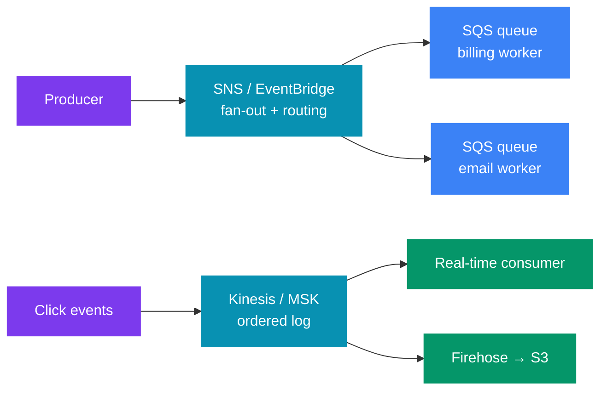
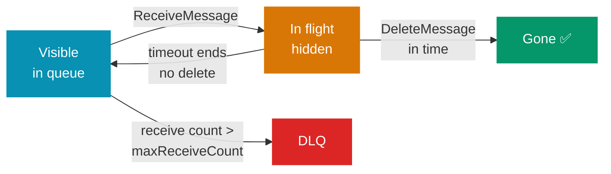
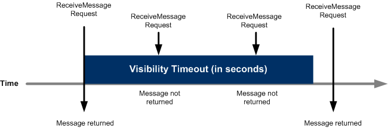
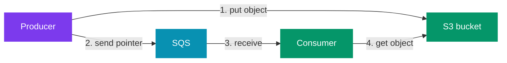
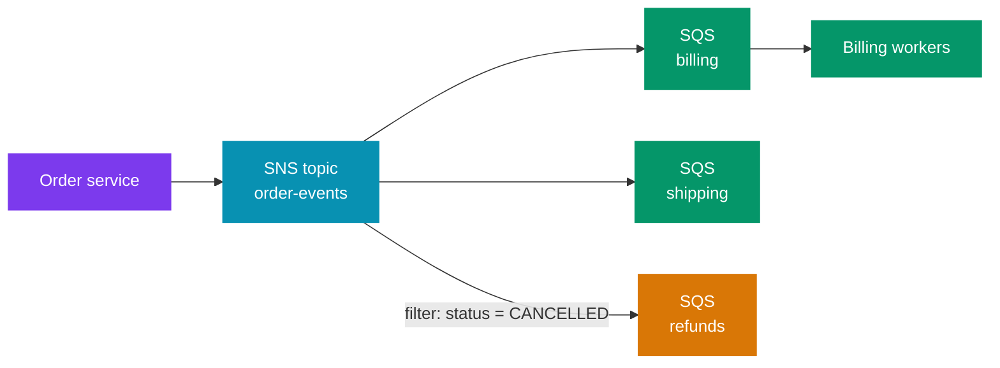
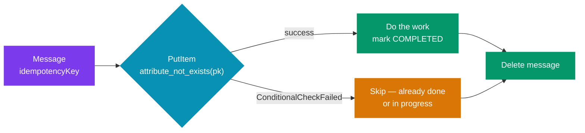
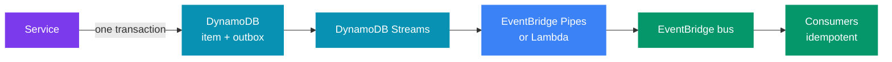
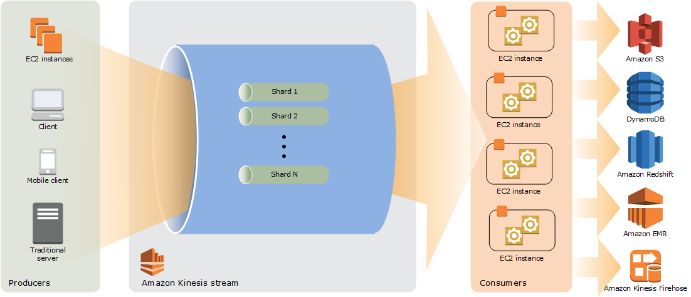
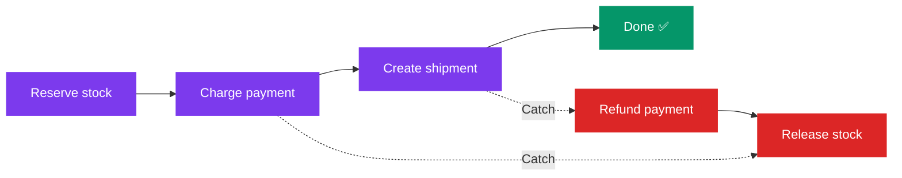
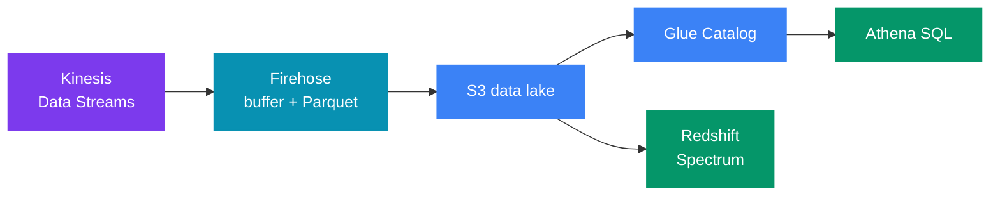

# 📨 Messaging and Streaming on AWS — SQS, SNS, EventBridge, Kinesis, MSK

> 🧭 **AWS for system design** &nbsp;·&nbsp; 🔥🔥 Very High Priority &nbsp;·&nbsp; 💬 **13 Questions**

> _"Any candidate can say 'put a queue in between.' A senior engineer says **which** queue, what
> happens when a consumer is slow or crashes, and how duplicates are made harmless."_

🎯 This file is about **choosing and running** AWS messaging services in a design round.
It does not teach queue theory again. For the general ideas, read these first:

- 🔗 Delivery semantics and broker internals: [Alex Xu Vol 2 — Distributed Message Queue](../../system-design/01_insider_guide_Alex_Xu/vol_2/ch04_distributed_message_queue.md)
- 🔗 Kafka producer, consumer and exactly-once details: [Kafka Interview Questions](../../java/1_interview_questions/17_Kafka_Interview_Questions.md)

> 📏 **Numbers checked against AWS docs on 31 Oct 2026.**  
> - 📨 SQS (Simple Queue Service) max message is **1 MiB**. The old limit was **256 KiB**. AWS raised it in Aug 2025.  
> - 🚌 EventBridge events are also **1 MB** now (since Jan 2026).  
> - 📢 SNS (Simple Notification Service) topics still default to **256 KiB**. Since Sep 2026 you can set a topic to 1 MiB, but only if it has 100 or fewer subscriptions, all SQS, Lambda or Firehose.  
> - 💡 Limits marked "soft" are default quotas. You can ask AWS to raise them.

---

📊 **Question Count**

| # | Section | Questions |
|---|---|---|
| 2 | [SQS — Standard vs FIFO](#2-sqs--standard-vs-fifo) | 2 |
| 3 | [Visibility Timeout — the Most Common Failure](#3-visibility-timeout--the-most-common-failure) | 1 |
| 4 | [Dead-Letter Queue and Redrive](#4-dead-letter-queue-and-redrive) | 1 |
| 5 | [Large Payloads — Claim-Check via S3](#5-large-payloads--claim-check-via-s3) | 1 |
| 6 | [Scaling Consumers on Queue Depth](#6-scaling-consumers-on-queue-depth) | 1 |
| 7 | [SNS — Fan-out and Filtering](#7-sns--fan-out-and-filtering) | 2 |
| 8 | [EventBridge — Content-Based Routing](#8-eventbridge--content-based-routing) | 1 |
| 9 | [Idempotent Consumers and the Outbox Pattern on AWS](#9-idempotent-consumers-and-the-outbox-pattern-on-aws) | 1 |
| 10 | [Kinesis Data Streams](#10-kinesis-data-streams) | 1 |
| 13 | [Step Functions — Orchestration and Sagas](#13-step-functions--orchestration-and-sagas) | 1 |
| 14 | [Data and Analytics in a Design](#14-data-and-analytics-in-a-design) | 1 |
| | **Total** | **13** |

> 🔥🔥 Very High — asked in almost every Tier-1 loop &nbsp;·&nbsp; 🔥 High — very frequent in Tier-1 interviews &nbsp;·&nbsp; ⚡ Medium — commonly asked &nbsp;·&nbsp; 💤 Low — good to know, rarely asked

---

## 📑 Table of Contents

1. [The Five Services in One Picture](#1-the-five-services-in-one-picture)
2. [SQS — Standard vs FIFO](#2-sqs--standard-vs-fifo)
3. [Visibility Timeout — the Most Common Failure](#3-visibility-timeout--the-most-common-failure)
4. [Dead-Letter Queue and Redrive](#4-dead-letter-queue-and-redrive)
5. [Large Payloads — Claim-Check via S3](#5-large-payloads--claim-check-via-s3)
6. [Scaling Consumers on Queue Depth](#6-scaling-consumers-on-queue-depth)
7. [SNS — Fan-out and Filtering](#7-sns--fan-out-and-filtering)
8. [EventBridge — Content-Based Routing](#8-eventbridge--content-based-routing)
9. [Idempotent Consumers and the Outbox Pattern on AWS](#9-idempotent-consumers-and-the-outbox-pattern-on-aws)
10. [Kinesis Data Streams](#10-kinesis-data-streams)
11. [Firehose and MSK](#11-firehose-and-msk)
12. [Decision Table — SQS vs SNS vs EventBridge vs Kinesis vs MSK](#12-decision-table--sqs-vs-sns-vs-eventbridge-vs-kinesis-vs-msk)
13. [Step Functions — Orchestration and Sagas](#13-step-functions--orchestration-and-sagas)
14. [Data and Analytics in a Design](#14-data-and-analytics-in-a-design)

---

## 1. The Five Services in One Picture

🧩 Each service answers a different question:

| Service | One-line job | Model |
|---|---|---|
| 📨 **SQS** | Hold work until a worker takes it | Queue — one consumer group per queue |
| 📢 **SNS** | Push one message to many subscribers now | Pub/sub — push, no storage |
| 🚌 **EventBridge** | Route events by content, across services and accounts | Event bus — rules + targets |
| 🌊 **Kinesis Data Streams** | Ordered, replayable stream of records | Log — shards, many readers |
| 🐘 **MSK** (Managed Streaming for Kafka) | Managed Apache Kafka | Log — partitions, consumer groups |



> 💡 **The key split:**  
> - 📨 A **queue** (SQS) deletes a message once one worker handles it. It spreads **work**.  
> - 📜 A **log** (Kinesis, MSK) keeps records for a retention period. Many readers read the same data at their own position. It shares **data**.

---

## 2. SQS — Standard vs FIFO

### What problem it solves

🧩 **Problem:** SQS puts a buffer between a producer and a worker.

- ⚡ The producer does not wait.
- 🐢 The worker reads at its own speed.
- 🛡️ If the worker is down, messages wait in the queue.

### Standard vs FIFO

| | **Standard** | **FIFO** (First-In, First-Out) |
|---|---|---|
| 📬 Delivery | At-least-once — duplicates can happen | Exactly-once **send** (dedup in a 5-minute window) |
| 🔢 Ordering | Best-effort — can arrive out of order | Strict order **within a message group** |
| ⚡ Throughput | Nearly unlimited TPS (transactions per second) per API action | 300 TPS per API action; 3,000 msg/s with batches of 10 |
| 📈 High-throughput FIFO | — | Up to 70,000 TPS per API action in the largest regions (lower in others, e.g. 9,000 in Mumbai); **about 300 msg/s per message group** |
| 🏷️ Queue name | Any | Must end in `.fifo` |
| ⏱️ Per-message delay | ✅ Yes | ❌ No — only queue-level delay |

🔑 **Message group ID** is the ordering key. Messages with the same group ID are delivered in
order, one batch at a time. Different groups are processed in parallel. So:

- ✅ Use the **entity ID** (order ID, account ID) as the group ID. You get order per entity and parallelism across entities.
- ❌ **Never** use one constant group ID. It turns the queue into a single-thread line.
- 📏 A hot group is capped at about **300 msg/s** even in high-throughput mode.

🔁 **Deduplication ID** stops duplicate **sends** within **5 minutes**. You set it yourself,
or turn on content-based dedup (SHA-256 of the body).

> ⚠️ **Trap:** the dedup ID does **not** stop a consumer from seeing a message twice after its visibility timeout runs out. So FIFO consumers still need to be idempotent (§9).

### Key limits

| Setting | 📏 Value |
|---|---|
| Max message size | **1 MiB** (was 256 KiB until Aug 2025) |
| Retention | 1 minute to 14 days, default 4 days |
| Visibility timeout | 0 s to 12 hours, default 30 s |
| Long-poll wait | 1–20 s (`WaitTimeSeconds`) |
| Delay | 0–15 minutes |
| Batch size per API call | 10 messages |
| In-flight messages | about 120,000 per queue (received, not yet deleted) |

### When NOT to use SQS

| ❌ If you need… | 🧭 Use instead |
|---|---|
| Many independent consumers that each read **every** message | SNS→SQS fan-out, or a log |
| 🔁 **Replay** of old messages (SQS deletes them) | Kinesis or MSK |
| A reply in the same request | A sync call, not a queue |

### Interview questions

1. **🔥 What is the difference between SQS Standard and SQS FIFO queues?**

<!-- -->
<details>
<summary>Answer</summary>

🔗 The full table and the limits are in [§2](#2-sqs--standard-vs-fifo). The short answer:

| | **Standard** | **FIFO** |
|---|---|---|
| 🔢 Ordering | Best-effort | Strict, **within a message group** |
| 📬 Delivery | At-least-once — duplicates can happen | Exactly-once **send** (5-minute dedup window) |
| ⚡ Throughput | Nearly unlimited TPS per API action | 300 TPS per API action; 3,000 msg/s with batches of 10; high-throughput mode up to 70,000 TPS per API action in the largest regions |
| 💰 Cost | Lower | A bit higher |

> 🎤 **Say it:** *"Standard is nearly unlimited. FIFO is 300 TPS per API action, or 3,000 messages/s with batches of 10. High-throughput mode raises that to thousands or tens of thousands, depending on the region."*

> ⚠️ **A common mistake:** "Standard: 3,000 msg/s". That is a FIFO number in the wrong column. Standard has no such limit.

💡 **FIFO order is per message group, not per queue.**

- 📈 More distinct group IDs give more parallel work.
- ✅ Use one group per entity (order ID, account ID).
- ❌ One constant group ID makes the whole queue run one message at a time.

⚠️ **FIFO "exactly-once" covers the send, not your processing.**

1. A consumer finishes the work and crashes before `DeleteMessage`.
2. 🔁 The message comes back after the visibility timeout.
3. So the consumer must still be idempotent ([§9](#9-idempotent-consumers-and-the-outbox-pattern-on-aws)).

🧭 **When to pick which:**

- ✅ **Standard** for most async work (emails, background jobs). Make the consumers idempotent, and duplicates do no harm.
- 🔢 **FIFO** only when the business needs order: ledger entries, stock changes, state transitions.

---

</details>

2. **🔥🔥 You need per-account ordering for ledger updates at 20,000 messages/s. SQS FIFO or Kinesis?**

<!-- -->
<details>
<summary>Answer</summary>

✅ **Both can work.**

📨 **Option 1 — SQS FIFO in high-throughput mode:**

- Use the account ID as the message group ID.
- Order is per account and groups run in parallel.
- 📏 Check two limits: the regional TPS limit, and about 300 msg/s per group (fine unless one account is very hot).

🌊 **Option 2 — Kinesis or MSK.** Pick it instead when:

- other teams also need to read the same ledger events, or
- 🔁 you need replay. SQS deletes a message once it is processed.

---

</details>

---

## 3. Visibility Timeout — the Most Common Failure

🧩 **How it works:**

1. When a consumer receives a message, SQS hides it from other consumers for the **visibility timeout**.
2. ⏱️ The consumer must call `DeleteMessage` before the timeout ends.
3. 🔁 If it does not, the message becomes visible again and another worker gets it.



<p align="center"></p>

> 🖼️ *The same message on a time line: while the timeout runs, other receives get nothing; after it ends, the message comes back.* Source: [Amazon SQS visibility timeout](https://docs.aws.amazon.com/AWSSimpleQueueService/latest/SQSDeveloperGuide/sqs-visibility-timeout.html) · License: CC BY-SA 4.0

### What goes wrong at each end

| Timeout is… | What happens |
|---|---|
| ⚠️ **Too short** (shorter than processing time) | Message comes back while worker 1 is still working. Worker 2 processes it too. You get **duplicate side effects** (two emails, two charges). The receive count climbs, and a healthy message can end up in the DLQ (dead-letter queue). |
| 🐢 **Too long** (hours) | A worker crashes. The message stays hidden for hours. Work is delayed, and queue-age alarms fire late. |

### How to set it

- 📏 Start at about **6× the normal p99 processing time**.
- 💓 For long jobs, keep a short timeout and **extend it** with `ChangeMessageVisibility` while the work runs (a "heartbeat").
- λ For a **Lambda** consumer, AWS recommends a visibility timeout of at least **6× the function timeout**. Lambda may retry a batch after throttling, so it needs this extra room.

### Long polling

| | Short polling | **Long polling** ✅ |
|---|---|---|
| Behaviour | Returns at once, even if the queue is empty | Waits until a message arrives or the time ends (`WaitTimeSeconds` up to 20 s) |
| 💰 Cost | Wastes API calls and money | Fewer calls |
| Accuracy | — | Asks more SQS servers, so you get fewer false "empty" replies |

> 💡 **Tip:** always use long polling unless you need an instant empty answer.

### Delay queues

⏱️ A delay queue hides **new** messages for 0–15 minutes before the first delivery.
Standard queues also allow a per-message delay (`DelaySeconds`).

- ✅ Use it for "retry after a short wait" or "check this payment status in 5 minutes."
- 🧭 For delays longer than 15 minutes, use **EventBridge Scheduler** or Step Functions `Wait`.

### Interview questions

3. **🔥🔥 Users sometimes get two "payment received" emails. The worker uses SQS Standard and takes 40 s in a busy period. What is wrong?**

<!-- -->
<details>
<summary>Answer</summary>

🔍 **Cause:** the visibility timeout is probably 30 s, the default.

1. During busy periods, processing runs longer than the timeout.
2. 🔁 The message becomes visible again.
3. A second worker sends the email again.

✅ **Fix both sides:**

- ⏱️ Raise the timeout to about 6× p99 processing time, or extend it with `ChangeMessageVisibility` as a heartbeat.
- 🛡️ Also make the consumer idempotent with a DynamoDB conditional write on the payment ID. Then a duplicate does no harm even when the timeout is right.

---

</details>

---

## 4. Dead-Letter Queue and Redrive

🪦 A **DLQ** is a normal queue. The source queue's **redrive policy** says: after
`maxReceiveCount` receives, move the message to the DLQ.

🧩 **Why it matters:** a **poison message** (bad data, a bug path) fails every time. Without a DLQ:

- 🔁 it cycles forever,
- 💰 it wastes workers, and
- ⚠️ in FIFO, it **blocks its whole message group**.

| Rule | Reason |
|---|---|
| 📏 `maxReceiveCount` = 3–5 (5+ for Lambda) | Too low sends healthy messages to the DLQ during short outages or throttling |
| 🔢 FIFO source → FIFO DLQ; Standard → Standard | The DLQ type must match |
| ⏱️ DLQ retention **longer** than the source | For Standard queues, the message keeps its **original** enqueue time. A 4-day DLQ can drop a message that already spent 3 days in the source |
| 🔭 Alarm on DLQ `ApproximateNumberOfMessagesVisible > 0` | A DLQ nobody watches is silent data loss |
| 🔁 Fix the bug, then **redrive** | `StartMessageMoveTask` (or the console "Start DLQ redrive") moves messages back to the source queue |

> 🎤 **In the interview:**  
> "Every queue gets a DLQ with maxReceiveCount of five and an alarm on any message in it. After I fix the bug, I redrive the DLQ back to the source. Because the consumer is idempotent, a message that half-ran before is safe to run again."

### Interview questions

4. **🔥 What is a dead-letter queue (DLQ), and when should you use one?**

<!-- -->
<details>
<summary>Answer</summary>

🪦 A DLQ is a normal SQS queue. The **source** queue's redrive policy names the DLQ ARN (Amazon Resource Name) and a `maxReceiveCount`. After that many receives, SQS moves the message to the DLQ. 🔗 The setup rules are in [§4](#4-dead-letter-queue-and-redrive).

✅ **Why you need it:**

- 🛡️ **Isolate poison messages.** A message that always fails would loop forever and waste workers. In FIFO it would also block its message group.
- 🔍 **Debug.** You can read the failed messages and see what went wrong.
- 🔁 **Replay after the fix.** SQS has a built-in DLQ redrive (`StartMessageMoveTask`, or the console). You do not need your own script.

🔭 **What to alarm on:**

| Alarm | What it catches |
|---|---|
| DLQ `ApproximateNumberOfMessagesVisible > 0` | Something in the consumer is broken |
| Source queue `ApproximateAgeOfOldestMessage` | The other failure: nothing fails, but the consumers cannot keep up |

⚠️ **The classic DLQ bug: a visibility timeout shorter than the processing time.**

1. A message takes 45 s, and the timeout is the default 30 s.
2. 🔁 The message comes back while worker 1 still runs it. Worker 2 picks it up, and the receive count climbs.
3. In the end a **healthy** message lands in the DLQ, after causing duplicate side effects.

> 🔍 **Debug tip:** if your DLQ fills with messages that look fine, check this first ([§3](#3-visibility-timeout--the-most-common-failure)).

⚠️ **The retention trap.**

- On a Standard queue, a message keeps its original enqueue time when it moves.
- A message that spent 3 days in a 4-day source queue has about 1 day left in the DLQ.
- ✅ So set the DLQ retention longer than the source (14 days is common).
- 🔢 On a **FIFO** queue, the move resets the enqueue time.

🍃 **In Spring Boot (Spring Cloud AWS 3.x):**

```java
@SqsListener("${queue.name}")
public void processMessage(OrderEvent event) {
    // Default acknowledgement mode is ON_SUCCESS:
    // the framework deletes the message only if this method returns normally.
    // If it throws, the message comes back after the visibility timeout.
    // After maxReceiveCount receives, SQS moves it to the DLQ.
    orderService.process(event);
}
```

Acknowledgement modes in 3.x:

| Mode | Behaviour |
|---|---|
| `ON_SUCCESS` | ✅ The default |
| `MANUAL` | Take an `Acknowledgement` parameter and call it yourself |
| `ALWAYS` | ⚠️ Acknowledge even on failure. This turns off DLQ routing |

> ⚠️ **Trap:** `SqsMessageDeletionPolicy` is the **2.x** API. It was removed in 3.x, the version that goes with Spring Boot 3. Do not write it if you say your stack is Spring Boot 3.

---

</details>

---

## 5. Large Payloads — Claim-Check via S3

🧩 **Problem:** even at 1 MiB, SQS and EventBridge are not for files. And SNS still defaults to 256 KiB.

🎟️ **Claim-check pattern (the SQS Extended Client Library does this for you):**

1. 🪣 Producer uploads the payload to **S3**.
2. 📨 Producer sends a small message with the S3 bucket and key.
3. ⚙️ Consumer reads the message, then gets the object from S3.



- 📏 The Java extended client supports payloads up to **2 GB**.
- 💡 Often you do not need the library at all. An S3 event notification already *is* a pointer message.

> ⚠️ **Fails when:** the S3 object is deleted (lifecycle rule) before a slow consumer reads it.  
> ✅ **Fix:** keep the S3 lifecycle longer than queue retention + DLQ retention.

### Interview questions

5. **⚡ A team wants to send 5 MB PDF metadata + content through SNS → SQS. What do you tell them?**

<!-- -->
<details>
<summary>Answer</summary>

❌ **Both are too small for 5 MB:**

- 📢 SNS allows 256 KiB by default (1 MiB at most).
- 📨 SQS takes 1 MiB now.

✅ **Use the claim-check pattern:**

1. 🪣 Store the PDF in S3 and publish only the bucket, key and metadata.
2. The SQS Extended Client does this for SQS.
3. ⏱️ Keep the S3 lifecycle longer than queue + DLQ retention, so a delayed consumer can still find the object.

---

</details>

---

## 6. Scaling Consumers on Queue Depth

### EC2 / ECS workers with Auto Scaling

> ⚠️ **Trap:** CPU is the wrong signal for a queue worker. A worker blocked on I/O has low CPU but a growing backlog.

📈 **Scale on backlog per instance:**

```text
backlogPerInstance = ApproximateNumberOfMessagesVisible / runningInstances
targetBacklog      = acceptableLatencySeconds / averageSecondsPerMessage
```

1. 🔭 Publish `backlogPerInstance` as a custom metric.
2. 🎯 Use **target tracking** to keep it at `targetBacklog`.

📏 **Example:** each message takes 0.5 s and you accept 30 s of delay → target = 60 messages per instance.

- 🔭 Also alarm on `ApproximateAgeOfOldestMessage`. Depth says how much work waits. Age says how late you are.
- ⚠️ Scale-in must be slow. A worker killed mid-message makes that message come back after the timeout.

### Lambda event source mapping (ESM)

λ Lambda polls SQS for you and calls your function with a batch.

| Setting | 📏 Value / effect |
|---|---|
| Batch size | Standard: 1–10,000 (above 10 needs a batching window); FIFO: 1–10 |
| `MaximumBatchingWindowInSeconds` | 0–300 s — wait to fill a bigger batch |
| Scaling (Standard) | Adds up to 300 concurrent invocations per minute, up to 1,250 by default |
| Scaling (FIFO) | One batch per message group at a time — parallelism = number of active groups |
| `MaximumConcurrency` | Caps concurrency for this queue — protects a small downstream DB |

🔁 **Partial batch failure.**

- ⚠️ By default, if one message in a batch of 10 fails, the **whole batch** comes back. Nine good messages run again.
- ✅ Turn on `ReportBatchItemFailures` and return only the failed IDs:

```java
public SQSBatchResponse handleRequest(SQSEvent event, Context context) {
    List<SQSBatchResponse.BatchItemFailure> failures = new ArrayList<>();
    for (SQSEvent.SQSMessage message : event.getRecords()) {
        try {
            process(message);
        } catch (Exception e) {
            failures.add(new SQSBatchResponse.BatchItemFailure(message.getMessageId()));
        }
    }
    return new SQSBatchResponse(failures);
}
```

- 🔢 For FIFO, stop at the first failure and also report every message after it. Otherwise order breaks.

> ⚠️ **Fails when — the downstream DB:** Lambda scales fast. A burst of 50,000 messages can open 1,000 DB connections and take RDS (Relational Database Service) down.  
> ✅ **Fix:** set `MaximumConcurrency`, and use RDS Proxy.

> 🎤 **In the interview:**  
> "I don't scale queue workers on CPU. I scale on backlog per worker and alarm on the age of the oldest message, because age is what the user actually feels."

### Interview questions

6. **🔥 A queue-backed worker fleet on ECS scales on CPU, but users still wait minutes during spikes. What would you change?**

<!-- -->
<details>
<summary>Answer</summary>

🔍 **Cause:** the workers are I/O-bound, so CPU stays low while the backlog grows.

✅ **What to change:**

1. 📈 Scale on backlog per task: visible messages ÷ running tasks.
2. 🎯 Set the target from the acceptable delay ÷ seconds per message, and use target tracking.
3. 🔭 Alarm on `ApproximateAgeOfOldestMessage`, because age is the latency users feel.
4. 🐢 Scale in slowly, so you do not kill tasks in the middle of a message.

---

</details>

---

## 7. SNS — Fan-out and Filtering

### What problem it solves

🧩 **Problem:** one event, many independent receivers. The producer publishes once. SNS **pushes** a copy to each subscription.

- 📬 **Subscribers:** SQS, Lambda, HTTP/S, Firehose, email, SMS, mobile push.
- 📈 **Scale:** up to 12.5 million subscriptions per standard topic.
- 📏 **Max message:** **256 KiB** by default. A topic can be set to **1 MiB** (since Sep 2026) if it has at most 100 subscriptions, all SQS, Lambda or Firehose.
- ⚠️ **No storage.** If a subscriber is down and retries run out, the message is lost — unless the subscription has its own DLQ.

### SNS → SQS fan-out (the standard pattern)



🧭 Why put an SQS queue behind each subscriber, and not call Lambda or HTTP directly?

- 🛡️ Each consumer gets **its own buffer**, its own retry, its own DLQ.
- 🐢 A slow consumer does not affect the others.
- ➕ Adding a new consumer = add a queue + subscription. The producer does not change.

> 💡 **Tip:** turn on **raw message delivery** so SQS gets the body, not the SNS JSON envelope.

### Filter policies

🔎 A filter policy is JSON on the **subscription**.

- It matches message **attributes** (default) or the message **body** (payload-based filtering).
- ⚠️ Without a policy, a subscriber gets every message.

```json
{
  "status": ["CANCELLED"],
  "amount": [{ "numeric": [">", 10000] }]
}
```

💰 Filtering in SNS saves the consumer from receiving and throwing away messages.

### FIFO topics

- 🔢 Same ordering (message group ID) and dedup (5-minute window) as SQS FIFO.
- 📬 Subscribers can be SQS FIFO or SQS Standard queues.
- ✅ Use it when you need **fan-out + order**: e.g. ledger events to several FIFO queues.
- ⚠️ Throughput is much lower than a standard topic. Check the current quota before you depend on it.

### Interview questions

7. **🔥🔥 What is the difference between SQS and SNS?**

<!-- -->
<details>
<summary>Answer</summary>

| | **SQS** | **SNS** |
|---|---|---|
| 🧩 Pattern | Queue — **one** consumer handles each message (competing consumers) | Pub/sub — **every** subscriber gets its own copy |
| 🔄 Model | Pull — consumers poll the queue | Push — SNS calls the subscribers |
| 💾 Storage | ✅ Yes — 4 days by default, up to 14 days | ❌ No store to read from later |
| 📬 Who reads | Your workers | SQS, Lambda, HTTP/S, Firehose, email, SMS, mobile push |
| 🎯 Use | Job queues, buffering, spreading work | Fan-out, notifications, broadcast |

⚠️ **The follow-up: "So if a subscriber is down, is the message lost?"** Not if you set it up well.

- 🔁 SNS **retries** failed deliveries with backoff. For HTTP/S endpoints, a delivery policy sets the retry schedule.
- 🪦 A **subscription DLQ** (an SQS queue in the subscription's redrive policy) catches a message after all retries fail.
- 🗄️ **FIFO topics** can archive messages and replay them to a subscriber, up to 365 days back.
- 💡 So "subscriber down means message lost" is true only when you set up none of these.

✅ This is why the standard pattern puts an SQS queue behind each subscriber ([§7](#7-sns--fan-out-and-filtering)). Each consumer gets its own buffer, retries and DLQ. Add a filter policy, so each queue gets only the events it needs.

- 🔗 Need replay or stream processing? Use Kinesis or MSK ([§12](#12-decision-table--sqs-vs-sns-vs-eventbridge-vs-kinesis-vs-msk)).
- 🔗 SNS vs EventBridge is the question in [§8](#8-eventbridge--content-based-routing).

---

</details>

8. **🔥🔥 An order event must reach billing, shipping, analytics, and — only for cancelled orders — refunds. Design it.**

<!-- -->
<details>
<summary>Answer</summary>

| Part | Design |
|---|---|
| 📢 Producer | The order service publishes once to an SNS topic |
| 📨 Billing, shipping | Each consumer has its own SQS queue subscribed, with raw delivery, its own DLQ and its own scaling |
| 🔎 Refunds | The refunds subscription has a filter policy `status = CANCELLED` |
| 🪣 Analytics | Analytics can subscribe Firehose to land events in S3 |

> 🧭 **Alternative:** if several teams own these consumers and want to add rules on their own, use an EventBridge bus instead. Then you also get archive and replay.

---

</details>

---

## 8. EventBridge — Content-Based Routing

### What problem it solves

🧩 **Problem:** EventBridge is an **event router**.

1. 🚌 Producers put events on a **bus**.
2. 🔎 **Rules** match on any field of the event JSON.
3. 🎯 Each rule sends the event to up to **5 targets**.

| Feature | Why it matters in a design |
|---|---|
| 🔎 **Rules on any field** | Route by `detail.status`, prefix, numeric range, "exists" — richer than SNS filters |
| ☁️ **AWS service events** | EC2 (Elastic Compute Cloud) state changes, S3, CodePipeline, CloudTrail API calls — all arrive on the default bus with no code |
| 🤝 **SaaS partner buses** | Events from tools like Datadog or Zendesk arrive with no polling code |
| 📐 **Schema registry** | Discovers event shapes; generates Java/TypeScript classes |
| 🔁 **Archive and replay** | Store events, then replay a time window to a bus — useful after a consumer bug |
| 🏢 **Cross-account buses** | One central bus for many teams' accounts |
| ⏰ **Scheduler** | One-time or cron jobs at large scale — replaces "a cron on one EC2" |
| 🔧 **Pipes** | Point-to-point: source (SQS, Kinesis, DynamoDB Streams, MSK) → filter → enrich → target |
| 🌐 **API destinations** | Call a third-party HTTP API with rate limits and auth |

🔁 **Delivery:** at-least-once. A failed target is retried for up to **24 hours** (185 attempts
by default).

> ⚠️ **Trap:** give each target a **DLQ** (an SQS queue), or failed events are dropped.

📏 **Limits that drive design:**

- 📦 Event size **1 MB** (was 256 KiB until Jan 2026).
- ⚡ `PutEvents` has a per-region TPS quota (soft; 10,000/s in the largest regions, 600/s in Mumbai). That is much lower than SNS.
- 🐢 Latency is usually well under a second, but it is higher than SNS.

### EventBridge vs SNS

| | 📢 **SNS** | 🚌 **EventBridge** |
|---|---|---|
| 🔎 Routing | Filter policy per subscription | Rules on any event field |
| 🎯 Targets | 12.5M subscriptions per topic | 5 targets per rule; many rules per bus |
| ⚡ Throughput | Very high | Lower default quota |
| ☁️ Sources | Your code | Your code + 200+ AWS services + SaaS |
| 🔁 Replay | ❌ No | ✅ Archive + replay |
| 📱 Human channels | ✅ Email, SMS, mobile push | ❌ No (send to SNS for that) |
| 🧭 Pick when | High-volume fan-out to a few known consumers | Many teams, many event types, routing by content |

> 🎤 **In the interview:**  
> "Inside one service I use SNS to SQS for fan-out because it is fast and cheap. Between teams I use an EventBridge bus. Teams add their own rules without asking the producer, and archive-and-replay lets a team recover after a consumer bug."

### Interview questions

9. **🔥 When would you choose EventBridge over SNS, and when not?**

<!-- -->
<details>
<summary>Answer</summary>

✅ **Choose EventBridge when:**

- 🏢 events go between teams or accounts;
- 🔎 you route by content on any field;
- ☁️ you need AWS service and SaaS events, archive and replay, or the schema registry.

❌ **Avoid it when:**

- ⚡ you need very high-TPS, latency-sensitive fan-out. Its `PutEvents` quota is lower and its latency is higher than SNS;
- 📱 you need email, SMS or mobile push.

> 💡 **A common setup uses both:** EventBridge between domains, SNS → SQS inside a domain.

---

</details>

---

## 9. Idempotent Consumers and the Outbox Pattern on AWS

### Why you need an idempotent consumer

🧩 Every AWS messaging service here is **at-least-once** to the consumer. Duplicates come from:

- ⏱️ the visibility timeout ending during slow processing,
- λ a Lambda batch retried after one message failed,
- 🔁 a producer retry after a network timeout (SQS, Kinesis, SNS),
- 🚌 an EventBridge target retry, or a DLQ redrive.

> ⚠️ **Trap:** FIFO dedup only covers duplicate **sends** in 5 minutes. It does not cover these.

### The AWS idempotency store — DynamoDB conditional write



- 🔑 The key comes from the **business** (payment ID, `orderId#eventType`), not from the SQS message ID. A producer retry creates a new message ID.
- ⏱️ Write the key with a status (`IN_PROGRESS` → `COMPLETED`) and a **TTL** (time to live) longer than the retry window (for example 24 h).
- 🗃️ If the work writes to the same DynamoDB table, do it in one `TransactWriteItems` with the key. Then "work done" and "key stored" cannot split.
- 🗃️ If the work writes to RDS, store the key in a unique-constraint table in the **same SQL transaction**.

> 💡 **Tip:** **Powertools for AWS Lambda** has an idempotency utility built on exactly this.

### The outbox pattern on AWS

🧩 **Problem:** "write to the DB, then publish to SNS" is two systems.

- ⚠️ If the service crashes between them, the DB has the change but no event is sent (or the reverse).

✅ **Fix:** write the business row and an **outbox row** in one transaction. A separate relay publishes the outbox.

| Database | Atomic write | Relay to the bus |
|---|---|---|
| 🗃️ **RDS / Aurora** | Business row + `outbox` row in one SQL transaction | Debezium CDC (change data capture) on **MSK Connect** reads the binlog / WAL (write-ahead log) → Kafka; or a poller publishes to SNS/EventBridge and marks rows sent |
| 🗃️ **DynamoDB** | `TransactWriteItems` (item + outbox item), or just the item itself | **DynamoDB Streams** (24 h retention, ordered per item) → Lambda or **EventBridge Pipes** → SNS / EventBridge |



> 💡 **Key idea:** the relay is at-least-once too. So the outbox + idempotent consumer **together** give effectively-once.

> ⚠️ **Fails when:** a stream consumer keeps failing. DynamoDB Streams keeps records for only **24 hours**.  
> ✅ **Fix:** set `MaximumRetryAttempts` and an on-failure destination, or the events expire and are lost.

🔗 For the general theory of outbox and sagas, see [Distributed Fundamentals](../../system-design/02_distributed_systems/01_distributed_fundamentals.md).

### Interview questions

10. **🔥🔥 Your service writes an order to Aurora, then publishes `OrderCreated` to SNS. Sometimes the event is missing. Fix it.**

<!-- -->
<details>
<summary>Answer</summary>

🔍 **Cause:** this is the dual-write problem. A crash between the commit and the publish loses the event.

✅ **Fix — use the outbox pattern:**

1. 🗃️ Insert the order and an outbox row in the same SQL transaction.
2. 📤 A relay then publishes the outbox: Debezium on MSK Connect reading the WAL, or a poller that publishes and marks rows as sent.
3. 🔁 The relay is at-least-once, so consumers must dedupe on the event ID.

---

</details>

---

## 10. Kinesis Data Streams

### What problem it solves

🧩 **Problem:** you need an ordered, durable, **replayable** stream for high-volume small records.

- 📊 Typical records: clicks, telemetry, logs, change events.
- 👥 Many consumers read the same data independently.

### Shards and limits

| Item | 📏 Value |
|---|---|
| Write per shard | **1 MB/s or 1,000 records/s** |
| Read per shard (shared) | **2 MB/s**, 5 `GetRecords` calls/s — shared by **all** standard consumers |
| Read with **enhanced fan-out** | 2 MB/s **per consumer** per shard, pushed over HTTP/2 (`SubscribeToShard`), about 70 ms latency |
| Retention | 24 hours default; up to **365 days** |
| Record size | **1 MiB** by default. Since Oct 2025 you can raise a stream's max to **10 MiB**. Large records are for occasional use; the 1 MB/s per-shard write limit still applies |
| Ordering | Within a shard. Same **partition key** → same shard → in order |
| Capacity modes | **Provisioned** (you pick shards) or **On-demand** (starts at 4 MB/s write, scales on the last 30 days' peak; soft cap per stream) |

<p align="center"></p>

> 🖼️ *Producers write into one stream split into shards; many consumers read the same shards. (The picture uses the old name "Kinesis Firehose".)* Source: [Amazon Kinesis Data Streams terminology and concepts](https://docs.aws.amazon.com/streams/latest/dev/key-concepts.html) · License: CC BY-SA 4.0

📏 **Sizing example:**

1. ✍️ 5,000 events/s × 2 KB = 10 MB/s in → at least **10 shards** for write.
2. 📖 Two standard consumers each wanting the full 10 MB/s need 20 MB/s out → use **enhanced fan-out**.
3. ⚠️ Without it, the consumers share 2 MB/s per shard and fall behind.

### Failure modes

| ⚠️ Failure | 🔍 Cause | ✅ Fix |
|---|---|---|
| 🔥 **Hot shard** | A few partition keys carry most traffic (one big merchant, one celebrity) | Better key with more spread; add a random suffix (you lose order across the suffix); split the shard |
| `WriteProvisionedThroughputExceeded` | Shard write limit hit | More shards, KPL (Kinesis Producer Library) aggregation, retry with backoff |
| ☠️ **Poison record blocks the shard** | Lambda retries a failing batch until the record **expires**. The whole shard stops | `BisectBatchOnFunctionError`, `MaximumRetryAttempts`, `MaximumRecordAgeInSeconds`, on-failure destination |
| 🐢 Consumer lag | Slow consumer or too few shards | Watch `GetRecords.IteratorAgeMilliseconds`; Lambda `ParallelizationFactor` (up to 10 per shard); more shards |
| 🔁 Duplicates | Producer retry; consumer restarts from last checkpoint | Idempotent consumer (§9) |

- 📈 Lambda reads **one batch per shard at a time** by default. So parallelism = shard count × `ParallelizationFactor`.
- ⚠️ KCL (Kinesis Client Library) stores checkpoints and shard leases in a **DynamoDB** table. That table's capacity can become the bottleneck.

> 🎤 **In the interview:**  
> "I partition by user ID, so each user's events stay in order. I size shards from peak MB/s, not average. I watch iterator age, because that tells me if consumers are falling behind."

### Interview questions

11. **🔥 A Lambda reading from Kinesis stopped making progress on one shard, and iterator age keeps growing. Why?**

<!-- -->
<details>
<summary>Answer</summary>

🔍 **Cause:** this is most likely a poison record. Lambda retries a failing batch until the record expires, and the shard is blocked in the meantime.

✅ **Fix:**

1. ✂️ Turn on `BisectBatchOnFunctionError` to isolate the bad record.
2. 🔁 Set `MaximumRetryAttempts` and `MaximumRecordAgeInSeconds`.
3. 📨 Add an on-failure destination (SQS or SNS) for skipped records.

> 🧭 **If all shards are slow, not just one,** the cause is capacity instead. Raise `ParallelizationFactor` or add shards.

---

</details>

---

## 11. Firehose and MSK

### Amazon Data Firehose (formerly Kinesis Data Firehose)

🚚 Firehose is a **delivery** service, not a stream you read from.

- 📥 **Sources:** direct PUT, Kinesis Data Streams, MSK, CloudWatch Logs, EventBridge.
- 📤 **Destinations:** S3, Redshift, OpenSearch, Splunk, Datadog, HTTP endpoints, and more.
- ⏱️ **Buffering:** it **buffers** by size or time, then writes in batches. So it is **near real-time** (seconds to minutes), not real-time.
- 🔧 **Extras:** optional Lambda transform; built-in convert to **Parquet / ORC** (Optimized Row Columnar); dynamic partitioning of S3 prefixes; compression.
- 📈 **Scaling:** fully managed, scales on its own.
- ❌ **Missing:** **no replay, no storage, no custom consumers.**
- 🛡️ **Errors:** failed records go to an S3 backup prefix.

> 🧭 **Use Firehose when** the answer to "who reads this?" is "a storage system," not "my service."

### Amazon MSK (Managed Streaming for Apache Kafka)

| Option | What you manage |
|---|---|
| 🖥️ **MSK Provisioned** | Broker size and count, storage, partitions. Express brokers are a newer type with faster scaling and less storage work |
| ⚙️ **MSK Serverless** | Only topics and partitions. Capacity scales on its own, with per-cluster limits |
| 🔌 **MSK Connect** | Managed Kafka Connect — for example Debezium CDC from RDS |

🧭 **Pick MSK over Kinesis when:**

- ☕ The team or the code already uses Kafka (Spring Kafka, Kafka Streams, Connect).
- 🧰 You need Kafka features: log compaction, transactions (exactly-once inside Kafka), many consumer groups at no extra read cost, very long retention with tiered storage.
- ☁️ You want to stay portable across clouds.

🧭 **Pick Kinesis over MSK when:**

- 👥 the team is small and wants no broker, partition-rebalance or version-upgrade work, and
- λ the AWS integrations (Lambda, Firehose) are enough.

⚠️ **Failure modes specific to MSK:**

- 💾 A broker disk fills up.
- 🐢 Consumer-group rebalances cause lag spikes.
- ❌ You cannot reduce a topic's partition count.
- 🌐 MSK runs inside your **VPC** (Virtual Private Cloud), so clients need network access and the right security groups.

🔗 Kafka internals are in [Kafka Interview Questions](../../java/1_interview_questions/17_Kafka_Interview_Questions.md).

---

## 12. Decision Table — SQS vs SNS vs EventBridge vs Kinesis vs MSK

| | 📨 **SQS** | 📢 **SNS** | 🚌 **EventBridge** | 🌊 **Kinesis Data Streams** | 🐘 **MSK** |
|---|---|---|---|---|---|
| 🧩 Model | Queue (pull) | Pub/sub (push) | Event bus (push) | Log (pull or push) | Log (pull) |
| 👥 Readers per message | One | All subscribers | All matching rules | All consumers | All consumer groups |
| 🔢 Ordering | FIFO: per group | FIFO topic: per group | ❌ None | Per shard (partition key) | Per partition |
| 🔁 Replay | ❌ No | ❌ No | ✅ Archive + replay | ✅ Yes, within retention | ✅ Yes, within retention |
| 💾 Retention | Up to 14 days | None | Archive (optional) | 24 h – 365 days | Any (tiered storage) |
| 📏 Max message | 1 MiB | 256 KiB default (1 MiB opt-in) | 1 MB | 1 MiB default, up to 10 MiB (§10) | 1 MB default, configurable |
| 📈 Scaling work | None | None | None | Shards (or on-demand) | Brokers + partitions |
| ✅ Typical use | Job queue, buffer, load levelling | Fan-out, notifications | Cross-team events, AWS events, SaaS | Clickstream, telemetry, CDC to analytics | Kafka workloads, event sourcing, CDC |
| ❌ Avoid when | Many readers need the same message | You need storage or replay | Very high TPS, low latency | Simple job queue | Small team, simple needs |

🧭 **One-line rules:**

- 📨 **"Do this work once"** → SQS.
- 📢 **"Tell everyone this happened"** → SNS → SQS (high volume) or EventBridge (many teams, routing by content).
- 🌊 **"Keep the ordered history, let many readers replay it"** → Kinesis or MSK.
- 🪣 **"Land it in S3 / Redshift / OpenSearch"** → Firehose.

---

## 13. Step Functions — Orchestration and Sagas

### Orchestration vs choreography

| | 💃 **Choreography** (events) | 🎼 **Orchestration** (Step Functions) |
|---|---|---|
| ⚙️ How | Each service reacts to events on SNS / EventBridge | A state machine calls each step and decides the next |
| 🔗 Coupling | Low — services do not know each other | The workflow knows every step |
| 👀 Seeing the flow | Hard — spread across services and logs | One visual graph with the state of every run |
| ✅ Good for | Simple fan-out, independent reactions | Multi-step business flows with rollback |

### What Step Functions gives you

- 🧱 **States:** Task, Choice, Parallel, Map, Wait, plus `Retry` and `Catch` per step.
- 🔌 **Direct service calls** (DynamoDB, SQS, SNS, ECS (Elastic Container Service), Bedrock and 200+ more) — often no Lambda is needed.
- ⏸️ **Wait for callback** (`.waitForTaskToken`): pause until a human approves or an outside system replies.
- 📈 **Distributed Map**: run up to 10,000 child workflows in parallel over items in S3.

| | **Standard** | **Express** |
|---|---|---|
| ⏱️ Max duration | 1 year | 5 minutes |
| 🔁 Execution semantics | Exactly-once per step | At-least-once (async) / at-most-once (sync) |
| 🔭 History | Full, visible in the console for 90 days | Sent to CloudWatch Logs |
| 💰 Price model | Per state transition | Per request + duration |
| ✅ Use | Business workflows, sagas, human steps | High-volume, short event processing |

> 📏 **Limit:** payload between states is **256 KiB** — pass S3 keys, not documents.

### Saga with Step Functions



- ↩️ Each forward step has a **compensating** step. `Catch` on a step runs the compensations in reverse.
- 🔁 Each step and each compensation must be **idempotent**. Retries and replays will call them again.

> 🎤 **In the interview:**  
> "For a checkout across stock, payment and shipping, I use a Step Functions Standard workflow as the saga orchestrator. Each step has a compensating action in its Catch, and every step is idempotent. Side reactions like emails stay as events on EventBridge."

### Interview questions

12. **🔥🔥 Checkout spans stock, payment and shipping services. How do you keep them consistent on AWS?**

<!-- -->
<details>
<summary>Answer</summary>

🧩 There is no distributed transaction, so use a saga.

1. 🎼 A Step Functions Standard workflow orchestrates the steps: reserve stock, charge payment, create shipment.
2. ↩️ Each step has a compensating action (release stock, refund) wired through `Catch`.
3. 🔁 Each step uses an idempotency key, so retries are safe.

> ⚖️ **Trade-off:** choreography over EventBridge is fine for side effects such as email. But a flow with ordered steps and rollback is easier to see and debug as one state machine.

---

</details>

---

## 14. Data and Analytics in a Design

🎯 Only what you name in a design round — one short paragraph each.

📊 **The standard analytics path:**

1. 🌊 Kinesis Data Streams (or direct PUT) → **Firehose**
2. 🪣 → **S3** as Parquet, partitioned by date
3. 📚 → **Glue Data Catalog** holds the table schema (a Glue crawler can discover it)
4. 🔍 → **Athena** runs SQL straight on S3.

> 💰 **Cost:** Athena is serverless and you pay per TB scanned. So Parquet, compression and partitions cut both cost and query time.



🏛️ **Redshift.** A columnar, MPP (massively parallel processing) **data warehouse** for heavy, repeated BI (business intelligence) queries and joins
over large data.

- ⚙️ It is provisioned or Serverless.
- 📥 Load with `COPY` from S3 (or zero-ETL (ETL: extract, transform, load) from Aurora / DynamoDB).
- 🪣 **Redshift Spectrum** queries S3 data without loading it.

> 🧭 **How to choose:** pick Athena for ad-hoc queries over a data lake; pick Redshift for dashboards that hit the same large tables all day.

🔎 **OpenSearch.** A search and log-analytics engine: full-text search, fuzzy match,
aggregations.

- ⚠️ In a design it is a **secondary index**, never the source of truth.
- 🗃️ The usual feed is DynamoDB Streams → Lambda (or an OpenSearch Ingestion pipeline) → OpenSearch.
- 🔭 Or CloudWatch Logs / Firehose → OpenSearch for log search.
- ⏱️ The index is eventually consistent with the database.

### Interview questions

13. **🔥 Clickstream at 50 MB/s must feed a real-time fraud model and a daily analytics job. Design the ingestion.**

<!-- -->
<details>
<summary>Answer</summary>

| Part | Design |
|---|---|
| 🌊 Ingest | Use Kinesis Data Streams, partitioned by user or session ID. That needs at least 50 shards for write, or on-demand mode |
| ⚡ Real-time fraud | The fraud consumer uses enhanced fan-out, so it gets its own 2 MB/s per shard and about 70 ms latency |
| 🪣 Daily analytics | Firehose reads the same stream and writes Parquet to S3, partitioned by date. Glue catalogs it, and Athena or Redshift Spectrum runs the daily job |
| 🔭 Monitoring | Monitor iterator age and write-throttle metrics, and watch for hot partition keys |

---

</details>

---

## 📊 Section Coverage Tracker

> **R-1:** `✅ First read` &nbsp;·&nbsp; **R0–R6:** `🟢🟡🔴 Recall confidence` · `[ ] Pending` · `⏭️ Skipped`  
> **Priority:** `🔥🔥 VH` · `🔥 H` · `⚡ M` · `💤 L`

| § | Section | Priority | R-1 | R0 | R1 | R2 | R3 | R4 | R5 | R6 |
|---|---------|----------|-----|----|----|----|----|----|----|----|
| 1 | The Five Services in One Picture | 🔥🔥 | [ ] | [ ] | [ ] | [ ] | [ ] | [ ] | [ ] | [ ] |
| 2 | SQS — Standard vs FIFO | 🔥🔥 | [ ] | [ ] | [ ] | [ ] | [ ] | [ ] | [ ] | [ ] |
| 3 | Visibility Timeout — the Most Common Failure | 🔥🔥 | [ ] | [ ] | [ ] | [ ] | [ ] | [ ] | [ ] | [ ] |
| 4 | Dead-Letter Queue and Redrive | 🔥 | [ ] | [ ] | [ ] | [ ] | [ ] | [ ] | [ ] | [ ] |
| 5 | Large Payloads — Claim-Check via S3 | ⚡ | [ ] | [ ] | [ ] | [ ] | [ ] | [ ] | [ ] | [ ] |
| 6 | Scaling Consumers on Queue Depth | 🔥 | [ ] | [ ] | [ ] | [ ] | [ ] | [ ] | [ ] | [ ] |
| 7 | SNS — Fan-out and Filtering | 🔥🔥 | [ ] | [ ] | [ ] | [ ] | [ ] | [ ] | [ ] | [ ] |
| 8 | EventBridge — Content-Based Routing | 🔥 | [ ] | [ ] | [ ] | [ ] | [ ] | [ ] | [ ] | [ ] |
| 9 | Idempotent Consumers and the Outbox Pattern on AWS | 🔥🔥 | [ ] | [ ] | [ ] | [ ] | [ ] | [ ] | [ ] | [ ] |
| 10 | Kinesis Data Streams | 🔥🔥 | [ ] | [ ] | [ ] | [ ] | [ ] | [ ] | [ ] | [ ] |
| 11 | Firehose and MSK | 🔥 | [ ] | [ ] | [ ] | [ ] | [ ] | [ ] | [ ] | [ ] |
| 12 | Decision Table — SQS vs SNS vs EventBridge vs Kinesis vs MSK | 🔥🔥 | [ ] | [ ] | [ ] | [ ] | [ ] | [ ] | [ ] | [ ] |
| 13 | Step Functions — Orchestration and Sagas | 🔥 | [ ] | [ ] | [ ] | [ ] | [ ] | [ ] | [ ] | [ ] |
| 14 | Data and Analytics in a Design | ⚡ | [ ] | [ ] | [ ] | [ ] | [ ] | [ ] | [ ] | [ ] |

### 🎯 Review Queue

_Questions missed in the last recall — drilled first next session, cleared when solid. Managed by `/recall`._

- _(empty)_
