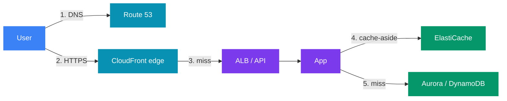
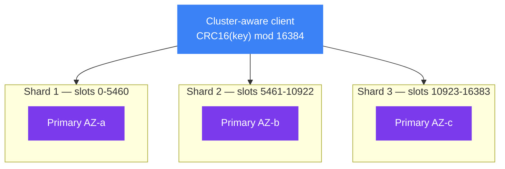
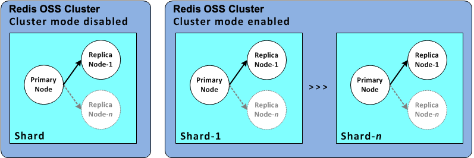
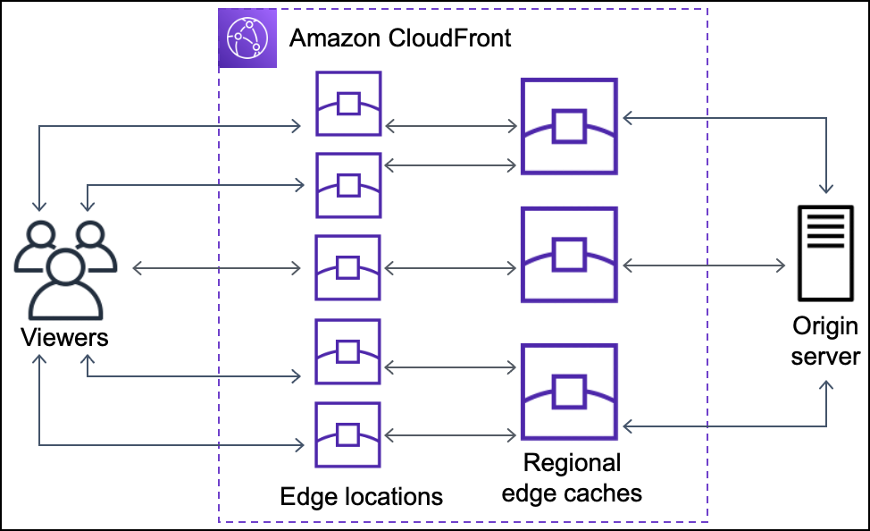
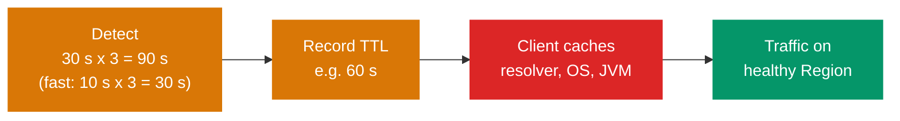

# ⚡ AWS Caching and Edge for System Design — ElastiCache, CloudFront, Global Accelerator, Route 53

> 🧭 **AWS for system design** &nbsp;·&nbsp; 🔥🔥 Very High Priority &nbsp;·&nbsp; 💬 **11 Questions**

> _"Latency is decided before the request reaches your code: by DNS, by the edge, and by the
> cache. A senior engineer knows how each layer fails, and how long the failure lasts."_

This note covers the layers **in front of** the database:

| Layer | Service |
|---|---|
| 🧠 An in-memory cache | ElastiCache |
| 🌍 A CDN (Content Delivery Network) | CloudFront |
| 🚀 An anycast network entry point | Global Accelerator |
| 🌐 DNS | Route 53 |

It is **AWS-specific**.

🔗 **The generic theory lives elsewhere:**
- 🧠 Cache strategies, eviction, CDN basics → [Alex Xu Vol 1 ch01 §4 and §5](../../system-design/01_insider_guide_Alex_Xu/vol_1/ch01_scale_from_zero.md)
- 🧮 Consistent hashing (how cache clients shard keys) → [Alex Xu Vol 1 ch05](../../system-design/01_insider_guide_Alex_Xu/vol_1/ch05_design_consistent_hashing.md)
- 🍃 Redis in Spring: rate limiting, idempotency, sessions, `@Cacheable` → [Redis Advanced Production Patterns](../../java/3_spring/02_spring_data_jpa/12_Redis_Advanced_Production_Patterns.md)
- ⚖️ Load balancer algorithms and L4 vs L7 → [Load Balancing Strategies](../../system-design/02_distributed_systems/02_load_balancing_strategies.md)
- 🗃️ DAX (DynamoDB Accelerator: the DynamoDB-only cache) → [02_databases.md §5.5](02_databases.md#55-dax--dynamodb-accelerator)

---

📊 **Question Count**

| # | Section | Questions |
|---|---|---|
| 1 | [ElastiCache — Valkey / Redis OSS vs Memcached](#1-elasticache--valkey--redis-oss-vs-memcached) | 1 |
| 2 | [Caching Patterns on AWS](#2-caching-patterns-on-aws) | 2 |
| 3 | [CloudFront — the CDN](#3-cloudfront--the-cdn) | 3 |
| 4 | [Edge Compute — CloudFront Functions vs Lambda@Edge](#4-edge-compute--cloudfront-functions-vs-lambdaedge) | 1 |
| 5 | [Global Accelerator — Anycast Entry to the AWS Network](#5-global-accelerator--anycast-entry-to-the-aws-network) | 1 |
| 6 | [Route 53 — DNS, Routing Policies and Health Checks](#6-route-53--dns-routing-policies-and-health-checks) | 3 |
| | **Total** | **11** |

> 🔥🔥 Very High — asked in almost every Tier-1 loop &nbsp;·&nbsp; 🔥 High — very frequent in Tier-1 interviews &nbsp;·&nbsp; ⚡ Medium — commonly asked &nbsp;·&nbsp; 💤 Low — good to know, rarely asked

---

## 📑 Table of Contents

1. [ElastiCache — Valkey / Redis OSS vs Memcached](#1-elasticache--valkey--redis-oss-vs-memcached)
2. [Caching Patterns on AWS](#2-caching-patterns-on-aws)
3. [CloudFront — the CDN](#3-cloudfront--the-cdn)
4. [Edge Compute — CloudFront Functions vs Lambda@Edge](#4-edge-compute--cloudfront-functions-vs-lambdaedge)
5. [Global Accelerator — Anycast Entry to the AWS Network](#5-global-accelerator--anycast-entry-to-the-aws-network)
6. [Route 53 — DNS, Routing Policies and Health Checks](#6-route-53--dns-routing-policies-and-health-checks)
7. [Numbers Cheat Sheet](#7-numbers-cheat-sheet)

---

## 1. ElastiCache — Valkey / Redis OSS vs Memcached

### 1.1 What problem it solves

🧩 **Problem:** ElastiCache runs an in-memory key-value store for you: **Valkey**, **Redis OSS** (open source) or **Memcached**.
☁️ AWS handles nodes, patching, replication and failover.

- 🆕 **Valkey** is the open-source fork of Redis 7.2 (Linux Foundation). It has the same API and protocol. AWS now recommends it for new clusters, and 💰 it costs less than Redis OSS on ElastiCache.
- 💡 In this note "Redis" means Valkey or Redis OSS. They behave the same for design purposes.

✅ **Use it when:**
- 🔁 Reads repeat on the same keys and the DB is the bottleneck.
- ⚡ You need sub-millisecond latency: sessions, rate limits, leaderboards, feature flags.
- 🤝 You need shared state across stateless app instances (locks, counters, dedupe keys).

❌ **Do NOT use it when:**
- ⚠️ The cache would be the **only** copy of important data. ElastiCache replication is async; use **MemoryDB** if Redis must be the primary database.
- 📉 The data is rarely read twice. The hit ratio will be low and you add a hop for nothing.
- 🗃️ You only need caching for DynamoDB item reads → **DAX** may be simpler.

### 1.2 Redis vs Memcached — when which

| | **Valkey / Redis OSS** | **Memcached** |
|---|---|---|
| Data types | Strings, hashes, lists, sets, sorted sets, streams, bitmaps, HyperLogLog | Strings (blobs) only |
| 🔁 Replication | ✅ Primary + up to **5 replicas** per shard | ❌ None |
| 🛡️ Multi-AZ (Availability Zone) auto failover | ✅ | ❌ — a lost node loses its keys |
| 💾 Persistence / backup | ✅ Snapshots | ❌ (serverless Memcached has snapshots) |
| ⚙️ Threads | Mostly single-threaded command execution (I/O threads help) | **Multi-threaded** — uses all cores of one big node |
| 📈 Sharding | Cluster mode: server-side hash slots | Client-side (consistent hashing in the client) |
| Pub/Sub, Lua, transactions | ✅ | ❌ |
| 🌍 Global Datastore (cross-Region) | ✅ | ❌ |

> 🧭 **Rule:** pick **Redis/Valkey** by default.  
> Pick **Memcached** only for a simple, large, multi-threaded object cache where losing a node is fine.

### 1.3 Cluster mode disabled vs enabled

| | **Cluster mode disabled** | **Cluster mode enabled** |
|---|---|---|
| Shards | 1 | Up to **500** shards (node quota applies) |
| Layout | 1 primary + up to 5 replicas | Each shard: 1 primary + up to 5 replicas |
| Keyspace | All keys on the primary | Split into **16,384 hash slots** across shards |
| 📈 Write scaling | Vertical only (bigger node) | Horizontal — add shards |
| Resharding | — | ✅ Online, slots move between shards |
| ⚠️ Multi-key commands | Any keys | Only keys in the **same slot** — use hash tags `{user42}:cart` |
| Client | Simple | Must be cluster-aware (Lettuce, Jedis cluster, Redisson) |

Each primary has its replicas in other AZs (not drawn).

> 🖼️ *Left: one shard (cluster mode disabled). Right: many shards, each with its own primary and replicas (cluster mode enabled).* Source: [Understanding Valkey and Redis OSS replication](https://docs.aws.amazon.com/AmazonElastiCache/latest/dg/Replication.Redis.Groups.html) · License: CC BY-SA 4.0

☁️ **ElastiCache Serverless** is a third option. It scales memory and throughput automatically, with no node or shard choice.
- ✅ Good for unknown load.
- 💰 Usually more expensive at steady high load.

### 1.4 Replication and Multi-AZ failover

- 🔁 Replication from primary to replicas is **asynchronous**.
- 🛡️ With **Multi-AZ** on, ElastiCache detects a failed primary and **promotes a replica**. The primary endpoint DNS moves to it.
- ⏳ The promotion usually takes seconds to under a minute. Writes fail during that window.
- ⚠️ Writes that the old primary acked but had not yet replicated are **lost**.

| Endpoint | Use |
|---|---|
| ✍️ **Primary endpoint** | Writes (cluster mode disabled) |
| 📖 **Reader endpoint** | Reads (cluster mode disabled) |
| 🧭 **Configuration endpoint** | Cluster mode enabled — the client learns the topology |

🌍 **Global Datastore** (Redis/Valkey only): one primary Region, up to 2 secondary read-only Regions, replication lag usually under 1 s. Promote a secondary for Regional DR (Disaster Recovery).

### 1.5 Memory and eviction

- 📏 ElastiCache reserves part of the memory for overhead (`reserved-memory-percent`, default **25%**). Do not size the cache to 100% of node RAM.
- 🗑️ Default eviction policy is **`volatile-lru`**: only keys **with a TTL** (Time To Live) can be evicted.
  - ⚠️ Failure mode: if most keys have no TTL, memory fills, nothing is evictable, and writes fail with `OOM command not allowed`.
  - ✅ For a pure cache, set **`allkeys-lru`** (or `allkeys-lfu`) and give every key a TTL.
- 🔭 Watch `DatabaseMemoryUsagePercentage`, `Evictions`, `CurrConnections`, `EngineCPUUtilization`, and cache hit rate.

### 1.6 How it fails

| Failure | Effect | 🛡️ Defence |
|---|---|---|
| 💥 Primary node dies | Seconds of failed writes, some acked writes lost | Multi-AZ, retries, cache is not the source of truth |
| 🧊 Whole cache cold (restart, new cluster, flush) | All traffic hits the DB at once — the DB is overloaded | Warm the cache before cut-over; request coalescing; DB capacity for some miss load |
| 🔥 Hot key | One shard's CPU at 100% while others idle | Local in-process cache (Caffeine) for the hottest keys; key replicas with suffixes; read from replicas |
| 🐘 Big key (a 50 MB hash) | Slow commands block the single command thread | Split values; avoid `KEYS`, big `HGETALL`; use `SCAN` |
| 📦 Memory full with `volatile-lru` | Writes rejected | `allkeys-lru` + TTL on everything |
| 🌊 Connection storm | Too many clients after a deploy or scale-out | Shared client pools; Lettuce (one multiplexed connection per node) |

🎤 **How to say it in an interview:**
> "I'll put ElastiCache for Valkey in cluster mode in front of the database, with Multi-AZ and one
> replica per shard. It is only a cache: replication is async, so I never store data there that
> I can't rebuild from the database. I set allkeys-lru and a TTL on every key, so memory pressure
> evicts instead of rejecting writes."

### Interview questions

1. **🔥 Redis or Memcached for a session store for 5 million users? And for a product-page HTML fragment cache?**

<!-- -->

Answer

| Use case | Pick | Why |
|---|---|---|
| 👤 **Sessions** | **Valkey/Redis** | It has replicas and Multi-AZ failover, so a node loss does not log everyone out. Hashes fit session fields. TTL per key handles expiry. |
| 🧩 **HTML fragment cache** | **Either; Memcached is fine** | Losing fragments only costs a re-render. Memcached is multi-threaded and simple. But if the team already runs Redis, one technology is easier to operate, so I would usually still pick Redis. |

> ⚠️ **Note for sessions:** Redis replication is async, so a failover can lose a few recent session writes. That is acceptable for sessions. It is not acceptable for money — use a database or MemoryDB.

💡 **Redis-only features that often decide it** (🔗 full comparison in [§1.2](#12-redis-vs-memcached--when-which)):
- 🔒 Distributed locks: `SET key value NX PX <ms>`.
- 🏆 Leaderboards: sorted sets.
- 🚦 Rate limiting: atomic `INCR` + `EXPIRE`.
- 📨 Pub/Sub and Lua scripts.

⚠️ **The AOF trap.** Open-source Redis supports AOF (append-only file). **ElastiCache does not**:
- ❌ AOF is not supported from Redis OSS **2.8.22** onward, never with Multi-AZ, and never on Valkey.
- 💾 ElastiCache gives **snapshots** (manual or scheduled backups, exportable to S3). Use them to restore or to seed a new cluster.
- 🛡️ On ElastiCache, durability comes from **Multi-AZ with replicas**. If Redis must be a durable primary store, use **MemoryDB**.

> 💡 **Tip:** For a new design, name **Valkey** (cheaper, recommended by AWS) or **ElastiCache Serverless** (no node sizing). 🔗 See [§1.1](#11-what-problem-it-solves) and [§1.3](#13-cluster-mode-disabled-vs-enabled).

---

---

## 2. Caching Patterns on AWS

🔗 The generic theory of cache-aside, write-through and write-back is in
[Alex Xu Vol 1 ch01 §4](../../system-design/01_insider_guide_Alex_Xu/vol_1/ch01_scale_from_zero.md).
This section only covers how they map to AWS and how they fail.

### 2.1 Pattern → AWS mapping

| Pattern | Where it appears on AWS | ⚠️ Main risk |
|---|---|---|
| 💤 **Cache-aside (lazy load)** | App + ElastiCache in front of RDS (Relational Database Service) / Aurora / DynamoDB | Stale data until TTL; miss storm on cold start |
| ✍️ **Write-through** | DAX for DynamoDB; app writes DB then cache | Cache full of data nobody reads |
| ⏳ **Write-behind (write-back)** | App writes Redis, a worker flushes to DB | Data loss if Redis fails before flush — avoid for money |
| 🌍 **Edge cache** | CloudFront in front of S3 / ALB (Application Load Balancer) / API Gateway | Stale content; wrong cache key leaks private data |
| 🚫 **Negative caching** | Cache "not found" for a short TTL | Hides a newly created item for that TTL |

### 2.2 Invalidation — the order matters

✅ **For cache-aside with a database:**
1. 🗃️ **Write the database first.** Commit the transaction.
2. 🗑️ **Then delete the cache key** (do not update it).

> 💡 **Why delete and not update:** two concurrent updaters can write the cache in the wrong order. A delete is always safe; the next read reloads.

⚠️ **A small race remains:**

1. A reader loads the old value from the DB.
2. A writer updates the DB and deletes the key.
3. The reader puts the old value into the cache.

🛡️ **Defences:**
- ⏳ A **TTL on every key**, so any stale value has a maximum life.
- 🔁 **Delayed double delete:** delete again ~1 s after the write.
- 📨 **CDC-driven invalidation:** DynamoDB Streams or Aurora CDC (Change Data Capture) → Lambda → delete key. The invalidation then never depends on the app remembering.

### 2.3 TTL choice

- 🧭 TTL = the longest time the business accepts stale data. Ask that question in the round.
- 🎲 Add **jitter** (for example TTL ± 10%). Keys written together must not all expire together.

| TTL | ⚖️ Effect |
|---|---|
| Short | More DB load |
| Long | More staleness |

> 💡 **Tip:** Event-driven invalidation lets you use a long TTL safely.

### 2.4 Cache stampede (thundering herd)

🧩 **Problem:** A hot key expires. Thousands of requests miss at the same moment and all query the DB.

| 🛡️ Defence | How on AWS |
|---|---|
| 🔒 **Lock / single flight** | `SET lock:<key> <id> NX PX 5000` in Redis. One request rebuilds; others wait briefly or serve the old value. |
| ♻️ **Stale-while-revalidate** | Store a soft expiry inside the value. After it, one request refreshes in the background; others get the old value. CloudFront supports `stale-while-revalidate` in `Cache-Control`. |
| 🎲 **Early probabilistic refresh** | Refresh a little before expiry, with a random chance that rises near the end. |
| ⏳ **TTL jitter** | Stops mass expiry at the same second. |
| ☕ **In-process cache** | Caffeine with a 1–5 s TTL in each app instance absorbs the hottest keys. |

🎤 **How to say it in an interview:**
> "I use cache-aside: write the database, then delete the key. A TTL with jitter is the safety
> net. For the few very hot keys I add a Redis lock. Then only one request rebuilds on a miss,
> and the database is safe from a stampede."

### Interview questions

2. **🔥🔥 Your ElastiCache cluster restarted during a deploy and Aurora CPU went to 100% within seconds. Explain what happened and how you prevent it.**

<!-- -->

Answer

🧩 **Cause:** The cache came back **cold**. Every request missed, and all of them went to Aurora at once. The database was sized for the **miss** traffic (maybe 5–10%), not for 100%.

🛡️ **Prevention:**
- 🔁 **Never restart all nodes at once.** Multi-AZ with replicas; rolling changes; failover instead of restart.
- 🔥 **Warm the cache** before cut-over (replay top keys from logs or a snapshot) for a new cluster.
- 🔒 **Request coalescing / single flight:** one DB load per key, others wait (Redis `SET NX` lock or an in-process lock).
- ☕ **Small in-process cache** (Caffeine, few seconds) to absorb the hottest keys.
- 🛡️ **Protect the DB:** connection pool limits, a circuit breaker, and serving stale or degraded data instead of queueing forever.
- 📈 Keep some DB headroom (or read replicas) for a partial miss storm.

---

3. **🔥 How do you keep ElastiCache consistent with Aurora when an item is updated?**

<!-- -->

Answer

1. 🗑️ Write Aurora first, then **delete** the cache key (do not update it).
2. ⏳ Put a **TTL with jitter** on every key, so any stale value has a maximum age.
3. ⚠️ A race remains: a slow reader can put an old value back after the delete. Close it with a **delayed second delete**. Or drive invalidation from **CDC** (Aurora change stream / DynamoDB Streams → Lambda → delete).
4. 💰 For values that must be exact (balance, stock at checkout), **read the database**, not the cache.

---

---

## 3. CloudFront — the CDN

### 3.1 What problem it solves

🧩 **Problem:** CloudFront serves content from **edge locations** close to the user.

- 🖼️ **Static files:** images, JS, CSS, video → cached at the edge, the origin is rarely hit.
- ⚡ **Dynamic APIs:** even with no caching, TLS ends at the edge. The request then travels on the **AWS backbone**, not the public internet. This cuts latency.
- 🔒 **Protection:** AWS Shield Standard (DDoS) is included, and AWS WAF (Web Application Firewall) attaches to the distribution.
- 📏 **Scale:** hundreds of points of presence (PoPs) plus regional edge caches. (The source notes say 216+ PoPs; AWS now lists 750+ PoPs and 15 regional edge caches.)

✅ **Use it when:** users are spread across countries, content is reused, or you want WAF and DDoS protection in front of an API.  
❌ **Do NOT use it for:** non-HTTP traffic (use Global Accelerator). It also adds little when every response is unique and all users sit in one city next to the Region.

### 3.2 Request flow

- 🗄️ **Regional edge caches** are larger, mid-tier caches. They hold objects that fell out of the small edge caches.
- 🛡️ **Origin Shield** is one extra cache layer in a chosen Region. All edges go through it, so the origin sees roughly one request per object. Use it when the origin is fragile or expensive.

> 🖼️ *Many edge locations share a few regional edge caches, so a miss at one edge often stops at the regional cache and never reaches the origin.* Source: [How CloudFront delivers content](https://docs.aws.amazon.com/AmazonCloudFront/latest/DeveloperGuide/HowCloudFrontWorks.html) · License: CC BY-SA 4.0

### 3.3 Origins

| Origin | 🔒 How to secure it |
|---|---|
| 🪣 **S3 bucket** | **Origin Access Control (OAC).** The bucket stays private; the bucket policy allows only this distribution. OAC replaces the older OAI (Origin Access Identity) and supports SSE-KMS (server-side encryption with Key Management Service keys). |
| 🌐 **ALB / NLB (Network Load Balancer) / EC2 in private subnets** | **VPC origins** (since late 2024; VPC = Virtual Private Cloud). The origin has no public IP. |
| ⚖️ **Public ALB / custom HTTP** | Allow only the CloudFront managed prefix list in the security group, and add a secret custom header that the ALB checks. |
| ⚙️ **API Gateway, Lambda function URL, MediaPackage** | Normal HTTPS origins. |

🛡️ **Origin groups** give failover: a primary and a secondary origin.
- 🔁 CloudFront retries on the secondary when the primary returns chosen 5xx codes or times out.
- ⚠️ It works for `GET`, `HEAD` and `OPTIONS` only — not for writes.

### 3.4 Cache key and TTL

🔑 **The cache key** decides which requests share one cached object.
By default it is the host + path. You add parts with a **cache policy**:
- 🧩 Query strings, headers, cookies — none, an allow-list, or all.
- ⚠️ **Every part you add lowers the hit ratio.** Adding `User-Agent` or all cookies can make every request unique.

> 💡 **Tip:** A separate **origin request policy** sends extra values to the origin **without** adding them to the cache key.

⏳ **TTL:**
- 🏷️ The origin sets it with `Cache-Control: max-age` / `s-maxage` or `Expires`.
- 📏 The cache policy has **min / default / max TTL** that bound it. Default TTL is 24 h (86,400 s); default max TTL is 1 year.
- 🚫 `Cache-Control: no-store` or `private` → not cached (if min TTL is 0).

> 🔒 **Security failure mode:** a personalised response (for example `/api/me`) cached with a key that does not include the user's identity. User B then gets user A's page.  
> ✅ **Fix:** Never cache authenticated responses unless the key includes the auth context, and prefer `Cache-Control: private` for them.

### 3.5 Invalidation vs versioned file names

| Invalidation fact | Detail |
|---|---|
| 🧹 What it does | Removes paths from all edge caches. It takes from seconds to a few minutes. |
| 💰 Cost | The first **1,000 paths per month** are free, then a fee per path. A wildcard `/*` counts as one path. |
| ⚠️ Side effect | After an invalidation the origin gets a burst of misses from every edge — a stampede on the origin. |

> ✅ **Better default: versioned file names.** `app.3f9a2c.js` with a 1-year TTL. A new deploy uses a new name, so nothing needs invalidating.  
> 💡 Keep `index.html` on a short TTL so it points to the new names.

### 3.6 Private content: signed URLs vs signed cookies

| | 🔗 **Signed URL** | 🍪 **Signed cookie** |
|---|---|---|
| Scope | One file | Many files (a path pattern) |
| ✅ Use | A single download link, an invoice PDF | A paid video (HLS, HTTP Live Streaming, has hundreds of segment files), a members-only area |
| Client | Works with any HTTP client | Needs a cookie-capable client |

- 🔐 Signing uses a key pair registered in a **trusted key group** (the old root-account CloudFront key pairs are legacy).
- ⏳ A **custom policy** can limit by start time, expiry and source IP range.

⚖️ **CloudFront signed URL vs S3 pre-signed URL:**

| | 🌍 CloudFront signed URL | 🪣 S3 pre-signed URL |
|---|---|---|
| Path | Goes through the CDN (cached, path-based, works for any origin) | Goes straight to S3 and carries the signer's IAM (Identity and Access Management) permissions |

> 🧭 Use the CloudFront one when the content is served through CloudFront.

### 3.7 How it fails

| Failure | Effect | 🛡️ Defence |
|---|---|---|
| 📉 Low hit ratio | Origin carries most of the load; the CDN adds cost but not much help | Narrow the cache key; normalise query strings; longer TTLs |
| 💥 Origin slow or down | 502 / 504 from the edge (default origin response timeout 30 s) | Origin groups; `stale-if-error`; Origin Shield; custom error pages |
| 🌊 Mass invalidation | Miss storm on origin | Versioned names; Origin Shield |
| 🔒 Wrong cache key | Private data served to the wrong user | Do not cache authenticated content; include auth in key only if you mean it |
| ⏳ Config change | A distribution update takes minutes to reach all edges | Test in a staging distribution (continuous deployment) |

🎤 **How to say it in an interview:**
> "Static assets go to S3 behind CloudFront with Origin Access Control, so the bucket stays
> private. I use content-hashed file names with a one-year TTL instead of invalidations. The API
> also goes through CloudFront, for TLS at the edge and WAF. But its caching is off, or the cache
> key is very narrow. A wrong cache key would show one user's data to another."

### Interview questions

4. **🔥🔥 You serve a React app and an API to users in India, Europe and the US. Design the edge layer.**

<!-- -->

Answer

- 🌍 **One CloudFront distribution**, two behaviours:
  - 🪣 `/static/*` → S3 with **OAC**, content-hashed file names, 1-year TTL. `index.html` with a short TTL.
  - ⚙️ `/api/*` → ALB through a **VPC origin** (or public ALB locked to the CloudFront prefix list + secret header). Caching disabled, or a very narrow cache key for public GETs. All headers needed by the API go in the origin request policy, not the cache key.
- 🔒 **AWS WAF** on the distribution: rate limits, managed rule sets.
- 🌐 **Route 53 alias** record at the apex → the distribution.
- ⚡ **CloudFront Function** for redirects and to normalise query strings for better hit ratio.
- 🛡️ If the API runs in two Regions: CloudFront origin group for GET failover, plus latency-based Route 53 or Global Accelerator for the API hostname.

---

5. **🔥 After a release, some users still get the old JavaScript for hours. You plan to run an invalidation on every deploy. Is that the right fix?**

<!-- -->

Answer

❌ **No.** Invalidations treat the symptom:
- 💰 They take seconds to minutes, cost money above 1,000 paths a month, and send a miss burst to the origin.
- ⚠️ Browsers also cache the file. An invalidation does not clear the browser cache.

> ✅ **Right fix:** **versioned (content-hashed) file names** with a long TTL, and a **short TTL on `index.html`** (or `no-cache` with revalidation). A deploy then changes the names in `index.html`, and old files simply stop being requested.

---

6. **🔥 A video platform must let only paying users watch HLS streams served by CloudFront. Signed URLs or signed cookies?**

<!-- -->

Answer

🍪 **Signed cookies.**
- 🎞️ An HLS stream is a playlist plus hundreds of segment files.
- ❌ A signed URL covers one file, so you would have to sign every segment URL.
- ✅ A signed cookie with a custom policy covers a path pattern (`/videos/123/*`) and an expiry.

🔒 **Details:**
- 🪣 Origin is S3 with OAC, so nobody can bypass CloudFront.
- 🔐 Keys in a **trusted key group**; the app's backend signs after checking the subscription.
- ⏳ Short expiry, refreshed while the user watches.
- 🔗 Use a signed URL for one-off items like an invoice PDF download.

---

---

## 4. Edge Compute — CloudFront Functions vs Lambda@Edge

💡 Both run your code inside CloudFront. ⚖️ They differ a lot in power and cost.

| | ⚡ **CloudFront Functions** | λ **Lambda@Edge** |
|---|---|---|
| Runs at | Edge locations (hundreds) | Regional edge caches |
| Events | Viewer request, viewer response | Viewer request/response **and origin request/response** |
| Language | JavaScript (ECMAScript-compatible runtime) | Node.js, Python |
| ⏱️ Max run time | **Under 1 ms** | **30 s** (all events) |
| 📏 Memory | 2 MB | 128 MB (viewer), up to 10,240 MB (origin) |
| 📦 Package size | 10 KB | 50 MB (all events) |
| 🌐 Network / file access | ❌ | ✅ — can call other services |
| Request body access | ❌ | ✅ |
| 📈 Scale | Millions of requests per second | 10,000 per second per Region (default) |
| 🗃️ Data store | CloudFront KeyValueStore (small, read-only at the edge) | Anything it can call |
| 🚀 Deploy from | — | `us-east-1`, then replicated |

| Use | For |
|---|---|
| ⚡ **CloudFront Functions** | URL rewrites and redirects, header changes, cache-key normalisation, simple JWT (JSON Web Token) check, A/B bucket assignment |
| λ **Lambda@Edge** | Auth that calls an identity provider, choosing an origin by user data, image resizing at origin-response, reading the request body |

⚠️ **Failure modes:**
- 🧊 Lambda@Edge adds cold starts and is slower to deploy (replication to all Regions).
- 🔍 Logs for Lambda@Edge land in CloudWatch in the **Region where it ran**, not in one place. Debugging is harder.
- 💥 Edge code is in every request path. A bug there takes down the whole site, so use staged deploys.

🎤 **How to say it in an interview:**
> "I'd do the redirect and cache-key normalisation in a CloudFront Function. It runs in under a
> millisecond at every edge and is cheap. I'd use Lambda@Edge only when I need network calls or
> the request body. It is slower, costs more and runs in fewer places."

### Interview questions

7. **⚡ An auth check runs on every request at the edge: verify a JWT signature, then add a header. CloudFront Functions or Lambda@Edge?**

<!-- -->

Answer

✅ **CloudFront Functions**, if the check is local:
- 🔐 Verifying a JWT with a known key and adding a header needs no network call.
- ⚡ It runs in under 1 ms at every edge, at a fraction of the cost.
- 🗃️ Keep the public key (or small config) in **CloudFront KeyValueStore**.

> 🧭 Use **Lambda@Edge** only if the check needs a network call (token introspection, a user lookup), the request body, or more than 1 ms of compute.

---

---

## 5. Global Accelerator — Anycast Entry to the AWS Network

### 5.1 What problem it solves

🧩 **Problem:** Global Accelerator gives you **2 static anycast IPv4 addresses** (dual-stack adds IPv6).

- 📡 **Anycast** = the same IP address is announced from many edge locations. The internet routes each user to the nearest one.
- ⚡ From that edge, traffic travels on the **AWS backbone** to your endpoints in one or more Regions.
- 🎯 Endpoints: ALB, NLB, EC2 instances, Elastic IPs.
- 🌐 It works at **layer 4: TCP and UDP**. It does not cache and does not look at HTTP.

### 5.2 Why use it

| Need | How Global Accelerator helps |
|---|---|
| 🛡️ **Fast Regional failover** | Health checks on endpoints. Unhealthy endpoint → traffic moves in seconds. **No DNS change**, so client DNS caches do not matter. |
| 📌 **Static IPs** | Customers or firewalls must allow-list fixed IPs. The 2 IPs never change, even when you change Regions behind them. |
| 🎮 **Non-HTTP traffic** | Gaming (UDP), VoIP, IoT (MQTT), custom TCP protocols. |
| ⚡ **Lower jitter** | Less time on the public internet. |
| 🎛️ **Traffic control** | **Traffic dials** per Region (0–100%) and **weights** per endpoint, for blue/green across Regions. |

### 5.3 Global Accelerator vs CloudFront

| | 🌍 **CloudFront** | 🚀 **Global Accelerator** |
|---|---|---|
| Layer | 7 (HTTP/HTTPS, WebSocket) | 4 (TCP/UDP) |
| Caching | ✅ | ❌ |
| Entry | DNS name, IPs change | 2 static anycast IPs |
| 🛡️ Failover | Origin groups (GET/HEAD/OPTIONS) | Endpoint health checks, any traffic, seconds |
| Edge compute, WAF | ✅ | ❌ (Shield yes) |
| ✅ Best for | Websites, APIs, media | Games, VoIP, IoT, static IP needs, fast multi-Region failover |

### 5.4 How it fails, and what it does not do

- ⚠️ It does not replicate data. Failing over to another Region is useless if that Region's database is not ready (🔗 see Aurora Global Database / DynamoDB Global Tables in [02_databases.md](02_databases.md)).
- 🩺 Health checks decide failover. A health check that only tests `/ping` can keep traffic on a Region whose database is down. Use a deep health check, but not one that fails on every small dependency issue.
- 💰 It adds cost per accelerator and per GB, so it needs a reason: static IPs, UDP, or failover speed.

🎤 **How to say it in an interview:**
> "For the UDP game servers in two Regions I'd use Global Accelerator. Players get two static
> anycast IPs and enter the AWS network at the nearest edge. If a Region fails, health checks
> move traffic in seconds, without waiting for DNS caches. For the HTTP website I'd use
> CloudFront instead, because it caches."

### Interview questions

8. **⚡ When would you choose Global Accelerator over CloudFront?**

<!-- -->

Answer

| ✅ Choose **Global Accelerator** when | ✅ Choose **CloudFront** when |
|---|---|
| 🎮 Traffic is TCP/UDP but not HTTP (games, VoIP, IoT) | 🌐 Traffic is HTTP/HTTPS |
| 📌 Clients need **fixed IPs** to allow-list | 🗄️ Content can be cached |
| 🛡️ You need multi-Region failover in **seconds**, not DNS minutes | 🔒 You want WAF and edge functions |
| | 💰 You want lower cost for static content |

> 💡 They can be combined: CloudFront for the website, Global Accelerator for a UDP or static-IP service.

---

---

## 6. Route 53 — DNS, Routing Policies and Health Checks

### 6.1 What problem it solves

🧩 **Problem:** Route 53 is AWS's managed DNS. It also does **health-checked routing**: it can answer DNS queries differently depending on where the user is and which endpoints are healthy.

| Plane | Fact |
|---|---|
| ✅ Query answering (data plane) | **100% availability SLA** (Service Level Agreement) |
| ⚠️ Configuration API (control plane) | Runs in `us-east-1` |

> ⚠️ **Trap:** **Do not plan a DR runbook that needs to edit records during a Regional outage.** Pre-create the failover records and let health checks switch them.  
> 💡 Route 53 Application Recovery Controller gives data-plane switches for manual failover.

### 6.2 Alias vs CNAME

| | **CNAME** (Canonical Name) | **Alias (Route 53 extension)** |
|---|---|---|
| Points to | Any hostname | AWS resources: ELB (Elastic Load Balancing), CloudFront, API Gateway, S3 website, Global Accelerator, VPC interface endpoint, another record in the same zone |
| Zone apex (`example.com`) | ❌ Not allowed by the DNS standard | ✅ Allowed |
| 💰 Query cost | Charged | ✅ **Free** for alias to AWS resources |
| ⏳ TTL | You set it | Set by Route 53 from the target (for example 60 s for ELB) |
| 🩺 Health | Separate health check needed | **Evaluate target health** — uses the target's own health |
| ❌ Cannot target | — | An EC2 public DNS name |

> 🧭 **Rule:** for AWS targets, use **alias**. It works at the apex, costs nothing per query, and follows the target's IP changes.

### 6.3 Routing policies

| Policy | How it chooses | 🩺 Health checks | Typical use |
|---|---|---|---|
| 1️⃣ **Simple** | Returns all values of one record; the client picks one at random | ❌ | One endpoint, or a basic list |
| ⚖️ **Weighted** | By weight (0–255) per record | ✅ | Canary release (5% → new stack), A/B, Region blue/green |
| ⚡ **Latency** | The Region with the lowest **measured latency** to the user's resolver | ✅ | Active-active multi-Region API |
| 🛡️ **Failover** | Primary while healthy, else secondary | ✅ (required on primary) | Active-passive DR, static "sorry" page on S3 |
| 🗺️ **Geolocation** | By user's continent, country or US state; needs a **default** record | ✅ | Data residency, legal content limits, local language |
| 📍 **Geoproximity** | By distance, with a **bias** (−99 to +99) to grow or shrink a Region's area | ✅ | Shift load between Regions gradually (Traffic Flow) |
| 🌐 **IP-based** | By the client's CIDR (Classless Inter-Domain Routing) block | ✅ | ISP- or network-specific routing |
| 🎲 **Multivalue answer** | Up to **8 healthy** records, at random | ✅ | Simple client-side load spreading. It is **not** a load balancer. |

⚠️ **Latency vs geolocation** — a common mix-up:

| Policy | Means | Example |
|---|---|---|
| ⚡ **Latency** | Performance | A user in Dubai may go to Mumbai if it is faster. |
| 🗺️ **Geolocation** | Rules | A user in Germany **must** go to the EU stack, even if another is faster. Use it for compliance. |

> 💡 **Tip:** You can **nest** policies: for example latency between Regions, then weighted inside each Region.

### 6.4 Health checks

| Setting | Value |
|---|---|
| 🩺 Checkers | About **15** health checkers in different locations |
| ⏱️ Interval | **30 s** (standard) or **10 s** (fast, 💰 extra cost) |
| 🔢 Failure threshold | Default **3** checks in a row |
| ✅ Healthy if | More than **18%** of checkers report healthy |
| 🎯 Pass condition | HTTP **2xx or 3xx**; optional string match in the first **5,120 bytes** |
| 🧩 Types | Endpoint, **calculated** (combine up to 255 child checks with AND / OR / "at least N"), **CloudWatch alarm** |

- ⚠️ Health checkers are on the internet. They **cannot reach private endpoints**. For a private resource, create a CloudWatch alarm on a metric and a health check on that alarm.
- 🔒 Allow the Route 53 health checker IP ranges in the security group.

### 6.5 TTL and DNS caching — the limit on failover speed

⚠️ DNS failover is **never instant**. The total time is the sum of three parts:

1. 🔍 **Detection:** interval × failure threshold. Standard 30 s × 3 = **90 s**. Fast 10 s × 3 = **30 s**.
2. ⏳ **Record TTL:** resolvers keep the old answer until the TTL ends. Alias to ELB is 60 s.
3. 🧊 **Client caching you do not control.** It adds more delay:
   - Some ISP resolvers ignore low TTLs.
   - The **JVM** caches DNS: 30 s by default without a security manager, **forever** with one, unless `networkaddress.cache.ttl` is set.
   - Long-lived HTTP keep-alive and DB connections stay on the old IP until they break.

> 📏 **So realistic DNS failover is about 2–5 minutes**, with a long tail.

⚡ **When that is too slow:** use **Global Accelerator** (failover in seconds, static IPs, no DNS change), or retry against a second endpoint in the client.

⚖️ **Low TTL trade-off:** a low TTL (30–60 s) gives faster failover but more DNS queries (cost, latency on first request).

> 💡 **Tip:** Before a planned migration, lower the TTL a day ahead, switch, then raise it again.

### 6.6 How it fails

| Failure | Effect | 🛡️ Defence |
|---|---|---|
| 🩺 Health check too shallow | Region marked healthy while its DB is down | Health endpoint checks key dependencies; or a calculated check |
| 💥 Health check too deep | One slow dependency fails every Region → **all** records unhealthy | Route 53 then returns all records ("fail open"); design for partial degradation |
| 🔁 Flapping | Traffic moves back and forth | Higher threshold; manual fail-back |
| ✏️ Need to edit DNS during an outage | Control plane may be impaired | Pre-built failover records; ARC (Application Recovery Controller) routing controls |
| 🧊 Clients ignore TTL | Slow failover for some users | Global Accelerator, client retries, short JVM DNS TTL |

🎤 **How to say it in an interview:**
> "I'd use latency-based alias records for the two Regions. Each has a health check on a deep
> health endpoint. But DNS failover takes minutes, not seconds: about 90 seconds to detect, plus
> the TTL, plus resolvers and the JVM caching the old answer. If the SLO (Service Level Objective) needs faster, I'd put
> Global Accelerator in front."

### Interview questions

9. **⚡ What routing policies does Route 53 support? And how do you point `example.com` at an ALB?**

<!-- -->

Answer

🌐 Route 53 is AWS's DNS service. It turns names into IP addresses and can route by health, weight, latency or location.

🧭 It has **8 routing policies** (🔗 full table in [§6.3](#63-routing-policies)). Group them by the need:

| Need | Policy |
|---|---|
| 1️⃣ One endpoint | Simple |
| ⚖️ Split traffic by percent (canary, A/B) | Weighted |
| ⚡ Fastest Region for the user | Latency |
| 🛡️ Active-passive DR | Failover |
| 🗺️ Rules by country (data residency, legal limits) | Geolocation |
| 📍 Move load between Regions by distance, with a bias | Geoproximity |
| 🌐 Route by the client's network (CIDR) | IP-based |
| 🎲 Return up to 8 healthy records | Multivalue answer |

✅ **Pointing `example.com` at an ALB → an alias record** ([§6.2](#62-alias-vs-cname)). Two reasons:
1. ❌ A CNAME is not allowed at the zone apex.
2. ❌ An ALB has no static IP to put in an A record.

⚖️ **Weighted routing for a canary:** send 5% to the new stack and 95% to the old one. Raise the weight step by step while the new stack stays healthy.

> ⚠️ **Trap:** Resolvers cache answers for the TTL, so the split is approximate and a rollback is not instant.

---

10. **🔥🔥 Your multi-Region API uses Route 53 failover routing with a 60-second TTL. A Region failed, but clients kept failing for about 5 minutes. Why, and how do you make it faster?**

<!-- -->

Answer

📏 **DNS failover time = detection + TTL + client caching:**
- 🔍 Detection: 30 s interval × 3 failures = **90 s** (fast checks: 30 s).
- ⏳ TTL: **60 s** more for resolvers.
- 🧊 Clients: some resolvers ignore TTL. The **JVM caches DNS** (30 s default, or forever with a security manager). Keep-alive connections stay on the old IP.

⚡ **Faster options:**
1. 🩺 Fast health checks (10 s) and a lower failure threshold.
2. ☕ Set `networkaddress.cache.ttl` in the JVM; set a max lifetime on HTTP connection pools.
3. 🚀 **Global Accelerator:** static anycast IPs, failover in seconds with no DNS change.
4. 🔁 Client-side retry to a secondary endpoint.

> ⚠️ **Also make sure the secondary Region is actually ready:** data replicated (Aurora Global Database / DynamoDB Global Tables) and capacity scaled.

---

11. **⚡ For an EU data-residency requirement, a teammate proposes latency-based routing. What is wrong with it?**

<!-- -->

Answer

❌ **The problem:** Latency routing optimises **speed**, not **location**. An EU user can be sent to a non-EU Region if it measures faster, which breaks residency.

✅ **Use geolocation routing:** EU countries → the EU stack, with a **default** record for everyone else.

⚠️ **Also remember:**
- 📍 DNS uses the resolver's location (or EDNS client subnet; EDNS = Extension Mechanisms for DNS), so it is approximate. Enforce residency again at the application and data layer.
- 🛡️ Health-check failover must stay **inside** the EU (a second EU Region), not fall back to a US Region.

---

---

## 7. Numbers Cheat Sheet

| Fact | Number |
|---|---|
| 🧠 ElastiCache replicas per shard | up to 5 |
| 🧠 ElastiCache shards (cluster mode enabled) | up to 500 (node quota applies) |
| 🧮 Redis cluster hash slots | 16,384 |
| 📏 ElastiCache reserved memory default | 25% |
| 🗑️ ElastiCache default eviction policy | `volatile-lru` |
| 🌍 Global Datastore | 1 primary + up to 2 secondary Regions, lag < 1 s |
| ⏳ CloudFront default TTL / max TTL | 24 h / 1 year |
| ⏱️ CloudFront origin response timeout (default) | 30 s |
| 💰 Free invalidation paths | 1,000 per month |
| ⚡ CloudFront Functions | < 1 ms, 2 MB memory, 10 KB code, viewer events only |
| λ Lambda@Edge | 30 s; 128 MB viewer / up to 10,240 MB origin; 50 MB package |
| 🚀 Global Accelerator | 2 static anycast IPv4, TCP + UDP |
| 🩺 Route 53 health check | ~15 checkers, 30 s or 10 s interval, threshold 3, healthy if > 18% |
| 🎯 Route 53 string match | first 5,120 bytes |
| ⚖️ Weighted routing weights | 0–255 |
| 📍 Geoproximity bias | −99 to +99 |
| 🎲 Multivalue answer | up to 8 healthy records |
| 🧩 Calculated health check | up to 255 child checks |
| ☕ JVM DNS cache (no security manager) | 30 s |

---

## 📊 Section Coverage Tracker

> **R-1:** `✅ First read` &nbsp;·&nbsp; **R0–R6:** `🟢🟡🔴 Recall confidence` · `[ ] Pending` · `⏭️ Skipped`  
> **Priority:** `🔥🔥 VH` · `🔥 H` · `⚡ M` · `💤 L`

| § | Section | Priority | R-1 | R0 | R1 | R2 | R3 | R4 | R5 | R6 |
|---|---------|----------|-----|----|----|----|----|----|----|----|
| 1 | ElastiCache — Valkey / Redis OSS vs Memcached | 🔥🔥 | [ ] | [ ] | [ ] | [ ] | [ ] | [ ] | [ ] | [ ] |
| 2 | Caching Patterns on AWS | 🔥🔥 | [ ] | [ ] | [ ] | [ ] | [ ] | [ ] | [ ] | [ ] |
| 3 | CloudFront — the CDN | 🔥🔥 | [ ] | [ ] | [ ] | [ ] | [ ] | [ ] | [ ] | [ ] |
| 4 | Edge Compute — CloudFront Functions vs Lambda@Edge | ⚡ | [ ] | [ ] | [ ] | [ ] | [ ] | [ ] | [ ] | [ ] |
| 5 | Global Accelerator — Anycast Entry to the AWS Network | 🔥 | [ ] | [ ] | [ ] | [ ] | [ ] | [ ] | [ ] | [ ] |
| 6 | Route 53 — DNS, Routing Policies and Health Checks | 🔥🔥 | [ ] | [ ] | [ ] | [ ] | [ ] | [ ] | [ ] | [ ] |
| 7 | Numbers Cheat Sheet | ⚡ | [ ] | [ ] | [ ] | [ ] | [ ] | [ ] | [ ] | [ ] |

### 🎯 Review Queue

_Questions missed in the last recall — drilled first next session, cleared when solid. Managed by `/recall`._

- _(empty)_
