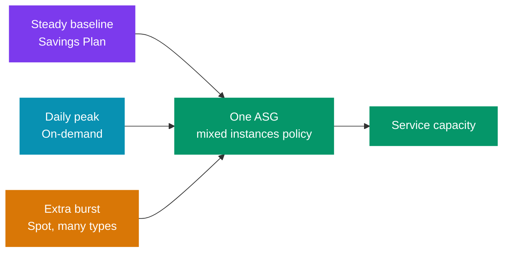
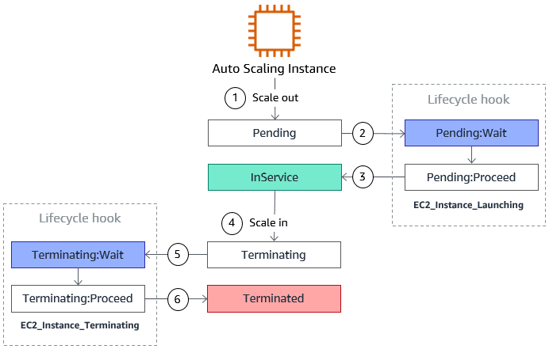
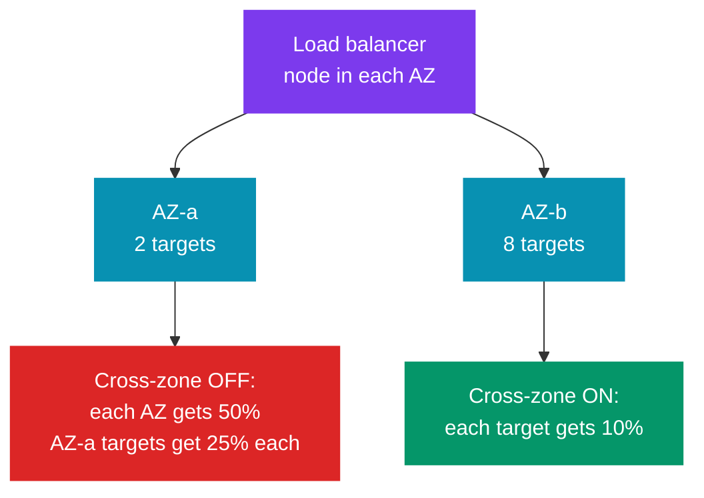
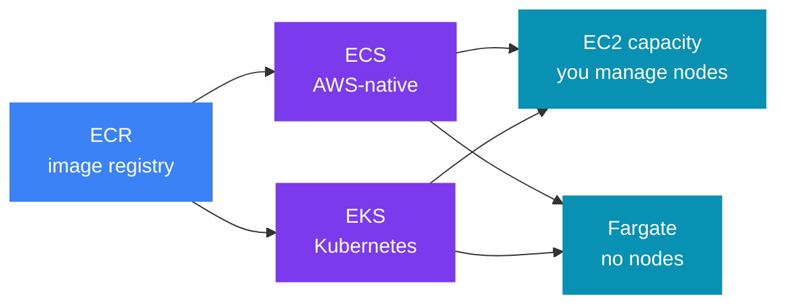
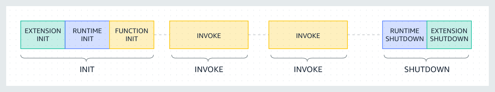
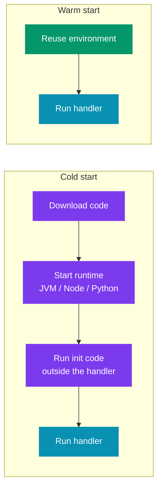
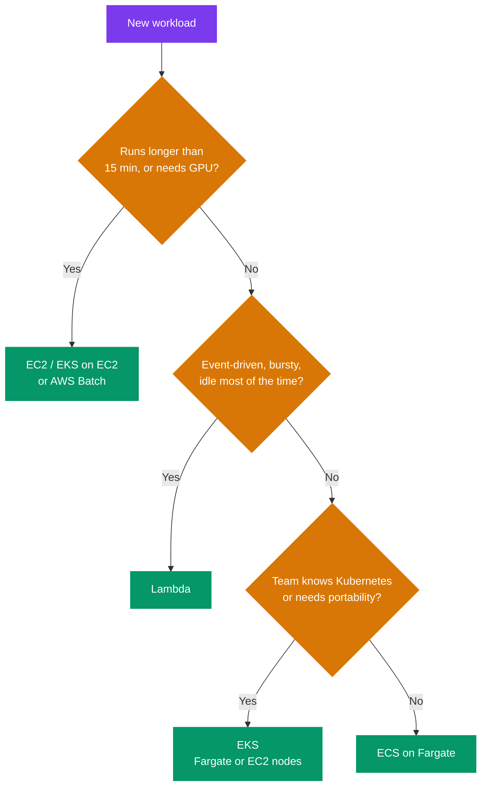

# ⚙️ Compute and Scaling on AWS — EC2, ASG, ELB, Containers, Lambda

> 🧭 **AWS for system design** &nbsp;·&nbsp; 🔥 High Priority &nbsp;·&nbsp; 💬 **14 Questions**

> _"In a design round nobody asks what an AMI (Amazon Machine Image) is. They ask: why EC2 (Elastic Compute Cloud) and not Lambda, what
> happens when an AZ (Availability Zone) fails, and how fast you scale when traffic jumps 10×."_

This note covers the compute layer of a design:

- ⚙️ **where** the code runs,
- 📈 **how** it scales,
- 🌐 **how** traffic reaches it.

It is written for system-design rounds, not for the SAA (Solutions Architect – Associate) exam.

> 🔗 **What this file does not repeat:**  
> - Load-balancing algorithms (round robin, least connections, consistent hashing) → [Load Balancing Strategies](../../system-design/02_distributed_systems/02_load_balancing_strategies.md)  
> - Stateless tiers and the "scale from zero" story → [Alex Xu Vol 1 ch01](../../system-design/01_insider_guide_Alex_Xu/vol_1/ch01_scale_from_zero.md)  
>
> This file stays AWS-specific: the limits, the failure modes and the trade-offs.

---

📊 **Question Count**

| # | Section | Questions |
|---|---|---|
| 1 | [EC2 — The Building Block](#1-ec2--the-building-block) | 2 |
| 2 | [Auto Scaling Groups (ASG)](#2-auto-scaling-groups-asg) | 5 |
| 3 | [Elastic Load Balancing (ALB / NLB / GWLB)](#3-elastic-load-balancing-alb--nlb--gwlb) | 3 |
| 4 | [Containers — ECS vs EKS vs Fargate](#4-containers--ecs-vs-eks-vs-fargate) | 1 |
| 5 | [Lambda — Serverless Functions](#5-lambda--serverless-functions) | 3 |
| | **Total** | **14** |

> 🔥🔥 Very High — asked in almost every Tier-1 loop &nbsp;·&nbsp; 🔥 High — very frequent in Tier-1 interviews &nbsp;·&nbsp; ⚡ Medium — commonly asked &nbsp;·&nbsp; 💤 Low — good to know, rarely asked

---

## 📑 Table of Contents

1. [EC2 — The Building Block](#1-ec2--the-building-block)
2. [Auto Scaling Groups (ASG)](#2-auto-scaling-groups-asg)
3. [Elastic Load Balancing (ALB / NLB / GWLB)](#3-elastic-load-balancing-alb--nlb--gwlb)
4. [Containers — ECS vs EKS vs Fargate](#4-containers--ecs-vs-eks-vs-fargate)
5. [Lambda — Serverless Functions](#5-lambda--serverless-functions)
6. [How to Choose Compute](#6-how-to-choose-compute)

---

## 1. EC2 — The Building Block

### 1.1 What problem it solves

🧩 **Problem:** EC2 gives you a virtual machine.

- You choose CPU, memory, disk and network.
- You control the OS, the runtime and the process.
- Every other compute service on AWS runs on EC2 underneath: ECS (Elastic Container Service) on EC2, EKS (Elastic Kubernetes Service) nodes, EMR (Elastic MapReduce).

✅ **Use when** you need **full control**:

- long-running processes,
- special kernels,
- local NVMe (Non-Volatile Memory Express: fast SSD) disks,
- GPUs,
- or a steady load where per-hour pricing beats per-request pricing.

### 1.2 Instance families — which family for which workload

💡 The name `m7g.xlarge` reads as: family `m`, generation `7`, extra feature `g` (Graviton/ARM),
size `xlarge`. In a design round you only need the family.

| Family | Optimised for | Typical design use |
|---|---|---|
| **T** (t3, t4g) | Burstable CPU — earns CPU credits when idle | Dev boxes, low-traffic admin tools. ⚠️ **Not** for steady production load: when credits run out, CPU is capped (or you pay extra in unlimited mode) |
| **M** (m6i, m7g) | Balanced CPU and memory | ✅ Default for app servers, Spring Boot services |
| **C** (c6i, c7g) | High CPU per GB of RAM | CPU-heavy work: encoding, batch compute, high-RPS (requests per second) stateless APIs |
| **R / X** (r6i, x2) | High memory per vCPU | In-memory caches, large JVM heaps, in-memory analytics |
| **I / D** (i4i, d3) | Fast local NVMe / dense local disk | 🗃️ Self-managed databases (Cassandra, Kafka brokers), search indexes |
| **P / G / Inf / Trn** | GPU or ML chips | ML training and inference |

> 💡 **Tip — Graviton (`g` suffix)** is ARM.  
> 💰 It usually gives better price-performance for Java.  
> ✅ The JVM runs on ARM without code change.  
> ⚠️ Check native libraries first.

### 1.3 Placement groups

🧩 A placement group tells AWS **how close together** to put your instances.

| Strategy | Layout | Gives you | Costs you | Use for |
|---|---|---|---|---|
| **Cluster** | All instances close together, one AZ, often the same rack area | ⚡ Lowest latency, highest network throughput between nodes | ⚠️ One AZ. One rack-level or AZ failure can take out all of them | HPC (High-Performance Computing), tightly coupled compute, low-latency trading engines |
| **Spread** | Each instance on different hardware | 🛡️ Maximum isolation between instances | 📏 **Max 7 running instances per AZ per group** | A small set of critical nodes: 3 ZooKeeper or etcd nodes, primary + standby |
| **Partition** | Groups of instances on separate racks (partitions). Up to **7 partitions per AZ**; can span AZs in a Region | 🛡️ Rack-level failure isolation at scale (hundreds of instances) | You must place replicas across partitions yourself | Kafka, Cassandra, HDFS (Hadoop Distributed File System) — systems that are "rack-aware" |

> ⚠️ **How it fails:** a cluster group gives speed but no fault isolation.  
> 🛡️ **Fix:** if the design needs both speed and high availability, run two cluster groups in
> two AZs and replicate between them.

### 1.4 Purchase options — a design trade-off, not a pricing detail

| Option | 💰 Discount vs on-demand | Commitment | Can AWS take it back? | Fits |
|---|---|---|---|---|
| **On-demand** | 0% | None | ❌ No | Spiky or unknown load, the part above your baseline |
| **Reserved Instances / Savings Plans** | Up to ~72% | 1 or 3 years | ❌ No | The steady baseline that runs 24×7 |
| **Spot** | Up to ~90% | None | ⚠️ **Yes — 2-minute warning** | Stateless, retryable, checkpointed work: batch jobs, CI runners, queue workers |
| **Capacity Reservation** | 0% (combine with Savings Plans) | Any duration | ❌ No | Guarantee capacity in one AZ for a known event (a big sale) |

> ⚠️ **Source correction.** The exam notes say you lose a Spot instance when "the spot price
> goes above your max price". That was the old model.  
> - Today Spot prices change slowly.  
> - Interruption happens mainly when **AWS needs the capacity back**.  
> - Your max price defaults to the on-demand price.  
>
> 🛡️ Design for interruption at any time, whatever the price.

🧭 **The senior pattern — mix them in one ASG (Auto Scaling Group):**

⚠️ **How Spot fails, and how to design for it:**

- 🔔 The 2-minute notice comes through instance metadata and EventBridge. Use it to stop taking
  work, finish or checkpoint the current job, and deregister from the load balancer.
- 🎯 AWS can take back **many instances of one type in one AZ at once**. Spread across many
  instance types and all AZs. Use the `price-capacity-optimized` allocation strategy.
- ❌ Never put state that you cannot rebuild on Spot (a single DB primary, a Kafka broker
  without replicas).

> 🎤 **In the interview:**  
> "I would cover the steady baseline with a Savings Plan, the daily peak with on-demand, and
> run the queue workers on Spot across six instance types. The workers are idempotent, so a
> 2-minute interruption only means one message gets processed again."

### Interview questions

1. **⚡ You run Kafka brokers yourself on EC2. Which placement group, and why?**

<!-- -->

Answer

✅ **A partition placement group.**

- Map each Kafka rack (`broker.rack`) to a partition, or to an AZ.
- Kafka then puts partition replicas on different racks, so one rack failure loses at most
  one replica.

**Why not the others:**

| Group | Problem |
|---|---|
| ❌ **Cluster** | Gives speed, but one failure could take out all brokers |
| ❌ **Spread** | Limited to 7 instances per AZ |

💡 Also use `i4i`-type instances (local NVMe) or EBS (Elastic Block Store) `gp3`, and keep replication factor 3
across 3 AZs.

---

2. **🔥 What are the EC2 purchasing options, and when would you use each?**

<!-- -->

Answer

🧭 Match each option to one part of the load. The main table is in
[§1.4](#14-purchase-options--a-design-trade-off-not-a-pricing-detail).

- **On-demand** — no commitment. Use it for spiky or unknown load.
- **Savings Plans / Reserved Instances** — a 1- or 3-year commitment. Use it for the 24×7
  baseline.
- ⚠️ **Spot** — spare capacity, up to ~90% off. AWS can take it back with a 2-minute notice.
  Use it for stateless, retryable work.
- 💰 **Dedicated Host** — a whole physical server only for you. Use it for licences tied to
  sockets or cores (BYOL: Bring Your Own License) or for compliance. It is the most expensive option.

⚖️ **Savings Plans vs Reserved Instances:**

| Option | Max discount | Flexibility |
|---|---|---|
| Standard RI (3 years, all upfront) | ~72% | One instance family in one Region. You can sell it on the RI Marketplace |
| EC2 Instance Savings Plan | ~72% | One instance family in one Region; any size, OS or tenancy |
| Compute Savings Plan | ~66% | Any family, any Region, and also **Fargate and Lambda** |

> ⚠️ **Common mistake:** "Savings Plans are always cheaper than RIs." They are not.  
> - The best discount is the same.  
> - ✅ Savings Plans win on **flexibility**: you commit to a spend per hour, not to an instance type.  
> - ❌ But you cannot cancel or resell a Savings Plan.

🎤 **The answer to give:** Savings Plan for the baseline, on-demand for the daily peak, Spot for
queue workers and batch. The diagram is in §1.4.

---

---

## 2. Auto Scaling Groups (ASG)

### 2.1 What problem it solves

🧩 **Problem:** an ASG keeps a fleet at the right size. It does two jobs:

1. 🛡️ **Self-healing** — it replaces any instance that fails a health check.
2. 📈 **Elasticity** — it adds or removes instances as load changes.

⚙️ **How you set it up:**

- You set three numbers: **min**, **desired** and **max**.
- The ASG creates instances from a **launch template** (AMI, instance type, security groups,
  user data).
- It spreads them across the AZs you list and tries to keep each AZ balanced.

> ⚠️ **Precondition:** the tier must be **stateless**.  
> - Sessions go to Redis or DynamoDB, files go to S3.  
> - If an instance holds state, the ASG will destroy that state when it scales in.

### 2.2 Scaling policies

| Policy | How it works | Use when |
|---|---|---|
| ✅ **Target tracking** | "Keep average CPU at 50%." The ASG creates and manages the CloudWatch alarms | The default choice. Works for most web tiers |
| **Step scaling** | Different sizes of change for different alarm levels (CPU > 70% → +2, > 85% → +4) | You need a stronger reaction to a bigger spike |
| ❌ **Simple scaling** | One alarm → one change, then wait for the cooldown | Legacy. Avoid for new designs |
| **Scheduled** | Change min/desired at a fixed time | Known patterns: 9 AM login rush, month-end batch |
| **Predictive** | ML forecast from 14 days of history; launches capacity **before** the load arrives | Strong daily or weekly cycles where boot time is long |

🧭 **Which metric to scale on** — this matters more than the policy type:

| Metric | ✅ Good for | ❌ Bad for |
|---|---|---|
| CPU utilisation | CPU-bound APIs | I/O-bound services (CPU stays low while requests queue up) |
| `ALBRequestCountPerTarget` | Web tiers behind an ALB (Application Load Balancer) | Requests with very different costs |
| **Queue depth per instance** (SQS (Simple Queue Service) `ApproximateNumberOfMessagesVisible` ÷ instances) | Worker fleets | — This is the right metric for workers. CPU is the wrong one |
| Custom metric (in-flight requests, p99 latency) | Services with a known bottleneck | Needs your own metric publishing |

### 2.3 Cooldown, warm-up and health-check grace

| Setting | 📏 Default | What it does |
|---|---|---|
| **Cooldown** | 300 s | Used by **simple scaling** only. After a scaling action, the ASG ignores new alarms until the cooldown ends |
| **Instance warm-up** | Set it yourself (AWS recommends setting the "default instance warm-up") | Used by target tracking and step scaling. A new instance's metrics are not counted until it is warm. This stops the ASG from adding too many instances while new ones boot |
| **Health-check grace period** | 300 s (console) | The ASG ignores failed health checks on a new instance for this long. ⚠️ Too short → the ASG kills instances that are still booting, in a loop |

> ⚠️ **Source correction.** The exam notes describe the 300-second cooldown as a general rule.
> For target tracking and step scaling, AWS now uses **instance warm-up**, not cooldown.

🩺 **Health check types:**

| Type | What it checks | Verdict |
|---|---|---|
| **EC2 health check** (default) | Only checks that the VM is running | ⚠️ A hung JVM still passes |
| **ELB (Elastic Load Balancing) health check** | Uses the load balancer's HTTP check | ✅ **Turn this on** for any web tier. Otherwise the ASG keeps an instance whose app is dead |

### 2.4 Lifecycle hooks and warm pools

- 🪝 **Lifecycle hooks** pause an instance in `Pending:Wait` or `Terminating:Wait`.
  - 📏 Default timeout is **1 hour**.
  - 🚀 On launch: pull config, warm caches, register with service discovery.
  - 🛑 On terminate: drain work, flush logs, copy local files to S3.

> 🖼️ *Where the two lifecycle hooks pause an instance: `Pending:Wait` on scale-out and `Terminating:Wait` on scale-in.* Source: [Amazon EC2 Auto Scaling lifecycle hooks](https://docs.aws.amazon.com/autoscaling/ec2/userguide/lifecycle-hooks-overview.html) · License: CC BY-SA 4.0 ([awsdocs/amazon-ec2-auto-scaling-user-guide](https://github.com/awsdocs/amazon-ec2-auto-scaling-user-guide))

- ⚡ **Warm pools** keep pre-initialised instances in a stopped (or running) state.
  - Scale-out then takes seconds, not minutes.
  - ✅ Good for Java services with slow start-up.

### 2.5 How an ASG fails

| ⚠️ Failure | What happens | 🛡️ Fix |
|---|---|---|
| Health check too strict (checks the DB) | DB has a short blip → every instance fails → ASG replaces the whole fleet | Health check tests **this instance only**. Use a shallow `/health` for the LB; keep deep checks for monitoring |
| Grace period shorter than boot time | Instances are killed while still booting → endless replace loop | Grace period > p99 boot time |
| Scale-out slower than the spike | 5-minute boot + 1-minute metric delay → users see errors for 6 minutes | Pre-baked AMI, warm pool, scheduled or predictive scaling, keep spare headroom |
| One AZ loses capacity | The ASG launches in the remaining AZs | Size each AZ so that **N−1 AZs carry the peak** (for 3 AZs, run at ≤ 66% capacity) |
| Scale-in kills a busy instance | In-flight requests fail | Deregistration delay on the LB + terminate lifecycle hook + scale-in protection for workers in a job |

> 🎤 **In the interview:**  
> "The app tier is a stateless ASG across three AZs, with target tracking on request count per
> target. I size it so two AZs can carry the peak. I use the ELB health check, with a grace
> period longer than our boot time."

### Interview questions

3. **⚡ What is the difference between horizontal and vertical scaling on AWS?**

<!-- -->

Answer

| | 📈 **Horizontal (scale out)** | ⬆️ **Vertical (scale up)** |
|---|---|---|
| What you do | Add more instances | Move to a bigger instance (more CPU and RAM) |
| AWS tool | ASG, ECS task count | Change the instance type (`t3.medium` → `m5.large`) |
| Downtime | ✅ None, behind a load balancer | ⚠️ Stop, change type, start |
| Limit | Almost none | The largest instance type |
| Fits | Stateless services | Stateful parts: a DB primary, an old monolith |

- ✅ AWS designs prefer horizontal scaling.
- ⚠️ It only works if the tier is **stateless**: sessions go to Redis or DynamoDB, files go to
  S3 (see [§2.1](#21-what-problem-it-solves)).
- 🧭 The usual mix: scale the app tier out with an ASG; scale the database primary up, and add
  read replicas for reads.

---

4. **🔥 What is Auto Scaling in AWS, and what are the different types?**

<!-- -->

Answer

🧩 Auto scaling changes capacity by itself, to keep performance steady and cost low. AWS has
two scaling engines:

| Engine | What it scales | Notes |
|---|---|---|
| ⚙️ **EC2 Auto Scaling** | EC2 instances in an ASG | Policies are in [§2.2](#22-scaling-policies). An ASG can attach to target groups (ALB, NLB, GWLB), or to **no load balancer** — normal for queue workers, which pull work |
| 📈 **Application Auto Scaling** | ECS task count, DynamoDB capacity, Aurora replicas, Lambda provisioned concurrency | Same ideas: target tracking, step and scheduled scaling |

⏱️ **Follow-up: cooldown vs warm-up.** Both stop the ASG from adding too much. The table is in
[§2.3](#23-cooldown-warm-up-and-health-check-grace). Two points people miss:

- 💡 That split is for **EC2 Auto Scaling**. **Application Auto Scaling** target tracking *does*
  have its own `ScaleOutCooldown` and `ScaleInCooldown` settings.
- ⚠️ On a Spring Boot fleet, set **instance warm-up ≥ app start time** (JVM boot + Spring
  context + health check passing). If it is too short, the ASG reads the CPU spike of a
  starting JVM as real load. It scales out again and again — a "scaling storm".

---

5. **🔥🔥 Traffic jumps 10× in 60 seconds during a flash sale. Your Spring Boot service runs on an ASG with CPU target tracking. Users see errors for 5 minutes. Why, and how do you fix it?**

<!-- -->

Answer

⚠️ **Why:** the ASG reacts too late.

| Step | ⏱️ Time |
|---|---|
| CloudWatch raises the alarm | 1–3 minutes |
| A new instance boots and warms the JVM | 2–4 minutes |

🛡️ **Fixes:**

- 🗓️ **Scheduled scaling** before the known sale time. This is the strongest fix.
- ⚡ A **warm pool** and a pre-baked AMI, so new capacity is ready in seconds.
- 📈 Scale on `ALBRequestCountPerTarget`, which reacts faster than CPU.
- 📏 Keep headroom (target 50%, not 80%).
- 📨 Add rate limiting or a queue, so excess load waits instead of failing.

---

6. **🔥 You run an image-processing worker fleet that reads from SQS. How do you scale it, and can you use Spot?**

<!-- -->

Answer

📈 **Scale:** on **backlog per instance**.

- Metric: `ApproximateNumberOfMessagesVisible` ÷ running instances.
- Target: from (acceptable delay ÷ average processing time).
- ❌ CPU is the wrong metric.

✅ **Spot:** yes — use **Spot** across many instance types and all AZs.

- 🔔 The 2-minute notice lets the worker stop polling.
- 🔁 If it is killed mid-message, SQS makes the message visible again.
- ⚠️ The handler must be **idempotent**, and a DLQ (Dead-Letter Queue) catches poison messages.

---

7. **🔥🔥 Your 3-AZ service runs 9 instances. One AZ goes down. What happens, and how should you have sized it?**

<!-- -->

Answer

⚠️ **What happens:**

1. You lose 3 instances, so 6 carry 100% of the traffic: a 50% jump per instance.
2. If they were at 70% CPU, they go above 100% and fail in a chain.
3. The ASG will launch replacements in the other two AZs, but that takes minutes.

🛡️ **How to size it:**

- 📏 **Size for N−1 AZs**: with 3 AZs, run each AZ at ≤ 66% of the peak load.
- ✅ Use an ELB health check and cross-zone load balancing so the load spreads evenly.

---

---

## 3. Elastic Load Balancing (ALB / NLB / GWLB)

🔗 The algorithms are in [Load Balancing Strategies](../../system-design/02_distributed_systems/02_load_balancing_strategies.md).
This section is about choosing and running the AWS load balancers.

### 3.1 L4 vs L7 in one table

| | **L4 (transport)** | **L7 (application)** |
|---|---|---|
| Sees | IP, port, TCP/UDP | HTTP method, path, host, headers, cookies |
| Can route by URL path | ❌ No | ✅ Yes |
| Ends the TCP connection | ❌ No (passes it through) | ✅ Yes (opens a new one to the target) |
| 💰 Cost per request | Very low | Higher — it parses every request |
| AWS service | **NLB** (Network Load Balancer) | **ALB** |

### 3.2 ALB vs NLB vs GWLB

| | 🌐 **ALB** | ⚡ **NLB** | 🛡️ **GWLB** (Gateway Load Balancer) |
|---|---|---|---|
| Layer | L7 (HTTP, HTTPS, gRPC, WebSocket) | L4 (TCP, UDP, TLS) | L3 (IP packets, GENEVE (Generic Network Virtualization Encapsulation) port 6081) |
| Routing | Path, host, header, query string, source IP | Port only | Sends all traffic through appliances |
| Targets | Instances, IPs, **Lambda** | Instances, IPs, **an ALB** | Instances, IPs (firewall appliances) |
| Static IP | ❌ **No** — DNS name only, IPs change | ✅ **Yes** — one per AZ, can use Elastic IPs | n/a |
| Client IP at the target | In `X-Forwarded-For` header | ✅ **Preserved** in the packet | ✅ Preserved |
| Latency | Milliseconds | Very low (microseconds added) | Low |
| Scale | Scales up over minutes; very sudden spikes may need pre-warming (Load Balancer Capacity Unit reservation) | Millions of requests per second | — |
| Cross-zone default | ✅ On, free | ⚠️ **Off**; inter-AZ data is charged if on | ⚠️ **Off** |
| Use for | Microservices, REST APIs, path routing, auth (OIDC (OpenID Connect) / Cognito) at the edge | Non-HTTP protocols, IP allow-lists, extreme RPS, PrivateLink services | Inline third-party firewalls / IDS (Intrusion Detection Systems) |

🧩 **Common combinations:**

| Combination | ✅ Use when |
|---|---|
| **NLB → ALB** | A partner needs fixed IPs to allow-list, and you still want path routing |
| **NLB + PrivateLink** | 🔒 Expose your service privately to other VPCs or other accounts |
| **CloudFront → ALB** | TLS and caching at the edge; the ALB only accepts traffic from CloudFront |

### 3.3 Sticky sessions — and why to avoid them

🧩 **What it is:** sticky sessions send one client to the same target every time.

- The ALB does this with a cookie (`AWSALB` for duration-based; an app cookie for
  application-based).
- 📏 The duration is 1 second to 7 days.

❌ **Why they hurt a design:**

1. ⚖️ **Uneven load.** A few heavy users stay pinned to one instance. Other instances sit idle.
2. 📈 **Scaling does not help at once.** New instances only get *new* users.
3. ⚠️ **Instance loss = session loss.** The user is logged out or loses a cart.
4. 🚀 **Deploys get harder.** Draining a sticky instance takes as long as its longest session.

✅ **What to do instead:** keep the tier stateless. Put sessions in **ElastiCache (Redis)** or
**DynamoDB**, or use a signed token (JWT: JSON Web Token) that the client sends each time.

> 💡 **When stickiness is fine:** a short-lived local cache warm-up, or a legacy app you cannot
> change yet. Say it is a temporary step.

### 3.4 Connection draining (deregistration delay)

🧩 **What it does:** when a target is removed (scale-in, deploy, failed health check), the LB
stops sending **new** requests to it. It lets **in-flight** requests finish for the
deregistration delay.

- 📏 Range **0–3,600 s**, default **300 s**.
- 💡 Set it a little above your longest normal request. For a 2-second REST API, 30 s is plenty.
  300 s just slows every deploy.
- ⚠️ For long-lived connections (WebSocket, gRPC streams), the client **must** reconnect. The
  delay only gives time; it does not move the connection.

### 3.5 Cross-zone load balancing

| Cross-zone | How traffic splits | Effect |
|---|---|---|
| ⚠️ **Off** | Evenly by AZ, not by target | Uneven target counts per AZ cause hot instances |
| ✅ **On** | Evenly across all targets | Every target gets the same share |

- 💰 ALB: on by default, no extra charge. NLB/GWLB: off by default, and inter-AZ data is charged.
- ⚖️ Trade-off for NLB: keeping it off saves money and keeps traffic in-zone (lower latency).
  It also limits the impact of an AZ problem. Then you **must** keep target counts equal per AZ.

### 3.6 How a load balancer fails

| ⚠️ Failure | Symptom | 🛡️ Fix |
|---|---|---|
| All targets unhealthy | The ALB "fails open" — it sends traffic to all targets anyway | Know this behaviour. Alert on `UnHealthyHostCount` |
| Idle timeout mismatch | Random 502s. The target closed a keep-alive connection the ALB still used | App keep-alive timeout **greater than** the ALB idle timeout (default 60 s) |
| Slow target | 504s when the target does not answer in time | Timeouts, circuit breakers, and scale on latency |
| Client caches old DNS | ALB IPs change; old IPs stop working | Respect DNS TTL (Time To Live). Use NLB or Global Accelerator if clients need fixed IPs |
| One AZ degraded | Errors only from one AZ | Zonal shift (ARC: Application Recovery Controller) to move traffic away from that AZ |

> 🎤 **In the interview:**  
> "I'd use an ALB, because I need path routing to five services and HTTP health checks. If a
> partner needs fixed IPs, I put an NLB with Elastic IPs in front of it. I don't use sticky
> sessions; sessions live in Redis, so any instance can serve any request."

### Interview questions

8. **🔥 What is the difference between ALB and NLB?**

<!-- -->

Answer

- 🌐 **ALB** works at L7. It reads the HTTP request and routes on path, host or headers.
- ⚡ **NLB** works at L4. It forwards TCP/UDP packets without reading them. It is very fast and
  gives one static IP per AZ.

🔗 The full comparison (with GWLB) is in [§3.2](#32-alb-vs-nlb-vs-gwlb).

> ❌ AWS has a fourth type, **CLB** (Classic Load Balancer). It is legacy — do not pick it for a new design.

Points the §3.2 table does not show:

| | **ALB** | **NLB** |
|---|---|---|
| TLS termination | ✅ Yes | ✅ Yes (TLS listener) |
| Sticky sessions | Cookie: duration-based (`AWSALB`) or application-based | Source IP only |
| 🔒 Security groups | ✅ Yes | ⚠️ Yes since Aug 2023, but only if you attach one **when you create** the NLB |

> ⚠️ **Common trick question:** cross-zone load balancing is on by default for ALB and off for NLB.
> See [§3.5](#35-cross-zone-load-balancing) for why this makes some targets hot.

🧭 **Rule:**

- HTTP microservices → ALB.
- Fixed IPs, non-HTTP protocols or extreme RPS → NLB.
- Need both → an NLB in front of an ALB (next question).

---

9. **🔥 A partner bank must allow-list your API by IP address. You also need path-based routing to six microservices. What do you put in front?**

<!-- -->

Answer

✅ An **NLB with one Elastic IP per AZ**, with an **ALB as its target**.

- ⚡ The NLB gives fixed IPs the partner can allow-list.
- 🌐 The ALB does the L7 path routing.
- 💡 Another option is **AWS Global Accelerator**, which gives two static anycast IPs in front
  of the ALB.
- ❌ An ALB alone cannot do it, because its IPs change.

---

10. **🔥🔥 Your team enabled sticky sessions to fix a "users get logged out" bug. What is wrong with this fix?**

<!-- -->

Answer

⚠️ It hides the real problem: session state lives in instance memory.

- ⚖️ Stickiness causes uneven load.
- 📈 New instances help only new users.
- ❌ Any scale-in, deploy or crash still logs users out.

✅ **The right fix:** move sessions to **ElastiCache (Redis)** or **DynamoDB** with a TTL, or
use signed JWTs. Then the tier is stateless and stickiness can be turned off.

---

---

## 4. Containers — ECS vs EKS vs Fargate

### 4.1 The two questions

🧭 Containers on AWS are two separate choices:

- 🎛️ **Orchestrator** — who schedules containers? **ECS** (AWS-native) or **EKS** (managed
  Kubernetes).
- ⚙️ **Capacity** — where do they run? **EC2** instances you manage, or **Fargate**
  (serverless, AWS manages the hosts).

### 4.2 Comparison

🎛️ **Orchestrator:**

| | **ECS** | **EKS** |
|---|---|---|
| API | AWS-specific (task definitions, services) | Standard Kubernetes API |
| Learning curve | ✅ Low | ⚠️ High (pods, deployments, ingress, CRDs (Custom Resource Definitions), Helm) |
| Ecosystem | AWS integrations only | ✅ Huge: Istio, Argo CD, KEDA (Kubernetes Event-Driven Autoscaling), Karpenter, operators |
| Portability | ❌ Locked to AWS | ✅ Same manifests run on GKE (Google Kubernetes Engine), AKS (Azure Kubernetes Service), on-prem |
| Ops load | ✅ Low — no control plane to run | ⚠️ Medium — you upgrade the cluster version on a schedule, manage add-ons |
| 🧭 Pick when | Small team, AWS-only, simple services | Team already knows Kubernetes, multi-cloud, needs the ecosystem |

⚙️ **Capacity:**

| | **EC2 capacity** | **Fargate** |
|---|---|---|
| You manage | Node AMIs, patching, bin-packing, node scaling | Nothing below the task |
| 💰 Cost | Cheaper at high, steady utilisation; can use Spot and Reserved | Higher per vCPU-hour; no wasted node space; Fargate Spot exists |
| 📏 Limits | Any instance type, GPUs, DaemonSets, privileged containers | Up to 16 vCPU / 120 GB per task; no GPUs; no privileged mode; no DaemonSets on EKS |
| ⚡ Start time | Fast if a node has room | Slower (tens of seconds) — it provisions a micro-VM per task |
| 🧭 Pick when | Large steady fleet, GPU, special needs | Small team, spiky or many small services, strong isolation per task |

### 4.3 Failure modes

| ⚠️ Failure | Cause | 🛡️ Fix |
|---|---|---|
| **Image pull failures** | ECR (Elastic Container Registry) outage, rate limits on Docker Hub, or no NAT (Network Address Translation) route | Keep images in ECR; use VPC (Virtual Private Cloud) endpoints for ECR and S3 |
| **Task placement failure** (ECS on EC2) | No node has enough free CPU or memory | Use a **capacity provider** with managed scaling so the ASG grows with demand |
| **Bad deploy** | New tasks crash in a loop | Use the ECS **deployment circuit breaker** with rollback, or Kubernetes readiness probes plus a progressive rollout |
| **Fargate Spot interruption** | Same 2-minute notice as EC2 Spot | Handle `SIGTERM` and set `stopTimeout` |
| **EKS IP exhaustion** | The VPC CNI (Container Network Interface) gives each pod a VPC IP. Big clusters run out of subnet IPs | Plan large subnets or use prefix delegation |

> 🎤 **In the interview:**  
> "For a ten-service backend with a small team I'd pick ECS on Fargate. There are no nodes to
> patch, and each service scales on its own. If the company already runs Kubernetes, I'd use
> EKS with Karpenter, because the team and the tools are already there."

### Interview questions

11. **🔥🔥 ECS vs EKS vs Fargate — which would you pick for a new 12-service platform, and why?**

<!-- -->

Answer

🧭 It depends on the team, not the technology. ECS and EKS are orchestrators. Fargate is a
capacity choice under either of them ([§4.1](#41-the-two-questions)).

| Pick | ✅ When |
|---|---|
| **ECS on Fargate** | The team is small and AWS-only. There is no control plane to upgrade and no nodes to patch, and it has deep IAM (Identity and Access Management) and ALB integration |
| **EKS** | The team already knows Kubernetes, needs portability, or wants the ecosystem (Argo CD, KEDA, a service mesh). ⚖️ The cost is regular cluster upgrades and more moving parts |
| **ECS on EC2** | You need special instance types (GPU, high memory) or want to use existing Savings Plans or Reserved Instances |

> ⚠️ I would not pick EKS only because it is "industry standard". The ops cost is real.

⚠️ **"EKS on Fargate gives the best of both" is not true.** Fargate runs one pod per
micro-VM, so many Kubernetes features are gone:

- ❌ No **DaemonSets** — the usual way to run log shippers and node agents.
- ❌ No privileged containers, no host networking, no `hostPort`.
- 💰 No GPUs. Pod CPU and memory are rounded up to a fixed Fargate size, and you pay for that size.

✅ For a steady fleet, **EKS with managed node groups** is usually the better default. **EKS
Auto Mode** (re:Invent 2024) manages nodes, scaling, patching and core add-ons for you,
without the Fargate limits.

🔐 **Two ECS details interviewers often check:**

| Role | Used by | For |
|---|---|---|
| **Task execution role** | The ECS agent, **before** your container starts | Pull the image from ECR, write logs to CloudWatch Logs, read secrets injected as env vars |
| **Task role** | **Your application code** at runtime | Calls to S3, SQS, DynamoDB. The SDK's default credential chain picks it up |

> ⚠️ **Trap:** mixing them up is the most common ECS failure.  
> - The task cannot pull its image (the execution role is missing permissions).  
> - Or the app gets `AccessDenied` on S3 (the permission was put on the execution role, not the task role).

🌐 **`awsvpc` network mode** is the default on Fargate and the recommended mode on EC2.

- Each task gets its **own ENI (Elastic Network Interface) and private IP** in your VPC.
- 🔒 So each task can have its own security group, and you can register it directly in an
  `ip` target group.
- ⚠️ The older `bridge` mode shares the host's network and needs dynamic port mapping.

---

---

## 5. Lambda — Serverless Functions

### 5.1 What problem it solves

🧩 **Problem:** Lambda runs a function in response to an event.

- 💰 You pay per request and per GB-second.
- 📈 It scales to zero.
- ✅ There are no servers, AMIs or ASGs to manage.

✅ **Use when:** it fits **event-driven glue** very well:

- 🪣 S3 upload → thumbnail
- 📨 SQS message → process
- 🗃️ DynamoDB stream → update a search index
- 🌐 API call → small CRUD handler

### 5.2 Key limits (current)

| 📏 Limit | Value | Design impact |
|---|---|---|
| Max run time | **15 min (900 s)** | Longer jobs → Step Functions, ECS/Fargate task, or AWS Batch |
| Memory | 128 MB – **10,240 MB** (1 MB steps) | ⚡ CPU scales with memory (≈ 6 vCPU at 10 GB). 💰 More memory can make a function cheaper because it ends sooner |
| `/tmp` storage | 512 MB – 10,240 MB | Scratch space only. ⚠️ It is lost when the environment is recycled |
| Sync payload | 6 MB request / 6 MB response | 🪣 Large files go through S3 with a presigned URL, not through Lambda |
| Async payload | 256 KB → raised to **1 MB** in Oct 2025 | Use `Invoke` with `InvocationType=Event`. ⚠️ The old `InvokeAsync` API is still 256 KB |
| Package size | 50 MB zipped / 250 MB unzipped; **10 GB** as a container image | Big ML models → container image or EFS (Elastic File System) |
| Account concurrency | **1,000** per Region by default (soft limit) | ⚠️ Shared by **all** functions in the account and Region |
| Scale-up rate | **1,000 new concurrent executions every 10 s, per function** | Very sudden spikes still get throttled for a few seconds |

> ⚠️ **Source corrections.**  
> - Memory steps are **1 MB**, not 64 MB. The 64 MB rule was removed years ago.  
> - The old "burst limit of 500–3,000, then +500 per minute" model was replaced in Nov 2023
> by the per-function rate above.  
> - The source notes that new accounts may start with a quota lower than 1,000. That is
> true; request an increase before launch.

### 5.3 Concurrency — the number that matters

> 📏 **Concurrency = requests per second × average duration in seconds.**  
> 200 RPS × 0.5 s = 100 concurrent executions.

| Control | What it does | ✅ Use for |
|---|---|---|
| 🔒 **Reserved concurrency** | Sets aside N for one function **and** caps it at N | Protect a critical function from noisy neighbours; protect a weak downstream (a DB) from a flood |
| ⚡ **Provisioned concurrency** | Keeps N environments **initialised and warm** | Remove cold starts on a latency-sensitive API. 💰 You pay for it while it is on |
| Unreserved pool | Whatever is left (AWS always keeps at least 100 unreserved) | Everything else |

> ⚠️ **The noisy-neighbour failure:** one function gets a traffic spike and uses all 1,000.
> Every other function in the account is throttled (HTTP 429), including the payment handler.  
> 🛡️ **Fix:** reserved concurrency on critical functions, or separate AWS accounts per workload.

### 5.4 Cold starts

🧩 **What it is:** a cold start happens when Lambda must create a new execution environment:

1. download code,
2. start the runtime,
3. run your init code (outside the handler).

> 🖼️ *One execution environment: Init runs once (this is the cold start), then many invokes reuse it, then Shutdown.* Source: [Lambda execution environment lifecycle](https://docs.aws.amazon.com/lambda/latest/dg/lambda-runtime-environment.html) · License: CC BY-SA 4.0 ([awsdocs/aws-lambda-developer-guide](https://github.com/awsdocs/aws-lambda-developer-guide))

| Runtime | ⚡ Typical cold start |
|---|---|
| Node.js / Python, small package | ~100–300 ms |
| ⚠️ Java with Spring, no tuning | 2–6 s or more |
| ✅ Java with **SnapStart** | Usually well under 1 s |

🛡️ **How to reduce them:**

1. 📸 **SnapStart** (Java, Python, .NET) — Lambda snapshots the initialised environment and
   restores it. No extra cost for Java.
   > ⚠️ **Watch out:** anything unique created at init (random seeds, connections) is now
   > **shared** by all restored copies. Recreate it in a `afterRestore` hook.
2. 🔥 **Provisioned concurrency** — always-warm environments, for a strict p99.
3. 📦 Smaller packages, fewer dependencies, lazy init; avoid heavy frameworks in the handler path.
4. 🌐 Lambda in a VPC no longer adds a big cold start (shared Hyperplane ENIs since 2019).

### 5.5 How Lambda fails

| Invocation type | ⚠️ Failure behaviour | 🛡️ Design rule |
|---|---|---|
| **Sync** (API Gateway, ALB) | Error goes straight back to the caller. Throttle → 429 | 🔁 Caller retries with back-off |
| **Async** (S3, SNS (Simple Notification Service), EventBridge) | Lambda retries **2 more times**, then sends to an **on-failure destination** or DLQ | Always set a failure destination. Handlers must be **idempotent** — events can arrive twice |
| **Poll-based** (SQS, Kinesis, DynamoDB Streams, Kafka) | SQS: message goes back after the visibility timeout. Streams: the **whole shard blocks** on a failing record | SQS: set visibility timeout ≥ 6 × function timeout; use partial batch response; add a DLQ. Streams: bisect on error, max retry attempts, on-failure destination |

⚠️ **Other common failures:**

| Failure | What happens | 🛡️ Fix |
|---|---|---|
| 🗃️ **DB connection storm** | 1,000 concurrent Lambdas each open a DB connection; RDS (Relational Database Service) runs out of connections | **RDS Proxy**, a low reserved concurrency, or DynamoDB |
| 🔁 **Recursive loop** | A function writes to the same S3 bucket that triggers it | Lambda now detects some loops and stops them, but use separate buckets or prefixes |
| ⏱️ **Timeout cascade** | API Gateway REST APIs time out at **29 s** by default (it can be raised for Regional and private APIs). A Lambda that runs 60 s behind it returns 504 to the user and keeps running | — |

### 5.6 When NOT to use Lambda

| ❌ Situation | Why Lambda is wrong | ✅ Use instead |
|---|---|---|
| Jobs longer than 15 min | Hard limit | Fargate task, AWS Batch, Step Functions to split the work |
| Steady high traffic, 24×7 | 💰 Per-request pricing costs more than a busy container | ECS/EKS or EC2 with Savings Plans |
| Strict p99 latency, no budget for provisioned concurrency | ⚡ Cold starts | Containers that are always running |
| Long-lived connections (WebSocket server, gRPC streams, Kafka consumer with local state) | Function is short-lived and stateless | ECS/EKS (API Gateway WebSocket APIs are an option for simple push) |
| Needs a GPU or large local disk | Not supported | EC2 or EKS with GPU nodes |
| Heavy, chatty access to a relational DB | 🗃️ Connection storms | Containers with a connection pool, or RDS Proxy |

🌐 **API Gateway in one line:** it sits in front of Lambda for auth, throttling, request
validation and usage plans. A later file in this folder covers it in depth.

> 🎤 **In the interview:**  
> "Lambda is right for the image-resize step: it's bursty, under a minute, and idle most of
> the day. It's wrong for the core order API at 3,000 steady RPS. There a container is
> cheaper, and I don't want cold starts on checkout."

### Interview questions

12. **🔥🔥 A Lambda behind API Gateway shows a p99 of 4 seconds but a p50 of 80 ms. What is happening, and how does a cold start work?**

<!-- -->

Answer

🔍 **Diagnosis:** almost certainly **cold starts**, likely a Java function with Spring.

- The p50 hits warm environments.
- The p99 hits new ones.

🛡️ **Fixes for Java, in order:**

1. 📸 **SnapStart** — the biggest gain for the least work. It is free for Java (Python and .NET
   pay for snapshot cache and restores). See [§5.4](#54-cold-starts).
2. 📦 **Move heavy init outside the handler.** Create SDK clients and connection pools once.
   Warm calls then reuse them. Also use a smaller package and lazy init.
3. ⚖️ **GraalVM native image** — can bring a cold start down to the low hundreds of ms. The cost
   is reflection config and a much harder build.
4. 💰 **Provisioned concurrency**, sized to the steady concurrency, with Application Auto Scaling
   on a schedule. It works, but you pay to keep environments warm all day.

💡 If the API has steady high traffic, consider moving it to a container that is always running.

⚠️ **Traps:**

- SnapStart works only on **published versions or aliases**, not `$LATEST`. You cannot use it
  together with provisioned concurrency on the same version.
- **Lambda Powertools for Java** is a logging, tracing, metrics and idempotency library. It
  does **not** reduce cold start.

💰 **Billing, often asked next:**

- A per-request charge plus GB-seconds (run time × memory), in **1 ms** steps (since Dec 2020).
- ⚡ CPU grows with memory (~1,769 MB = 1 vCPU).
- So a function that runs 4× faster on 2× the memory costs *less*.

---

13. **🔥 One Lambda in your account had a traffic spike. Suddenly the payment-callback Lambda started returning 429. Why?**

<!-- -->

Answer

⚠️ **Why:** account concurrency (default **1,000 per Region**) is shared by all functions. The
spiking function used it all, so other functions were throttled.

🛡️ **Fixes:**

- 🔒 **Reserved concurrency** on the payment callback — it guarantees capacity.
- 📏 A reserved concurrency **cap** on the noisy function.
- 🧱 Separate AWS accounts for unrelated workloads.
- 📨 For an SQS-triggered function, set **maximum concurrency** on the event source mapping.
  It caps how many copies that one queue can start.
- 📈 Ask for a higher quota.

---

14. **🔥 You need to run a nightly reconciliation job that takes 40 minutes. Lambda or something else?**

<!-- -->

Answer

❌ Not a single Lambda — the hard limit is **15 minutes**.

✅ **Options:**

| Option | 🧭 When |
|---|---|
| An **ECS Fargate task** started by an EventBridge schedule | This is the simplest |
| **AWS Batch** | There are many jobs, possibly on Spot |
| **Step Functions** | Split the work into chunks under 15 minutes each, with a Distributed Map for parallel chunks |

> 🔁 **Tip:** the job should write checkpoints, so a retry continues instead of starting over.

---

---

## 6. How to Choose Compute

### 6.1 Decision flow

### 6.2 Comparison on the axes interviewers ask about

| Axis | ⚙️ EC2 + ASG | 📦 ECS / EKS on Fargate | 📦 ECS / EKS on EC2 | λ Lambda |
|---|---|---|---|---|
| ⚡ Scale-out time | Minutes (boot + app start) | ~30–60 s | Seconds if nodes have room, minutes if not | Milliseconds to seconds |
| Scale to zero | ❌ No | ✅ Yes (desired = 0) | ⚠️ Tasks yes, nodes need care | ✅ Yes, built in |
| 📏 Max run time | Unlimited | Unlimited | Unlimited | 15 min |
| Ops work | High (AMIs, patching) | Low | Medium | Lowest |
| 💰 Cost at steady high load | Lowest (with Savings Plans + Spot) | Medium | Low | Highest |
| 💰 Cost at low or spiky load | Waste when idle | Low | Medium | Lowest |
| Control (kernel, GPU, local NVMe) | Full | Little | High | Very little |

### 6.3 Rules of thumb for the round

1. 📈 **Start with the traffic shape.** Steady → containers or EC2. Spiky with idle time → Lambda.
2. 🗃️ **Name the stateful parts.** Compute should be stateless. State goes to RDS, DynamoDB,
   ElastiCache or S3.
3. 🧩 **Mix is normal.** A real system often uses Fargate for the APIs, Lambda for event glue,
   and EC2 for Kafka or a self-managed database.
4. 🛡️ **Always give the AZ story.** At least two AZs, better three. Size for N−1 AZs.
5. 🎤 **Say how it scales and what limits it.** "Lambda concurrency 1,000 per Region" or "ASG
   boot time 3 minutes" — a real number shows real experience.

---

## 📊 Section Coverage Tracker

> **R-1:** `✅ First read` &nbsp;·&nbsp; **R0–R6:** `🟢🟡🔴 Recall confidence` · `[ ] Pending` · `⏭️ Skipped`  
> **Priority:** `🔥🔥 VH` · `🔥 H` · `⚡ M` · `💤 L`

| § | Section | Priority | R-1 | R0 | R1 | R2 | R3 | R4 | R5 | R6 |
|---|---------|----------|-----|----|----|----|----|----|----|----|
| 1 | EC2 — The Building Block | 🔥 | [ ] | [ ] | [ ] | [ ] | [ ] | [ ] | [ ] | [ ] |
| 2 | Auto Scaling Groups (ASG) | 🔥🔥 | [ ] | [ ] | [ ] | [ ] | [ ] | [ ] | [ ] | [ ] |
| 3 | Elastic Load Balancing (ALB / NLB / GWLB) | 🔥🔥 | [ ] | [ ] | [ ] | [ ] | [ ] | [ ] | [ ] | [ ] |
| 4 | Containers — ECS vs EKS vs Fargate | 🔥 | [ ] | [ ] | [ ] | [ ] | [ ] | [ ] | [ ] | [ ] |
| 5 | Lambda — Serverless Functions | 🔥🔥 | [ ] | [ ] | [ ] | [ ] | [ ] | [ ] | [ ] | [ ] |
| 6 | How to Choose Compute | 🔥🔥 | [ ] | [ ] | [ ] | [ ] | [ ] | [ ] | [ ] | [ ] |

### 🎯 Review Queue

_Questions missed in the last recall — drilled first next session, cleared when solid. Managed by `/recall`._

- _(empty)_
