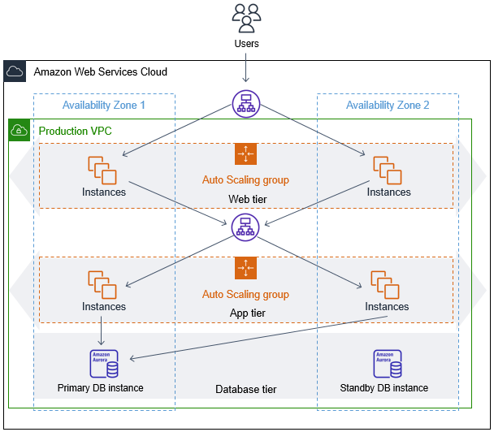
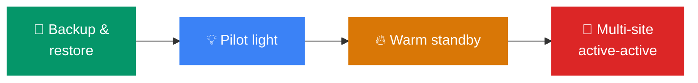
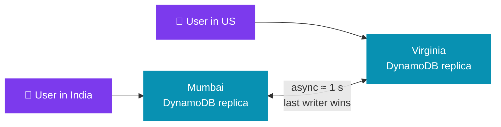
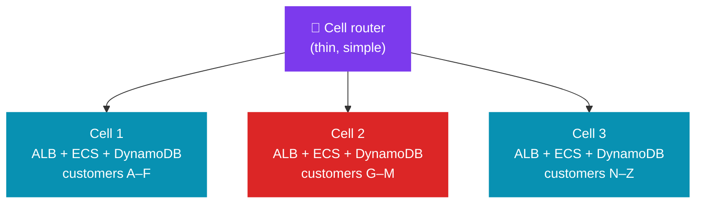
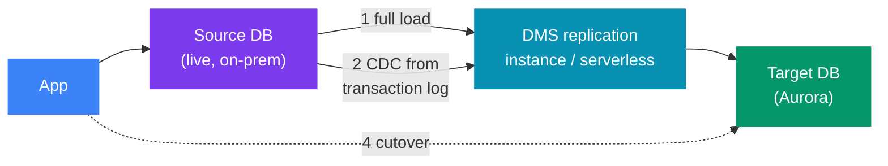

# 🛡️ Reliability and Disaster Recovery on AWS

> 🧭 **AWS for system design** &nbsp;·&nbsp; 🔥 High Priority &nbsp;·&nbsp; 💬 **11 Questions**

> _"Every design is highly available until someone asks a hard question. What happens when the whole Region is gone? What happens when a bad deploy deletes half the data? This file answers that."_

---

This file covers how an AWS system **survives failure**. The order is:

1. 💥 The two scopes of failure: an AZ (Availability Zone) and a Region.
2. ⏱️ RPO (Recovery Point Objective) / RTO (Recovery Time Objective) and the four DR (Disaster Recovery) strategies.
3. 🧱 Amazon ideas that stop failures from spreading: static stability, cells, shuffle sharding, retries, load shedding.
4. 🧭 A short Well-Architected lens and a short migration section.

🔗 **What this file does not repeat:**

| Topic | Where it lives |
|---|---|
| CAP, PACELC, consistency models, split brain | [`../../system-design/02_distributed_systems/01_distributed_fundamentals.md`](../../system-design/02_distributed_systems/01_distributed_fundamentals.md) |
| Failover vs active-active load balancing, circuit breakers | [`../../system-design/02_distributed_systems/02_load_balancing_strategies.md`](../../system-design/02_distributed_systems/02_load_balancing_strategies.md) |
| RDS (Relational Database Service) / Aurora / DynamoDB internals | [`./02_databases.md`](./02_databases.md) |
| Route 53 routing policies, Global Accelerator | [`./07_networking.md`](./07_networking.md) |
| CloudWatch alarms, health dashboards | [`./10_observability.md`](./10_observability.md) |

---

📊 **Question Count**

| # | Section | Questions |
|---|---|---|
| 1 | [Availability vs Disaster Recovery](#1-availability-vs-disaster-recovery) | 1 |
| 4 | [The Four DR Strategies](#4-the-four-dr-strategies) | 2 |
| 6 | [Active-Active: Write Conflicts](#6-active-active-write-conflicts) | 1 |
| 7 | [Static Stability and Control Plane vs Data Plane](#7-static-stability-and-control-plane-vs-data-plane) | 2 |
| 8 | [Cells and Shuffle Sharding](#8-cells-and-shuffle-sharding) | 1 |
| 9 | [Retries, Backoff, Jitter and Timeouts](#9-retries-backoff-jitter-and-timeouts) | 1 |
| 10 | [Throttling, Load Shedding and Health Checks](#10-throttling-load-shedding-and-health-checks) | 1 |
| 11 | [Well-Architected Lens](#11-well-architected-lens) | 1 |
| 12 | [Migrations: DMS + CDC and the 7 Rs](#12-migrations-dms--cdc-and-the-7-rs) | 1 |
| | **Total** | **11** |

> 🔥🔥 Very High — asked in almost every Tier-1 loop &nbsp;·&nbsp; 🔥 High — very frequent in Tier-1 interviews &nbsp;·&nbsp; ⚡ Medium — commonly asked &nbsp;·&nbsp; 💤 Low — good to know, rarely asked

---

## 📑 Table of Contents

1. [Availability vs Disaster Recovery](#1-availability-vs-disaster-recovery)
2. [Multi-AZ vs Multi-Region](#2-multi-az-vs-multi-region)
3. [RPO, RTO and the Availability Math](#3-rpo-rto-and-the-availability-math)
4. [The Four DR Strategies](#4-the-four-dr-strategies)
5. [AWS Building Blocks for DR](#5-aws-building-blocks-for-dr)
6. [Active-Active: Write Conflicts](#6-active-active-write-conflicts)
7. [Static Stability and Control Plane vs Data Plane](#7-static-stability-and-control-plane-vs-data-plane)
8. [Cells and Shuffle Sharding](#8-cells-and-shuffle-sharding)
9. [Retries, Backoff, Jitter and Timeouts](#9-retries-backoff-jitter-and-timeouts)
10. [Throttling, Load Shedding and Health Checks](#10-throttling-load-shedding-and-health-checks)
11. [Well-Architected Lens](#11-well-architected-lens)
12. [Migrations: DMS + CDC and the 7 Rs](#12-migrations-dms--cdc-and-the-7-rs)
13. [Numbers to Remember](#13-numbers-to-remember)

---

## 1. Availability vs Disaster Recovery

🧩 These are two different problems. Interviewers often check if you mix them up.

| | 🛡️ **High availability (HA)** | 💥 **Disaster recovery (DR)** |
|---|---|---|
| 🧩 Protects against | One component fails: an instance, a disk, one AZ | A large event: a Region outage, a bad deploy, data corruption, ransomware, an operator deleting a table |
| 🧰 Typical tool | Multi-AZ, Auto Scaling, load balancer health checks | Backups, cross-Region replication, a second Region |
| 📏 Measured by | Uptime % (99.9, 99.99) | **RPO** (data loss) and **RTO** (downtime) |
| ⏱️ Recovery is | Automatic, seconds to minutes | Often a human decision, minutes to hours |

> ⚠️ **Trap — replication is not a backup.**  
> If a bug writes bad data, replication copies the bad data to every replica within a second.  
> Only a **point-in-time backup** (PITR (Point-In-Time Recovery), snapshots, S3 versioning) lets you go back to before the bug.

> 🎤 **In the interview:** "Multi-AZ gives me availability. It does not give me DR. For DR I need a copy that a bad write cannot reach — point-in-time backups in another account and Region."

### Interview questions

1. **🔥🔥 A developer runs a bad migration that corrupts the `orders` table. You have DynamoDB Global Tables in two Regions. Can you fail over to the other Region?**

<!-- -->
<details>
<summary>Answer</summary>

❌ **No.** The corruption replicated to the other Region within about a second.

- 🧩 Global Tables protect against a Region failure, not against bad writes.
- 🔁 I recover with **point-in-time recovery** (DynamoDB PITR keeps up to 35 days).
- 🗃️ I restore to a new table at a time just before the migration.
- 🔍 Then I reconcile the writes made after that point.

> 💡 **Key idea:** this is why every DR design needs PITR and backups as well as replication.

---

</details>

---

## 2. Multi-AZ vs Multi-Region

- 🏢 **Availability Zone (AZ):** one or more data centers with their own power, cooling and network.
- 📏 AZs in a Region are within about 100 km (60 miles) of each other.
- 🌐 **Region:** a group of AZs (most have 3 or more), fully isolated from other Regions.

<p align="center"></p>

> 🖼️ *A Multi-AZ stack: every tier has capacity in each AZ, and the database keeps a standby in the second AZ.* Source: [Amazon EC2 Auto Scaling benefits for application architecture](https://docs.aws.amazon.com/autoscaling/ec2/userguide/auto-scaling-benefits.html) · License: CC BY-SA 4.0 ([awsdocs/amazon-ec2-auto-scaling-user-guide](https://github.com/awsdocs/amazon-ec2-auto-scaling-user-guide))

| | **Multi-AZ** | **Multi-Region** |
|---|---|---|
| 🛡️ Protects against | Power/network/flood failure of one data center group | Full Region outage, Region-wide service failure, large regulatory or geo needs |
| ⚡ Latency between sites | Single-digit ms (often about 1–2 ms) | Tens to hundreds of ms (for example, Mumbai ↔ Virginia ≈ 180–200 ms round trip) |
| 🗃️ Synchronous replication? | ✅ **Practical** (RDS Multi-AZ, Aurora storage, EBS (Elastic Block Store), S3) | ❌ **Not in practice** — sync writes across Regions add a full round trip to every write |
| ⚠️ Data loss on failover | Usually zero | Usually equal to replication lag (≈ 1 s for Aurora Global / DynamoDB Global Tables) |
| 💰 Cost | ≈ 1.5× compute (N+1 capacity) + inter-AZ data transfer | ≈ 2× everything + cross-Region data transfer + much more engineering |
| ⚙️ Complexity | Mostly managed by AWS services | You own routing, data conflicts, config drift, failover runbooks |
| 🧭 Default choice? | ✅ **For every production system** | Only when the RTO/RPO or the users' location needs it |

### When to use / when NOT to use multi-Region

✅ **Use it when:**

- ⏱️ the business cannot accept hours of downtime during a Region event, or
- 🌍 users are on several continents and need low latency, or
- 📜 a regulator demands it.

❌ **Avoid it when:**

- 🙈 you only want to "be safe". Most outages are bad deploys and config changes, not Region failures. A second Region does not help if you deploy the same bad change to both.
- ⚖️ the data model needs strong consistency on every write. It is also a bad fit if the team cannot handle conflict design (see §6).

> 🎤 **In the interview:** "I start with three AZs in one Region. That covers almost every failure I will see. I add a second Region only in two cases. The RTO is less than the time to rebuild from backups. Or users on another continent need low latency."

---

## 3. RPO, RTO and the Availability Math

| Term | Question it answers | Drives |
|---|---|---|
| 💾 **RPO** — Recovery Point Objective | "How much data, in time, can we lose?" | How often you back up or how you replicate |
| ⏱️ **RTO** — Recovery Time Objective | "How long can we be down?" | How much of the second site is already running |


⏱️ **Detection time is part of RTO.** Say your RTO is 1 hour. Then four steps must all fit in that hour:

1. 🔍 Detect the problem.
2. 📟 Page a human.
3. 🧭 Decide to fail over.
4. ▶️ Run the failover.

> ⚠️ **Trap:** many DR plans fail here. The failover takes 10 minutes, but the decision takes 50.

### The availability numbers

| Availability | Downtime per year | Downtime per month (30 days) |
|---|---|---|
| 99% | 3.65 days | 7.2 hours |
| 99.9% | 8.76 hours | 43.2 minutes |
| 99.95% | 4.38 hours | 21.6 minutes |
| 99.99% | 52.6 minutes | 4.32 minutes |
| 99.999% | 5.26 minutes | 25.9 seconds |

- ⛓️ **Serial dependencies multiply.** If a request needs three services, each 99.9%, the total is 0.999³ ≈ 99.7%. Every hard dependency lowers your number.
- 🛡️ **Redundant copies add.** Two independent copies, each 99%, give 1 − (0.01)² = 99.99%. This only works if the failures are truly independent — two instances in the same AZ are not.
- ⚠️ You cannot be more available than your least available **hard** dependency.

> 💡 **Tip:** turn hard dependencies into soft ones (cache, default value, async) to break this rule.

---

## 4. The Four DR Strategies

🧭 AWS names four strategies. They go from cheap and slow to expensive and fast.



_⚖️ Left to right: lower RPO/RTO, higher cost, more complexity._

| Strategy | What runs in the DR Region | Typical RPO | Typical RTO | Cost | AWS pieces |
|---|---|---|---|---|---|
| **Backup & restore** | Nothing. Only backups. | Hours (time since last backup; minutes with PITR copies) | Hours to a day | 💲 Lowest — storage only | AWS Backup cross-Region copy, S3 CRR (Cross-Region Replication), EBS/RDS snapshot copy, IaC (Infrastructure as Code: CloudFormation/CDK/Terraform), AMIs (Amazon Machine Images) |
| **Pilot light** | Data is live and replicated. Compute is **off** (or at zero). | Seconds to minutes | Tens of minutes | 💲💲 Data stores + replication | Aurora Global DB / RDS cross-Region replica, DynamoDB Global Tables, S3 CRR, ASG (Auto Scaling Group) at 0, Elastic Disaster Recovery |
| **Warm standby** | A **full but small** copy of the stack is running and can serve traffic now. | Seconds | Minutes | 💲💲💲 Small always-on stack | Same as pilot light + ASG at minimum size + ALB (Application Load Balancer) ready + Route 53 failover |
| **Multi-site active-active** (or **hot standby**) | Full production size in 2+ Regions. Active-active takes traffic in all; hot standby takes none until failover. | Near zero (seconds) | Near zero to minutes | 💲💲💲💲 ≈ 2× production | Aurora Global DB, DynamoDB Global Tables, Route 53 latency/weighted or Global Accelerator, CloudFront |

### Pilot light vs warm standby — the difference people miss

- ❌ **Pilot light cannot serve a single request** until you start servers and scale up.
- ✅ **Warm standby can serve traffic right away**, at reduced capacity. You only need to scale up.
- 🧪 Warm standby is also easy to **test continuously** — you can send 1% of real traffic to it.

### The trade-off inside warm standby

🧩 **The problem:** scaling up the DR Region uses **Auto Scaling, which is a control plane action** (see §7).

- ⚠️ During a large Region event, control planes are the first thing to slow down.
- ⚠️ Also, many customers try to launch instances at once.

🧭 **So you choose:**

| Option | ✅ What you gain | ⚖️ What you pay |
|---|---|---|
| 🛡️ Pre-provision full capacity → **hot standby** | Statically stable | 💰 Costs ≈ 2× |
| 📈 Pre-provision enough for the first wave of traffic, then let Auto Scaling grow | Cheaper | RTO depends on getting capacity during the event |

> 📏 **Quotas:** also raise **service quotas** in the DR Region ahead of time. A vCPU quota at the default value can block the scale-up.

### Failure modes for every strategy

| ⚠️ Failure | Why it happens | Fix |
|---|---|---|
| DR Region does not work on the day | Never tested; AMIs, secrets, quotas or config drifted | 🧪 Game days; AWS Config + CloudFormation drift detection; deploy to both Regions from one pipeline |
| Data corruption copied to DR | Replication is not a backup | 🔒 PITR + backups in a separate account, with Vault Lock |
| Failover by false alarm | Automatic failover on a shallow health check | 🔍 Deep health checks on business KPIs (Key Performance Indicators); often a **human decides**, but the steps are automated ("one button") |
| Failback is harder than failover | Old primary has diverged writes | 🧭 Plan failback as a second migration; reconcile before routing back |

> 🎤 **In the interview:** "I pick the DR strategy from the RTO and RPO, not from fashion. Say the business can wait four hours. Then backup and restore with cross-Region, cross-account copies is enough, and it costs almost nothing. If they need minutes, I run a warm standby. I test it every month with real traffic."

### Interview questions

2. **🔥🔥 Your service runs in one Region with Multi-AZ RDS. The business asks for "no more than 15 minutes of downtime and 1 minute of data loss, even if the Region fails." What do you build?**

<!-- -->
<details>
<summary>Answer</summary>

🧭 RPO 1 min and RTO 15 min rule out backup and restore. I would run a **warm standby**:

- 🗃️ Migrate to Aurora. Add an **Aurora Global Database** secondary in the second Region (lag < 1 s, failover < 1 min).
- ⚙️ In the DR Region, keep the full stack deployed at small size — ALB, ECS (Elastic Container Service) service at minimum tasks. The same pipeline deploys both Regions.
- 🌐 Route 53 ARC (Application Recovery Controller) routing controls switch traffic.
- 📏 Raise service quotas there in advance.
- 🧪 Run a failover drill every quarter.
- 🔒 Backups still go to a separate account with Vault Lock. Replication does not protect against corruption.

---

</details>

3. **🔥 What is the difference between pilot light and warm standby?**

<!-- -->
<details>
<summary>Answer</summary>

- 🗃️ **Pilot light:** only the data layer is live in the DR Region. Compute is off, so it cannot serve any request until you start and scale it.
- ⚙️ **Warm standby:** a small but complete copy is running. It can serve traffic at once; you only scale it up.
- ⚖️ **Trade-off:** warm standby has lower RTO and costs more.
- 🧪 It is also easier to test, because it can take a slice of real traffic.

---

</details>

---

## 5. AWS Building Blocks for DR

| Service | What it does | 📏 Key numbers | ⚠️ Watch out for |
|---|---|---|---|
| 🗃️ **Aurora Global Database** | Storage-level replication from one primary Region to secondary Regions | Typical lag **< 1 s**. Managed **failover** promotes a secondary in **< 1 min** (RPO = lag). Planned **switchover** has RPO 0. Up to **10** secondary Regions. | Secondaries are **read-only**. **Write forwarding** sends writes to the primary but adds cross-Region latency. |
| 🗃️ **RDS cross-Region read replica** | Async engine-level replication (MySQL, PostgreSQL, etc.) | Promotion takes **minutes** and includes a reboot | Promotion is one-way; replication to other replicas breaks |
| 🗃️ **DynamoDB Global Tables** | Multi-active replication: every Region accepts reads and writes | Default mode (**MREC**: Multi-Region Eventual Consistency): typical replication **≈ 1 s**, **last-writer-wins**. **MRSC** (multi-Region strong consistency, GA (generally available) mid-2025) gives RPO 0. It needs 3 Regions (or 2 + a witness). Writes pay cross-Region latency | Conditional writes and transactions are checked **only in the local Region** under MREC |
| 🪣 **S3 Cross-Region Replication (CRR)** | Async object copy to another Region (versioning must be on) | Most objects in seconds. **S3 Replication Time Control** has an SLA (Service Level Agreement): 99.99% of objects within **15 minutes** | Existing objects are not copied (use **S3 Batch Replication**). Deletes with a version ID are **not** replicated — good against malicious deletes. |
| 🗃️ **ElastiCache Global Datastore** | Cross-Region replication for Redis OSS / Valkey | Typical lag < 1 s; promote a secondary in about a minute | It is a cache — the source of truth must be elsewhere |
| 🌐 **Route 53 failover + health checks** | DNS sends traffic to a healthy endpoint | Check interval **30 s** (or **10 s** fast); failure threshold default **3** | Clients cache DNS for the TTL (Time To Live). Keep the TTL low (≈ 60 s) on failover records. |
| 🌐 **Route 53 ARC routing controls** | On/off switches for failover, served from a highly available **data plane** cluster in 5 Regions | — | The safe way to do a **manual** failover. Editing a record or weights is a control plane call. |
| 🌐 **Global Accelerator** | 2 static anycast IPs; routes on the AWS backbone to healthy Regional endpoints | Traffic dials per Region | No DNS caching problem; changing a dial is a control plane call |
| 💾 **AWS Backup** | Central backup plans across EC2 (Elastic Compute Cloud), EBS, RDS, Aurora, DynamoDB, EFS (Elastic File System), FSx, S3 and more | Cross-Region and **cross-account** copy; PITR for supported services | 🔒 **Vault Lock** (WORM: Write Once, Read Many). In compliance mode, after the grace period, nobody — not even root — can delete backups. |
| ⚙️ **AWS Elastic Disaster Recovery (DRS)** | Block-level continuous replication of servers (on-prem, other cloud, or EC2) into a cheap staging area | RPO of **seconds**, RTO of **minutes** | Pilot-light model for **servers**. Not for managed databases like RDS. |

> 🎤 **In the interview:** "For the database I use Aurora Global Database. Lag is under a second, and a managed failover takes under a minute. For the traffic switch I use Route 53 ARC routing controls. Flipping a routing control uses the data plane. Editing DNS records during a Region event depends on a control plane."

---

## 6. Active-Active: Write Conflicts

- ✅ **Reads are easy:** **read local** — serve each user from the nearest Region.
- ⚠️ **Writes are the hard part.** If two Regions accept a write to the same item at the same time, one write must lose.

| Write strategy | How it works | AWS fit | Conflict risk |
|---|---|---|---|
| 🎯 **Write global** | All writes go to one primary Region. Other Regions are read-only. | Aurora Global DB (+ write forwarding) | ✅ None. But writes from far users pay cross-Region latency. |
| 🏠 **Write partitioned** | Each user (or tenant) has a **home Region**. Their writes always go there. | DynamoDB Global Tables or S3 bi-directional replication, plus routing by user ID | ✅ None, while the home rule holds. A failover moves the home and needs care. |
| 🌍 **Write local** | Any Region accepts any write. | DynamoDB Global Tables (MREC) | ❌ **Yes.** Last-writer-wins on timestamp → **lost updates**. |



### What goes wrong with last-writer-wins

| ⚠️ Failure | What happens |
|---|---|
| **Lost update** | Two Regions each add ₹100 to a balance read as ₹500. Both write ₹600. One ₹100 is gone. |
| **Uniqueness breaks** | Two Regions both accept the username `alex` in the same second. |
| **Conditional writes lie** | `attribute_not_exists` is checked only against the local replica. |

### How to design around it

1. ❌ **Do not write-local money or inventory.** Use write global or a home Region for those entities. Use write local only for data where the last value is fine (profile, preferences, session, "last seen").
2. 💡 **Make updates commutative.** Store events (append-only) instead of overwriting a total. Add, not set: `ADD balance :x` still conflicts across Regions, but an append-only ledger with unique IDs does not.
3. 🔁 **Idempotency keys** on every write, so a retried or replayed write does not apply twice.
4. ⚖️ **Need strong consistency across Regions?** DynamoDB MRSC or a write-global database. Accept the cross-Region latency on every write. There is no free option. This is PACELC: you pay latency for consistency, even with no partition.

> 🎤 **In the interview:** "Reads are local in every Region. For writes I use a home Region per user, so one user's writes never race across Regions. I only allow write-anywhere for data where last-writer-wins is acceptable, like user preferences."

### Interview questions

4. **🔥 You run active-active in Mumbai and Virginia with DynamoDB Global Tables. A user's wallet balance is sometimes wrong. Why, and how do you fix it?**

<!-- -->
<details>
<summary>Answer</summary>

⚠️ **Why:** Global Tables (MREC) resolve concurrent writes with last-writer-wins. If two Regions update the same balance at nearly the same time, one update is lost.

🧭 **Three fixes:**

- 🏠 Give each user a **home Region** and route all their writes there (write partitioned).
- 🗃️ Store the balance as an **append-only ledger** with unique transaction IDs. Compute the balance from it.
- ⚖️ Use DynamoDB **MRSC** for strong consistency, and accept higher write latency.

❌ I would not use write-local for money.

---

</details>

---

## 7. Static Stability and Control Plane vs Data Plane

🔗 These two ideas come from the Amazon Builders' Library. They explain **why** some designs survive an AZ failure and others do not.

### Control plane vs data plane

| | ⚙️ **Control plane** | 🛡️ **Data plane** |
|---|---|---|
| 🧩 Job | Create, change, delete resources | Serve the real traffic |
| 📋 Examples | `RunInstances`, Auto Scaling launches, `CreateDBInstance`, editing a Route 53 record, IAM (Identity and Access Management) changes | A running EC2 instance, an ALB routing a request, DynamoDB `GetItem`, Route 53 answering a DNS query, health checks |
| ⚖️ Complexity | High: many steps, workflows, databases | Low: simple and fast |
| 📏 Availability goal | Lower | Higher |

> 💡 **Rule:** your recovery path should use **only data plane actions**. Do not plan a recovery that needs to launch new instances or edit IAM during the event.

### Static stability

🛡️ A **statically stable** system keeps working during a failure **without making any changes**. It does not need to launch, scale, or reconfigure anything.

📏 **Example: three AZs.** Peak load needs 300 instances' worth of capacity.

| Design | Normal | When one AZ fails | Statically stable? |
|---|---|---|---|
| 100 per AZ (300 total) | ✅ | 200 left. Must launch 100 more — a control plane action, during the event, competing with everyone else | ❌ |
| 150 per AZ (450 total) | ✅ (67% busy) | 300 left — enough for peak with no action | ✅ |

> 💰 **Cost:** the price is **N+1 capacity**. With 3 AZs you run **150%** of peak. With 2 AZs you would need **200%**. This is one reason to use 3 AZs, not 2.

**More examples of static stability:**

- ⚙️ EC2 instances keep running, and keep their IAM credentials cached, even if the EC2 control plane is down.
- ✅ Lambda functions and DynamoDB tables keep serving — they spread across AZs inside the service.
- ⚠️ Avoid **bimodal behavior**. Some systems behave differently in failure mode — for example, they start calling a cold fallback path. That recovery path is rarely tested.
- 💡 **Constant work:** a config system can push the **full** config every few seconds, not only the changes. Then it does the same work in good and bad times. It cannot be overloaded by a spike of changes.

> 🎤 **In the interview:** "I size each AZ so the other two can carry peak without scaling. Then an AZ failure needs no control plane call. Auto Scaling becomes an optimisation for cost, not something recovery depends on."

### Interview questions

5. **🔥 Explain static stability with an example.**

<!-- -->
<details>
<summary>Answer</summary>

🛡️ A statically stable system keeps working during a failure without changing anything.

📏 **Example:** with three AZs and a peak need of 300 instances, I run 150 in each AZ.

- ✅ **150 per AZ:** if one AZ fails, the other two still have 300 — no scaling needed.
- ❌ **100 per AZ:** I would need Auto Scaling to launch 100 more during the event. That is a control plane action, and control planes are the least reliable part during a large event.

---

</details>

6. **⚡ Why should a failover use the data plane and not the control plane?**

<!-- -->
<details>
<summary>Answer</summary>

- ⚙️ **Control planes** launch instances, edit DNS records and change IAM. They are complex, and their availability goals are lower than those of data planes.
- 🛡️ **Data planes** serve requests, answer DNS and run health checks.
- ⚠️ In a large event, control planes slow down or fail, and everyone calls them at once.
- 🧭 **So** I use Route 53 health checks or ARC routing controls (data plane) to move traffic. I also pre-provision capacity, so I do not need to launch anything.

---

</details>

---

## 8. Cells and Shuffle Sharding

🧩 Both ideas reduce how many customers one failure can hurt.

> ⚠️ **The most common failure is not hardware.** It is a **bad request** (a "poison pill") or a **noisy customer** that overloads whatever it touches.

### Cell-based architecture

🧩 A **cell** is a full, independent copy of the stack (load balancer, compute, database) that serves a fixed **subset of customers**. A thin **cell router** maps each customer to one cell.



_🛡️ If cell 2 fails (red), only its customers are hurt — about 1/N of all customers._

| Property | Why it matters |
|---|---|
| 📏 Fixed maximum cell size | Each cell is load-tested at that size. You scale by adding cells, not by growing one. |
| 🛡️ Deploy one cell at a time | A bad deploy hits one cell first. You stop the rollout before it spreads. |
| ⚠️ Router stays very simple | The router is shared by all cells. If it has logic, it becomes the new single point of failure. |
| 💰 Cost | More fixed overhead per cell; cross-cell queries and moving customers between cells are hard. |

- ✅ **Use when:** large multi-tenant services where one tenant's failure must not hurt others (AWS itself uses cells for many services).
- ❌ **Avoid when:** a small system — one well-built Multi-AZ stack is simpler and good enough.

### Shuffle sharding

- ❌ **Normal sharding:** 8 workers in 4 shards of 2. A poison customer kills its shard → **25%** of customers are down.
- ✅ **Shuffle sharding:** give **each customer its own random pair** of the 8 workers. There are C(8,2) = **28** possible pairs.
  - A poison customer kills its 2 workers.
  - Another customer is fully down only if it has the **exact same pair** — a chance of about 1 in 28.
  - Most customers share at most one worker with the bad one. Their client retries on its second worker.

- 📈 With more workers, the numbers grow fast. Route 53 gives each hosted zone 4 name servers from a pool of 2,048 virtual name servers. That is about 730 billion combinations. An attack on one domain almost never takes down another.
- ⚠️ **Needs a client that retries on another worker** in its shard. Without retries, shuffle sharding helps much less.

> 🎤 **In the interview:** "To limit how many customers one bad tenant can hurt, I use shuffle sharding. Each tenant gets a random small set of workers. Two tenants rarely share the full set, so one tenant's poison request does not take others down."

### Interview questions

7. **⚡ One tenant sends a request that crashes any server it reaches. How do you stop it from taking down everyone?**

<!-- -->
<details>
<summary>Answer</summary>

🧭 First, cells or shuffle sharding.

- 🧩 **Shuffle sharding:** each tenant maps to a small random set of workers. The poison request only hits that set. Other tenants rarely share the same full set, and their clients retry on their other worker.
- 🛡️ **Cells:** the damage stays inside one cell.
- 🔍 **Poison-pill detector:** after N crashes from the same tenant or request signature, the router rejects it and alerts.

---

</details>

---

## 9. Retries, Backoff, Jitter and Timeouts

### Retries can make an outage worse

> ⚠️ **Trap:** if every layer retries, the load multiplies. Five layers, each trying 3 times, can turn one user request into **3⁵ = 243** calls to the bottom service. This happens exactly when that service is already struggling.

**Rules:**

1. 🔁 **Retry at one layer only.** Usually this is the layer closest to the user, or the one that owns the idempotency key.
2. 🔑 **Only retry idempotent operations**, or make them idempotent with an idempotency key.
3. 🧭 **Only retry errors that can succeed later**: timeouts, 5xx, throttling (429). Never retry a 400 or a validation error.
4. 📏 **Use a retry budget.** Allow retries only while they are a small part of traffic (for example, ≤ 10%). The AWS SDKs do this in "standard" retry mode with a client-side **retry quota** (a token bucket). The default is **3 total attempts**.

### Exponential backoff with full jitter

- ⚠️ **Backoff alone is not enough.** Say 1,000 clients fail at the same moment. They all retry at 100 ms, then 200 ms, then 400 ms — in synchronized waves.
- 💡 **Jitter** adds randomness so the retries spread out.

```java
// Full jitter: sleep = random(0, min(cap, base * 2^attempt))
long backoffMillis(int attempt, long baseMillis, long capMillis) {
    long exp = Math.min(capMillis, baseMillis * (1L << attempt));
    return ThreadLocalRandom.current().nextLong(0, exp + 1);
}
```

⚡ AWS measured several variants. **Full jitter** and "decorrelated jitter" both finish the work with far fewer total calls than plain exponential backoff.

### Timeouts

- ⚠️ **Always set a timeout.** Many HTTP clients default to infinite or very long timeouts. One slow dependency then holds all your threads and connections.
- 📏 **Set it from data:** pick the downstream's p99.9 latency and add a margin. Too low → false timeouts and retries; too high → threads pile up.
- ⏱️ **Two timeouts:** a **connect** timeout (short, ≈ 1 s) and a **request** timeout.
- ⬇️ **Pass the deadline down.** If the caller has 2 s left, the next call must not wait 5 s. Work done after the caller gave up is wasted.
- 📏 **Know the hard limits:**
  - API Gateway integration timeout: **29 s** by default. Since 2024 you can raise it for Regional and private REST APIs.
  - Lambda max run time: **15 min**.
  - ALB idle timeout: **60 s** by default.

> 🎤 **In the interview:** "Every outbound call has a timeout set from the downstream p99.9. Only the edge layer retries, with exponential backoff and full jitter. It retries only idempotent calls that carry an idempotency key. I cap retries with a budget, so a struggling service does not get 3× its load."

### Interview questions

8. **🔥🔥 During an outage of a downstream service, your callers' traffic triples. What went wrong?**

<!-- -->
<details>
<summary>Answer</summary>

⚠️ **Retry amplification.** Each layer retried without a budget and without jitter, so failed calls multiplied and arrived in synchronized waves.

🧭 **Fixes:**

- 🔁 Retry at one layer only.
- 🎲 Use exponential backoff with **full jitter**.
- 📏 Cap retries with a retry budget (token bucket).
- ⏱️ Set timeouts from the downstream p99.9.
- 🛡️ Add a circuit breaker, so callers stop calling a dependency that is clearly down.

---

</details>

---

## 10. Throttling, Load Shedding and Health Checks

### Throttling (protect from callers)

⚖️ Throttling limits how much one caller can send. It is about **fairness**: one client must not use all the capacity.

| Layer | AWS mechanism | 📏 Default numbers |
|---|---|---|
| 🌐 Edge | AWS WAF (Web Application Firewall) rate-based rules | Per-IP request rate over a time window |
| 🚪 API | API Gateway account throttle + usage plans with API keys (per client) | **10,000 rps** steady, **5,000** burst, per account per Region (soft limit) |
| ⚙️ Compute | Lambda **reserved concurrency** per function | **1,000** concurrent executions per Region by default (soft limit) |
| 🗃️ Data | DynamoDB per-partition limits | **3,000 RCU (Read Capacity Units) / 1,000 WCU (Write Capacity Units)** per partition |

- 💡 Return **429** with a `Retry-After` hint.
- 🔗 The rate limiter algorithms are in [`../../system-design/01_insider_guide_Alex_Xu/vol_1/ch04_design_a_rate_limiter.md`](../../system-design/01_insider_guide_Alex_Xu/vol_1/ch04_design_a_rate_limiter.md).

### Load shedding (protect yourself)

🛡️ Throttling is per caller. **Load shedding** protects the server when **total** load is too high.

> ⚠️ **Without it,** a server at 120% load does not serve 100%. Latency grows, every request times out, and goodput (useful work) falls toward zero.

1. ⚡ **Reject early and cheaply.** Check in-flight requests or queue depth at the front door. Return 503 before you do any expensive work.
2. 🧭 **Shed by priority.** Drop background jobs and retries first; keep checkout.
3. ⏱️ **Do not serve requests the client already gave up on.** If a request waited in a queue longer than its timeout, drop it.
4. 📏 **Bound every queue.** An unbounded queue turns a 1-minute spike into a 1-hour backlog. Under backlog, serving **newest first** (LIFO: Last In, First Out) helps current users; the old requests have timed out anyway.

### Health checks — shallow vs deep

| Type | Checks | ⚠️ Risk |
|---|---|---|
| 🩺 **Shallow** (liveness) | Process is up, port open | Misses a broken dependency |
| 🔍 **Deep** (readiness) | Can reach the DB, cache, disk | One shared dependency fails → **every** host fails the check → the load balancer removes all of them |

> 💡 **Fail open.** ALB and Route 53 both do this: if **all** targets are unhealthy, they send traffic to all of them anyway. A partly working fleet is better than none.  
> Design your own checks the same way. Use deep checks to stop traffic to a **single** bad host, not to shut down the fleet.

> 🎤 **In the interview:** "API Gateway usage plans throttle each client. Behind it, each service sheds load by priority when in-flight work passes a limit. It also drops any request that has already waited past its deadline. That keeps goodput flat under overload instead of falling to zero."

### Interview questions

9. **🔥 What is load shedding, and how is it different from throttling?**

<!-- -->
<details>
<summary>Answer</summary>

- ⚖️ **Throttling** limits each **caller** to its fair share (API Gateway usage plans, WAF rate rules).
- 🛡️ **Load shedding** protects the **server** when total load is too high. It:
  - rejects extra work early and cheaply (503);
  - drops low-priority work first;
  - drops requests that already passed their deadline.
- ⚠️ **Without it,** an overloaded server spends all its time on requests that will time out. Useful throughput then falls to zero.

---

</details>

---

## 11. Well-Architected Lens

🏛️ The AWS Well-Architected Framework has **six pillars**: Operational Excellence, Security, Reliability, Performance Efficiency, Cost Optimization, Sustainability.

> 💡 **Tip:** in a design round you do not list them. You use their ideas as a checklist at the end of your design.

### Reliability pillar — the five design principles

| Principle | What it means in a design |
|---|---|
| 🛡️ Automatically recover from failure | Alarms on **business KPIs** (orders/min), not only CPU; automatic replacement of failed parts |
| 🧪 Test recovery procedures | Game days, chaos tests (AWS Fault Injection Service), real failover drills |
| 📈 Scale horizontally | Many small instances across AZs, not one large one |
| 📏 Stop guessing capacity | Auto Scaling and load tests instead of fixed sizing |
| ⚙️ Manage change through automation | IaC, pipelines, small deploys with automatic rollback |

The pillar groups best practices into **four areas**:

| Area | Covers |
|---|---|
| 🧱 Foundations | Service quotas, network planning (no overlapping CIDRs, i.e. Classless Inter-Domain Routing IP ranges) |
| 🧩 Workload architecture | Loose coupling, idempotency, throttling, retries, timeouts, statelessness |
| 🔄 Change management | Monitoring, auto scaling, immutable deploys |
| 🛡️ Failure management | Backups, fault isolation, static stability, DR testing |

> 💡 **One lesson from AWS that is worth quoting:** "the only recovery path that works is the one you test often." Keep the number of recovery paths small.

### Performance and cost ideas that matter in a design round

| Pillar | Idea | Use it like this |
|---|---|---|
| ⚡ Performance | Use managed and serverless services | "DynamoDB and Lambda remove capacity planning for this spiky workload." |
| ⚡ Performance | Go global in minutes | CloudFront, Global Accelerator, Global Tables for far-away users |
| ⚡ Performance | Mechanical sympathy | Choose the data store by access pattern (key-value vs relational vs search) |
| 💰 Cost | Consumption model | Pay per request for spiky or low traffic; reserved/Savings Plans for steady base load |
| 💰 Cost | Plan for data transfer | Cross-AZ and cross-Region bytes cost money; CloudFront egress is cheaper than direct |
| 💰 Cost | Manage demand | Buffer with SQS (Simple Queue Service) or throttle, instead of sizing for the peak |
| 💰 Cost | Spot for interruptible work | Batch and stateless workers with checkpoints, up to 90% cheaper |

> 🎤 **In the interview:** "Before I finish, I check the design against reliability, performance and cost. Here the single-Region Aurora writer is my main risk. So I add a Global Database secondary and a monthly failover drill."

### Interview questions

10. **⚡ What is the AWS Well-Architected Framework?**

<!-- -->
<details>
<summary>Answer</summary>

🏛️ It is AWS's set of best practices for designing and reviewing cloud systems. It has **six pillars**.

> ⚠️ **Trap:** **Sustainability** became the sixth in **December 2021**. If you say "five pillars", the interviewer knows your knowledge is old.

| Pillar | Focus | Key practices |
|---|---|---|
| ⚙️ **Operational Excellence** | Run and monitor systems | IaC (Terraform/CDK), automated deploys, runbooks |
| 🔒 **Security** | Protect data and systems | Least-privilege IAM, encryption at rest and in transit, MFA (Multi-Factor Authentication), VPC (Virtual Private Cloud) isolation |
| 🛡️ **Reliability** | Recover from failure | Multi-AZ, Auto Scaling, retries with backoff, tested DR |
| ⚡ **Performance Efficiency** | Use resources well | Right-sizing, caching (ElastiCache), CDN (Content Delivery Network: CloudFront) |
| 💰 **Cost Optimization** | Avoid waste | Savings Plans/Reserved, Spot, S3 lifecycle rules, right-sizing |
| 🌱 **Sustainability** | Reduce environmental impact | Managed and serverless services, right-sizing, efficient code and data lifecycle |

🎤 Interviewers ask most about **Reliability**. Make these points:

- 🛡️ Design for failure: assume any part can fail. Use Multi-AZ, Auto Scaling and health checks ([§2](#2-multi-az-vs-multi-region), [§10](#10-throttling-load-shedding-and-health-checks)).
- 🔁 Retry with exponential backoff and jitter, and add a circuit breaker so failures do not spread ([§9](#9-retries-backoff-jitter-and-timeouts)).
- 🧪 Test recovery often. An untested failover path is not a recovery plan ([§4](#4-the-four-dr-strategies)).

💡 In a design round, do not recite the table. Use the pillars as a checklist at the end, as shown above.

---

</details>

---

## 12. Migrations: DMS + CDC and the 7 Rs

### Zero-downtime database migration with DMS + CDC

- 🗃️ **AWS DMS** (Database Migration Service) copies data from a source DB to a target while the source **stays live**.
- 🔁 **CDC** (change data capture) reads the source's transaction log (MySQL binlog, PostgreSQL WAL (Write-Ahead Log), Oracle redo). It replays every change on the target.



**Steps:**

1. 🧱 **Create the schema on the target first.** DMS moves **data**, not the full schema. It creates bare tables without secondary indexes, foreign keys or procedures. For the same engine, use native tools. For a different engine (Oracle → PostgreSQL), use **AWS SCT** (Schema Conversion Tool) or DMS Schema Conversion.
2. 🔁 **Full load**, then **CDC** keeps the target in sync. Turn on log retention on the source so CDC does not lose its position.
3. 🔍 **Validate** (DMS data validation compares rows) and run read traffic or shadow reads on the target.
4. 🔀 **Cutover:** stop writes for a short window (seconds to minutes). Wait for CDC lag to reach zero. Switch the app's connection. Keep the old DB as the rollback target.

⚠️ **Watch out for:**

- 🐢 Large LOB (Large Object) columns — slow to copy.
- 🔑 Tables without a primary key — CDC cannot apply updates well.
- 🔢 Sequences and auto-increment values — reset them on the target.
- 🛡️ Run the replication instance as **Multi-AZ** in production.

> 💡 **Tip:** for RDS MySQL/PostgreSQL → Aurora, a simpler path exists. Create an **Aurora read replica** of the RDS instance, wait for lag 0, and promote it.

### The 7 Rs of migration

| R | Meaning | Example |
|---|---|---|
| 🗑️ **Retire** | Turn it off | An old reporting app nobody uses |
| 📌 **Retain** | Keep it where it is, for now | A mainframe with a 3-year license |
| 🚚 **Rehost** | "Lift and shift" — same app on EC2 | AWS Application Migration Service (MGN) |
| 📦 **Relocate** | Move the hypervisor-level platform as-is | VMware Cloud on AWS |
| 🔧 **Replatform** | "Lift, tinker and shift" — small changes | Self-managed MySQL → RDS; app → Elastic Beanstalk |
| 🛒 **Repurchase** | Move to a SaaS (Software as a Service) product | On-prem CRM (Customer Relationship Management) → Salesforce |
| 🏗️ **Refactor** | Re-architect for cloud-native | Monolith → microservices on ECS/Lambda + DynamoDB |

_💡 Older lists have 6 Rs — **Relocate** was added later._

### Interview questions

11. **🔥 You must move a 2 TB PostgreSQL database from on-prem to Aurora PostgreSQL with less than 5 minutes of downtime. How?**

<!-- -->
<details>
<summary>Answer</summary>

- 🧱 Create the schema on Aurora with `pg_dump -s` (same engine, so no SCT needed).
- 🔁 Run AWS DMS with **full load + CDC**. CDC reads the PostgreSQL WAL through logical replication. It keeps Aurora in sync while the app still writes to on-prem.
- 🔍 Validate with DMS data validation.
- 🔀 At cutover, stop writes, wait until CDC lag is zero, reset sequences, and point the app to Aurora.
- ↩️ Keep the on-prem DB as a rollback target for a few days.
- 🛡️ Use a Multi-AZ replication instance.
- ⚠️ Before starting, add a primary key to any table that lacks one.

---

</details>

---

## 13. Numbers to Remember

| Number | What |
|---|---|
| ≈ 100 km | 🌐 Max distance between AZs in a Region |
| 150% | 🛡️ Capacity to run with 3 AZs for static stability (200% with 2 AZs) |
| 60–120 s | 🗃️ RDS Multi-AZ (instance) failover; < 35 s for a Multi-AZ DB cluster |
| < 1 s / < 1 min | 🗃️ Aurora Global Database lag / managed failover time |
| ≈ 1 s | 🗃️ DynamoDB Global Tables replication (MREC) |
| 15 min | 🪣 S3 RTC (Replication Time Control) SLA for 99.99% of objects |
| 30 s / 10 s, × 3 | 🌐 Route 53 health check interval (standard / fast), failure threshold |
| 52.6 min | ⏱️ Downtime per year at 99.99% |
| 3⁵ = 243 | 🔁 Load amplification from 3 tries at 5 layers |
| 10,000 / 5,000 | 🚪 API Gateway default rps / burst per account per Region |
| 1,000 | ⚙️ Default Lambda concurrency per Region |
| 28 | 🧩 Shuffle-shard pairs from 8 workers |

---

## 📊 Section Coverage Tracker

> **R-1:** `✅ First read` &nbsp;·&nbsp; **R0–R6:** `🟢🟡🔴 Recall confidence` · `[ ] Pending` · `⏭️ Skipped`  
> **Priority:** `🔥🔥 VH` · `🔥 H` · `⚡ M` · `💤 L`

| § | Section | Priority | R-1 | R0 | R1 | R2 | R3 | R4 | R5 | R6 |
|---|---------|----------|-----|----|----|----|----|----|----|----|
| 1 | Availability vs Disaster Recovery | 🔥🔥 | [ ] | [ ] | [ ] | [ ] | [ ] | [ ] | [ ] | [ ] |
| 2 | Multi-AZ vs Multi-Region | 🔥 | [ ] | [ ] | [ ] | [ ] | [ ] | [ ] | [ ] | [ ] |
| 3 | RPO, RTO and the Availability Math | 🔥 | [ ] | [ ] | [ ] | [ ] | [ ] | [ ] | [ ] | [ ] |
| 4 | The Four DR Strategies | 🔥🔥 | [ ] | [ ] | [ ] | [ ] | [ ] | [ ] | [ ] | [ ] |
| 5 | AWS Building Blocks for DR | 🔥 | [ ] | [ ] | [ ] | [ ] | [ ] | [ ] | [ ] | [ ] |
| 6 | Active-Active: Write Conflicts | 🔥 | [ ] | [ ] | [ ] | [ ] | [ ] | [ ] | [ ] | [ ] |
| 7 | Static Stability and Control Plane vs Data Plane | 🔥 | [ ] | [ ] | [ ] | [ ] | [ ] | [ ] | [ ] | [ ] |
| 8 | Cells and Shuffle Sharding | ⚡ | [ ] | [ ] | [ ] | [ ] | [ ] | [ ] | [ ] | [ ] |
| 9 | Retries, Backoff, Jitter and Timeouts | 🔥🔥 | [ ] | [ ] | [ ] | [ ] | [ ] | [ ] | [ ] | [ ] |
| 10 | Throttling, Load Shedding and Health Checks | 🔥 | [ ] | [ ] | [ ] | [ ] | [ ] | [ ] | [ ] | [ ] |
| 11 | Well-Architected Lens | ⚡ | [ ] | [ ] | [ ] | [ ] | [ ] | [ ] | [ ] | [ ] |
| 12 | Migrations: DMS + CDC and the 7 Rs | 🔥 | [ ] | [ ] | [ ] | [ ] | [ ] | [ ] | [ ] | [ ] |
| 13 | Numbers to Remember | ⚡ | [ ] | [ ] | [ ] | [ ] | [ ] | [ ] | [ ] | [ ] |

### 🎯 Review Queue

_Questions missed in the last recall — drilled first next session, cleared when solid. Managed by `/recall`._

- _(empty)_
