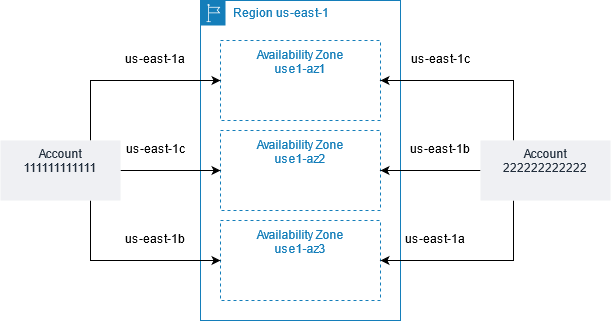
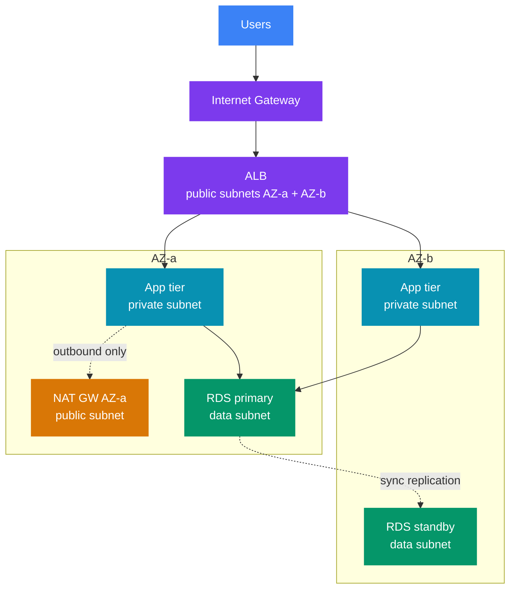
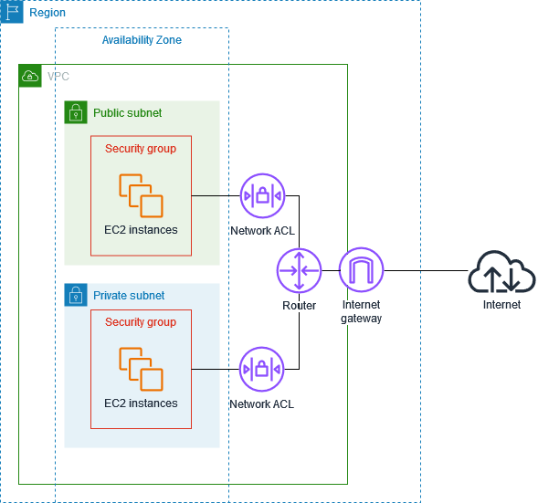
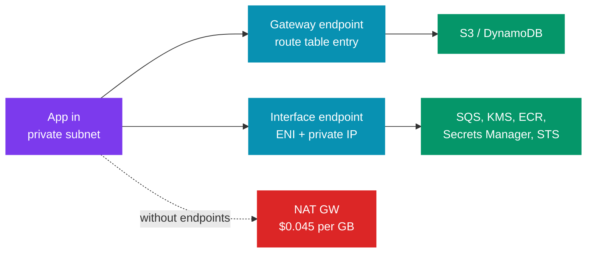

# 🌐 AWS Networking for System Design — VPC, Subnets, Endpoints and Hybrid Links

> ☁️ **AWS for system design** &nbsp;·&nbsp; 🔥🔥 Very high priority &nbsp;·&nbsp; 💬 **11 Questions**

> _"Every AWS design has a network box on the whiteboard. A senior engineer can say which
> subnet each box lives in, how traffic leaves it, and what that traffic costs."_

🎯 This note covers only what a backend engineer draws in a design round. It is not exam prep.
Each main section answers six things:

| | Question |
|---|---|
| 🧩 | What problem does it solve? |
| ✅ | When do you use it? |
| 📏 | What are the numbers? |
| ⚠️ | How does it fail? |
| ⚖️ | What are the trade-offs? |
| 🎤 | What one or two lines do you say in the interview? |

> 🔗 **Already covered elsewhere — not repeated here:**  
> - ALB (Application Load Balancer) vs NLB (Network Load Balancer): [05 Compute §3](./05_compute_and_scaling.md#3-elastic-load-balancing-alb--nlb--gwlb)  
> - Load-balancing algorithms: [02_load_balancing_strategies.md](../../system-design/02_distributed_systems/02_load_balancing_strategies.md)

> 💰 **Prices** in this note are **us-east-1 list prices** as of 2026. They differ by Region and change over time.  
> Use them for rough estimates in an interview, not for a bill.

---

📊 **Question Count**

| # | Section | Questions |
|---|---|---|
| 3 | [Subnets — the standard 3-tier layout](#3-subnets--the-standard-3-tier-layout) | 2 |
| 5 | [Route tables](#5-route-tables) | 1 |
| 6 | [NAT Gateway](#6-nat-gateway) | 2 |
| 7 | [Security Groups vs Network ACLs](#7-security-groups-vs-network-acls) | 1 |
| 8 | [VPC Endpoints and PrivateLink](#8-vpc-endpoints-and-privatelink) | 2 |
| 9 | [VPC Peering vs Transit Gateway](#9-vpc-peering-vs-transit-gateway) | 1 |
| 10 | [Hybrid connectivity — Site-to-Site VPN vs Direct Connect](#10-hybrid-connectivity--site-to-site-vpn-vs-direct-connect) | 1 |
| 12 | [Data transfer cost as a design factor](#12-data-transfer-cost-as-a-design-factor) | 1 |
| | **Total** | **11** |

> 🔥🔥 Very High — asked in almost every Tier-1 loop &nbsp;·&nbsp; 🔥 High — very frequent in Tier-1 interviews &nbsp;·&nbsp; ⚡ Medium — commonly asked &nbsp;·&nbsp; 💤 Low — good to know, rarely asked

---

## 📑 Table of Contents

1. [Regions and Availability Zones](#1-regions-and-availability-zones)
2. [VPC and CIDR planning](#2-vpc-and-cidr-planning)
3. [Subnets — the standard 3-tier layout](#3-subnets--the-standard-3-tier-layout)
4. [Internet Gateway (IGW)](#4-internet-gateway-igw)
5. [Route tables](#5-route-tables)
6. [NAT Gateway](#6-nat-gateway)
7. [Security Groups vs Network ACLs](#7-security-groups-vs-network-acls)
8. [VPC Endpoints and PrivateLink](#8-vpc-endpoints-and-privatelink)
9. [VPC Peering vs Transit Gateway](#9-vpc-peering-vs-transit-gateway)
10. [Hybrid connectivity — Site-to-Site VPN vs Direct Connect](#10-hybrid-connectivity--site-to-site-vpn-vs-direct-connect)
11. [VPC Flow Logs](#11-vpc-flow-logs)
12. [Data transfer cost as a design factor](#12-data-transfer-cost-as-a-design-factor)
13. [Design checklist — the network box in 60 seconds](#13-design-checklist--the-network-box-in-60-seconds)

---

## 1. Regions and Availability Zones

🧩 **Problem:** Hardware fails, and whole data centers fail. You need a failure unit you can design around.

| Unit | What it is | Design meaning |
|---|---|---|
| 🗺️ **Region** | A geographic area (e.g. `ap-south-1`, Mumbai) with 3 or more AZs | Data residency, latency to users, disaster recovery unit |
| 🏢 **Availability Zone (AZ)** | One or more data centers with their own power, cooling and network | The **failure unit** for high availability |
| 📏 **AZ distance** | AZs in a Region are up to 100 km (60 miles) apart | Close enough for synchronous replication |
| ⚡ **Inter-AZ latency** | Single-digit milliseconds (usually 1–2 ms round trip) | Fine for sync DB replication; not free (see §12) |

🧭 **Rules to say in a design:**

- 🛡️ **Multi-AZ is the default** for anything in production. One AZ = one failure takes you down.
- ⚖️ **Multi-Region is a business choice**, not a default. It doubles cost and adds data conflicts. Use it for a strict RTO (Recovery Time Objective: how long the system can be down) or RPO (Recovery Point Objective: how much recent data you can lose), data residency, or global latency.
- ⚠️ **AZ names are per account.** `us-east-1a` in your account may be a different building than `us-east-1a` in another account. Use the **AZ ID** (`use1-az1`) when you line up AZs across accounts (for example, with a PrivateLink provider).

> 🖼️ *The same AZ name points to a different physical AZ in each account. The AZ ID is the same for everyone.* Source: [Working with shared subnets — Amazon VPC User Guide](https://docs.aws.amazon.com/vpc/latest/userguide/vpc-sharing-share-subnet-working-with.html) · License: CC BY-SA 4.0 ([awsdocs/amazon-vpc-user-guide](https://github.com/awsdocs/amazon-vpc-user-guide/blob/master/LICENSE-SUMMARY)) · White background added

> 🎤 **Say it:** "I spread every tier across three AZs. One AZ can fail and I still have two-thirds of capacity, so I size each AZ to carry 50% of peak."

---

## 2. VPC and CIDR planning

🧩 **Problem:** You need a private network that you control: your IP ranges, your routes, your firewalls.

- 🌐 A **VPC** (Virtual Private Cloud) is that network. It lives in **one Region** and spans all its AZs.
- 🔢 A **CIDR block** (Classless Inter-Domain Routing; e.g. `10.0.0.0/16`) is the IP range of the VPC.
- 💡 The number after `/` is how many bits are fixed. Fewer fixed bits = more addresses.

### Key numbers

| Item | Value |
|---|---|
| 📏 VPC size | `/16` (65,536 IPs) to `/28` (16 IPs) |
| ➕ IPv4 CIDRs per VPC | 5 by default (adjustable up to 50) — you can add ranges later |
| 🚫 Reserved IPs per subnet | **5** — the first 4 and the last 1 |
| `/24` subnet | 256 − 5 = **251** usable IPs |
| `/20` subnet | 4,096 − 5 = **4,091** usable IPs |
| 🔒 Private ranges (RFC 1918) | `10.0.0.0/8`, `172.16.0.0/12`, `192.168.0.0/16` |

### How to plan

1. 🚫 **Never overlap.** Peering, Transit Gateway and VPN routing all fail when two networks share a range. Keep a company-wide IP plan (AWS **IPAM** (IP Address Manager) can manage it).
2. 📈 **Leave room.** Take a `/16` per VPC per environment. Changing a subnet's size later means re-creating it.
3. ☸️ **Size subnets for Kubernetes.** On EKS (Elastic Kubernetes Service) with the default **VPC CNI** (Container Network Interface), every pod gets a real VPC IP. A node with 30 pods uses 30+ IPs. Use `/19` or `/20` private subnets for EKS, not `/24`.
4. 🐳 **Avoid `172.17.0.0/16`.** Docker uses it by default on hosts. A VPC in that range causes strange routing bugs in containers.
5. 🏢 **Plan for on-prem.** If a data center joins later, its ranges must not overlap with yours either.

⚠️ **How it fails:**

| Failure | What happens |
|---|---|
| **Subnet runs out of IPs** | Auto Scaling, Lambda in VPC, or EKS pods fail to launch with an "insufficient IP" error. This is a common real outage during a scale-up |
| **Overlapping CIDRs** with a partner | You cannot peer. Your only clean option is **PrivateLink** (§8), which works even with overlap |

> 🎤 **Say it:** "I give each environment its own `/16` from a central plan, so we can peer or join a Transit Gateway later without re-IPing. EKS gets large private subnets because each pod takes a VPC IP."

---

## 3. Subnets — the standard 3-tier layout

🧩 **Problem:** Different parts of the system need different exposure. The load balancer must face the internet. The database must never face it.

- 🧱 A **subnet** is a slice of the VPC CIDR inside **one AZ**.
- 💡 A subnet is **public** or **private** only because of its **route table** (§5). There is no "public" checkbox.

| Tier | Subnet type | What lives there | Route to internet |
|---|---|---|---|
| 🌍 **Edge** | Public, one per AZ | ALB / NLB, NAT (Network Address Translation) Gateway | `0.0.0.0/0 → IGW` |
| ⚙️ **App** | Private, one per AZ | EC2, ECS (Elastic Container Service) tasks, EKS nodes, Lambda ENIs (Elastic Network Interfaces) | `0.0.0.0/0 → NAT GW` (same AZ) |
| 🗃️ **Data** | Private (isolated), one per AZ | RDS (Relational Database Service), Aurora, ElastiCache, MSK (Managed Streaming for Apache Kafka) | ❌ No internet route at all |

📐 With 3 AZs this is **9 subnets**. That is the layout to draw in most designs.

> 💡 **Note:** The diagram shows one NAT Gateway to stay under 8 nodes. In production, AZ-b has its own NAT  
> Gateway too (§6).

> 🖼️ *AWS's own example: public and private subnets in two AZs, with one NAT gateway in each AZ. It has no separate data tier.* Source: [Example: VPC with servers in private subnets and NAT — Amazon VPC User Guide](https://docs.aws.amazon.com/vpc/latest/userguide/vpc-example-private-subnets-nat.html) · License: CC BY-SA 4.0 ([awsdocs/amazon-vpc-user-guide](https://github.com/awsdocs/amazon-vpc-user-guide/blob/master/LICENSE-SUMMARY))

🔒 **Rules:**
- ✅ **Only load balancers and NAT Gateways go in public subnets.** App servers never get a public IP.
- ❌ **No SSH from the internet.** Use **SSM Session Manager** (SSM = AWS Systems Manager) to reach a private instance. You need no bastion host and no open port 22.
- 🗃️ **Data subnets have no `0.0.0.0/0` route.** If a DB needs AWS APIs, give it a VPC endpoint (§8).

> 🎤 **Say it:** "Three tiers, three AZs, nine subnets. Only the ALB and the NAT Gateways are public. The database subnets have no route to the internet at all."

### Interview questions

1. **🔥🔥 Explain AWS VPC — subnets, route tables, security groups and NACLs.**

<!-- -->

Answer

🌐 A **VPC** is your own private network in one Region. It spans all the AZs of that Region ([§2](#2-vpc-and-cidr-planning)). Its parts:

| Part | What it is | Stateful? |
|---|---|---|
| 🧱 **Subnet** | A slice of the VPC CIDR in **one AZ**. It is public only if its route table sends `0.0.0.0/0` to an IGW (Internet Gateway) | — |
| 🧭 **Route table** | Picks the next hop for a packet. Each subnet has exactly one ([§5](#5-route-tables)) | — |
| 🚪 **Internet Gateway** | Connects the VPC to the internet, in both directions ([§4](#4-internet-gateway-igw)) | — |
| ↗️ **NAT Gateway** | Lets private subnets start outbound connections. The internet cannot start one back ([§6](#6-nat-gateway)) | — |
| 🛡️ **Security group** | Firewall on an **ENI** (instance, task, pod). Allow rules only | ✅ Stateful — return traffic is allowed |
| 🧱 **NACL** (Network Access Control List) | Firewall on a **subnet**. Allow and deny rules, checked in number order | ❌ Stateless — allow both directions yourself |

🎤 **The follow-ups interviewers ask:**
- ⚖️ **SG (Security Group) vs NACL:** the security group is the real firewall. Use a NACL only for a coarse deny on a whole subnet ([§7](#7-security-groups-vs-network-acls)).
- ⚠️ **The stateless trap:** a NACL remembers nothing about the inbound request. Its outbound rules must allow the ephemeral ports 1024–65535, or the replies are dropped.
- 🪣 **S3 from a private subnet:** this traffic does not need NAT. A gateway endpoint is free and keeps it private ([§8](#8-vpc-endpoints-and-privatelink)).

---

2. **🔥🔥 Draw the network for a public REST API with a Postgres database across 3 AZs. What is public?**

<!-- -->

Answer

- 🧱 **Layout:** one VPC, `/16`, three AZs, **nine subnets**: public / private app / isolated data, one each per AZ.
- 🌍 **Public:** only the ALB and one NAT Gateway per AZ. App and DB have no public IPs.
- 🛡️ **SG chain:**
  - `alb-sg` allows 443 from the internet (or only from the CloudFront prefix list).
  - `app-sg` allows the app port from `alb-sg`.
  - `db-sg` allows 5432 from `app-sg`.
- 🗃️ **Data subnets** have no `0.0.0.0/0` route.
- 🔒 **Admin access** through SSM Session Manager, not a bastion with port 22 open.

---

---

## 4. Internet Gateway (IGW)

🧩 **What it does:** It connects a VPC to the internet. It also does 1:1 NAT between an instance's private IP and its public IP.

| Fact | Value |
|---|---|
| 🔢 Per VPC | One IGW |
| 🛡️ Availability | Managed by AWS, redundant across AZs, no single point of failure |
| ⚡ Bandwidth | No limit you need to design for |
| 💰 Cost | The IGW is free. You pay for data out to the internet (§12) |

✅ **For an instance to be reachable from the internet, all four must be true:**
1. 🚪 The VPC has an IGW attached.
2. 🧭 The subnet's route table has `0.0.0.0/0 → igw-…`.
3. 🌍 The instance has a **public IPv4** or an Elastic IP.
4. 🛡️ The security group and NACL allow the traffic.

> 💰 **Public IPv4 costs money.**  
> - Since 1 Feb 2024, AWS charges **$0.005 per hour** for every public IPv4 address, attached or not (about $3.6 per month each).  
> - A fleet of 200 instances with public IPs costs about $720 per month for nothing.  
> - This is one more reason to keep app servers private.

---

## 5. Route tables

🧩 **What they do:** Each subnet has exactly one route table. It decides where a packet goes next.

| Rule | Meaning |
|---|---|
| 🎯 **Longest prefix match** | The most specific route wins. `10.1.0.0/16 → peering` beats `0.0.0.0/0 → NAT` |
| 🏠 **`local` route** | Every route table has a route for the VPC CIDR. You cannot delete it. All subnets in a VPC can reach each other |
| 🎯 **Targets** | IGW, NAT GW, VPC peering, Transit Gateway, virtual private gateway, gateway endpoint (via prefix list), ENI |
| 📋 **Main route table** | A subnet with no explicit table uses the main one. Keep the main table private, so a new subnet is private by default |

⚠️ **How it fails:**
- 🌍 **Wrong main table.** A new subnet lands on a public main table by mistake. Fix: keep the main table with no internet route.
- 🔀 **Asymmetric routing** (one path out, another path back). Traffic goes out through one path and returns through another. Firewalls and stateful devices drop it.
- 🔒 **Security is not in route tables.** The `local` route means every subnet can reach every other subnet. Isolation inside a VPC comes from **security groups**, not routes.

### Interview questions

3. **🔥 An instance in a private subnet cannot download packages. Walk through how you debug it.**

<!-- -->

Answer

🔍 Check the path hop by hop:

| Step | Check | Question to ask |
|---|---|---|
| 1 | 🧭 **Route table** of the private subnet | Is there `0.0.0.0/0 → nat-…`? |
| 2 | ↗️ **NAT Gateway** | Is it in a **public** subnet, and does that subnet route `0.0.0.0/0 → IGW`? Is the NAT state `available`? |
| 3 | 🛡️ **Security group** on the instance | Is outbound 443 allowed? (Default SG outbound allows all.) |
| 4 | 🧱 **NACLs** on both subnets | Outbound 443 **and** inbound ephemeral ports 1024–65535 for the replies? |
| 5 | 🔤 **DNS** | Is `enableDnsSupport` on in the VPC? |
| 6 | 🔭 **Flow logs** | Inbound ACCEPT with outbound REJECT points to a NACL |

---

---

## 6. NAT Gateway

🧩 **Problem:** Private instances must call the internet (payment gateways, third-party APIs, OS updates). The internet must not be able to call them.

↗️ **How it works:**
1. A **NAT Gateway** sits in a public subnet.
2. Private subnets route `0.0.0.0/0` to it.
3. It rewrites the source IP to its own Elastic IP.
4. Only **outbound-started** connections work.

### Key numbers

| Item | Value |
|---|---|
| ⚡ Bandwidth | 5 Gbps, scales automatically up to **100 Gbps** |
| 📦 Packets | 1 million pps, scales up to 10 million pps |
| 🔌 Connections | **55,000** simultaneous connections to each unique destination (IP + port + protocol) |
| 📈 More connections | Add secondary IPs — up to 8 IPs per NAT Gateway (8 × 55,000 = 440,000) |
| ⏱️ Idle timeout | **350 seconds** — an idle TCP connection is dropped silently |
| 💰 Price | $0.045 per hour + **$0.045 per GB processed** |
| 🏢 Scope | **One AZ.** It is redundant inside its AZ only |

### High availability — one NAT Gateway per AZ

| Setup | 🛡️ AZ failure | 💰 Cost |
|---|---|---|
| ❌ **One shared NAT** in AZ-a | **AZ-a failing breaks outbound traffic for every AZ** | Traffic from AZ-b to a NAT in AZ-a pays **cross-AZ transfer** on top of NAT processing |
| ✅ **One NAT per AZ** | Each AZ's private route table points to its own NAT. An AZ failure takes only that AZ's NAT, and that AZ's instances are down anyway | No cross-AZ charge |

### How it fails

| Failure | Symptom | Fix |
|---|---|---|
| ⚠️ Port exhaustion | `ErrorPortAllocation` metric rises; calls to one busy API fail | Add secondary IPs; reuse connections (HTTP keep-alive, connection pools) |
| ⏱️ Idle timeout | Long-lived DB or gRPC connection to an outside host dies after ~6 minutes idle | TCP keep-alive under 350 s |
| 🛡️ Single NAT | One AZ outage breaks outbound for all AZs | One NAT per AZ |
| 💰 Surprise bill | S3 or ECR (Elastic Container Registry) traffic goes through NAT at $0.045/GB | Gateway endpoint for S3, interface endpoints for ECR (§8) |

❌ **When NOT to use it:**
- 🔗 **For AWS services.** Use **VPC endpoints** instead (§8). It is cheaper and the traffic stays private.
- 🔒 **For traffic that must be filtered by domain name.** NAT does not inspect traffic. Add **AWS Network Firewall** or a proxy in front if egress must be allow-listed.

> ⚠️ **Legacy:** A **NAT instance** (an EC2 instance doing NAT) is legacy. Mention it only to say you would not use it: you manage patching, failover and bandwidth yourself.

> 🎤 **Say it:** "I put one NAT Gateway in each AZ so an AZ failure stays inside that AZ. S3 and DynamoDB traffic skips NAT through gateway endpoints. NAT charges $0.045 per GB, and that soon becomes the biggest line on the network bill."

### Interview questions

4. **🔥🔥 Your private EKS cluster's NAT Gateway bill is $8,000 a month. How do you find and fix it?**

<!-- -->

Answer

🔍 **Find:** turn on flow logs (or use the NAT `BytesOutToDestination` metric) and query the top destinations in Athena. Usually it is S3, ECR image pulls and CloudWatch Logs.

🛠️ **Fix:**

| Traffic | Fix | 💰 Cost |
|---|---|---|
| 🪣 S3 | **Gateway endpoint** | Free |
| 📦 ECR API, ECR DKR, STS (Security Token Service), CloudWatch Logs | **Interface endpoints** | About $0.01/hr per AZ + $0.01/GB, much less than $0.045/GB |

- 🔤 Check that **private DNS** is on, so the SDKs actually use the endpoints.
- ⚖️ Add an interface endpoint only where the traffic is high. Each one costs about $7 per month per AZ. For a service with little traffic, that can be more than its NAT cost.
- 🛡️ **Also:** if one shared NAT serves all AZs, add one per AZ. That removes cross-AZ charges on NAT traffic and fixes the single point of failure.

---

5. **🔥 A service makes many calls to one external payment API through a NAT Gateway. Under load, some calls fail. Why?**

<!-- -->

Answer

- 📏 A NAT Gateway supports **55,000 simultaneous connections per unique destination** (IP + port + protocol). One busy API is one destination.
- ⚠️ At high load with no connection reuse, ports run out. The `ErrorPortAllocation` metric goes up.
- 🛠️ **Fixes:**
  - 🔁 Reuse connections — HTTP keep-alive and a connection pool.
  - ➕ Add **secondary IPs** to the NAT Gateway (up to 8 → 440,000 connections).
  - 📈 Spread traffic over NAT Gateways in more AZs.
- ⏱️ Also check the **350-second idle timeout**. Pooled connections idle longer than that are dropped silently, so set TCP keep-alive below it.

---

---

## 7. Security Groups vs Network ACLs

🧩 **Problem:** You need firewall rules between tiers, and you need them to be easy to get right.

| | 🛡️ **Security Group (SG)** | 🧱 **Network ACL (NACL)** |
|---|---|---|
| Attached to | An **ENI** (network interface) — so an instance, task, pod or endpoint | A **subnet** |
| State | ✅ **Stateful** — return traffic is allowed automatically | ❌ **Stateless** — you must allow return traffic yourself |
| Rule types | **Allow only** | Allow **and Deny** |
| Order | All rules are checked together | Numbered rules, lowest first, **first match wins** |
| Source | CIDR, prefix list, or **another security group** | CIDR only |
| 📏 Default limits | 60 inbound + 60 outbound rules per SG; 5 SGs per ENI (adjustable to 16) | 20 rules per direction (adjustable to 40) |
| Main use | **Your real firewall** | Coarse subnet-wide blocks (e.g. deny a bad CIDR) |

> 🖼️ *A security group wraps the instances. A network ACL guards the whole subnet, at its edge.* Source: [Infrastructure security in Amazon VPC — Amazon VPC User Guide](https://docs.aws.amazon.com/vpc/latest/userguide/infrastructure-security.html) · License: CC BY-SA 4.0 ([awsdocs/amazon-vpc-user-guide](https://github.com/awsdocs/amazon-vpc-user-guide/blob/master/LICENSE-SUMMARY))

### SG chaining — the pattern to draw

| SG | Rule |
|---|---|
| 🌍 `alb-sg` | Allow 443 from `0.0.0.0/0` |
| ⚙️ `app-sg` | Allow 8080 **from `alb-sg`** (not from a CIDR) |
| 🗃️ `db-sg` | Allow 5432 **from `app-sg`** |

> 💡 **Key idea:** Referencing a security group means "any ENI that has this SG". It keeps working when instances scale in and out and their IPs change.

### The NACL trap — ephemeral ports

1. 🔌 A client opens a connection from a random high port (the **ephemeral port**, 1024–65535).
2. ↩️ The reply goes back to that port.
3. ⚠️ A NACL is stateless. If its outbound rules do not allow 1024–65535, replies are dropped. The connection hangs with no clear error.

### How it fails

- ⚠️ **NACL blocks return traffic** → timeouts that look like an app bug. Most teams leave NACLs at the default (allow all) and use SGs.
- 🔓 **SG opened to `0.0.0.0/0`** on a DB or admin port. This is the most common real breach pattern. Use SG references, never wide CIDRs.
- ⏱️ **SG changes apply at once** but existing tracked connections may continue. Removing a rule does not always cut a live connection.

> 🎤 **Say it:** "Security groups are my real firewall. Each tier only accepts traffic from the tier in front of it, by SG reference. I leave NACLs open unless I need a subnet-wide deny, because a stateless rule that forgets ephemeral ports is a classic silent outage."

### Interview questions

6. **⚡ Security groups vs NACLs — when would you actually use a NACL?**

<!-- -->

Answer

- 🛡️ **SGs** are stateful, allow-only, per ENI, and can reference other SGs. They are the main firewall.
- 🧱 **NACLs** are stateless, per subnet, and support **deny**.
- ✅ Use a NACL when you need an **explicit deny for a whole subnet**. Two examples:
  - 🚫 Block a known bad CIDR during an incident.
  - 🗃️ Enforce "the data subnet never talks to the public subnet" as a second guard.
- ⚠️ **Risk:** stateless rules must allow return traffic on ephemeral ports 1024–65535. Forgetting it causes silent timeouts.

---

---

## 8. VPC Endpoints and PrivateLink

🧩 **Problem:** A private instance calls S3, DynamoDB, SQS (Simple Queue Service), KMS (Key Management Service) or Secrets Manager.
- ❌ Without an endpoint, that traffic goes **private subnet → NAT → IGW → public AWS endpoint**.
- 💰 You pay NAT per GB, and the traffic leaves your VPC.

✅ **Solution:** A **VPC endpoint** gives a private path from your VPC to the service. No NAT, no IGW, no public IP.

### Gateway vs Interface endpoints

| | 🚪 **Gateway endpoint** | 🔌 **Interface endpoint (PrivateLink)** |
|---|---|---|
| Services | **S3 and DynamoDB only** | Most AWS services, SaaS, your own services |
| How it works | An entry in the route table (a prefix list → endpoint) | An **ENI with a private IP** in each subnet/AZ you choose |
| 🔒 Security | Endpoint policy | Endpoint policy **+ security group** |
| 🔤 DNS | Normal public service name, routed privately | Private DNS makes the normal name resolve to the ENI IP |
| Reach from on-prem / peered VPC | ❌ **No** — only from inside the VPC | ✅ **Yes** — over VPN, Direct Connect, peering, TGW (Transit Gateway) |
| 💰 Cost | **Free** | About $0.01 per hour per AZ + $0.01 per GB |

> 🧭 **Which to choose for S3:**  
> - ✅ Gateway endpoint by default. It is free and needs no DNS work.  
> - 🔌 Use an **interface endpoint for S3** only when on-prem or another VPC must reach S3 privately.

📦 **The typical endpoint set for an EKS/ECS cluster with no NAT:**
- 🪣 S3 (gateway).
- 🐳 ECR API + ECR DKR (interface, for image pulls).
- 🔐 STS (for IRSA / pod identity) and CloudWatch Logs (IRSA = IAM Roles for Service Accounts).
- 📨 Any of SQS, KMS or Secrets Manager that the app uses.

### Endpoint policies and bucket policies

| Policy | What it does | 🔒 What it blocks |
|---|---|---|
| 🔌 **Endpoint policy** | Limits what can be done through the endpoint (e.g. only `my-company-*` buckets) | Data exfiltration to an attacker's bucket |
| 🪣 **Bucket policy** | Can require `aws:SourceVpce` (only via this endpoint) or `aws:SourceVpc` | Access from the internet, even with valid credentials |

### PrivateLink to expose your own service

🧩 **Problem:** Team B (another VPC or another account) must call your service. You do not want to connect whole networks.

- 🏭 **Provider side:** put the service behind an **NLB** (or Gateway Load Balancer). Create a **VPC endpoint service** on it.
- 🛒 **Consumer side:** create an **interface endpoint** to that service. They get a private IP in their own subnet.

| Property | Why it matters |
|---|---|
| ✅ **Overlapping CIDRs are fine** | No routing between the VPCs. Only the endpoint is shared |
| ➡️ **One direction** | The consumer can call the provider. The provider cannot reach into the consumer VPC |
| 🔒 **Narrow exposure** | Only one service port is exposed, not a whole network |
| 📈 **Scales to many consumers** | Hundreds of consumer accounts can connect to one endpoint service |
| 👍 **You approve consumers** | Allow-list principals, or accept each connection by hand |

💡 This is how SaaS vendors (Snowflake, Datadog, MongoDB Atlas) offer private connections.

⚠️ **How it fails:**

| Failure | Result | 🔍 Check / fix |
|---|---|---|
| 🔤 **Private DNS turned off** on an interface endpoint | The SDK still resolves the public name and goes through NAT. The endpoint exists but is never used | Check with `nslookup` from inside the VPC |
| 🛡️ **SG on the interface endpoint** does not allow 443 from the app | Timeouts | Allow 443 from the app |
| 🏢 **Endpoint in only one AZ** | An AZ failure breaks access to that service | Put the ENI in every AZ you use |

> 🎤 **Say it:** "Private subnets reach S3 and DynamoDB through free gateway endpoints, and ECR, STS and Secrets Manager through interface endpoints. That keeps AWS traffic off the NAT bill and off the internet. To share a service across accounts, I expose it with PrivateLink behind an NLB, so the consumer gets one private IP, not my whole network."

### Interview questions

7. **🔥 A partner company needs to call one of your APIs privately. Both of you use `10.0.0.0/16`. What do you do?**

<!-- -->

Answer

- ❌ Peering and Transit Gateway are out — **overlapping CIDRs cannot be routed**.
- ✅ Use **PrivateLink**: put the API behind an **NLB**, create a **VPC endpoint service**, and allow-list the partner's AWS account.
- 🔌 The partner creates an **interface endpoint** in their VPC. They get a private IP in their own range.
- 🔒 It is **one-way** (they call you, you cannot reach into their VPC), and only that one service is exposed.

---

8. **🔥 How do you make sure an S3 bucket with customer documents can only be read from inside your VPC?**

<!-- -->

Answer

1. 🚪 Create a **gateway endpoint** for S3 in the VPC.
2. 🪣 **Bucket policy:** `Deny` all `s3:*` unless `aws:SourceVpce` equals your endpoint ID. Keep an exception for a break-glass admin role.
3. 🔌 **Endpoint policy:** allow only your company's buckets. This stops a compromised instance from copying data to an attacker's bucket.
4. 🔐 Keep **Block Public Access** on, and encrypt with a customer managed KMS key (see [08_security.md](08_security.md)).

✅ **Result:** stolen credentials used from outside the VPC are denied.

---

---

## 9. VPC Peering vs Transit Gateway

🧩 **Problem:** Many VPCs (per team, per environment, per account) need to talk to each other and to on-prem.

### VPC peering

🔗 A direct 1:1 private link between two VPCs. Same or different account. Same or different Region.

| Fact | Value |
|---|---|
| 🔀 Transitive | ❌ **No.** A↔B and B↔C does **not** give A↔C |
| Edge-to-edge | ❌ No. A cannot use B's IGW, NAT, VPN or Direct Connect |
| CIDRs | Must not overlap |
| 📏 Limit | 50 active peerings per VPC by default (max 125) |
| 💰 Cost | No hourly fee. Normal data transfer: free in the same AZ, cross-AZ and cross-Region rates otherwise |
| ⚡ Bandwidth | No extra limit or hop — same as inside a VPC |
| 🛡️ SG reference | ✅ You can reference a peer VPC's security group (same Region) |

> ⚠️ **The scaling problem:** a full mesh of N VPCs needs **N × (N − 1) / 2** peerings.  
> 10 VPCs = 45 peerings, each with route entries on both sides.

### Transit Gateway (TGW)

🛰️ A regional **hub router**. VPCs, VPNs and Direct Connect gateways attach to it once. Routing is transitive through the hub.

| Fact | Value |
|---|---|
| 📏 Attachments | Up to 5,000 per TGW |
| ⚡ Bandwidth | Up to 100 Gbps per VPC attachment (per AZ) |
| 💰 Cost | About $0.05 per hour per attachment **+ $0.02 per GB processed** |
| 🧱 Segmentation | **TGW route tables** — e.g. prod and dev both reach shared services, but not each other |
| 👥 Multi-account | Share with AWS **RAM** (Resource Access Manager) |
| 🗺️ Multi-Region | Peer TGWs across Regions |
| ➕ Extra | ECMP (Equal-Cost Multi-Path routing) across multiple VPN connections for more VPN bandwidth; IP multicast |

### Choose

| Situation | 🧭 Choice |
|---|---|
| 2–5 VPCs, high traffic between them | 🔗 **Peering** — no per-GB processing fee, lowest latency |
| 10+ VPCs, many accounts, on-prem joins | 🛰️ **Transit Gateway** |
| Expose one service, CIDRs may overlap | 🔌 **PrivateLink** |
| Global network across many Regions with policy | 🌐 **AWS Cloud WAN** (managed layer over TGW-style routing) — name it, do not go deep |

⚠️ **How it fails:**
- 💰 **TGW per-GB fee on chatty traffic.** A service doing 50 TB per month through the TGW pays about $1,000 in processing alone. Peer those two VPCs directly.
- 🔀 **Expecting transitive peering.** A→B→C does not work. People find this out in production.
- 🔓 **One TGW route table for all.** Then dev can reach prod. Use separate route tables per environment.

> 🎤 **Say it:** "With a handful of VPCs I peer them directly, because peering has no processing fee. Past about ten VPCs, or when on-prem joins, I use a Transit Gateway as the hub. It has separate route tables, so dev cannot route to prod."

### Interview questions

9. **🔥 You have 25 VPCs across 6 accounts and an on-prem data center. How do you connect them?**

<!-- -->

Answer

- ❌ 25 VPCs as a full peering mesh = 300 peerings. Not manageable.
- 🛰️ Use a **Transit Gateway** in a central network account, shared with **RAM**.
- 🧱 **TGW route tables** for segmentation: prod, non-prod, and shared services. Prod and non-prod both reach shared services and on-prem, but not each other.
- 🏢 **On-prem:** Direct Connect via a **DX Gateway** (DX = Direct Connect) into the TGW, with a Site-to-Site VPN as backup.
- 💰 **Exception:** if two VPCs move tens of TB a month between them, add a direct peering for that pair. Peering avoids the $0.02/GB TGW fee.

---

---

## 10. Hybrid connectivity — Site-to-Site VPN vs Direct Connect

🧩 **Problem:** An on-prem data center or a bank partner must reach your VPC privately.

| | 🔐 **Site-to-Site VPN** | 🔌 **Direct Connect (DX)** |
|---|---|---|
| Path | IPsec (Internet Protocol Security) tunnels **over the public internet** | **Private fiber** from a DX location to AWS |
| ⏱️ Setup time | Minutes to hours | **Weeks to months** (physical cross-connect) |
| ⚡ Bandwidth | Up to **1.25 Gbps per tunnel**; 2 tunnels per connection | Dedicated: **1, 10, 100, 400 Gbps**; hosted: 50 Mbps up to 25 Gbps |
| 📈 More bandwidth | ECMP over several VPN connections on a Transit Gateway | Add connections; link aggregation (LAG) |
| ⚡ Latency | Varies with internet conditions | **Consistent** and low |
| 🔒 Encryption | ✅ **Yes**, IPsec by default | ❌ **No** by default — add MACsec (Media Access Control Security; 10/100/400 Gbps dedicated) or run IPsec VPN over DX |
| 💰 Cost | Low hourly fee + internet data out | Port-hours + **lower** data-out rate than the internet |
| Attach point | Virtual private gateway (1 VPC) or Transit Gateway | Private VIF (Virtual Interface) to a VGW (Virtual Private Gateway), or **DX Gateway** → many VPCs and Regions |

🧭 **Choose:**
- 🔐 **VPN** for a quick start, low volume, or as the **backup** path.
- 🔌 **Direct Connect** for steady high volume, predictable latency, or a compliance rule that traffic must not cross the internet.
- 🛡️ **Production pattern:** DX as primary + Site-to-Site VPN as backup. BGP (Border Gateway Protocol) fails over to the VPN when DX goes down. For critical links, use two DX connections at **two DX locations**.

⚠️ **How it fails:**
- 🛡️ **One DX connection = single point of failure.** A fiber cut takes the link down. Always have a second DX or a VPN backup.
- 🔓 **Assuming DX is encrypted.** It is private, not encrypted. Regulated data needs MACsec or IPsec on top.
- 📏 **VPN bandwidth ceiling.** 1.25 Gbps per tunnel is easy to hit for bulk data. Plan ECMP or DX.

> 🎤 **Say it:** "I would start with a Site-to-Site VPN because it is up in an hour. For steady high volume I move to Direct Connect and keep the VPN as the BGP backup. DX is private but not encrypted, so for regulated data I add MACsec or IPsec on top."

### Interview questions

10. **⚡ When would you choose Direct Connect over a Site-to-Site VPN, and how do you make it highly available?**

<!-- -->

Answer

| | 🔐 VPN | 🔌 Direct Connect |
|---|---|---|
| Setup | Minutes | Weeks to months |
| Path | Over the internet, encrypted | Private fiber, consistent latency |
| ⚡ Bandwidth | Up to 1.25 Gbps per tunnel | 1–400 Gbps |
| 💰 Data-out | Internet rate | Cheaper per GB |
| ✅ Good for | A start, or a backup | Steady high volume, or a rule that traffic must not cross the internet |

- 🛡️ **HA (High Availability):** two DX connections at **two DX locations**, or DX + VPN backup with BGP failover.
- 🔒 DX is **not encrypted** by default. Add MACsec or IPsec for sensitive data.

---

---

## 11. VPC Flow Logs

🔭 **What they are:** Records of IP traffic metadata (not payloads) for a VPC, a subnet or one ENI.

| Item | Value |
|---|---|
| 📋 Fields | Source/destination IP and port, protocol, packets, bytes, start/end time, **ACCEPT / REJECT** |
| 📤 Destinations | CloudWatch Logs, S3, Kinesis Data Firehose |
| ⏱️ Delay | Aggregated over **10 minutes** (default) or **1 minute**. Not real time |
| ❌ Not captured | Traffic to the Amazon DNS resolver, instance metadata (`169.254.169.254`), Time Sync (`169.254.169.123`), DHCP, Windows license activation |
| 💰 Cost | Charged as log ingestion. To S3 is much cheaper than to CloudWatch Logs for high volume |

✅ **Uses in a design:**
- 🔍 **Debug connectivity.** Was the packet rejected, and in which direction?
- 🔒 **Security forensics.** Who talked to the DB? Did anything send large data to an unknown IP? GuardDuty reads flow logs for this.
- 💰 **Cost analysis.** Find the top cross-AZ and NAT talkers.

🔍 **Reading SG vs NACL from flow logs:**

| Inbound | Outbound | Who blocked it |
|---|---|---|
| ❌ **REJECT** | — | SG or NACL blocked the request |
| ✅ **ACCEPT** | ❌ **REJECT** | The **NACL**. A security group is stateful and would have allowed the reply |

> 💡 **Pattern:** flow logs → S3 (Parquet, partitioned by hour) → **Athena** for queries. Cheap and enough for most teams.

---

## 12. Data transfer cost as a design factor

🧩 **Problem:** Network cost is easy to forget on a whiteboard and easy to see on the bill. A senior engineer names it.

| Path | 💰 Cost per GB (us-east-1, approx.) |
|---|---|
| 📥 Internet → AWS (ingress) | ✅ **Free** |
| 🏢 Same AZ, private IP | ✅ **Free** |
| ↔️ **Cross-AZ** inside a Region | **$0.01 out + $0.01 in = $0.02 per GB moved** |
| 🗺️ Cross-Region | About $0.02 (varies by Region pair) |
| 📤 AWS → internet (egress) | **$0.09** for the first 10 TB/month, cheaper at higher tiers; first 100 GB/month free |
| ↗️ NAT Gateway processing | **$0.045**, on top of any transfer cost |
| 🛰️ Transit Gateway processing | **$0.02** |
| 🪣 S3 → CloudFront | Free; CloudFront → internet is cheaper than S3 → internet |
| ⚙️ EC2 → S3 / DynamoDB, same Region | ✅ **Free** (via gateway endpoint, no NAT) |

### Where it matters in designs

1. 📨 **Kafka / MSK across 3 AZs.** Producers and consumers in other AZs pay cross-AZ per GB. MSK broker-to-broker replication is free, but client traffic is not. Use **rack-aware consumers** (fetch from the follower in the same AZ, KIP-392, a Kafka Improvement Proposal) to cut consumer cross-AZ traffic.
2. 🕸️ **Chatty microservices.** A service mesh that sends every call to a random AZ pays $0.02/GB on two-thirds of calls. Prefer **zone-aware routing** where latency and cost matter.
3. ↗️ **NAT for AWS APIs.** Pulling container images and S3 objects through NAT is the most common "why is the network bill so high" finding. Fix with endpoints.
4. 🎬 **Egress-heavy products** (video, file download). Serve through **CloudFront**. It is cheaper per GB and cuts origin load.
5. ⚙️ **Move compute to the data.** If an on-prem app pulls 100 MB to return 50 KB, run it in AWS next to the database. You then pay egress on 50 KB, not 100 MB.

> ⚖️ **The trade-off:** Putting everything in one AZ makes transfer free but removes high availability.  
> - ❌ Do **not** trade multi-AZ for transfer cost on stateful tiers.  
> - ✅ Do reduce *unnecessary* cross-AZ hops.

> ⚠️ **Source correction.** The SAA (AWS Solutions Architect – Associate exam) notes priced S3 access through a gateway endpoint at $0.01/GB.  
> Same-Region transfer between EC2 and S3 is **free**. The note also gave cross-AZ as $0.01/GB; AWS  
> charges $0.01/GB **in each direction**, so moving 1 GB across AZs costs about $0.02.

> 🎤 **Say it:** "I keep the stateful tiers multi-AZ even though cross-AZ traffic costs $0.02 per GB. Then I remove the waste. Gateway endpoints replace NAT for S3, CloudFront serves downloads, and rack-aware Kafka consumers read in their own AZ."

### Interview questions

11. **⚡ Your Kafka cluster runs across 3 AZs and the data transfer bill is high. What is happening and what can you change?**

<!-- -->

Answer

- 📨 Each partition leader is in one AZ. Producers and consumers in the other two AZs cross AZs on about two-thirds of their traffic. Cross-AZ costs $0.01/GB in each direction.
- 💰 On MSK, broker-to-broker replication is free. **Client traffic is not.**
- 🛠️ **Fixes:**
  - 🏢 **Rack-aware consumers** (`client.rack` + KIP-392 fetch-from-follower). Consumers read from the replica in their own AZ.
  - 🗜️ Compress batches (`lz4` or `zstd`) to cut bytes.
- ❌ **Do not** move the cluster to one AZ. That trades availability for cost on a stateful tier.

---

---

## 13. Design checklist — the network box in 60 seconds

🎤 When you draw the network in a design round, say these in order:

| # | Topic | What to say |
|---|---|---|
| 1 | 🗺️ **Region and AZs** | "one Region, three AZs; multi-Region only if the RTO needs it." |
| 2 | 🔢 **VPC CIDR** | "a `/16` from the company IP plan, no overlap." |
| 3 | 🧱 **Subnets** | "public for ALB and NAT, private for app, isolated for data — one of each per AZ." |
| 4 | 📥 **Ingress** | "CloudFront → ALB in public subnets. Nothing else is public." |
| 5 | 📤 **Egress** | "NAT Gateway per AZ for third-party APIs. VPC endpoints for AWS services." |
| 6 | 🛡️ **Firewall** | "security groups chained by reference: ALB → app → DB." |
| 7 | 🔗 **Other VPCs** | "peering for a few, Transit Gateway for many, PrivateLink to expose one service." |
| 8 | 🏢 **On-prem** | "Direct Connect primary, VPN backup." |
| 9 | 🔭 **Visibility** | "flow logs to S3, queried with Athena." |
| 10 | 💰 **Cost** | "watch cross-AZ, NAT and egress." |

---

## 📊 Section Coverage Tracker

> **R-1:** `✅ First read` &nbsp;·&nbsp; **R0–R6:** `🟢🟡🔴 Recall confidence` · `[ ] Pending` · `⏭️ Skipped`  
> **Priority:** `🔥🔥 VH` · `🔥 H` · `⚡ M` · `💤 L`

| § | Section | Priority | R-1 | R0 | R1 | R2 | R3 | R4 | R5 | R6 |
|---|---------|----------|-----|----|----|----|----|----|----|----|
| 1 | Regions and Availability Zones | ⚡ | [ ] | [ ] | [ ] | [ ] | [ ] | [ ] | [ ] | [ ] |
| 2 | VPC and CIDR planning | 🔥 | [ ] | [ ] | [ ] | [ ] | [ ] | [ ] | [ ] | [ ] |
| 3 | Subnets — the standard 3-tier layout | 🔥🔥 | [ ] | [ ] | [ ] | [ ] | [ ] | [ ] | [ ] | [ ] |
| 4 | Internet Gateway (IGW) | ⚡ | [ ] | [ ] | [ ] | [ ] | [ ] | [ ] | [ ] | [ ] |
| 5 | Route tables | ⚡ | [ ] | [ ] | [ ] | [ ] | [ ] | [ ] | [ ] | [ ] |
| 6 | NAT Gateway | 🔥🔥 | [ ] | [ ] | [ ] | [ ] | [ ] | [ ] | [ ] | [ ] |
| 7 | Security Groups vs Network ACLs | 🔥🔥 | [ ] | [ ] | [ ] | [ ] | [ ] | [ ] | [ ] | [ ] |
| 8 | VPC Endpoints and PrivateLink | 🔥🔥 | [ ] | [ ] | [ ] | [ ] | [ ] | [ ] | [ ] | [ ] |
| 9 | VPC Peering vs Transit Gateway | 🔥 | [ ] | [ ] | [ ] | [ ] | [ ] | [ ] | [ ] | [ ] |
| 10 | Hybrid connectivity — VPN vs Direct Connect | ⚡ | [ ] | [ ] | [ ] | [ ] | [ ] | [ ] | [ ] | [ ] |
| 11 | VPC Flow Logs | ⚡ | [ ] | [ ] | [ ] | [ ] | [ ] | [ ] | [ ] | [ ] |
| 12 | Data transfer cost as a design factor | 🔥 | [ ] | [ ] | [ ] | [ ] | [ ] | [ ] | [ ] | [ ] |
| 13 | Design checklist | 🔥 | [ ] | [ ] | [ ] | [ ] | [ ] | [ ] | [ ] | [ ] |

### 🎯 Review Queue

_Questions missed in the last recall — drilled first next session, cleared when solid. Managed by `/recall`._

- _(empty)_
