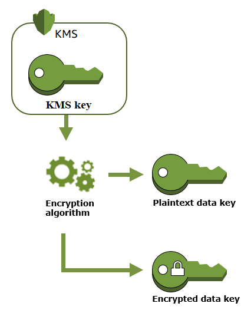
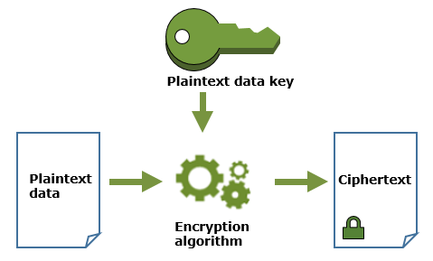
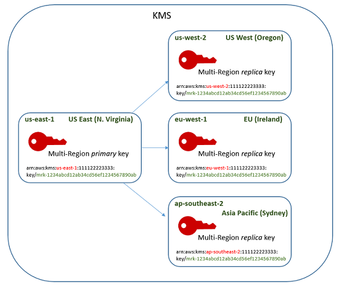
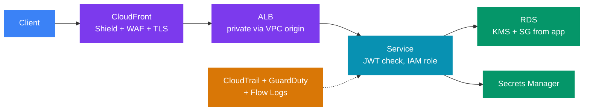

# 🔐 AWS Security for System Design — IAM, KMS, Secrets and Edge Protection

> ☁️ **AWS for system design** &nbsp;·&nbsp; 🔥🔥 Very high priority &nbsp;·&nbsp; 💬 **12 Questions**

> _"Every design gets the same follow-up: how do services authenticate, where are the keys,
> and what stops an attacker at the edge? Answer with a layer for each, and name the AWS piece."_

🎯 This note covers only the security parts that show up in a design round. It is not exam prep.
Each main section answers six things:

| | Question |
|---|---|
| 🧩 | What problem does it solve? |
| ✅ | When do you use it? |
| 📏 | What are the numbers? |
| ⚠️ | How does it fail? |
| ⚖️ | What are the trade-offs? |
| 🎤 | What one or two lines do you say in the interview? |

> 🔗 **Already covered elsewhere — not repeated here:**  
> - Network firewalls (security groups, NACLs (Network Access Control Lists), VPC (Virtual Private Cloud) endpoints): [07_networking.md](07_networking.md)

> 💰 **Prices and quotas** are us-east-1 values as of 2026. They differ by Region and change over time.  
> 📏 Check Service Quotas before you design around a limit.

---

📊 **Question Count**

| # | Section | Questions |
|---|---|---|
| 1 | [IAM for services — roles, never access keys](#1-iam-for-services--roles-never-access-keys) | 2 |
| 2 | [Kubernetes on AWS — IRSA vs EKS Pod Identity](#2-kubernetes-on-aws--irsa-vs-eks-pod-identity) | 1 |
| 3 | [Cross-account access and policy evaluation](#3-cross-account-access-and-policy-evaluation) | 2 |
| 4 | [Cognito — user authentication for the app](#4-cognito--user-authentication-for-the-app) | 1 |
| 5 | [KMS — keys and envelope encryption](#5-kms--keys-and-envelope-encryption) | 1 |
| 6 | [Secrets Manager vs SSM Parameter Store](#6-secrets-manager-vs-ssm-parameter-store) | 2 |
| 7 | [Encryption in transit — ACM and where TLS ends](#7-encryption-in-transit--acm-and-where-tls-ends) | 1 |
| 8 | [AWS WAF — layer 7 filtering](#8-aws-waf--layer-7-filtering) | 2 |
| | **Total** | **12** |

> 🔥🔥 Very High — asked in almost every Tier-1 loop &nbsp;·&nbsp; 🔥 High — very frequent in Tier-1 interviews &nbsp;·&nbsp; ⚡ Medium — commonly asked &nbsp;·&nbsp; 💤 Low — good to know, rarely asked

---

## 📑 Table of Contents

1. [IAM for services — roles, never access keys](#1-iam-for-services--roles-never-access-keys)
2. [Kubernetes on AWS — IRSA vs EKS Pod Identity](#2-kubernetes-on-aws--irsa-vs-eks-pod-identity)
3. [Cross-account access and policy evaluation](#3-cross-account-access-and-policy-evaluation)
4. [Cognito — user authentication for the app](#4-cognito--user-authentication-for-the-app)
5. [KMS — keys and envelope encryption](#5-kms--keys-and-envelope-encryption)
6. [Secrets Manager vs SSM Parameter Store](#6-secrets-manager-vs-ssm-parameter-store)
7. [Encryption in transit — ACM and where TLS ends](#7-encryption-in-transit--acm-and-where-tls-ends)
8. [AWS WAF — layer 7 filtering](#8-aws-waf--layer-7-filtering)
9. [Shield Standard vs Shield Advanced — DDoS](#9-shield-standard-vs-shield-advanced--ddos)
10. [Defense in depth for a public API](#10-defense-in-depth-for-a-public-api)
11. [Detection services — one line each](#11-detection-services--one-line-each)

---

## 1. IAM for services — roles, never access keys

🧩 **Problem:** Your code calls AWS APIs (S3, SQS (Simple Queue Service), DynamoDB). It needs credentials. Long-lived access keys in config files leak through git, logs, images and laptops.

> 💡 **The rule:**  
> 1. A workload gets an **IAM role** (IAM = Identity and Access Management).  
> 2. The role gives **temporary credentials** from **STS** (Security Token Service).  
> 3. The SDK's **default credential chain** finds and refreshes them.  
> 4. The code never sees a key.

| Where the code runs | How it gets the role |
|---|---|
| ⚙️ EC2 | **Instance profile** (a wrapper that attaches a role to an instance); creds from IMDS (Instance Metadata Service) |
| 🐳 ECS (Elastic Container Service) / Fargate | **Task role** (what the app can do) — separate from the **task execution role** (pull image, write logs) |
| λ Lambda | **Execution role** |
| ☸️ EKS (Elastic Kubernetes Service) pod | **IRSA** (IAM Roles for Service Accounts) or **EKS Pod Identity** (§2) |
| 🏢 On-prem / other cloud | **IAM Roles Anywhere** (X.509 certs) or OIDC (OpenID Connect) federation — still no static keys |
| 🔁 CI/CD (GitHub Actions) | **OIDC federation** → `AssumeRoleWithWebIdentity` |

### STS numbers

| Item | Value |
|---|---|
| ⏱️ `AssumeRole` session length | 15 minutes up to the role's max session (**1 hour default, 12 hours max**) |
| 🔗 **Role chaining** (a role assumes another role) | Session is limited to **1 hour** |
| 🔁 SDK refresh | The SDK refreshes before expiry. No code change needed |

### Least privilege in practice

- 🧍 **One role per service.** Never share a role between the payment service and the report service.
- 🎯 **Scope actions and resources.** `s3:GetObject` on `arn:aws:s3:::docs-bucket/customer/*`, not `s3:*` on `*`.
- 🔒 **Use conditions.** `aws:SourceVpce`, `aws:PrincipalOrgID`, `aws:RequestedRegion`, resource tags.
- 🔍 **Start wide in dev, then tighten.** **IAM Access Analyzer** can generate a policy from CloudTrail activity and flag unused permissions.

### How it fails

| ⚠️ Failure | Result |
|---|---|
| 🔑 Access key in an env var or image | Key leaks; attacker has long-term access until someone notices |
| 🕳️ IMDSv1 + an SSRF (Server-Side Request Forgery) bug | Attacker reads the instance role credentials from `169.254.169.254` — enforce **IMDSv2** |
| 👥 Shared role for many services | One compromised service can do everything all of them can do |
| ⬆️ `*` on `iam:PassRole` | A user can launch an instance with an admin role and escalate privileges |

> 🎤 **Say it:** "No service in my design holds an access key. Each one has its own IAM role, scoped to the exact buckets and queues it uses. The SDK refreshes the STS credentials on its own. CI deploys through OIDC federation, so there are no secrets in the pipeline either."

### Interview questions

1. **🔥🔥 What is IAM, and what is the difference between IAM roles and IAM policies?**

<!-- -->
<details>
<summary>Answer</summary>

🔐 **IAM** (Identity and Access Management) decides **who** can call AWS (authentication) and **what** they may do (authorization).

| Concept | What it is |
|---|---|
| 🧍 **IAM user** | A long-term identity with permanent credentials (access key + secret). The key can leak |
| 👥 **IAM group** | A set of users. Attach a policy once to give all of them the same permissions |
| 🎭 **IAM role** | An identity with **no long-term credentials**. A service, an instance, a pod or an outside identity **assumes** it and gets temporary STS credentials |
| 📜 **IAM policy** | A JSON document that lists allowed or denied actions on resources. You attach it to a user, group or role |

> 💡 **Role vs policy:**  
> - A role is *who* — an identity to assume.  
> - A policy is *what* — the permissions.  
> - A role can do nothing until a policy is attached to it.

🎤 **Every role has two policies.** Interviewers check that you know both:
- 🤝 The **trust policy** says who may assume the role. It is a full policy document with a `Principal`:

```json
{
  "Version": "2012-10-17",
  "Statement": [
    {
      "Effect": "Allow",
      "Principal": { "Service": "ec2.amazonaws.com" },
      "Action": "sts:AssumeRole"
    }
  ]
}
```

- 📜 The **permissions policy** says what the role can do after it is assumed.

⚙️ **Instance profile — the part people skip.**
- An EC2 instance cannot hold a role directly. The role is wrapped in an **instance profile**, and the profile is attached to the instance.
- 💡 The console creates the profile for you, with the same name as the role. That is why many people never learn the term.
- 🔗 Other services use their own name for the same idea: the ECS **task role** and the Lambda **execution role** (table above).

🛡️ **IMDSv2.**
- ⚠️ The app reads the role's credentials from the instance metadata service at `169.254.169.254`. With IMDSv1, an **SSRF** bug can steal them. (In SSRF, the attacker makes your app fetch a URL they choose.)
- ✅ IMDSv2 blocks this:
  1. It is session-based. The client first sends a `PUT` to get a token. Then it sends the token on every request.
  2. 📏 The token response has a **hop limit** (IP TTL, Time To Live). With a hop limit of 1, the token cannot leave the instance. Containers on the instance need 2 — or keep 1 on purpose so pods cannot reach IMDS (§2).
  3. 🔒 Enforce it with `HttpTokens: required`.

🔗 How IAM evaluates a request — default deny, explicit deny wins, guardrails only remove — is in [§3](#3-cross-account-access-and-policy-evaluation).

> ✅ **Rule for production:** an application never uses an IAM user. It gets a role, so its credentials are temporary and rotate on their own.

---

</details>

2. **🔥🔥 A developer committed an AWS access key to a public GitHub repo. What do you do now, and what do you change so it cannot happen again?**

<!-- -->
<details>
<summary>Answer</summary>

🚨 **Now:**
1. 🔑 **Deactivate** the key at once, then delete it.
2. 🔍 **Check CloudTrail** for every call made with that key ID. Look for new IAM users, roles or keys the attacker created, and new instances (crypto-mining).
3. 🔁 Revoke anything they created. Rotate any secrets the key could read.

🛡️ **Prevent:**
- 🎭 Workloads use **IAM roles** (instance profile, task role, Pod Identity). No static keys.
- 🔁 CI uses **OIDC federation**. People use SSO (Single Sign-On, via IAM Identity Center).
- 🚫 An **SCP** (Service Control Policy) that denies `iam:CreateAccessKey` except for a break-glass role.
- 🔍 Secret scanning in CI, plus GitHub push protection.

---

</details>

---

## 2. Kubernetes on AWS — IRSA vs EKS Pod Identity

🧩 **Problem:** Many pods share one EKS node.
- ⚠️ If they all use the **node's** instance role, every pod gets the union of all permissions.
- ✅ You need a role **per pod** (per service account).

| | **IRSA** (IAM Roles for Service Accounts) | **EKS Pod Identity** (since late 2023) |
|---|---|---|
| How | Cluster has an **OIDC provider** in IAM; pod gets a projected token; SDK calls `AssumeRoleWithWebIdentity` | **Pod Identity Agent** (DaemonSet) on each node gives creds; you map service account → role with an **association** |
| 🤝 Trust policy | Names the cluster's OIDC provider and the service account | Trusts `pods.eks.amazonaws.com` — the same for every cluster |
| 🔁 Reuse a role across clusters | ⚠️ Hard — the trust policy changes per cluster | ✅ Easy — no change |
| 📏 Limits | IAM has a limit on OIDC providers per account | No OIDC provider needed |
| Fargate pods | ✅ Works | ❌ **Not supported** — use IRSA |
| Session tags (ABAC: Attribute-Based Access Control) | ❌ No | ✅ Yes — cluster, namespace, service account tags |

🧭 **Choose:**
- ✅ **Pod Identity** for new EKS clusters on EC2 nodes.
- ✅ **IRSA** for Fargate, older clusters, or self-managed Kubernetes.

⚠️ **How it fails:**
- 🕳️ **Pods fall back to the node role.** If the service account is not mapped, the SDK finds the node's instance role through IMDS. Block this with an IMDS hop limit of 1 (pods cannot reach IMDS) or by keeping the node role minimal.
- 🌐 **No STS endpoint in a private cluster.** IRSA needs STS. Add an STS interface endpoint and use the **regional** STS endpoint.

> 🎤 **Say it:** "Each Kubernetes service account maps to its own IAM role through EKS Pod Identity. Pods cannot fall back to the node role, because the node role is minimal and pods cannot reach IMDS."

### Interview questions

3. **🔥🔥 Your payment service on EKS must read from one S3 bucket and one SQS queue. How do you give it access?**

<!-- -->
<details>
<summary>Answer</summary>

1. 🎭 **Role:** create an IAM role only for this service. Allow `s3:GetObject` on `arn:aws:s3:::payments-docs/*` and `sqs:ReceiveMessage`, `sqs:DeleteMessage` on that one queue.
2. ☸️ **Mapping:** map the service account to the role with **EKS Pod Identity** (or IRSA on Fargate).
3. 🛡️ **No fallback:** make sure pods cannot use the **node role**: IMDS hop limit 1, minimal node role.
4. 🪣 **Bucket:** add a bucket policy condition `aws:SourceVpce` so the bucket is reachable only from the VPC.
5. 🔐 **KMS (Key Management Service):** if the bucket uses SSE-KMS (Server-Side Encryption with KMS keys), the **key policy** must also allow this role, ideally with `kms:ViaService` = S3.

---

</details>

---

## 3. Cross-account access and policy evaluation

### Two ways to cross accounts

| | 🎭 **AssumeRole into the other account** | 📜 **Resource-based policy** (S3, SQS, SNS (Simple Notification Service), KMS, Lambda) |
|---|---|---|
| How | Account B has a role. Its trust policy allows account A. A calls `sts:AssumeRole` | The resource in B lists A's role as a `Principal` |
| Caller's identity | Becomes the B role — loses its A permissions for that session | Keeps its own A identity and permissions |
| ✅ Good for | Many actions across many resources in B | One resource, e.g. a shared bucket or queue |

> ⚠️ **Third parties (a SaaS vendor):** require an **`sts:ExternalId`** condition in the trust policy.  
> This stops the **confused deputy** problem — another customer of the vendor tricking it into using your role.

### Policy evaluation — the rules to say

1. 🚫 **Default is deny** (implicit deny).
2. ⛔ **An explicit `Deny` anywhere wins.** Nothing overrides it.
3. 🧱 **Guardrails only remove.** SCPs, RCPs (Resource Control Policies), permission boundaries and session policies never grant. The action must fall inside **all** of them.
4. 🏠 **Same account:** an `Allow` in the identity policy **or** the resource policy is enough.
5. 🤝 **Cross account:** **both** sides must allow — the caller's identity policy **and** the resource policy (or the role trust).
6. 🔐 **KMS is special:** the **key policy** must allow access. IAM policies work only if the key policy delegates to the account (§5).

💡 A short policy that shows rule 2:

```json
{
  "Version": "2012-10-17",
  "Statement": [
    { "Effect": "Allow", "Action": "s3:*", "Resource": "*" },
    {
      "Effect": "Deny",
      "Action": "s3:*",
      "Resource": "*",
      "Condition": { "Bool": { "aws:SecureTransport": "false" } }
    }
  ]
}
```

⛔ Any S3 call over plain HTTP is denied, even though the first statement allows everything.

### Guardrails — SCPs, RCPs and permission boundaries

| Guardrail | Applies to | Typical use |
|---|---|---|
| 🏛️ **SCP** (Service Control Policy) | All principals in member accounts of an AWS Organization (not the management account) | "No one may disable CloudTrail", "only `ap-south-1` and `us-east-1`" |
| 🪣 **RCP** (Resource Control Policy, since late 2024) | Resources in member accounts | "Our S3 buckets and KMS keys can only be used by principals in our org" |
| 🚧 **Permission boundary** | One IAM user or role | Let developers create roles for their services, but never more powerful than the boundary |

> 🎤 **Say it:** "Cross-account, the consumer assumes a role in our account with an external ID if it is a vendor. An explicit deny always wins, and SCPs only cap permissions. So I put the hard rules — no CloudTrail changes, approved Regions only — in SCPs at the org level."

### Interview questions

4. **🔥 A SaaS monitoring vendor needs read access to your CloudWatch metrics. How do you set it up safely?**

<!-- -->
<details>
<summary>Answer</summary>

1. 🎭 Create a role in your account with **read-only** CloudWatch permissions.
2. 🤝 **Trust policy:** allow the vendor's AWS account as principal, with a condition on **`sts:ExternalId`** set to a unique value the vendor gives you.

- 🛡️ The external ID stops the **confused deputy** problem: another customer of the vendor cannot make the vendor assume *your* role.
- ✅ No access keys are shared. You can revoke access by deleting the role.

---

</details>

5. **🔥 Explain how IAM decides whether a cross-account request to an S3 bucket is allowed.**

<!-- -->
<details>
<summary>Answer</summary>

1. ⛔ Any **explicit Deny** — in an SCP, RCP, the identity policy, the bucket policy, or a boundary — ends it: denied.
2. 🧱 **SCPs / RCPs / permission boundaries** must not block the action (they only remove).
3. 🤝 **Cross-account needs both sides:** the caller's **identity policy** must allow it **and** the **bucket policy** must allow the caller's account or role.
4. 🔐 If the object uses SSE-KMS, the **KMS key policy** must also allow the caller.
5. 🚫 If nothing allows it: **implicit deny**.

---

</details>

---

## 4. Cognito — user authentication for the app

🧩 **Problem:** Your app's end users must sign up, sign in, reset passwords and use MFA (Multi-Factor Authentication). You do not want to build that, and you want standard tokens your APIs can verify.

| | 👤 **User Pool** | 🔑 **Identity Pool** |
|---|---|---|
| Answers | "**Who is this user?**" (authentication) | "**What AWS resources can this user touch?**" (AWS authorization) |
| Gives you | **JWTs** (JSON Web Tokens): ID token, access token, refresh token | **Temporary AWS credentials** (via STS) |
| ✅ Typical use | Login for web/mobile apps; your API checks the JWT | A mobile app uploads straight to S3 under `users/${sub}/` |
| 🔗 Federation | Google, Apple, Facebook, SAML (Security Assertion Markup Language), OIDC (corporate IdP: Identity Provider) | Takes tokens from a user pool or other IdPs |

### Where the JWT is checked

| Where | How | 💡 Note |
|---|---|---|
| 🚪 **API Gateway** | Cognito authorizer (REST API) or JWT authorizer (HTTP API) | Invalid tokens never reach your service |
| ⚖️ **ALB** (Application Load Balancer) | `authenticate-cognito` listener action | Good for internal web apps |
| ⚙️ **Your service** | Verify the signature with the pool's **JWKS** (JSON Web Key Set: the public keys) | Check `exp`, `iss`, `aud`/`client_id` and `token_use` |

### Token numbers

| Token | ⏱️ Default lifetime | 📏 Range |
|---|---|---|
| ID token / access token | **1 hour** | 5 minutes – 24 hours |
| 🔁 Refresh token | **30 days** | 60 minutes – 10 years |

### Trade-offs and failure modes

- ⚠️ **JWTs are stateless.** A stolen access token works until it expires. Keep it short (15–60 min). Revoking a refresh token does not kill access tokens already issued.
- 🔒 **Lock-in.** Exporting users with password hashes is not possible. Moving off Cognito later means a reset-password flow or a lazy migration.
- 📏 **Quotas.** User pool APIs have per-category request-rate quotas (sign-in, sign-up, token). A big login spike (e.g. a sale at 12:00) can be throttled. Check and raise them before launch.
- ❌ **When NOT to use it:** you need a rich identity product (complex B2B (business-to-business) tenants, fine-grained admin UI). Then teams pick Auth0, Okta or Keycloak.

> 🎤 **Say it:** "Cognito user pools handle sign-in and issue JWTs. API Gateway validates the token before the request reaches my service. I only use identity pools when the client must call AWS directly, like a mobile app uploading a photo to S3."

### Interview questions

6. **🔥 Design user login for a mobile app that also uploads profile photos directly to S3.**

<!-- -->
<details>
<summary>Answer</summary>

- 👤 **Cognito user pool** for sign-up and sign-in, with social login and MFA. It returns JWTs.
- 🚪 **API Gateway** checks the JWT with a Cognito or JWT authorizer before calling the backend.
- 🪣 **Photo upload — two options:**

| Option | How it works |
|---|---|
| 🔑 **Identity pool** | Exchange the JWT for temporary AWS credentials. The IAM policy allows `s3:PutObject` only on `photos/${cognito-identity.amazonaws.com:sub}/*` |
| 🔗 **Presigned URL** (often simpler) | The backend checks the user and returns a short-lived presigned PUT URL. No AWS credentials on the device |

- ⏱️ Short access tokens (≤ 1 hour); refresh tokens for longer sessions.

---

</details>

---

## 5. KMS — keys and envelope encryption

🧩 **Problem:** Data at rest must be encrypted. The hard part is not the cipher. It is:
- 👥 **who can use the key**,
- 🔍 **audit** of every use,
- 🔁 and **rotation**.

🔐 **KMS** keeps keys inside HSMs (Hardware Security Modules; FIPS 140-3 validated).
- The key never leaves KMS in plain form. You call the KMS API to use it.
- 🔭 Every call goes to **CloudTrail**.

### Envelope encryption

📏 `Encrypt` takes at most **4 KB**. So you do not send data to KMS. Instead:

1. 🔑 Call `GenerateDataKey` → KMS returns a **plaintext data key** and the same key **encrypted** under your KMS key.
2. 🔒 Encrypt the data **locally** with the plaintext data key (AES-256-GCM).
3. 🗑️ Throw away the plaintext data key. Store the **encrypted data key** next to the data.
4. 📖 To read: `Decrypt` the encrypted data key with KMS → decrypt the data locally.

<p align="center"></p>

> 🖼️ *Step 1: one `GenerateDataKey` call returns the data key twice — in plain form and encrypted under the KMS key.* Source: [Generate data keys — AWS KMS Developer Guide](https://docs.aws.amazon.com/kms/latest/developerguide/data-keys.html) · License: CC BY-SA 4.0 ([awsdocs/aws-kms-developer-guide](https://github.com/awsdocs/aws-kms-developer-guide/blob/master/LICENSE-SUMMARY))

<p align="center"></p>

> 🖼️ *Step 2: the data is encrypted locally with the plaintext data key. KMS is not in this picture.* Source: [Generate data keys — AWS KMS Developer Guide](https://docs.aws.amazon.com/kms/latest/developerguide/data-keys.html) · License: CC BY-SA 4.0 ([awsdocs/aws-kms-developer-guide](https://github.com/awsdocs/aws-kms-developer-guide/blob/master/LICENSE-SUMMARY))

> 💡 **Why:**  
> - ⚡ Large data never crosses the network to KMS, and encryption runs at local speed.  
> - 🔒 KMS controls access to every data key.  
> - ✅ S3, EBS (Elastic Block Store), RDS (Relational Database Service) and DynamoDB all do this for you.

### Key types

| | **AWS owned** | **AWS managed** (`aws/s3`, `aws/rds`) | **Customer managed (CMK)** |
|---|---|---|---|
| 💰 Cost | Free | Free (per-call fee) | **$1/month** + per-call fee |
| 📜 Key policy | Not visible | You cannot change it | ✅ **You control it** |
| 🤝 Cross-account use | ❌ No | ❌ **No** | ✅ **Yes** |
| 🔁 Rotation | AWS | Every year, automatic | Optional: yearly by default, or 90–2,560 days, or on demand |
| 🗑️ Disable / delete | ❌ No | ❌ No | ✅ Yes — 7 to 30 day waiting period |

🧭 **Choose a CMK** when you need one of these:
- 🤝 Cross-account access.
- 📜 A key policy you control.
- 👥 Separation of duties (key admins ≠ key users).
- ⛔ The ability to **disable the key** and cut off all access to the data.

### Key policies

- 📜 Every KMS key has **exactly one key policy**. Without an allow in it, **no one** can use the key — not even the account root.
- 🔗 The default key policy has a statement that **delegates to IAM** (principal = the account). Only then do IAM policies work for that key.
- 🎯 For tighter control, name the exact roles in the key policy. Use `kms:ViaService` so a role can use the key only **through** S3 or RDS, not by direct `Decrypt` calls.
- 🏷️ Use **encryption context** (key-value pairs bound to the ciphertext, e.g. `tenantId`). It must match on decrypt and appears in CloudTrail.

### Request quotas — a design factor

- 📏 **The quota:** KMS has a **shared per-account, per-Region** quota for cryptographic calls. For symmetric keys it is **10,000, 20,000 or 100,000 requests per second**, depending on the Region (Mumbai: 10,000). It is a soft quota.
- ⚠️ **Over quota → `ThrottlingException`.** Every S3 `GetObject` on an SSE-KMS object calls `Decrypt`. A busy read path can hit the limit.

🛠️ **Fixes:**

| Fix | ⚡ Effect |
|---|---|
| 🪣 **S3 Bucket Keys** | S3 gets a bucket-level key from KMS and reuses it. This cuts KMS calls by up to **99%** |
| 💾 **Data key caching** in the AWS Encryption SDK | For app-level encryption |
| 📈 **Quota increase** | Request one before a launch |

### Multi-Region keys

- 🗺️ **What:** a **primary** key and **replicas** in other Regions with the **same key ID and key material**. Each is managed separately.
- ⚡ Data encrypted in Region A can be decrypted in Region B with no cross-Region KMS call.
- ✅ **Use for** client-side encryption with DynamoDB global tables, or app-level encrypted data that fails over across Regions.
- ❌ **Not needed** for S3 replication or Aurora global databases. Those re-encrypt with the destination Region's key.
- ⚖️ AWS recommends single-Region keys unless you need this, because one key in many places is a larger compliance scope.

<p align="center"></p>

> 🖼️ *One primary key and three replicas. Only the Region in the ARN changes; the `mrk-` key ID is the same.* Source: [How multi-Region keys work — AWS KMS Developer Guide](https://docs.aws.amazon.com/kms/latest/developerguide/mrk-how-it-works.html) · License: CC BY-SA 4.0 ([awsdocs/aws-kms-developer-guide](https://github.com/awsdocs/aws-kms-developer-guide/blob/master/LICENSE-SUMMARY))

### How it fails

| ⚠️ Failure | Result | 🛠️ Guard |
|---|---|---|
| 🗑️ **Key disabled or deleted** | All data under it is unreadable | Deletion waits 7–30 days for this reason. Alarm on `ScheduleKeyDeletion` in CloudTrail |
| 📜 **Key policy missing the IAM delegation** | IAM `Allow` does nothing; calls get `AccessDenied` | Keep the delegation statement |
| ⚡ **Throttling** on a hot read path | `ThrottlingException` | See quotas above |

> 🎤 **Say it:** "Sensitive data uses a customer managed KMS key with envelope encryption. Only the service roles can decrypt, and only through S3 or RDS via `kms:ViaService`. I turn on S3 Bucket Keys because each SSE-KMS read is a KMS call, and the account quota is only 10,000 to 100,000 per second, by Region."

### Interview questions

7. **🔥 Your S3 read path started returning `ThrottlingException` after you switched to SSE-KMS. Why, and what is the fix?**

<!-- -->
<details>
<summary>Answer</summary>

- ⚠️ **Why:** each `GetObject` on an SSE-KMS object calls KMS `Decrypt`. KMS has a **shared per-account, per-Region** quota (10,000 to 100,000 requests per second, by Region). A hot read path can go over it.
- ✅ **Fix:** turn on **S3 Bucket Keys**. S3 caches a bucket-level key and cuts KMS calls by up to 99%. It applies to new objects, so re-copy old hot objects.
- ➕ **Also:** CloudFront caching in front of S3, and a quota increase request if needed.

---

</details>

---

## 6. Secrets Manager vs SSM Parameter Store

🧩 **Problem:** The app needs a DB password, an API key for a payment partner, and some config values. They must not be in code or in the image, and passwords should rotate.

| | 🔑 **Secrets Manager** | 📋 **Parameter Store** (SSM = AWS Systems Manager) |
|---|---|---|
| Made for | **Secrets that rotate** | Config values and simple secrets (`SecureString`) |
| 🔁 Rotation | ✅ **Built in** — Lambda on a schedule (as often as every 4 hours); managed rotation for RDS, Aurora, Redshift, DocumentDB | ❌ **None** — you build it |
| 📏 Size | 64 KB | 4 KB standard, 8 KB advanced |
| 📏 Count | 500,000 per Region | 10,000 standard, 100,000 advanced |
| 🗺️ Cross-Region | ✅ **Replication** to other Regions | ❌ No |
| 🤝 Cross-account | ✅ Yes (resource policy + CMK) | ⚠️ Advanced tier, via RAM |
| ⚡ Throughput | `GetSecretValue` up to 10,000 TPS (transactions per second) | 40 TPS default, up to 10,000 TPS with the paid higher-throughput setting |
| 💰 Cost | **$0.40 per secret per month** + $0.05 per 10,000 calls | Standard free; advanced $0.05 per parameter per month |
| 🔐 Encryption | Always KMS | `SecureString` uses KMS |

### How rotation works (single-user vs alternating users)

- 🏷️ Rotation uses **staging labels**: `AWSCURRENT`, `AWSPENDING`, `AWSPREVIOUS`.
- 🔁 **Steps:** create the new secret (`AWSPENDING`) → set it in the DB → test it → move `AWSCURRENT` to it.

| Strategy | What happens | 🛡️ Downtime |
|---|---|---|
| 🧍 **Single user** | The same DB user gets a new password | ⚠️ For a few seconds, apps with the old password can fail to open new connections |
| 👥 **Alternating users** | Two DB users take turns. The old one keeps working while apps pick up the new one | ✅ Use this for zero-downtime rotation |

### How it fails

| ⚠️ Failure | Result | 🛠️ Fix |
|---|---|---|
| 📞 **Calling Secrets Manager on every request** | Cost, latency and throttling | Cache the secret in memory (AWS caching client, default 1 hour TTL) and refresh on an auth error |
| 💾 **App caches forever** | After rotation, new DB connections fail | Refresh on `authentication failed` or use alternating users |
| 📏 **Parameter Store 40 TPS default** | A big fleet starting at the same moment gets throttled | Cache, or turn on higher throughput |
| 🐳 **Secret in an ECS env var** | It is injected once at task start. A rotation is not seen until the task restarts | — |

🧭 **Choose:**
- 🔑 **Secrets Manager** for anything that rotates (DB passwords, partner keys).
- 📋 **Parameter Store** for config and feature flags.
- 💡 Many teams use both.

✅ Two simpler options exist for RDS:
- 🗃️ **RDS-managed master password** — RDS stores and rotates it in Secrets Manager.
- 🎭 **IAM database authentication** — a short-lived token, no password at all.

> 🎤 **Say it:** "The DB password lives in Secrets Manager with alternating-user rotation every 30 days. The service caches it and re-reads it on an auth failure, so rotation never causes an outage. Plain config sits in Parameter Store, which is free."

### Interview questions

8. **🔥 What is the difference between AWS KMS, Secrets Manager and Parameter Store?**

<!-- -->
<details>
<summary>Answer</summary>

💡 KMS holds **keys**. The other two hold **values**.

| Service | What it stores | ✅ Best for |
|---|---|---|
| 🔐 **KMS** | Encryption **keys**. The key never leaves KMS. (AWS renamed "customer master key (CMK)" to "KMS key" in 2021) | Encryption at rest for S3, RDS, EBS — and for the other two services |
| 🔑 **Secrets Manager** | Secrets, with **built-in rotation**. $0.40 per secret per month | DB passwords, partner API keys, OAuth client secrets — anything that rotates |
| 📋 **Parameter Store** | Config values and simple secrets (`SecureString`). Standard tier is free. No rotation | URLs, feature flags, limits, per-environment settings |

🔗 **How they work together:**
- 🔐 Secrets Manager **always** encrypts with KMS. Parameter Store uses KMS only for `SecureString` parameters.
- 🧭 **The usual split:** DB password → Secrets Manager. Plain config → Parameter Store. Keys → KMS.
- 📏 KMS uses **envelope encryption** for large data, because `Encrypt` takes at most 4 KB ([§5](#5-kms--keys-and-envelope-encryption)).
- 🔁 One more gain: rotating a KMS key does **not** mean re-encrypting old data. KMS keeps the old key material and still decrypts with it.

📊 The limits and prices side by side are in the table at the top of this section.

---

</details>

9. **⚡ How do you rotate a database password without downtime?**

<!-- -->
<details>
<summary>Answer</summary>

1. 👥 **Strategy:** store it in **Secrets Manager** with the **alternating-users** rotation strategy. There are two DB users. Rotation updates the user that is not in use, then moves `AWSCURRENT` to it.
2. ✅ **Why it works:** the old credential keeps working until the next rotation, so live connections and pools are not broken.
3. 💾 **App side:** the app **caches** the secret and **re-reads it on an auth error**. The **AWS Secrets Manager JDBC library** does this re-read and retry for you.

> ⚠️ **Single-user trap:** with **single-user** rotation, there is a short window between "password changed in the DB" and "new value saved in the secret".  
> A new login in that window can fail. So "zero downtime" needs alternating users.

💡 **Simpler options:**
- 🗃️ **RDS-managed master password** (since Dec 2022). RDS keeps it in Secrets Manager and rotates it itself, every **7 days** by default.
- 🎭 **IAM database authentication** — a 15-minute token, no stored password.

---

</details>

---

## 7. Encryption in transit — ACM and where TLS ends

🧩 **Problem:** Traffic must be encrypted. You must decide **where TLS ends**, because the load balancer cannot inspect or route on what it cannot decrypt.

📜 **ACM** (AWS Certificate Manager) issues **free public TLS certificates** for integrated services (ALB, NLB, CloudFront, API Gateway). 🔁 It **renews them automatically** when they use DNS validation.

| Rule | Detail |
|---|---|
| 🌍 CloudFront certificates | Must be in **us-east-1** |
| ⚖️ ALB / API Gateway certificates | In the **same Region** as the resource |
| ⚠️ Imported certificates | ❌ **No** auto-renewal. ACM sends expiry events to EventBridge (from 45 days before) |
| 📤 Export | Normal ACM public certs cannot be exported. Since June 2025, ACM offers **exportable** public certs for a fee, for use on your own servers |
| 🔒 Private certs | **AWS Private CA** (Certificate Authority) for internal mTLS (mutual TLS) between services |

### Where to end TLS

| Option | How | ✅ Gain | ❌ Lose |
|---|---|---|---|
| **End at ALB** | HTTPS listener, HTTP to targets | Simple; ALB can route on path/header; WAF (Web Application Firewall) sees the request | Plain text inside the VPC |
| **End at ALB, re-encrypt** | HTTPS listener, HTTPS to targets | Encrypted end to end; still L7 features | Two TLS handshakes; ALB does **not** validate the target cert |
| **Passthrough at NLB (Network Load Balancer)** | TCP listener on 443, app holds the cert | TLS ends only in your app (strict compliance) | No L7 routing, **no WAF**, you manage certs on the app |
| **mTLS at ALB** (since late 2023) | ALB verifies the client cert against a trust store | Partner/B2B APIs with client certificates | You run a CA and revocation lists |
| **Service mesh mTLS** | Istio / App Mesh sidecars | Service-to-service identity and encryption | Mesh complexity |

> 🧭 **Choose:**  
> - ✅ For most APIs, end TLS at the ALB (or CloudFront) and **re-encrypt to the targets** if compliance asks for "encrypted in transit everywhere".  
> - 🔒 Use NLB passthrough only when the rule is "no one else may decrypt".

✅ **Always:**
- ↪️ Redirect HTTP 80 → HTTPS 443 at the ALB.
- 🔒 Use a modern **TLS security policy** (TLS 1.2 minimum, TLS 1.3 preferred).
- ⛔ Deny `aws:SecureTransport = false` in bucket policies.

> 🎤 **Say it:** "ACM certificates on CloudFront and the ALB, renewed automatically. TLS ends at the ALB so WAF can inspect the request and the ALB can route on path, then the ALB re-encrypts to the pods. For a partner API that needs client certificates, I turn on mTLS on the ALB."

### Interview questions

10. **⚡ Where do you end TLS for a public API, and how do you satisfy "encrypted in transit everywhere"?**

<!-- -->
<details>
<summary>Answer</summary>

- 🌍 **Default:** end TLS at **CloudFront and the ALB**, with free ACM certificates that renew automatically. Then WAF can inspect requests and the ALB can route on path.
- 🔁 **"Encrypted everywhere":** the ALB **re-encrypts** to the targets over HTTPS. Or use service mesh mTLS between services.
- ⚠️ **Strict rule:** use **NLB TLS passthrough** only if the rule is that no AWS component may decrypt. You lose WAF and L7 routing.
- 🤝 **B2B clients with certificates:** **mTLS on the ALB** with a trust store.

---

</details>

---

## 8. AWS WAF — layer 7 filtering

🧩 **Problem:** Attacks at the HTTP layer — SQL injection, XSS (cross-site scripting), credential stuffing, scrapers, one IP sending 10,000 requests a minute. A security group cannot see any of this.

🧱 **AWS WAF** runs a **web ACL** (Access Control List: a list of rules) on each HTTP request **before** it reaches your app.

### Where you can attach it

| ✅ Can attach | ❌ Cannot attach |
|---|---|
| **CloudFront**, **ALB**, **API Gateway REST API**, AppSync, Cognito user pool, App Runner, Verified Access, Amplify | **NLB** (layer 4), **API Gateway HTTP API**, EC2 directly |

- 🌍 **Scope:** a web ACL for CloudFront is **global** (created in us-east-1). For the others it is **regional**.
- 💡 **Best place:** at **CloudFront**. Bad traffic is blocked at the edge, before it costs origin capacity. Attach to the ALB too if the ALB can be reached without CloudFront.

### Rule types

| Rule | Use |
|---|---|
| 🛡️ **AWS managed rule groups** | Core rule set (OWASP top 10; OWASP = Open Worldwide Application Security Project), SQL injection, known bad inputs, IP reputation, anonymous IPs |
| 🤖 **Bot Control / Account Takeover Prevention** | Paid managed groups for scrapers and credential stuffing on login |
| ⏱️ **Rate-based rule** | Block a key (IP, forwarded IP, header, API key, or a mix) that goes over N requests in a time window |
| 🗺️ **Geo match** | Allow or block countries |
| 📋 **IP set** | Up to 10,000 CIDRs (Classless Inter-Domain Routing IP ranges) per set |
| ✏️ **Custom** | Match headers, URI, query string, body; size limits |

### Rate-based rules — the numbers

| Item | Value |
|---|---|
| 📏 Lowest limit | **10 requests** per window (was 100 before 2023) |
| ⏱️ Window | **1, 2, 5 or 10 minutes** (was fixed at 5 minutes before 2023) |
| 🔑 Aggregation key | Source IP, forwarded IP (`X-Forwarded-For`), or **custom keys** (header, cookie, query arg, label) |
| 🎯 Scope-down | Apply only to some paths — e.g. stricter on `/login` than on `/products` |
| ⚠️ Reaction time | Counts are approximate and take some seconds. It is **not** a precise per-second limiter |

⚖️ **WAF rate limit vs app rate limiter:**

| Layer | What it does |
|---|---|
| 🧱 **WAF** | Coarse abuse blocking at the edge, per IP or key. Cheap protection for your capacity |
| ⚙️ **App / API Gateway limiter** (token bucket, Redis) | Precise per-customer quotas and business plans |

> 🎤 **In the interview:** a senior answer uses **both**.

### Other numbers

| Item | Value |
|---|---|
| 📏 Web ACL capacity | **5,000 WCUs** (web ACL capacity units) max (rules cost WCUs by complexity); above 1,500 WCUs costs extra |
| 📦 Body inspected | ALB and AppSync: first **8 KB**. CloudFront, API Gateway, Cognito, App Runner, Verified Access: **16 KB** default, up to 64 KB |

### How it fails

| ⚠️ Failure | 🛠️ Fix |
|---|---|
| 🚫 **New rules block real users** | Deploy managed rules in **Count** mode first, check the WAF logs, then switch to Block |
| 👥 **Rate limit by IP behind a proxy** → all users share one IP and get blocked together | Use the forwarded IP or a header key |
| 🕳️ **Origin reachable directly.** WAF on CloudFront does nothing if attackers hit the ALB DNS name | Lock the ALB (§10) |
| 📦 **Large bodies** past the inspection limit are not checked | Set the oversize handling to Block for APIs that should not get large bodies |

> 🎤 **Say it:** "WAF sits on CloudFront with AWS managed rules and a rate-based rule — about 100 requests per 5 minutes per IP on `/login`, looser elsewhere. Precise per-customer quotas live in the API layer. WAF is the coarse filter at the edge."

### Interview questions

11. **🔥 Your login endpoint is under a credential-stuffing attack from thousands of IPs. What do you do?**

<!-- -->
<details>
<summary>Answer</summary>

🧱 **WAF on CloudFront:**
- ⏱️ A **rate-based rule** scoped to `/login`. Low limit, 1–5 minute window.
- 🤖 **Account Takeover Prevention** managed rule group — it checks for stolen credentials and login failure patterns.
- 🛡️ IP reputation and anonymous-IP rule groups. Bot Control for automated clients.

⚠️ **Per-IP limits alone are weak** against thousands of IPs:
- 👤 Also rate-limit **per username** in the app.
- 🔒 Add CAPTCHA or MFA after failures.

➕ **Also:**
- 🛡️ **Shield Advanced** if the volume threatens availability.
- 🔭 Watch WAF logs and GuardDuty findings.

---

</details>

12. **⚡ Your ALB has WAF attached, but logs show attacks reaching the app that the WAF should block. What is wrong?**

<!-- -->
<details>
<summary>Answer</summary>

🔍 Likely causes:
- 🕳️ **WAF is on CloudFront, but the ALB is public.** Attackers hit the ALB DNS name and skip CloudFront. Two fixes:
  - 🔒 **CloudFront VPC origins** — the ALB moves to private subnets.
  - 🛡️ An ALB SG (security group) that allows only the CloudFront managed prefix list, plus a secret header check.
- 👀 **Rules are in Count mode**, not Block.
- 📦 **Body larger than the inspection limit** (8 KB on ALB) — the payload was past the part WAF read. Set oversize handling to Block.
- ⏱️ **Rate rule keyed on IP behind a proxy**, or the window is too long to react to a short burst.

---

</details>

---

## 9. Shield Standard vs Shield Advanced — DDoS

| | 🛡️ **Shield Standard** | 🛡️ **Shield Advanced** |
|---|---|---|
| 💰 Cost | **Free**, on for every account | **$3,000 per month** per organization, **1-year commitment**, plus data transfer fees |
| Protects against | Common **L3/L4** attacks: SYN floods, UDP floods, reflection | Larger and more complex L3/L4 **and L7** attacks |
| Resources | All | CloudFront, Route 53, Global Accelerator, ELB (Elastic Load Balancing), EC2 Elastic IPs |
| 🧑‍🚒 Response team | ❌ No | ✅ **Shield Response Team (SRT)**, 24/7 |
| 💰 Cost protection | ❌ No | ✅ **Credits for scaling costs** caused by an attack |
| 🧱 L7 help | ❌ No | ✅ **Automatic L7 protection** — creates WAF rules during an attack; WAF fees for protected resources included |
| 🔭 Visibility | Basic | Attack metrics and reports, health-based detection |

🧭 **Choose:**
- ✅ **Standard** is enough for most systems, **if** you put CloudFront and Route 53 in front. They absorb volume at the edge.
- 💰 **Advanced** when downtime is very expensive (payments, trading, big e-commerce events), when you need the SRT, or when an attack bill would hurt.

> 🛡️ **DDoS-resilient shape** (DDoS = Distributed Denial of Service): Route 53 → CloudFront (+ WAF) → ALB in multiple AZs (Availability Zones) → Auto Scaling.  
> Absorb at the edge, filter at L7, and scale behind it.

---

## 10. Defense in depth for a public API

💡 **The idea:** No single control is enough. Each layer stops a different attack. If one fails, the next still holds.



| Layer | Control | ⛔ Stops |
|---|---|---|
| 🌍 **1. Edge** | CloudFront + Shield Standard/Advanced | Volume DDoS, L3/L4 floods |
| 🧱 **2. L7 filter** | WAF: managed rules, rate-based rules, geo | SQLi (SQL injection), XSS, bots, credential stuffing |
| 🔒 **3. Transport** | TLS 1.2+ with ACM certs; HSTS (HTTP Strict Transport Security) | Eavesdropping, tampering |
| 🚪 **4. Origin lock** | ALB in **private** subnets via **CloudFront VPC origins** (since late 2024), or ALB SG allows only the CloudFront managed prefix list + a secret header | Attackers skipping CloudFront and WAF |
| 👤 **5. AuthN / AuthZ** (authentication / authorization) | Cognito JWT checked at API Gateway or the service; object-level checks in code | Unauthenticated calls; one user reading another user's data |
| 🌐 **6. Network** | Private subnets, SG chain ALB → app → DB, VPC endpoints | Lateral movement, direct DB access |
| 🎭 **7. Workload identity** | One IAM role per service, least privilege, IMDSv2 | A compromised service reaching other data |
| 🔐 **8. Data** | KMS CMK at rest, Secrets Manager for creds, `aws:SecureTransport` deny | Data readable after theft of disks, snapshots or backups |
| 🔭 **9. Detect** | CloudTrail (all Regions, to a locked log account), GuardDuty, Flow Logs, Security Hub | Finding what got through |

> ⚠️ **Do not forget the application layer.**  
> - WAF cannot see a broken **authorization check** (e.g. `GET /accounts/123` that does not check the owner).  
> - That is OWASP's top API risk (BOLA: Broken Object Level Authorization). Only your code fixes it.

> 🎤 **Say it:** "I protect it in layers. CloudFront with Shield and WAF sits at the edge, and the ALB accepts traffic only from CloudFront. JWTs are checked before the service. Security groups are chained down to the database, each service has its own role, and KMS encrypts the data. GuardDuty and CloudTrail detect whatever gets through."

---

## 11. Detection services — one line each

| Service | What it does |
|---|---|
| 🕵️ **GuardDuty** | Threat detection from CloudTrail, VPC Flow Logs, DNS logs (and EKS, S3, RDS logs) — e.g. crypto-mining, creds used from an unusual IP |
| 🔬 **Inspector** | Scans EC2, ECR (Elastic Container Registry) images and Lambda for known CVEs (Common Vulnerabilities and Exposures) and network exposure |
| 🪣 **Macie** | Finds sensitive data (PII: personally identifiable information, card numbers) in S3 buckets |
| 📊 **Security Hub** | Collects findings from all of the above into one place, with compliance checks |
| 🔭 **CloudTrail** | Log of every AWS API call — who did what, when. Turn on an org trail to a separate log account |

---

## 📊 Section Coverage Tracker

> **R-1:** `✅ First read` &nbsp;·&nbsp; **R0–R6:** `🟢🟡🔴 Recall confidence` · `[ ] Pending` · `⏭️ Skipped`  
> **Priority:** `🔥🔥 VH` · `🔥 H` · `⚡ M` · `💤 L`

| § | Section | Priority | R-1 | R0 | R1 | R2 | R3 | R4 | R5 | R6 |
|---|---------|----------|-----|----|----|----|----|----|----|----|
| 1 | IAM for services — roles, never access keys | 🔥🔥 | [ ] | [ ] | [ ] | [ ] | [ ] | [ ] | [ ] | [ ] |
| 2 | IRSA vs EKS Pod Identity | 🔥 | [ ] | [ ] | [ ] | [ ] | [ ] | [ ] | [ ] | [ ] |
| 3 | Cross-account access and policy evaluation | 🔥🔥 | [ ] | [ ] | [ ] | [ ] | [ ] | [ ] | [ ] | [ ] |
| 4 | Cognito — user authentication | 🔥 | [ ] | [ ] | [ ] | [ ] | [ ] | [ ] | [ ] | [ ] |
| 5 | KMS — keys and envelope encryption | 🔥🔥 | [ ] | [ ] | [ ] | [ ] | [ ] | [ ] | [ ] | [ ] |
| 6 | Secrets Manager vs Parameter Store | 🔥 | [ ] | [ ] | [ ] | [ ] | [ ] | [ ] | [ ] | [ ] |
| 7 | Encryption in transit — ACM and TLS | 🔥 | [ ] | [ ] | [ ] | [ ] | [ ] | [ ] | [ ] | [ ] |
| 8 | AWS WAF | 🔥 | [ ] | [ ] | [ ] | [ ] | [ ] | [ ] | [ ] | [ ] |
| 9 | Shield Standard vs Advanced | ⚡ | [ ] | [ ] | [ ] | [ ] | [ ] | [ ] | [ ] | [ ] |
| 10 | Defense in depth for a public API | 🔥🔥 | [ ] | [ ] | [ ] | [ ] | [ ] | [ ] | [ ] | [ ] |
| 11 | Detection services | 💤 | [ ] | [ ] | [ ] | [ ] | [ ] | [ ] | [ ] | [ ] |

### 🎯 Review Queue

_Questions missed in the last recall — drilled first next session, cleared when solid. Managed by `/recall`._

- _(empty)_
