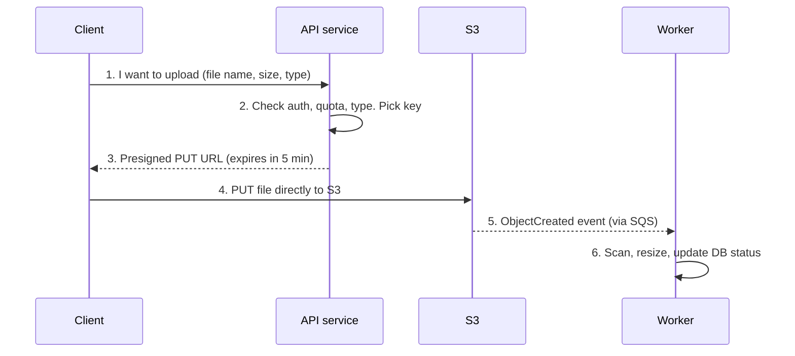
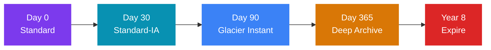
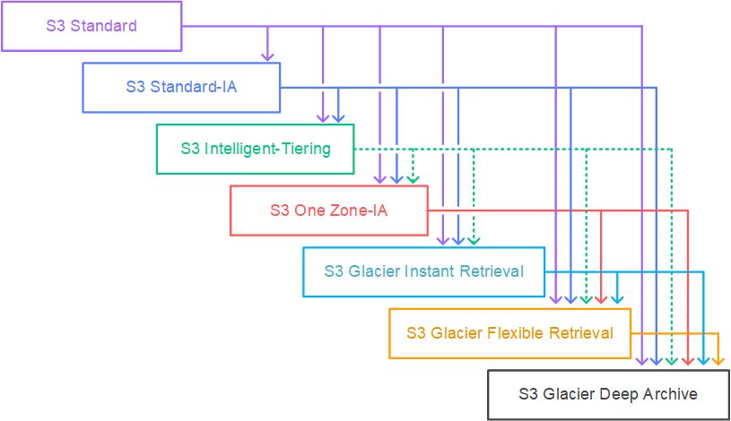
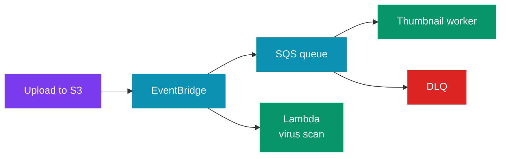
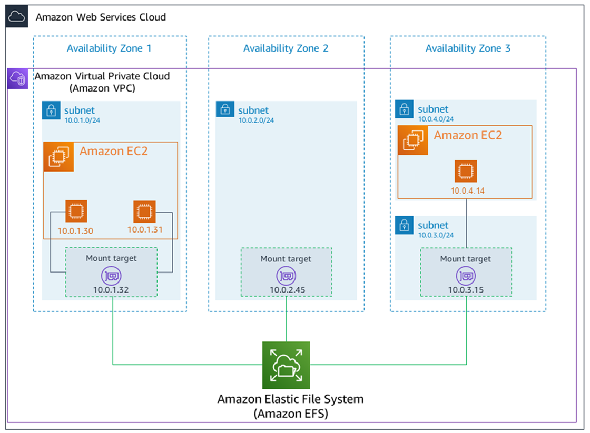
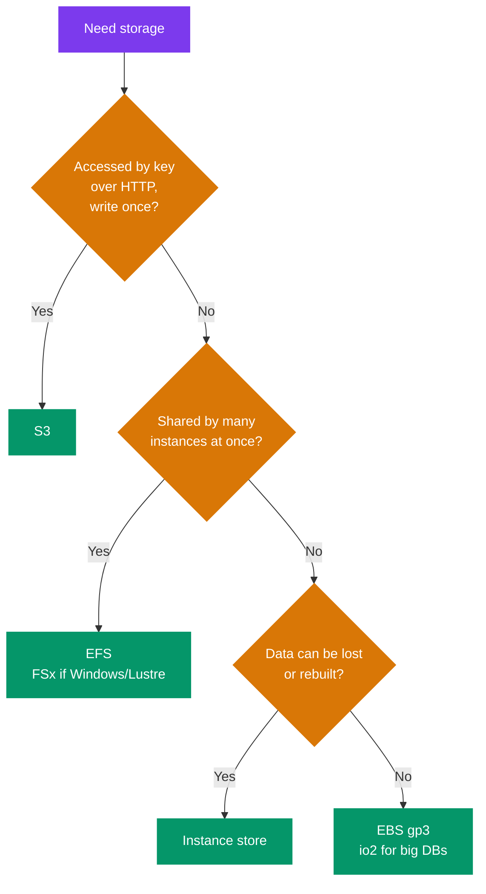

# 🗄️ Storage on AWS — S3, EBS, Instance Store, EFS

> 🧭 **AWS for system design** &nbsp;·&nbsp; 🔥 High Priority &nbsp;·&nbsp; 💬 **11 Questions**

> _"Every design has a 'where do the files go' moment. The weak answer is 'S3'. The strong
> answer says how the client uploads, how many requests per second it can take, what it
> costs after a year, and what happens when a Region goes down."_

This note covers storage for system-design rounds.

- 🪣 **Most of it is about S3**, because S3 shows up in almost every design: uploads, media,
  backups, logs, data lakes.
- 💽 **The second part compares block, file and object storage**, so you can say **why** you
  picked one.

> 🔗 **What this file does not repeat:**  
> - How an object store works inside (metadata service, erasure coding, placement) → [Alex Xu Vol 2 ch09 — S3-like Object Storage](../../system-design/01_insider_guide_Alex_Xu/vol_2/ch09_s3_like_object_storage.md)  
> - Consistency models in general → [Distributed Fundamentals](../../system-design/02_distributed_systems/01_distributed_fundamentals.md)
>
> This file stays AWS-specific: the limits, the failure modes and the trade-offs.

---

📊 **Question Count**

| # | Section | Questions |
|---|---|---|
| 1 | [S3 — The Model and the Numbers](#1-s3--the-model-and-the-numbers) | 1 |
| 2 | [S3 Performance — Prefixes, Multipart, Ranges](#2-s3-performance--prefixes-multipart-ranges) | 1 |
| 3 | [Presigned URLs — Direct Upload and Download](#3-presigned-urls--direct-upload-and-download) | 1 |
| 4 | [Storage Classes and Lifecycle — Cost as a Design](#4-storage-classes-and-lifecycle--cost-as-a-design) | 2 |
| 5 | [Versioning and Replication (CRR / SRR)](#5-versioning-and-replication-crr--srr) | 2 |
| 6 | [Event Notifications](#6-event-notifications) | 1 |
| 8 | [S3 as a Data Lake and as a Static Website](#8-s3-as-a-data-lake-and-as-a-static-website) | 1 |
| 9 | [Block vs File vs Object — EBS, Instance Store, EFS, S3](#9-block-vs-file-vs-object--ebs-instance-store-efs-s3) | 2 |
| | **Total** | **11** |

> 🔥🔥 Very High — asked in almost every Tier-1 loop &nbsp;·&nbsp; 🔥 High — very frequent in Tier-1 interviews &nbsp;·&nbsp; ⚡ Medium — commonly asked &nbsp;·&nbsp; 💤 Low — good to know, rarely asked

---

## 📑 Table of Contents

1. [S3 — The Model and the Numbers](#1-s3--the-model-and-the-numbers)
2. [S3 Performance — Prefixes, Multipart, Ranges](#2-s3-performance--prefixes-multipart-ranges)
3. [Presigned URLs — Direct Upload and Download](#3-presigned-urls--direct-upload-and-download)
4. [Storage Classes and Lifecycle — Cost as a Design](#4-storage-classes-and-lifecycle--cost-as-a-design)
5. [Versioning and Replication (CRR / SRR)](#5-versioning-and-replication-crr--srr)
6. [Event Notifications](#6-event-notifications)
7. [S3 Security in a Design](#7-s3-security-in-a-design)
8. [S3 as a Data Lake and as a Static Website](#8-s3-as-a-data-lake-and-as-a-static-website)
9. [Block vs File vs Object — EBS, Instance Store, EFS, S3](#9-block-vs-file-vs-object--ebs-instance-store-efs-s3)
10. [Other Storage Services in One Line](#10-other-storage-services-in-one-line)

---

## 1. S3 — The Model and the Numbers

### 1.1 What problem it solves

🧩 **Problem:** S3 is an **object store**.

- 🪣 You store a blob (the object) under a key in a bucket.
- 🌐 You get it back by key over HTTPS.
- ❌ There is no file system, no in-place edit and no rename.
- 📈 It scales with no capacity planning, and it is very durable.

✅ **Use when** data is **written once and read many times**: user uploads, images, video,
backups, logs, exports, ML datasets, static web assets.

### 1.2 The numbers that drive design

| 📏 Property | Value | Design impact |
|---|---|---|
| Durability | **99.999999999%** (11 nines), all classes | You do not need your own copies to protect against disk loss. ⚠️ You still need versioning against **human error** |
| Availability (Standard) | 99.99% design; 99.9% SLA (Service Level Agreement) | S3 can still return 5xx. 🔁 Clients must retry with back-off |
| Max object size | **50 TB** (raised from 5 TB in Dec 2025) | One GET returns at most 5 TB, so read bigger objects with parallel range GETs |
| Single PUT max | **5 GB** | Above that, multipart upload is required |
| Multipart | Parts 5 MiB – 5 GiB, max **10,000 parts** | Choose part size so file size ÷ part size ≤ 10,000 |
| Request rate | **3,500 writes/s and 5,500 reads/s per prefix** | See §2 |
| ⚡ First-byte latency | Tens to ~100–200 ms | ❌ Not a database. Put a cache or CloudFront in front of hot reads |
| Buckets per account | 10,000 by default (raised in 2024 from 100) | Bucket-per-tenant designs are now possible, but prefix-per-tenant is still simpler |

### 1.3 Consistency — strong read-after-write

✅ Since **December 2020**, S3 is **strongly consistent** for all operations, at no extra cost:

| After a successful… | This call… | Returns |
|---|---|---|
| `PUT` | `GET` | The new object |
| Overwrite | `GET` | The new version |
| `PUT` or `DELETE` | `LIST` | The change |

> ⚠️ **Source correction.** Older notes and blog posts say "eventual consistency for overwrites
> and deletes". That is no longer true. Saying it in an interview sounds out of date.

⚠️ **What S3 still does not give you:**

- ❌ **No transactions across objects.** You cannot update two objects atomically.
- ⚖️ **Last writer wins** for two concurrent `PUT`s to the same key, unless you use conditional
  writes.
- 🔒 **Conditional writes** (added in 2024):
  - `If-None-Match: *` makes a `PUT` fail if the key exists (create-only).
  - `If-Match: <ETag>` makes it fail if the object changed (optimistic locking).
  - 💡 This lets you build simple locks or "write once" logic on S3 alone.
- 🌍 **Replication (CRR: Cross-Region Replication / SRR: Same-Region Replication) is asynchronous.** A reader in the other Region can see old data.

### 1.4 How S3 fails

| ⚠️ Failure | Symptom | 🛡️ Fix |
|---|---|---|
| Too many requests on one prefix | `503 Slow Down` | Spread keys over more prefixes; retry with exponential back-off and jitter |
| Regional outage (rare, but has happened — `us-east-1`, Feb 2017) | All S3 calls in that Region fail | CRR to a second Region + failover logic, or Multi-Region Access Points |
| Accidental delete or overwrite | Data gone | Versioning + MFA (Multi-Factor Authentication) Delete or Object Lock |
| 🔒 Bucket made public by mistake | Data leak | Block Public Access at the account level |
| Large upload over a weak network | Restarts from zero | Multipart upload; retry only the failed part |

> 🎤 **In the interview:**  
> "Files go to S3, and the database stores only the key and metadata. S3 is strongly
> consistent, so the processing service can read the object right after the upload event.
> I keep versioning on, so a bad overwrite can be undone."

### Interview questions

1. **🔥🔥 A team says "S3 is eventually consistent, so after upload we sleep 5 seconds before reading". What do you tell them?**

<!-- -->
<details>
<summary>Answer</summary>

❌ **Remove the sleep.**

- ✅ S3 has been **strongly consistent** for reads after writes, overwrites and lists since
  December 2020.
- A `GET` after a successful `PUT` returns the new data.

⚠️ **The real risks are elsewhere:**

- Concurrent writers to the same key (last writer wins — use conditional writes with `If-Match`).
- 🌍 **Cross-Region replicas**, which are still asynchronous.

---

</details>

---

## 2. S3 Performance — Prefixes, Multipart, Ranges

### 2.1 Request-rate limits per prefix

🧩 A **prefix** is the part of the key before the object name. For `invoices/2026/10/abc.pdf`,
the prefix is `invoices/2026/10/`.

- 📏 Each prefix supports **3,500 PUT/COPY/POST/DELETE** and **5,500 GET/HEAD** per second.
- 📈 There is **no limit on the number of prefixes**. Ten prefixes give 55,000 GET/s.
- ⚠️ S3 **splits partitions automatically** as load grows. This takes time. During a sudden jump
  you may see `503 Slow Down` until it catches up.

🧭 **Key design for very high write rates:**

| Key layout | Problem / benefit |
|---|---|
| `logs/2026-10-31T10:00:01-uuid` | ❌ All writes for "now" go to one key range → hot partition |
| `logs/{hash(id)[0:2]}/2026-10-31/...` | ⚖️ Writes spread over 256 prefixes. Good for writes; listing by date is harder |
| `tenant={id}/date=2026-10-31/...` | ✅ Spread by tenant **and** easy to query by date (data-lake style) |

> 💡 **Tip:** most systems never reach these limits. Raise this only if the numbers in the round
> need it (for example, 50,000 writes/s of telemetry).

### 2.2 Multipart upload

- 📏 **Required** above 5 GB; **recommended** above ~100 MB.
- ⚡ Parts upload **in parallel** and **retry one at a time**.
- 💡 The object does not exist until `CompleteMultipartUpload`.

> ⚠️ **Failure mode:** an abandoned upload leaves its parts stored — and 💰 **billed** — but not
> visible in a normal list.  
> 🛡️ Always add a lifecycle rule: *abort incomplete multipart uploads after N days*.

### 2.3 Byte-range fetches

- 🧩 `GET` with a `Range` header returns part of an object.
- ✅ Use it to download a large file in parallel chunks, or to read only a file header
  (Parquet footers, video metadata).
- 🔁 A failed range retries alone.

### 2.4 Faster transfers over distance

| Tool | How it helps |
|---|---|
| ⚡ **Transfer Acceleration** | Clients upload to the nearest CloudFront edge; data then travels on the AWS network. Helps users far from the bucket's Region |
| 🌐 **CloudFront** in front of S3 for downloads | Caches hot objects at the edge, reduces S3 GETs and latency |

### Interview questions

2. **🔥 Your telemetry service writes 40,000 small objects per second to S3 and gets `503 Slow Down`. Why, and what do you change?**

<!-- -->
<details>
<summary>Answer</summary>

🔍 **Why:** each prefix supports about **3,500 writes/s**. The keys probably start with a
timestamp, so all writes hit one prefix.

🛡️ **Fixes:**

- 📈 Add a hash or shard prefix: `{hash % 32}/2026/10/31/...`. 32 prefixes give over 100,000
  writes/s.
- 🔁 Retry with exponential back-off and jitter.
- ✅ Better: **batch** the small records. Use Kinesis Data Firehose to buffer and write larger
  files every minute. Fewer objects also means less request cost and faster queries later.

---

</details>

---

## 3. Presigned URLs — Direct Upload and Download

### 3.1 The problem

🧩 If clients upload through your API servers, every byte passes through your fleet.

- ⚠️ A 2 GB video holds a connection for minutes.
- It uses memory and network.
- 📏 It limits how many uploads one server can handle.

### 3.2 The pattern

💡 A **presigned URL** is a normal S3 URL with a signature and an expiry time.

- Anyone holding it can do **one specific action** (`PUT` this key, or `GET` this key) until it
  expires.
- 🔐 The signature uses the credentials of whoever signed it.



🧭 **Design points:**

- 🔒 The **server picks the key** (for example `uploads/{userId}/{uuid}`). Never let the client
  choose it.
- 📏 Keep expiry **short** (minutes). Maximum is **7 days** with IAM (Identity and Access Management) user keys. With temporary
  credentials (an IAM role on EC2 (Elastic Compute Cloud), ECS (Elastic Container Service) or Lambda), the URL also dies when the session
  credentials expire.
- ⚠️ A plain presigned PUT **cannot limit file size**. Use a **presigned POST** with a policy
  (`content-length-range`, content type) when you must enforce limits.
- ⚡ For big files, presign each **multipart part** and let the client upload parts in parallel.
- 🌐 Downloads: serve through **CloudFront signed URLs or signed cookies** when files are
  popular. You get caching plus access control.
- 🗃️ The DB row starts as `PENDING`. The upload event moves it to `UPLOADED`. A cleanup job
  removes rows that stay `PENDING` too long.

⚠️ **How it fails:**

| ⚠️ Failure | 🛡️ Fix |
|---|---|
| 🔒 URL leaks (logs, browser history, shared link) | Short expiry; never log full URLs; one key per upload |
| Client uploads malware or a wrong type | Treat the upload as untrusted: scan in the worker before marking it usable; keep it in a quarantine prefix |
| Upload succeeds but the event is lost or late | Reconcile job that lists `PENDING` rows and checks S3 with `HEAD` |
| Signing role lacks permission | URL is created fine but S3 returns 403 on use. The signer needs `s3:PutObject` on that key |

> 🎤 **In the interview:**  
> "The client never streams files through our servers. The API checks the user and returns a
> 5-minute presigned PUT URL for a key it chooses. The client uploads straight to S3, and an
> S3 event on SQS (Simple Queue Service) starts the processing."

### Interview questions

3. **🔥🔥 Users upload videos up to 10 GB from mobile apps on weak networks. Design the upload path.**

<!-- -->
<details>
<summary>Answer</summary>

🧭 **The upload path, step by step:**

1. 🔐 The API checks the user and creates an upload record (`PENDING`).
2. 🪣 It starts a **multipart upload** and returns **presigned URLs for each part** (for example
   100 MB parts).
3. 🔁 The app uploads parts in parallel and retries only the failed part. It can resume after
   the app restarts, if it keeps the upload ID.
4. ✅ The app calls `CompleteMultipartUpload` (or asks the API to do it).
5. 📨 An S3 event → SQS → transcoding worker → record moves to `READY`.

🛡️ **Around it:**

- 💰 A lifecycle rule **aborts incomplete multipart uploads** after 7 days.
- ⚡ **Transfer Acceleration** helps users far from the Region.

---

</details>

---

## 4. Storage Classes and Lifecycle — Cost as a Design

### 4.1 The classes

💡 All classes have 11-nines durability. They differ in **availability, retrieval time, minimum
storage time and retrieval fee**.

| Class | ⚡ Retrieval | 📏 Min. storage duration | AZs (Availability Zones) | ✅ Use for |
|---|---|---|---|---|
| 🔥 **Standard** | Milliseconds | None | ≥ 3 | Hot data, frequent reads |
| 🧭 **Intelligent-Tiering** | Milliseconds (frequent / infrequent / archive-instant tiers) | None | ≥ 3 | **Unknown or changing access patterns.** Small monthly monitoring fee per object; no retrieval fees |
| **Standard-IA** (IA = Infrequent Access) | Milliseconds, per-GB retrieval fee | 30 days | ≥ 3 | Read about once a month: older user files, backups you may need fast |
| ⚠️ **One Zone-IA** | Milliseconds, retrieval fee | 30 days | **1** | Data you can recreate: thumbnails, secondary backup copies |
| **Glacier Instant Retrieval** | Milliseconds, higher retrieval fee | 90 days | ≥ 3 | Archive read about once a quarter, but needed instantly when read |
| 🧊 **Glacier Flexible Retrieval** | Expedited 1–5 min · Standard 3–5 h · Bulk 5–12 h | 90 days | ≥ 3 | Archives where minutes to hours is fine |
| 💰 **Glacier Deep Archive** | Standard 12 h · Bulk up to 48 h | 180 days | ≥ 3 | Compliance data kept 7–10 years, almost never read. Cheapest |
| ⚡ **Express One Zone** | Single-digit ms | None | **1** | Very hot data next to compute: ML training, analytics scratch. Uses "directory buckets" |

> ⚠️ **Small-object trap:** the IA classes bill a **minimum of 128 KB per object**.  
> - 💰 Millions of 2 KB objects in Standard-IA cost more than in Standard.  
> - Intelligent-Tiering does not monitor or move objects under 128 KB.

### 4.2 Lifecycle rules

🧩 A lifecycle rule acts on objects by **age** (and by prefix or tag):

| Action | What it does |
|---|---|
| 📉 **Transition** | Moves to a cheaper class (Standard → Standard-IA after 30 days → Glacier after 180) |
| 🗑️ **Expire** | Deletes current versions after N days |
| ⚠️ **Expire noncurrent versions** | Deletes old versions after N days — essential when versioning is on |
| 🧹 **Abort incomplete multipart uploads** | Cleans up after N days |



<p align="center"></p>

> 🖼️ *Lifecycle rules can only move an object down this ladder, to a colder class — never back up.* Source: [Transitioning objects using Amazon S3 Lifecycle](https://docs.aws.amazon.com/AmazonS3/latest/userguide/lifecycle-transition-general-considerations.html) · License: CC BY-SA 4.0

🧭 **How to choose the transition days:** use **S3 Storage Class Analysis** or the Storage Lens
dashboard to see real access patterns. If you cannot predict them, use Intelligent-Tiering.

⚠️ **How it goes wrong:**

- 💰 Moving objects to IA or Glacier **and then reading them often** → retrieval fees exceed
  the savings.
- 📏 Deleting or moving before the **minimum duration** → you pay for the remaining days anyway.
- 📦 Transition requests are charged **per object**. Moving a billion tiny objects to Glacier
  can cost more than you save. Bundle small files first (tar, Parquet).
- ⏳ Glacier restores are **async**. The app must request a restore, wait, then read a temporary
  copy. If the product needs "show me any old invoice now", use Glacier Instant Retrieval,
  not Flexible.

> 🎤 **In the interview:**  
> "Statements are read a lot in the first month, then almost never. They must be kept for 8
> years. So: Standard for 30 days, Standard-IA until day 90, Glacier Instant until a year,
> then Deep Archive, then expire at 8 years. Users still get old statements in milliseconds
> for the first year."

### Interview questions

4. **🔥 What are S3 storage classes, and how do you choose between them?**

<!-- -->
<details>
<summary>Answer</summary>

💡 All classes have the same 11-nines durability. They differ in retrieval time, minimum
storage time, number of AZs and retrieval fee. The full table is in
[§4.1](#41-the-classes).

🧭 Choose by **how often the data is read**:

| Read pattern | Class |
|---|---|
| 🔥 Daily, or latency-critical next to compute | Standard; Express One Zone for the hottest data |
| ❓ Unknown or changing | Intelligent-Tiering |
| About once a month, needed fast | Standard-IA (One Zone-IA if you can recreate it) |
| About once a quarter, needed fast | Glacier Instant Retrieval |
| Rarely, and minutes to hours is fine | Glacier Flexible Retrieval |
| 🧊 Almost never (7–10 year retention) | Glacier Deep Archive |

📜 **Lifecycle rule** — moves objects between classes by age ([§4.2](#42-lifecycle-rules)):

```json
{
  "Rules": [
    {
      "ID": "logs-archival",
      "Status": "Enabled",
      "Filter": { "Prefix": "logs/" },
      "Transitions": [
        { "Days": 30,  "StorageClass": "STANDARD_IA" },
        { "Days": 90,  "StorageClass": "GLACIER" },
        { "Days": 365, "StorageClass": "DEEP_ARCHIVE" }
      ],
      "Expiration": { "Days": 2555 }
    }
  ]
}
```

> ⚠️ **Trap:** `put-bucket-lifecycle-configuration` rejects the JSON if you get any of these wrong:  
> - The key is **`Transitions`** (plural). `Transition` is the XML name.  
> - **`Status`** is required on every rule.  
> - **`Filter`** is required. For the whole bucket, send an empty `"Filter": {}`.

> 💡 **Tip:** `Days: 30` for `STANDARD_IA` is not random. An object must stay **30 days** in
> Standard before a lifecycle rule can move it to Standard-IA or One Zone-IA. A rule with
> `Days: 20` is rejected.

🔗 **Follow-ups that often come next:**

- 🔐 **Presigned URLs** — see [§3](#3-presigned-urls--direct-upload-and-download). The client must
  send the signed headers (for example `Content-Type`) exactly as signed, or S3 returns
  `SignatureDoesNotMatch`. Use the Java SDK v2 `S3Presigner`; SDK v1 reached end of support on
  31 Dec 2025.
- ✅ **Consistency** — strong read-after-write since Dec 2020
  ([§1.3](#13-consistency--strong-read-after-write)).
- 🔒 **Encryption and access** — see [§7](#7-s3-security-in-a-design). Also know **SSE-C** (you
  send the key with every request; S3 does not store it). A **bucket policy** is
  resource-based and can grant cross-account access. An **IAM policy** is identity-based.
- 💽 **EBS (Elastic Block Store) gp2 → gp3** — gp3 is about 20% cheaper per GB and its performance does not depend on
  size ([§9.3](#93-ebs-volume-types--only-what-matters)).

---

</details>

5. **🔥 Bank statements must be kept for 8 years. They are read often in the first 30 days, then rarely, but users must get any statement within seconds. Design the storage.**

<!-- -->
<details>
<summary>Answer</summary>

🧭 **The plan:**

| Age | Class |
|---|---|
| Day 0–30 | **Standard** |
| Until day 90 | **Standard-IA** |
| From day 90 | ⚡ **Glacier Instant Retrieval** — millisecond reads, low storage cost |
| 8 years | 🗑️ **Expire** |

- ❌ **Not** Glacier Flexible or Deep Archive — their restores take minutes to hours, which
  breaks "within seconds".
- 🔒 **Object Lock** in compliance mode for the retention period, if regulation needs WORM (Write Once, Read Many).
- ⚠️ Check object size: if statements are under 128 KB, the IA minimum charge may cancel the
  savings.

---

</details>

---

## 5. Versioning and Replication (CRR / SRR)

### 5.1 Versioning

- 🧩 Each overwrite creates a **new version**. A delete adds a **delete marker**; older versions
  stay.
- 🛡️ Protects against **human and application error**, not against disk loss (S3 already does
  that).
- ⚠️ Once enabled, it can only be **suspended**, never fully turned off.

> 💰 **Cost trap:** every overwrite keeps the old copy. A file rewritten every minute keeps
> 1,440 copies a day.  
> 🛡️ Add a lifecycle rule to **expire noncurrent versions**.

### 5.2 Replication

| | 🌍 **CRR (Cross-Region)** | 📍 **SRR (Same-Region)** |
|---|---|---|
| Purpose | Disaster recovery, lower latency for users in another Region, compliance copy in another Region | Collect logs from many buckets, prod → test copy, copy into another account for isolation |
| ⚡ Latency | Asynchronous. Most objects within seconds to minutes | Asynchronous |

📏 **Rules that matter for design:**

- ✅ **Versioning must be on** in both source and destination buckets.
- ⚠️ Only **new objects** replicate after you turn it on. For existing objects, use **S3 Batch
  Replication**. Batch Replication also retries failed replications.
- ❌ **No chaining.** A → B → C does not copy A's objects to C. Configure A → C directly.
- 🔒 **Deletes:** delete markers can be replicated (an option). Deleting a **specific version**
  is never replicated — this protects the copy against malicious deletes.
- ⏱️ **Replication Time Control (RTC)**: an SLA of 99.99% of objects within **15 minutes**, with
  metrics. Use it when the RPO (Recovery Point Objective: how much recent data you can lose) must be written into a contract.
- 🛡️ Replicating to a bucket in **another account** with Object Lock gives a copy that an
  attacker in the source account cannot delete.

🌐 **Multi-Region Access Points** give one global endpoint over buckets in many Regions. They
route each request to the nearest healthy bucket and support failover.

### 5.3 How replication fails

| ⚠️ Failure | Effect | 🛡️ Fix |
|---|---|---|
| Lag during a Region outage | The DR (Disaster Recovery) copy misses the last minutes of writes | RTC + monitor `ReplicationLatency`; state the RPO honestly |
| Failed replication (KMS (Key Management Service) key permissions, Object Lock conflict) | Object status `FAILED`; copy is missing | Alarm on the failed-operations metric; Batch Replication to retry |
| Readers in the DR Region expect the latest data | They see old data | Design readers to accept lag, or read from the primary Region |

> 🎤 **In the interview:**  
> "Documents replicate to a second Region with CRR and RTC, so RPO is under 15 minutes. The
> destination is in a separate backup account with Object Lock. Even with stolen admin keys
> in production, nobody can delete the copy."

### Interview questions

6. **🔥 Someone ran a script that overwrote 2 million objects with empty files. How would you have prevented the damage, and how do you recover?**

<!-- -->
<details>
<summary>Answer</summary>

| Step | What to do |
|---|---|
| 🛡️ **Prevent** | Versioning on; least-privilege IAM (the script role should not have broad `PutObject`); MFA Delete or Object Lock for critical data; a replicated copy in another account |
| 🔁 **Recover** | With versioning, each object still has its previous version. Use **S3 Batch Operations** with an S3 Inventory list to copy the previous version back as the current one |
| 💰 **Cost** | Keep a lifecycle rule that expires noncurrent versions after N days, so versioning does not grow storage forever |

---

</details>

7. **🔥 Your DR plan needs RPO ≤ 15 minutes for documents in S3. What do you set up, and what are the gaps?**

<!-- -->
<details>
<summary>Answer</summary>

✅ **Set up:**

- 🌍 **CRR with Replication Time Control** (99.99% within 15 minutes) to a bucket in another
  Region, ideally in a **separate account**.
- 🔁 Versioning on both sides. **Batch Replication** for objects that existed before.
- 🔭 Alarms on replication latency and failed operations.

⚠️ **Gaps:**

- Replication is asynchronous, so the last minutes may be missing.
- 🔐 KMS keys must exist in the DR Region, and the replication role needs permission to use them.
- 🌐 The app also needs a way to switch Regions — Multi-Region Access Points with failover, or
  config-driven endpoints.

---

</details>

---

## 6. Event Notifications

### 6.1 What it does

🧩 S3 can emit an event when an object is created, deleted, restored or replicated. You can
filter by prefix and suffix (`uploads/` and `.jpg`).

| Destination | Notes |
|---|---|
| 📨 **SQS** (standard queues only, not FIFO (First-In, First-Out)) | ✅ Best for workers: buffering, retries, DLQ (Dead-Letter Queue) |
| 📣 **SNS** (Simple Notification Service) | Fan out to many subscribers |
| λ **Lambda** | Direct, simple processing |
| 🚌 **EventBridge** | All events go to EventBridge when enabled. Rich filtering (by size, metadata), many targets, archive and replay |



### 6.2 Delivery guarantees — design for them

| Guarantee | ⚠️ What it means | 🛡️ Design for it |
|---|---|---|
| 🔁 **At least once** | The same event can arrive twice | Handlers must be **idempotent** (key on bucket + key + version ID or `sequencer`) |
| 🔀 **No strict ordering** | Two writes to the same key can produce events out of order | Use the `sequencer` field to find the latest one, or read the object's current state |
| ⏱️ **Usually seconds, sometimes a minute or more** | Delivery is not instant | Do not use S3 events for user-facing real-time paths |
| ❌ **Can be lost in rare cases** | Or fail to deliver if the destination policy is wrong | For critical flows, add a **reconciliation job** that compares S3 (or an S3 Inventory report) with the database |

> ⚠️ **Recursion trap:** a Lambda that writes back to the same bucket and prefix triggers itself.  
> 🛡️ Write output to another bucket or prefix.

> 🎤 **In the interview:**  
> "S3 events go to SQS, not directly to Lambda, so I get buffering, retries and a DLQ. The
> worker is idempotent on bucket, key and version ID, because S3 events are at-least-once and
> not ordered."

### Interview questions

8. **🔥 An S3 upload triggers a Lambda that updates the order status. Sometimes the status is updated twice, and once it went backwards. Why?**

<!-- -->
<details>
<summary>Answer</summary>

🔍 **Why:** S3 event notifications are **at least once** and **not ordered**.

- 🔁 A duplicate event explains the double update.
- 🔀 Two quick writes to the same key can produce events out of order, which explains
  "backwards".

🛡️ **Fixes:**

- ✅ Make the handler **idempotent** — store processed `(bucket, key, versionId)` or `sequencer`.
- 🔢 Compare the event's `sequencer` with the last processed one, and ignore older events.
- 📨 Put **SQS** in between, for retries and a DLQ.
- 🔍 Run a reconciliation job for critical status.

---

</details>

---

## 7. S3 Security in a Design

💡 Keep this short in a round. Mention the defaults and the one or two controls that fit the
case.

| 🔒 Control | What to say |
|---|---|
| 🚫 **Block Public Access** | On at the account level. On by default for new buckets since April 2023 |
| 👤 **Object Ownership = bucket owner enforced** | ACLs (Access Control Lists) are off (the default since April 2023). Access is by IAM and bucket policy only |
| 🔐 **Encryption at rest** | SSE-S3 (SSE = Server-Side Encryption) is the default for every new object since January 2023. Use **SSE-KMS** when you need key-level audit and access control. Turn on **S3 Bucket Keys** to cut KMS request cost and avoid KMS throttling |
| 🔒 **Encryption in transit** | Bucket policy denies requests where `aws:SecureTransport` is false |
| 🌐 **Private access from a VPC (Virtual Private Cloud)** | **Gateway VPC endpoint** for S3 — no NAT (Network Address Translation) gateway cost, traffic stays on AWS |
| 🧱 **Object Lock** | WORM (write once, read many). Compliance mode: nobody, not even root, can delete before the retention date. For audit and regulatory records |
| 🚪 **Access Points** | One named entry point per app or team, each with its own policy. Simpler than one huge bucket policy |
| 🌍 **CORS** (Cross-Origin Resource Sharing) | Needed when a browser on another origin calls S3 directly, for example with a presigned URL |

> ⚠️ **KMS throttling** is a real failure mode.  
> - Each SSE-KMS request calls KMS, and KMS has per-Region request quotas.  
> - 🛡️ At very high S3 request rates, use Bucket Keys or SSE-S3.

---

## 8. S3 as a Data Lake and as a Static Website

### 8.1 Data lake

🧩 S3 is the storage layer. Other services add schema and compute on top.

| Layer | AWS service |
|---|---|
| 🪣 Storage | S3 (raw / cleaned / curated zones as prefixes or buckets) |
| 📚 Catalog (table schemas) | Glue Data Catalog |
| 🔍 Query | Athena (serverless SQL), Redshift Spectrum, EMR (Elastic MapReduce) / Spark |
| 🧊 Table format | Apache Iceberg (S3 Tables give managed Iceberg tables) |
| 🔐 Access control | Lake Formation |

📏 **Design rules:**

- 💰 Store **columnar formats** (Parquet, ORC: Optimized Row Columnar) with compression. Athena charges per byte
  scanned, so this cuts both cost and time.
- 🗂️ **Partition** by the most common filter: `s3://lake/events/date=2026-10-31/`.
- ⚠️ Avoid **many tiny files**. Each one adds request overhead. Compact into files of about
  128 MB – 1 GB.
- ✅ Use a table format (Iceberg) when you need updates, deletes, schema change or time travel.

### 8.2 Static website hosting

- ⚠️ S3 website endpoints serve **HTTP only**, not HTTPS.
- ✅ Production pattern: **CloudFront → private S3 bucket** with **Origin Access Control (OAC)**.
  You get HTTPS, a custom domain, edge caching, and the bucket stays private.
- 🌐 Good for SPAs (Single-Page Applications: React, Angular), documentation and download pages.

### Interview questions

9. **🔥 You must serve a React SPA and user avatars globally with HTTPS and low latency. How do you set it up?**

<!-- -->
<details>
<summary>Answer</summary>

- 🪣 Two private S3 buckets (or two prefixes): one for the built SPA, one for avatars.
- 🌐 **CloudFront** in front, using **Origin Access Control**, so the buckets stay private.
- 🔒 An ACM (AWS Certificate Manager) certificate and a custom domain on CloudFront.
- ⚡ Long cache TTL (Time To Live) for hashed SPA assets; short TTL for `index.html`.
- 💡 Avatars: upload through a presigned PUT to the avatar bucket. Use a new key per upload
  (`{userId}/{uuid}.jpg`) instead of overwriting, so the CDN (Content Delivery Network) cache never serves a stale image
  and you never need an invalidation.
- ❌ **Not** the S3 website endpoint — it serves HTTP only, and the bucket would have to be
  public.

---

</details>

---

## 9. Block vs File vs Object — EBS, Instance Store, EFS, S3

### 9.1 The three storage models

| Model | You see | Shared by many machines? | Example |
|---|---|---|---|
| 💽 **Block** | A raw disk. The OS puts a file system on it | ❌ Usually no (one instance) | EBS, instance store |
| 📁 **File** | Folders and files over a network protocol (NFS: Network File System, SMB: Server Message Block) | ✅ Yes | EFS (Elastic File System), FSx |
| 🪣 **Object** | Whole objects by key over HTTP | ✅ Yes, by any client anywhere | S3 |

### 9.2 Comparison

| | 💽 **EBS** | ⚡ **Instance store** | 📁 **EFS** | 🪣 **S3** |
|---|---|---|---|---|
| Type | Network block disk | Physical disk on the host | Managed NFS (v4.1) | Object store |
| Scope | **One AZ** | **One host** | **Region** (multi-AZ); One Zone option | **Region** |
| Attach to | One instance (io1/io2 Multi-Attach: up to 16 Nitro instances in one AZ) | Only its host instance | Thousands of instances, Lambda, ECS, EKS (Elastic Kubernetes Service) | Any client with permission |
| Survives stop / terminate | ✅ Yes (unless "delete on termination") | ❌ **No** — lost on stop, terminate, hibernate or host failure. Survives reboot | ✅ Yes | ✅ Yes |
| ⚡ Latency | Sub-ms (io2) to ~1 ms | Lowest (local NVMe: Non-Volatile Memory Express SSD) | ~1–few ms | Tens of ms |
| 📏 Capacity | Provisioned in advance (pay for size) | Fixed by instance type | Elastic, pay for what you use | Elastic, unlimited |
| 🛡️ Backup | Snapshots (incremental, stored regionally) | ⚠️ None — your job | AWS Backup, replication | Versioning, replication |
| OS | Any | Any | ⚠️ **Linux only** (POSIX: the standard Unix file system interface) | Any (HTTP API) |
| ✅ Use for | Database volumes, boot disks, Kafka on EC2 | Caches, scratch, buffers, data replicated at app level (Cassandra, Kafka with RF=3, where RF = replication factor) | Shared content, CMS (Content Management System) uploads, shared config, ML datasets across many nodes | Everything written once and read many times |

<p align="center"></p>

> 🖼️ *A Regional EFS file system has one mount target in each AZ, so instances in every AZ share the same files.* Source: [How Amazon EFS works](https://docs.aws.amazon.com/efs/latest/ug/how-it-works.html) · License: CC BY-SA 4.0

### 9.3 EBS volume types — only what matters

| Type | ⚡ Performance | ✅ Use for |
|---|---|---|
| **gp3** | Baseline **3,000 IOPS** (I/O operations per second) and 125 MiB/s at any size. Set IOPS and throughput **separately** from size | Default for almost everything |
| gp2 | 3 IOPS per GB, bursts to 3,000, max 16,000 | ⚠️ Legacy. Migrate to gp3 (cheaper, and performance does not depend on size) |
| **io2 Block Express** | Up to **256,000 IOPS**, 4,000 MiB/s, 64 TiB, 99.999% durability | Large, critical databases with steady high IOPS |
| st1 / sc1 (HDD) | High throughput for large sequential reads, low IOPS | Big sequential data, log processing, cold data. ❌ Cannot be a boot disk |

> ⚠️ **Source corrections.**  
> - The exam notes give gp3 a maximum of 16,000 IOPS and 1,000 MB/s. In **September 2025**
> AWS raised gp3 to **80,000 IOPS, 2,000 MiB/s and 64 TiB** per volume.  
> - The notes list "standard io2" at 64,000 IOPS next to "io2 Block Express" at 256,000. Since
> 30 April 2025, all io2 volumes (new and old) are Block Express.

### 9.4 How each one fails

| Storage | ⚠️ Failure | 🛡️ Design answer |
|---|---|---|
| 💽 EBS | The AZ fails → the volume is unreachable | Replicate at the app or DB level across AZs (RDS (Relational Database Service) Multi-AZ, Kafka RF=3). Snapshots let you restore into another AZ |
| 💽 EBS | Volume restored from a snapshot is slow at first (blocks load lazily from S3) | **Fast Snapshot Restore**, or read every block once before going live |
| 💽 EBS | IOPS or throughput cap reached → high latency | Watch `VolumeQueueLength`; raise gp3 IOPS; check the **instance's** EBS bandwidth limit too |
| ⚡ Instance store | Host fails or instance stops → **data gone** | Only for data you can rebuild, or data replicated elsewhere |
| 📁 EFS | Throughput or per-client limits for small-file, metadata-heavy loads | Use **Elastic throughput** (the default now); avoid millions of tiny files in one directory |
| 🪣 S3 | Wrong tool for random small writes or appends | S3 has no append and no in-place edit. Use a DB or EBS for that |

> ⚠️ **Source correction.** The notes list EFS performance modes "General Purpose" and "Max I/O".  
> - ✅ AWS now recommends **General Purpose** for almost all workloads.  
> - ❌ Elastic throughput and One Zone file systems do not support Max I/O.

### 9.5 How to choose — decision flow



> 🎤 **In the interview:**  
> "Uploaded documents go to S3. The Postgres volume is EBS gp3 inside RDS. For the ten
> worker nodes that share a model file, I'd use EFS so they all see one copy. The local NVMe
> on the Kafka nodes is fine, because Kafka keeps three replicas across AZs."

### Interview questions

10. **⚡ Ten EC2 instances in an ASG must share user-uploaded files. One engineer suggests EBS Multi-Attach. What do you say?**

<!-- -->
<details>
<summary>Answer</summary>

❌ **No.**

- 📏 EBS Multi-Attach works only with **io1/io2**, up to 16 Nitro instances, in **one AZ**.
- ⚠️ It also needs a **cluster-aware file system** — a normal ext4 or XFS will corrupt.
- It does not fit an ASG (Auto Scaling Group) spread across AZs.

✅ **Options:**

| Option | Use when |
|---|---|
| 🪣 **S3** | The app can use an object API. Best for user uploads |
| 📁 **EFS** | The app needs a shared POSIX file system across AZs |

---

</details>

11. **⚡ You run Cassandra on EC2. Instance store or EBS?**

<!-- -->
<details>
<summary>Answer</summary>

⚖️ Both are valid, with different trade-offs.

| | ⚡ **Instance store (i4i, local NVMe)** | 💽 **EBS gp3/io2** |
|---|---|---|
| ✅ Gains | The lowest latency and no per-IOPS cost | Survives instance failure, so you can reattach and recover faster. It has snapshots |
| ⚠️ Costs | It is lost on stop or host failure. Rebuild takes time and network | It adds network latency, and the instance's EBS bandwidth can become the limit |

> 💡 Instance store is acceptable **only** because Cassandra keeps RF=3 across AZs and can
> rebuild a node from its replicas.

🧭 For a latency-critical cluster with good automation, I'd choose instance store. For a smaller
team that wants simpler recovery, EBS.

---

</details>

---

## 10. Other Storage Services in One Line

| Service | One line |
|---|---|
| 📁 **FSx** | Managed third-party file systems: Windows File Server (SMB, AD: Active Directory), Lustre (HPC: High-Performance Computing, linked to S3), NetApp ONTAP and OpenZFS (lift-and-shift of NAS: Network-Attached Storage) |
| 🌉 **Storage Gateway** | Hybrid bridge: on-prem servers see a local file share, volume or tape library that is backed by S3 |
| 🔄 **DataSync** | Online, scheduled, incremental copy between on-prem NFS/SMB and S3, EFS or FSx |
| 📦 **Snow family** | Physical devices for offline transfer when the network is too slow. Snowmobile was retired in 2024; prefer DataSync or Direct Connect when bandwidth allows |
| 🛡️ **AWS Backup** | One central place to set backup policies for EBS, EFS, RDS, DynamoDB and S3, with cross-account and cross-Region copies |

---

## 📊 Section Coverage Tracker

> **R-1:** `✅ First read` &nbsp;·&nbsp; **R0–R6:** `🟢🟡🔴 Recall confidence` · `[ ] Pending` · `⏭️ Skipped`  
> **Priority:** `🔥🔥 VH` · `🔥 H` · `⚡ M` · `💤 L`

| § | Section | Priority | R-1 | R0 | R1 | R2 | R3 | R4 | R5 | R6 |
|---|---------|----------|-----|----|----|----|----|----|----|----|
| 1 | S3 — The Model and the Numbers | 🔥🔥 | [ ] | [ ] | [ ] | [ ] | [ ] | [ ] | [ ] | [ ] |
| 2 | S3 Performance — Prefixes, Multipart, Ranges | 🔥 | [ ] | [ ] | [ ] | [ ] | [ ] | [ ] | [ ] | [ ] |
| 3 | Presigned URLs — Direct Upload and Download | 🔥🔥 | [ ] | [ ] | [ ] | [ ] | [ ] | [ ] | [ ] | [ ] |
| 4 | Storage Classes and Lifecycle — Cost as a Design | 🔥 | [ ] | [ ] | [ ] | [ ] | [ ] | [ ] | [ ] | [ ] |
| 5 | Versioning and Replication (CRR / SRR) | 🔥 | [ ] | [ ] | [ ] | [ ] | [ ] | [ ] | [ ] | [ ] |
| 6 | Event Notifications | 🔥 | [ ] | [ ] | [ ] | [ ] | [ ] | [ ] | [ ] | [ ] |
| 7 | S3 Security in a Design | ⚡ | [ ] | [ ] | [ ] | [ ] | [ ] | [ ] | [ ] | [ ] |
| 8 | S3 as a Data Lake and as a Static Website | ⚡ | [ ] | [ ] | [ ] | [ ] | [ ] | [ ] | [ ] | [ ] |
| 9 | Block vs File vs Object — EBS, Instance Store, EFS, S3 | 🔥🔥 | [ ] | [ ] | [ ] | [ ] | [ ] | [ ] | [ ] | [ ] |
| 10 | Other Storage Services in One Line | 💤 | [ ] | [ ] | [ ] | [ ] | [ ] | [ ] | [ ] | [ ] |

### 🎯 Review Queue

_Questions missed in the last recall — drilled first next session, cleared when solid. Managed by `/recall`._

- _(empty)_
