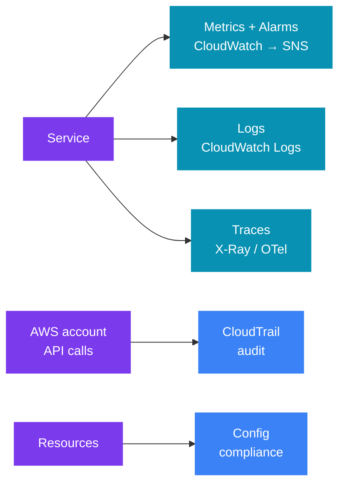
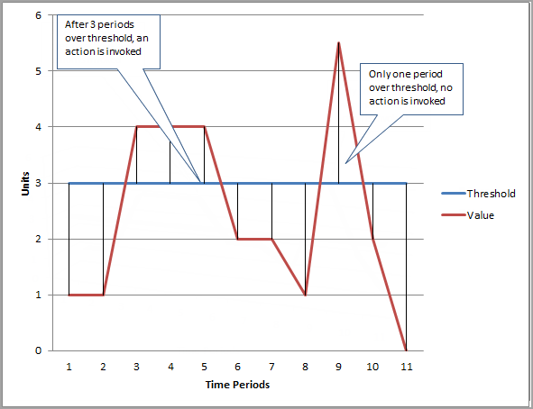
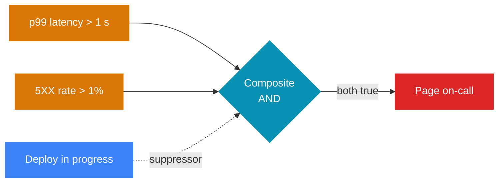
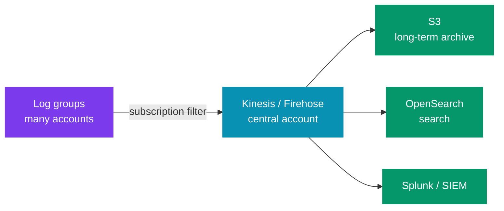
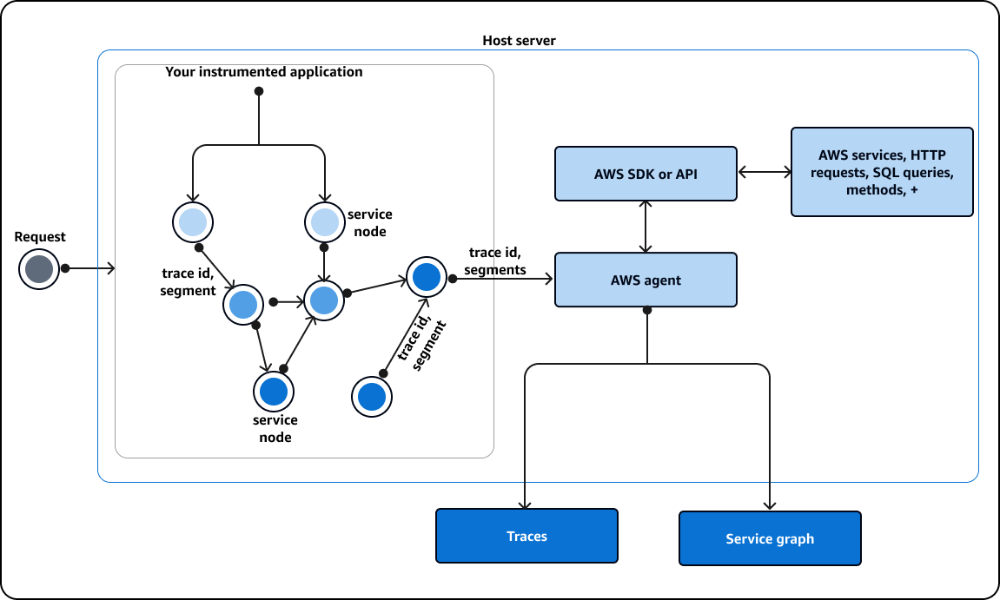
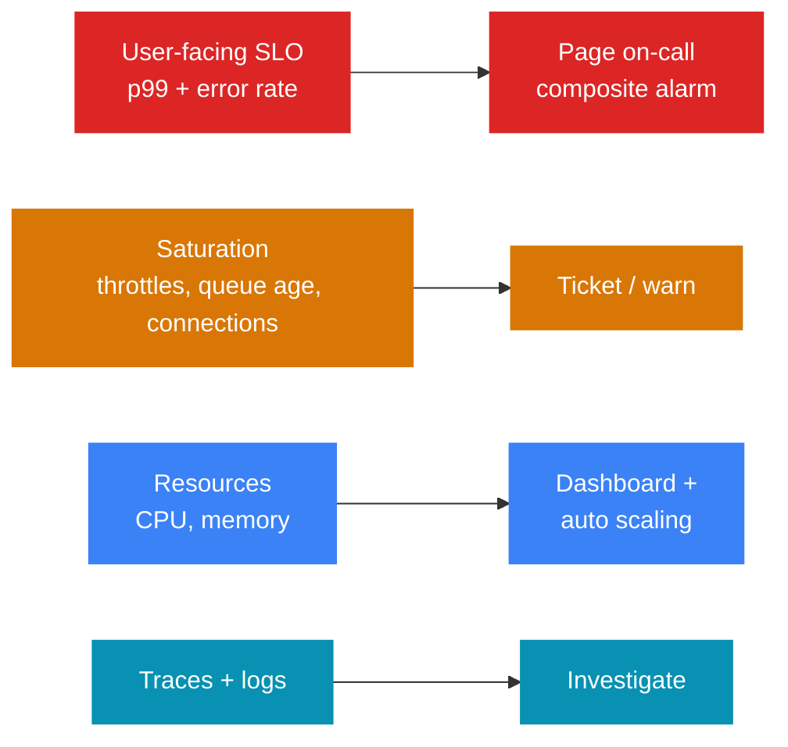

# 🔭 Observability on AWS — CloudWatch, X-Ray, CloudTrail, Config

> 🧭 **AWS for system design** &nbsp;·&nbsp; 🔥 High Priority &nbsp;·&nbsp; 💬 **9 Questions**

> _"'I'll add CloudWatch' is not a monitoring plan. A senior engineer names the **signals**,
> the **thresholds**, and who gets woken up — and why CPU alone is the wrong alarm."_

🎯 This file maps observability ideas to AWS services for a design round. It stays AWS-specific.

- 🔗 For the general design of a metrics system, see [Alex Xu Vol 2 — Metrics Monitoring and Alerting](../../system-design/01_insider_guide_Alex_Xu/vol_2/ch05_metrics_monitoring_alerting.md).


---

📊 **Question Count**

| # | Section | Questions |
|---|---|---|
| 1 | [Which Service Answers Which Question](#1-which-service-answers-which-question) | 1 |
| 2 | [CloudWatch Metrics](#2-cloudwatch-metrics) | 1 |
| 3 | [CloudWatch Alarms](#3-cloudwatch-alarms) | 2 |
| 4 | [CloudWatch Logs](#4-cloudwatch-logs) | 2 |
| 5 | [Distributed Tracing — X-Ray and OpenTelemetry](#5-distributed-tracing--x-ray-and-opentelemetry) | 1 |
| 6 | [CloudTrail — Who Did What](#6-cloudtrail--who-did-what) | 1 |
| 8 | [What I Would Monitor in a Design](#8-what-i-would-monitor-in-a-design) | 1 |
| | **Total** | **9** |

> 🔥🔥 Very High — asked in almost every Tier-1 loop &nbsp;·&nbsp; 🔥 High — very frequent in Tier-1 interviews &nbsp;·&nbsp; ⚡ Medium — commonly asked &nbsp;·&nbsp; 💤 Low — good to know, rarely asked

---

## 📑 Table of Contents

1. [Which Service Answers Which Question](#1-which-service-answers-which-question)
2. [CloudWatch Metrics](#2-cloudwatch-metrics)
3. [CloudWatch Alarms](#3-cloudwatch-alarms)
4. [CloudWatch Logs](#4-cloudwatch-logs)
5. [Distributed Tracing — X-Ray and OpenTelemetry](#5-distributed-tracing--x-ray-and-opentelemetry)
6. [CloudTrail — Who Did What](#6-cloudtrail--who-did-what)
7. [AWS Config — Configuration Compliance and Drift](#7-aws-config--configuration-compliance-and-drift)
8. [What I Would Monitor in a Design](#8-what-i-would-monitor-in-a-design)

---

## 1. Which Service Answers Which Question

| Question | Service | Data |
|---|---|---|
| 💓 "Is my system healthy **now**?" | **CloudWatch Metrics + Alarms** | Numbers over time |
| 📜 "What exactly happened in **this request**?" | **CloudWatch Logs** | Text / JSON events |
| 🧵 "**Where** in the call chain is the time spent?" | **X-Ray / OpenTelemetry** | Traces and spans |
| 🕵️ "**Who** changed or called what in my AWS account?" | **CloudTrail** | AWS API call records |
| 📋 "Is my **infrastructure configured** the way the rules say?" | **AWS Config** | Resource config history + rule results |



> 💡 **The key split:**  
> - ⚙️ CloudWatch and X-Ray watch the **application**.  
> - 🔒 CloudTrail and Config watch the **AWS account**.  
> - ⚠️ Do not use CloudTrail to debug slow requests, and do not use CloudWatch to answer "who deleted the bucket?"

### Interview questions

1. **🔥 What is the difference between CloudWatch, CloudTrail and X-Ray? Could you use CloudTrail for application monitoring?**

<!-- -->
<details>
<summary>Answer</summary>

| Service | What it watches | Question it answers | Example data |
|---|---|---|---|
| 🔭 **CloudWatch** | Application and infrastructure **metrics + logs** | "Is the system healthy now?" | CPU, p99 latency, custom metrics, log streams |
| 🕵️ **CloudTrail** | **AWS API calls** in the account | "Who did that?" | `CreateBucket`, `TerminateInstances`, console sign-in |
| 🧵 **X-Ray** | **Distributed traces** across services | "Why is this request slow? Which hop?" | Service map, latency per hop, error traces |

🏛️ **The three pillars of observability** are **metrics, logs and traces**.

| Pillar | On AWS | Self-managed |
|---|---|---|
| 📈 Metrics | CloudWatch | Prometheus |
| 📜 Logs | CloudWatch | ELK (Elasticsearch, Logstash, Kibana) |
| 🧵 Traces | X-Ray | Jaeger |

> 🔒 CloudTrail is **not** one of the three pillars. It is the **audit** log of AWS API calls, for security and compliance.

❌ **Can CloudTrail replace application monitoring? No.**

- 🙈 It records management (control-plane) events, and data events if you turn them on. It never sees your HTTP request handling or business errors.
- 🐢 Delivery to S3 takes minutes ([§6](#6-cloudtrail--who-did-what)).
- 🔗 Your application's logs belong in CloudWatch Logs ([§4](#4-cloudwatch-logs)).

⚠️ **Two traps interviewers check:**

1. 💾 **EC2 (Elastic Compute Cloud) memory and disk-space use are not default metrics.** You need the CloudWatch agent ([§2](#2-cloudwatch-metrics)). An **ECS service** (ECS: Elastic Container Service) does report `MemoryUtilization` with no agent, on EC2 and Fargate. But it is per task or service, not the JVM heap.
2. 🧵 **New code should use OpenTelemetry and send traces to X-Ray.** The X-Ray SDKs and daemon are in maintenance mode since 25 Feb 2026 ([§5](#5-distributed-tracing--x-ray-and-opentelemetry)).

---

</details>

---

## 2. CloudWatch Metrics

### Basic ideas

- 📈 A **metric** is a time series in a **namespace** (`AWS/ApplicationELB`, `AWS/SQS`, or your own).
- 🏷️ **Dimensions** are name/value pairs that identify it (`LoadBalancer=…`, `QueueName=…`). Up to **30** per metric.
- 💰 Each new combination of dimension values is a **separate metric** (and a separate cost).
- ❌ Never put a user ID or request ID in a dimension.
- 🧮 **Statistics:** Average, Sum, Min, Max, SampleCount, and **percentiles** (p50, p90, p99).

### Resolution

| Kind | Resolution | Notes |
|---|---|---|
| 🐢 **Basic monitoring** (EC2 default) | 5 minutes | 💰 Free. Too slow to react to a spike |
| ⚡ **Detailed monitoring** (EC2) | 1 minute | 💰 Paid. Needed for faster scaling |
| ☁️ Most other AWS services (ALB, SQS, Lambda, DynamoDB) | 1 minute | By default |
| 📊 **Custom metric — standard** | 1 minute | Your own app metrics |
| ⚡ **Custom metric — high-resolution** | 1 second (stored at 1/5/10/30 s) | For fast alarms; costs more |

📏 **Retention is automatic and gets coarser with age:**

| Data point | Kept for |
|---|---|
| 1-second | 3 hours |
| 1-minute | 15 days |
| 5-minute | 63 days |
| 1-hour | 455 days (15 months) |

### Getting custom metrics in

| Way | When |
|---|---|
| 📡 `PutMetricData` API | Direct, but it is a network call on your hot path. Batch the calls |
| ✅ **Embedded Metric Format (EMF)** | Write a structured JSON log line. CloudWatch pulls the metric out of it. Best for **Lambda** — no extra API call |
| 🕵️ **CloudWatch agent** | EC2 / on-prem: memory, disk, process metrics, and StatsD / collectd |
| 🍃 Micrometer `cloudwatch2` registry | Spring Boot apps publish JVM and HTTP metrics |

> ⚠️ **Trap:** **EC2 does not report memory or disk-space use by default.** The hypervisor cannot see inside the OS. You need the CloudWatch agent for those.

### Failure modes

| ⚠️ Failure | What goes wrong | ✅ What to do |
|---|---|---|
| **Averages hide pain** | An average latency of 80 ms can hide a p99 of 3 s | Alarm on **p99** (or p95) |
| **High-cardinality dimensions** | They blow up cost and make dashboards useless | Keep dimensions low-cardinality |
| **Metric lag** | Standard metrics arrive about 1–2 minutes late | Do not expect a 1-minute alarm to fire in 10 seconds |

### Interview questions

2. **🔥🔥 Your API's average latency is 90 ms and looks fine, but customers complain about slowness. What do you check?**

<!-- -->
<details>
<summary>Answer</summary>

🧩 **The average hides the tail.**

🔍 **What to check, in order:**

1. 📈 Look at `TargetResponseTime` p99 and p99.9 on the ALB (Application Load Balancer), and split by target group or route.
2. 🧵 Find a slow trace in X-Ray (filter by the annotation for the slow route) to see which hop takes the time.
3. 🐢 Often it is one downstream call, a DB query, or a cold start.
4. 🔔 Then move the alarm from average to p99.

---

</details>

---

## 3. CloudWatch Alarms

### How an alarm works

- 👀 **What it watches:** **one metric** (or a metric math expression) over a **period**.
- 🚦 **States:** `OK`, `ALARM`, `INSUFFICIENT_DATA`.
- 🔕 **M of N datapoints** (for example 3 of 5 one-minute periods) stops one noisy minute from paging someone.
- 🕳️ **Missing data** handling: treat as `missing`, `notBreaching`, `breaching`, or `ignore`.
- 🎬 **Actions:** SNS (→ on-call tool, Lambda, email), EC2 actions (stop, reboot, **recover**), Auto Scaling policies, Systems Manager OpsItems.
- ⚡ High-resolution alarms can use a 10 s or 30 s period.
- 🤖 **Anomaly detection** alarms learn a band from history. Good for traffic, which changes by hour and day.

> 💡 **Tip:** for a heartbeat-style metric, missing data should be **breaching** — silence means the thing is dead.

<p align="center"></p>

> 🖼️ *With 3 evaluation periods, three breaching periods in a row fire the alarm; one spike alone does not.* Source: [Alarm evaluation](https://docs.aws.amazon.com/AmazonCloudWatch/latest/monitoring/alarm-evaluation.html) · License: CC BY-SA 4.0

### Composite alarms

🧩 A composite alarm combines other alarms with `AND`, `OR`, `NOT`.



- 🔕 Child alarms have **no actions**. Only the composite pages. This cuts alert noise.
- 🤫 An **actions suppressor** alarm can mute the composite (for example during a planned deploy).

### What to alarm on — and what not

| ✅ Alarm on (symptoms users feel) | ❌ Not alone |
|---|---|
| p99 latency above the SLO (service level objective) | CPU > 80% |
| Error rate (5XX ÷ requests), not error count | A raw error **count** (it grows with traffic) |
| `ApproximateAgeOfOldestMessage` on a queue | Queue depth alone |
| Any message in a DLQ (dead-letter queue) | Each single failed request |
| Throttles (Lambda, DynamoDB, Kinesis) | Memory of one instance |
| Healthy host count below minimum | |

🧭 **Why not CPU alone?** CPU is a **cause**, not a symptom.

| Case | Verdict |
|---|---|
| High CPU with good latency | ✅ Fine — you paid for that CPU |
| Low CPU with a stuck thread pool | ⚠️ A real outage that a CPU alarm never sees |

> 💡 **Rule:** use CPU for **scaling** and **dashboards**. Page on what the user feels.

> 🎤 **In the interview:**  
> "I page on symptoms: p99 latency, error rate, and the age of the oldest queue message. These come through one composite alarm so one incident is one page. CPU and memory go on the dashboard and drive auto scaling, but they don't wake anyone up."

### Interview questions

3. **🔥 The team has a CPU > 80% alarm on every instance and gets paged at night with nothing broken. How would you redesign alerting?**

<!-- -->
<details>
<summary>Answer</summary>

1. 🔔 **Page only on symptoms:** p99 latency and error rate against the SLO, queue age, DLQ messages.
2. 🔕 **Use M-of-N datapoints** to ignore single spikes.
3. 🧩 **Combine the child alarms into a composite alarm,** so one incident sends one page.
4. 📈 **Keep CPU for target-tracking scaling and dashboards.**

> 💡 High CPU with good latency means capacity is being used, not a fault.

---

</details>

4. **🔥🔥 A queue-based order pipeline silently stopped processing for two hours, and no alarm fired. What alarms were missing?**

<!-- -->
<details>
<summary>Answer</summary>

🔍 **Two were missing:**

| # | Alarm | What it catches |
|---|---|---|
| 1 | ⏱️ `ApproximateAgeOfOldestMessage` above the processing SLO | A stuck or crashed consumer, even when depth looks small |
| 2 | 🪦 DLQ alarm on `ApproximateNumberOfMessagesVisible > 0` | Messages that keep failing |

> 💡 **Also add** a heartbeat-style metric for "orders completed per minute" with missing data treated as **breaching**. Silence is then a failure.

---

</details>

---

## 4. CloudWatch Logs

### Structure

- 📁 **Log group** = one app or one Lambda function. Retention is set here: 1 day to 10 years, or never expire (the default — set it, or cost grows forever).
- 📄 **Log stream** = one source inside the group (one container, one Lambda instance).
- 📥 **Sources:** Lambda (automatic), ECS / EKS (EKS: Elastic Kubernetes Service; awslogs driver or Fluent Bit), EC2 (CloudWatch agent), API Gateway, VPC (Virtual Private Cloud) Flow Logs, Route 53, CloudTrail.

> 💡 **Tip:** **write structured JSON logs** with a `traceId`, `requestId`, and the business key (`orderId`). Then every tool below can filter by field.

### Logs Insights

🔍 A query language for searching and aggregating logs, across many log groups at once.

```text
fields @timestamp, orderId, @message
| filter level = "ERROR" and service = "payment"
| stats count(*) as errors by bin(5m), errorCode
| sort errors desc
```

- ✅ Use it for **investigation** ("which error codes spiked at 14:05?"), not for alarms.
- 💰 You pay per GB scanned. Narrow the time range and the log groups.

### Metric filters

🔢 A metric filter turns matching log lines into a **CloudWatch metric**. Then you can alarm on it.

- 📏 **Example:** count lines with `"level":"ERROR"` and `"errorCode":"PAYMENT_TIMEOUT"` → alarm when > 10 per minute.
- ⚠️ **Not retroactive.** It only counts lines that arrive **after** you create it.
- 💡 With EMF you often do not need a metric filter. The app writes the metric directly.

### Subscription filters — streaming logs out

📤 A subscription filter sends matching log events, in near real time, to:

- 🎯 **Targets:** **Kinesis Data Streams**, **Firehose**, **Lambda**, or **OpenSearch** (through a Lambda).
- 📏 **Limit:** up to **2** subscription filters per log group.
- 🏢 **Cross-account:** send to a **destination** in a central logging account.



| Need | Use |
|---|---|
| ⚡ Real-time stream to another tool | Subscription filter |
| 🪣 One-off copy to S3 | `CreateExportTask` — batch, can take up to 12 hours, not real time |
| 🔍 Watch logs while you debug | **Live Tail** |

### Failure modes

| ⚠️ Mistake | Result |
|---|---|
| No retention set | 💰 Log cost grows every month |
| Logging full request bodies | 🔒 PII (personally identifiable information) in logs, and very high ingestion cost |
| Lambda logs at DEBUG in production | 💰 Logs cost more than the compute |

### Interview questions

5. **⚡ How do you count a specific business error (e.g. `PAYMENT_TIMEOUT`) and alarm on it?**

<!-- -->
<details>
<summary>Answer</summary>

📜 **First,** log structured JSON with an `errorCode` field. Then pick one:

| Option | How | Note |
|---|---|---|
| 1️⃣ Metric filter | A metric filter on the log group counts matching lines into a custom metric | ⚠️ Remember that it is not retroactive |
| 2️⃣ Embedded Metric Format | The app writes a log line that is also a metric, with no extra API call | ✅ Better for Lambda |

> 💡 **Tip:** alarm on the rate per minute, and keep dimensions low-cardinality (error code, not order ID).

---

</details>

6. **🔥 You need all application logs from 40 accounts searchable in one place and kept for 7 years. Design it.**

<!-- -->
<details>
<summary>Answer</summary>

1. 📤 Each log group gets a subscription filter to a cross-account destination. That is a Kinesis Data Stream or Firehose in a central logging account.
2. 🪣 Firehose writes to S3, compressed and partitioned, with lifecycle rules to Glacier for the 7-year retention.
3. 🔎 It can also feed OpenSearch for search over the last few weeks.
4. 💰 Set retention on the source log groups (e.g. 30 days) so you do not pay twice.
5. 🔍 Athena can query the S3 archive when needed.

---

</details>

---

## 5. Distributed Tracing — X-Ray and OpenTelemetry

### What problem it solves

🧩 **Problem:** one user request crosses API Gateway, three services, a queue and a database.

| Tool | What it tells you |
|---|---|
| 📈 Metrics | "p99 is slow." |
| 📜 Logs | One service at a time |
| 🧵 **Trace** | The whole path and where the time went |

### Main ideas

| Term | Meaning |
|---|---|
| 🧵 **Trace** | One request end to end, with one trace ID |
| 🧱 **Segment / span** | Work done by one service (segment) or one call inside it (subsegment / span) |
| 🏷️ **Trace header** | `X-Amzn-Trace-Id` (X-Ray) or W3C `traceparent` (OpenTelemetry) — passed on every hop |
| 🗺️ **Service map** | Graph of services built from traces, with latency and error rate per edge |
| 🎲 **Sampling** | Not every request is traced. X-Ray default: first request each second + 5% of the rest |
| 🔑 **Annotations** | Indexed key/values (e.g. `orderId`) — you can search traces by them |
| 📝 **Metadata** | Not indexed — extra debug data only |

<p align="center"></p>

> 🖼️ *Each service passes the trace ID on and sends its segments to an agent; X-Ray joins them into traces and a service graph.* Source: [What is AWS X-Ray?](https://docs.aws.amazon.com/xray/latest/devguide/aws-xray.html) · License: CC BY-SA 4.0

### Where tracing works out of the box — and where it breaks

| Hop | Trace propagates? |
|---|---|
| API Gateway, Lambda (active tracing), ALB (adds the header) | ✅ Yes |
| SQS → Lambda | ✅ Yes (`AWSTraceHeader` system attribute) |
| SNS → SQS / Lambda | ✅ Yes |
| EventBridge, Step Functions | ✅ Yes, when tracing is turned on |
| **Kafka / MSK** (Managed Streaming for Kafka) | ❌ You must put the header into Kafka record headers yourself (OTel instrumentation does this) |
| Batch jobs reading many messages | ⚠️ One span cannot have many parents — use **span links** |

### X-Ray SDK vs OpenTelemetry (ADOT)

- 📦 **AWS Distro for OpenTelemetry (ADOT)** is the AWS build of OpenTelemetry. It exports to X-Ray, CloudWatch, or other back ends (Datadog, Jaeger).
- 📊 **CloudWatch Application Signals** builds service-level dashboards and SLOs from OTel (OpenTelemetry) data.
- ☕ For Java, the OTel Java agent instruments Spring, JDBC, HTTP clients and the AWS SDK with no code change.

> ⚠️ **X-Ray SDK status:**  
> - AWS put the X-Ray SDKs and daemon into **maintenance mode** on 25 Feb 2026 (security fixes only, no new features).  
> - It recommends OpenTelemetry for new work.  
> - The X-Ray service itself is still fully supported.  
> - ✅ Use OTel in new designs.

### Failure modes

| ⚠️ Failure | ✅ Fix |
|---|---|
| A hop that drops the header **breaks the trace** into two. Usually a custom HTTP client or a Kafka consumer | 🏷️ Pass the trace header on every hop |
| 5% sampling may miss the rare slow request | 🎲 Use **tail-based sampling** in the OTel collector to keep all error and slow traces |

> 🎤 **In the interview:**  
> "I instrument services with the OpenTelemetry Java agent and export to X-Ray. I put the order ID as an annotation so I can find a customer's trace. And I check that the trace header crosses the Kafka hop, because that is where traces usually break."

### Interview questions

7. **🔥 A trace in X-Ray ends at the Kafka producer, and the consumer side starts a new trace. Why, and how do you fix it?**

<!-- -->
<details>
<summary>Answer</summary>

🔍 **Why:** the trace context was not carried across the Kafka hop.

- ✅ AWS propagates the header automatically for SQS (Simple Queue Service), SNS (Simple Notification Service) and Lambda.
- ❌ It does not do this for Kafka / MSK.

🛠️ **Fix:**

1. 📤 Put the W3C `traceparent` (or `X-Amzn-Trace-Id`) into the Kafka record headers on produce.
2. 📥 Read it on consume.
3. ☕ The OpenTelemetry Java agent's Kafka instrumentation does both.
4. 🔗 For consumers that read a batch, use span links to each message's trace.

---

</details>

---

## 6. CloudTrail — Who Did What

### What problem it solves

🕵️ CloudTrail records **AWS API calls** in your account: who called, from where, when, what
parameters, and the result.

- ✅ **Use it for:** **audit, security and compliance**.
- ❌ **Not for:** application monitoring — it does not see your HTTP requests or business errors.

| Event type | Examples | Default |
|---|---|---|
| ⚙️ **Management events** | `CreateBucket`, `PutBucketPolicy`, `TerminateInstances`, `AssumeRole`, console sign-in | ✅ On. 90-day **Event history** free |
| 🪣 **Data events** | S3 `GetObject` / `PutObject`, Lambda `Invoke`, DynamoDB item reads/writes | ❌ Off — very high volume, extra cost |
| 🤖 **Insights events** | Unusual API call rate or error rate (e.g. a spike in `DeleteObject`) | ❌ Off |

### Design points

- 🪣 **Create a trail** to keep events longer than 90 days. It writes to **S3** (and optionally CloudWatch Logs).
- 🔒 Use an **organization trail** in a separate, locked **log-archive account**. An attacker in a workload account cannot delete it.
- ✍️ Turn on **log file integrity validation** (signed digest files). It proves logs were not changed.
- 💰 Turn on **data events only for sensitive resources** (the bucket with customer documents), not for everything.
- 🔍 **CloudTrail Lake** lets you query events with SQL and keep them for years.
- 🚌 **Real-time reaction:** CloudTrail management events also arrive on **EventBridge**. A rule on `DeleteTrail` or `PutBucketPolicy` → Lambda / SNS gives an alert within minutes.

> ⚠️ **Trap:** delivery to S3 is **not instant** — usually within about 5 minutes. Do not build a sub-second control on it.

> 🎤 **In the interview:**  
> "CloudTrail answers 'who did this', not 'why is it slow'. I send an organization trail to a separate log-archive account with integrity validation. I turn on S3 data events only for the bucket that holds customer documents."

### Interview questions

8. **🔥 Someone opened port 22 to 0.0.0.0/0 on a production security group. How do you find out who did it, and how do you stop it next time?**

<!-- -->
<details>
<summary>Answer</summary>

| Step | Tool | What it does |
|---|---|---|
| 🕵️ Find who | CloudTrail | Search for `AuthorizeSecurityGroupIngress` on that group ID. You get the IAM (Identity and Access Management) principal, source IP and time |
| 📋 See the state | AWS Config | The `restricted-ssh` rule shows the group as non-compliant and its config history |
| 🔧 Undo it | SSM (Systems Manager) Automation | Auto-remediation can remove the rule |
| 🔔 Alert fast | EventBridge | To be told within minutes, add a rule on that API call that alerts |
| 🔒 Prevent it | SCP (Service Control Policy) or IAM policy | Blocks the change, because Config only detects |

---

</details>

---

## 7. AWS Config — Configuration Compliance and Drift

### What problem it solves

📋 AWS Config records the **configuration** of each resource over time, and checks it against
**rules**. It answers:

- 🪣 "Is any S3 bucket public right now?"
- 🕰️ "What did this security group look like last Tuesday?"
- 🔐 "Which resources are not encrypted?"

| Feature | Detail |
|---|---|
| 📸 **Configuration items** | A snapshot of a resource's config each time it changes, plus relationships (this ENI (Elastic Network Interface) belongs to this instance) |
| 📏 **Rules** | AWS managed rules (e.g. `s3-bucket-public-read-prohibited`, `encrypted-volumes`) or custom (Lambda or Guard) |
| ⏱️ **Evaluation** | On each config change, or on a schedule (1, 3, 6, 12, 24 h) |
| 🔧 **Remediation** | Run an **SSM Automation** document — manual or automatic (e.g. turn on bucket encryption) |
| 📦 **Conformance packs** | A bundle of rules + remediations (e.g. a CIS (Center for Internet Security) or PCI-style (Payment Card Industry) pack) |
| 🏢 **Aggregator** | One view across many accounts and regions |

### Limits of Config

| ⚠️ Limit | What it means | ✅ What to do |
|---|---|---|
| **Detective**, not preventive | It finds a public bucket **after** it exists | To **block** it, use SCPs, IAM, or S3 Block Public Access |
| **Regional** | Drift in an unused region goes unseen | Turn it on in every region you use |
| Records **config**, not **traffic** | It shows the state, not the calls that changed it | "Who opened port 22?" → CloudTrail. "Is port 22 open now, and since when?" → Config |

### CloudWatch vs CloudTrail vs Config

| | 🔭 **CloudWatch** | 🕵️ **CloudTrail** | 📋 **Config** |
|---|---|---|---|
| 👀 Watches | App and resource **performance** | **API calls** (who, what, when) | Resource **configuration** over time |
| ❓ Question | "Is it healthy?" | "Who changed it?" | "Is it set up correctly, and was it before?" |
| 💡 Example | p99 latency alarm on the ALB | IAM user deleted a security group rule | Security group allows 0.0.0.0/0 on port 22 — non-compliant |

---

## 8. What I Would Monitor in a Design

### The four golden signals

| Signal | Meaning |
|---|---|
| ⚡ **Latency** | Time to serve a request — p50 and **p99**, and errors timed separately |
| 🚗 **Traffic** | Demand — requests/s, messages/s |
| ❌ **Errors** | Failed requests as a **rate** |
| 🌡️ **Saturation** | How full the system is — the resource that runs out first |

> 💡 **For queues, add age / lag:** how late the oldest unprocessed work is.

### Golden signals mapped to AWS metrics

| Service | Latency | Traffic | Errors | Saturation |
|---|---|---|---|---|
| 🌐 **ALB** | `TargetResponseTime` p99 | `RequestCount` | `HTTPCode_Target_5XX_Count`, `HTTPCode_ELB_5XX_Count` (as % of requests) | `HealthyHostCount` / `UnHealthyHostCount`, `RejectedConnectionCount` |
| λ **Lambda** | `Duration` p99 | `Invocations` | `Errors`, `DeadLetterErrors` | `Throttles`, `ConcurrentExecutions`; `IteratorAge` (stream sources); `AsyncEventAge` |
| 📨 **SQS** | `ApproximateAgeOfOldestMessage` | `NumberOfMessagesSent` / `Deleted` | DLQ `ApproximateNumberOfMessagesVisible` > 0 | `ApproximateNumberOfMessagesVisible`, `ApproximateNumberOfMessagesNotVisible` (in flight) |
| 🗃️ **DynamoDB** | `SuccessfulRequestLatency` | `ConsumedReadCapacityUnits` / `ConsumedWriteCapacityUnits` | `SystemErrors`, `UserErrors`, `ConditionalCheckFailedRequests` (watch, not page) | `ReadThrottleEvents` / `WriteThrottleEvents`; `ReplicationLatency` (global tables) |
| 🗃️ **RDS / Aurora** | `ReadLatency`, `WriteLatency`; Performance Insights DB load | `ReadIOPS` / `WriteIOPS` | Failed connections; app-side SQL errors | `DatabaseConnections`, `CPUUtilization`, `FreeableMemory`, `FreeStorageSpace`, `ReplicaLag`, `DiskQueueDepth` |

💡 **Notes on the table:**

- 🌐 **ALB** `TargetResponseTime` measures the backend. ELB (Elastic Load Balancing) 5XX means the load balancer itself failed (often no healthy target).
- λ **Lambda** `Throttles` > 0 for a sync API means users see 429s. Alarm on it.
- 📨 **SQS** age matters more than depth. 10,000 messages that clear in 20 s is fine. 50 messages stuck for an hour is not.
- 🗃️ **DynamoDB** throttles in on-demand mode usually mean a **hot partition** key, not low capacity.
- ⚠️ **RDS** (Relational Database Service) `DatabaseConnections` near `max_connections` is the classic Lambda-burst failure. RDS Proxy fixes it.

### A layered plan to say in a design round



1. 🚨 **Page** on SLO symptoms: p99 latency and error rate at the ALB / API Gateway, queue age, DLQ not empty.
2. ⚠️ **Warn** on saturation that leads to an outage: Lambda throttles, DynamoDB throttles, DB connections > 80%, Kinesis iterator age.
3. 📊 **Dashboard** the resources (CPU, memory) and use them for auto scaling.
4. 🔍 **Investigate** with traces (find the slow hop) and Logs Insights (find the error).
5. 🔒 **Audit** with CloudTrail; **compliance** with Config. These sit outside the on-call loop.

> 🎤 **In the interview:**  
> "For this design I'd alarm on three things: ALB p99 latency and 5XX rate against the SLO, the age of the oldest SQS message, and any message in a DLQ. They feed one composite alarm. DynamoDB throttles and Lambda throttles are warnings. A trace ID in every log line connects the alarm to the request that caused it."

### Interview questions

9. **🔥🔥 For a serverless design (API Gateway → Lambda → DynamoDB, with an SQS async path), list the alarms you would set.**

<!-- -->
<details>
<summary>Answer</summary>

🚨 **Page on:**

- 🌐 API Gateway `5XXError` rate and `Latency` p99 against the SLO;
- 📨 SQS `ApproximateAgeOfOldestMessage`;
- 🪦 DLQ messages > 0.

⚠️ **Warn on:**

- λ Lambda `Throttles` > 0 and `ConcurrentExecutions` near the account limit;
- 🗃️ DynamoDB `ReadThrottleEvents` / `WriteThrottleEvents` (on-demand throttles point to a hot key);
- ⏱️ Lambda `Duration` p99 near the timeout.

🔍 **Add:** tracing with the order ID as an annotation, plus Lambda Insights for memory and cold starts.

---

</details>

---

## 📊 Section Coverage Tracker

> **R-1:** `✅ First read` &nbsp;·&nbsp; **R0–R6:** `🟢🟡🔴 Recall confidence` · `[ ] Pending` · `⏭️ Skipped`  
> **Priority:** `🔥🔥 VH` · `🔥 H` · `⚡ M` · `💤 L`

| § | Section | Priority | R-1 | R0 | R1 | R2 | R3 | R4 | R5 | R6 |
|---|---------|----------|-----|----|----|----|----|----|----|----|
| 1 | Which Service Answers Which Question | 🔥 | [ ] | [ ] | [ ] | [ ] | [ ] | [ ] | [ ] | [ ] |
| 2 | CloudWatch Metrics | 🔥 | [ ] | [ ] | [ ] | [ ] | [ ] | [ ] | [ ] | [ ] |
| 3 | CloudWatch Alarms | 🔥🔥 | [ ] | [ ] | [ ] | [ ] | [ ] | [ ] | [ ] | [ ] |
| 4 | CloudWatch Logs | 🔥 | [ ] | [ ] | [ ] | [ ] | [ ] | [ ] | [ ] | [ ] |
| 5 | Distributed Tracing — X-Ray and OpenTelemetry | 🔥 | [ ] | [ ] | [ ] | [ ] | [ ] | [ ] | [ ] | [ ] |
| 6 | CloudTrail — Who Did What | 🔥 | [ ] | [ ] | [ ] | [ ] | [ ] | [ ] | [ ] | [ ] |
| 7 | AWS Config — Configuration Compliance and Drift | ⚡ | [ ] | [ ] | [ ] | [ ] | [ ] | [ ] | [ ] | [ ] |
| 8 | What I Would Monitor in a Design | 🔥🔥 | [ ] | [ ] | [ ] | [ ] | [ ] | [ ] | [ ] | [ ] |

### 🎯 Review Queue

_Questions missed in the last recall — drilled first next session, cleared when solid. Managed by `/recall`._

- _(empty)_
